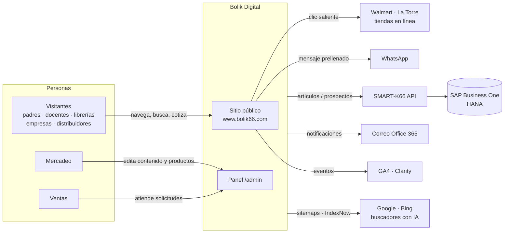
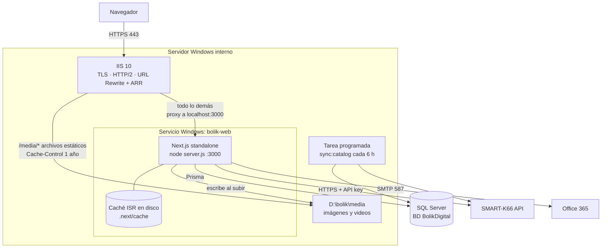
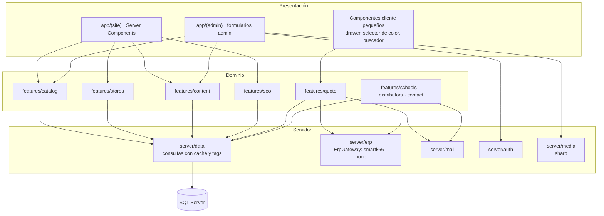
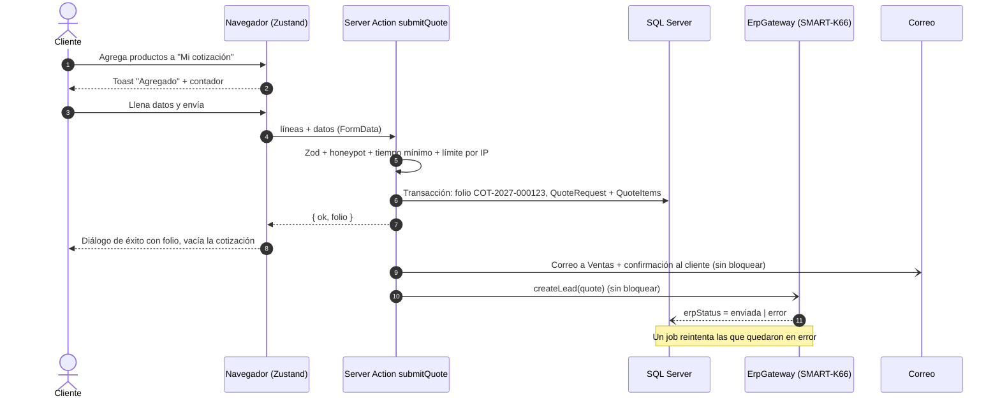
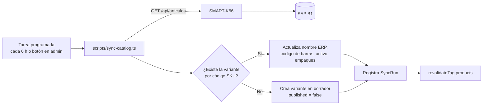
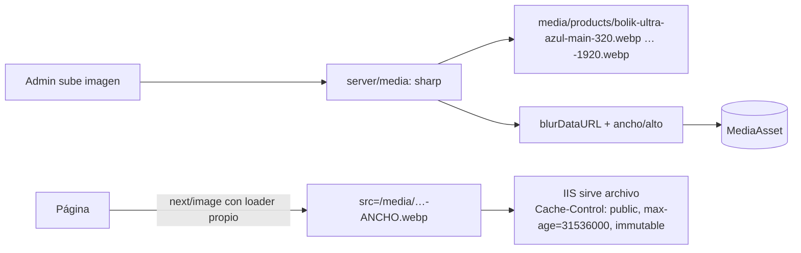

# 03 · Arquitectura

Los diagramas están en **Mermaid**: GitHub, GitLab, VS Code (extensión Markdown Preview Mermaid) y Claude Code los entienden.

## 1. Contexto del sistema

Quién usa el sistema y con qué se conecta.



## 2. Contenedores y despliegue



**Por qué así:** IIS ya es la plataforma de la empresa; hace TLS, compresión y sirve los medios como archivos estáticos (lo más rápido posible). Node solo genera HTML y responde acciones.

## 3. Capas de la aplicación



Regla de dependencias: `app → features → server → prisma`. `lib/` (funciones puras) puede usarse en cualquier capa. **`components/` nunca importa de `server/`.**

## 4. Estrategia de renderizado por ruta

| Ruta | Render | Revalidación | Index |
|---|---|---|---|
| `/` | Estático | tags `content:home`, `products`, `stores` | Sí |
| `/productos` | Estático (filtros en cliente) | `products` | Sí |
| `/productos/[categoria]` | Estático (`generateStaticParams`) | `category:{slug}`, `products` | Sí |
| `/productos/[categoria]/[producto]` | Estático | `product:{slug}` | Sí |
| `/p/[codigo]` | Redirección 301 | — | No |
| `/donde-comprar` y `/donde-comprar/[departamento]` | Estático | `stores` | Sí |
| `/escuelas`, `/mayoreo`, `/empresas`, `/kits-escolares`, `/nuestra-historia`, `/preguntas-frecuentes`, `/contacto`, `/legal/*` | Estático | tags de contenido | Sí |
| `/buscar` | Estático + búsqueda en cliente | — | **No** |
| `/cotizacion` | Estático + estado en cliente | — | **No** |
| `/cotizacion/enviada/[folio]` | Dinámico | — | **No** |
| `/styleguide` | Estático | — | **No** |
| `/admin/**` | Dinámico, sin caché, con sesión | — | **No** (y bloqueado en robots) |
| `/api/**` | Route handlers | según endpoint | No |
| `/sitemap.xml`, `/robots.txt`, `/llms.txt`, `/llms-full.txt` | Generados | tags | — |

**Caché con Cache Components (Next.js 16):** se activa `cacheComponents: true` en `next.config.ts`. Cada consulta pública en `server/data` es una función con la directiva `'use cache'`, `cacheLife('max')` y `cacheTag(...)`:

```ts
// src/server/data/products.ts
import "server-only";
import { cacheLife, cacheTag } from "next/cache";
import { db } from "@/server/db";
import { TAGS } from "@/lib/cache-tags";

export async function getProductBySlug(slug: string) {
  "use cache";
  cacheLife("max");
  cacheTag(TAGS.products, TAGS.product(slug));
  return db.product.findFirst({ where: { slug, published: true }, include: { variants: true, specs: true } });
}
```

Cuando el admin guarda un producto, la Server Action llama `updateTag(TAGS.product(slug))` y `updateTag(TAGS.products)` (el editor ve el cambio de inmediato). Desde procesos externos (sync del catálogo vía route handler) se usa `revalidateTag(tag, "max")`. Las páginas con parámetros dinámicos exportan `generateStaticParams` para prerenderizarse en el build.

**Reglas que evitan errores de build con Cache Components:**
- Nada que lea `cookies()`, `headers()` o `searchParams` puede estar dentro de `'use cache'`. Léelo afuera y pásalo como argumento.
- Lo que dependa de la petición (sesión del admin, folio en `/cotizacion/enviada/[folio]`) va dentro de `<Suspense>` o en rutas que llaman `await connection()`.
- La caché vive en memoria del proceso Node (autohospedado). Se pierde al reiniciar o desplegar, y se vuelve a llenar en el build y con la primera visita: es normal.

## 5. Flujo de una cotización



Puntos clave:
- El folio se genera **dentro de la transacción** con la tabla `FolioSequence` (ver doc 05).
- El usuario recibe respuesta en cuanto se guarda en la BD; correo y ERP van después (`after()` de Next o promesa no esperada con registro de errores).
- Si la BD falla, el diálogo de error ofrece reintentar y un enlace de WhatsApp con el contenido de la cotización.

## 6. Sincronización del catálogo con SAP



**Qué manda SAP y qué manda la web:**

| Dato | Dueño |
|---|---|
| Código (SKU), código de barras, nombre ERP, activo/inactivo, empaques y unidades | SAP (solo lectura en el admin) |
| Nombre comercial, descripción, especificaciones, medidas, imágenes, beneficios, usos, SEO, publicación | Web (admin) |

## 7. Modelo de caché y medios



Los nombres de archivo llevan un hash corto (`-a1b2c3`) para que la caché de un año sea segura.

## 8. Seguridad

| Capa | Medida |
|---|---|
| Transporte | HTTPS obligatorio, HSTS, redirección http→https y sin-www→www en IIS |
| Cabeceras | CSP, `X-Content-Type-Options`, `Referrer-Policy: strict-origin-when-cross-origin`, `Permissions-Policy`, `frame-ancestors 'none'` (ver doc 15) |
| Formularios | Zod en servidor, honeypot, tiempo mínimo 3 s, límite 5 envíos/10 min por IP (hash), tamaño máximo |
| Admin | iron-session (cookie `bolik_admin` cifrada, `httpOnly`, `secure`, `sameSite=lax`), contraseñas con bcryptjs (coste 12), sesión de 8 h, roles, bloqueo tras 5 intentos, `/admin` fuera de robots y sitemap |
| BD | Usuario SQL con permisos mínimos (sin `db_owner` en producción); migraciones con otro usuario |
| ERP | API key en variable de entorno, solo desde servidor, timeout 8 s, reintentos con backoff |
| Datos personales | Solo lo necesario; IP guardada como hash; retención de solicitudes 24 meses; página de privacidad |
| Subidas | Solo imágenes (jpg, png, webp, avif) ≤ 10 MB, validación por contenido real con sharp, nombre generado por el servidor |

## 9. Variables de entorno

```bash
# Sitio
NEXT_PUBLIC_SITE_URL=https://www.bolik66.com
NEXT_PUBLIC_GA_ID=G-XXXXXXX
NEXT_PUBLIC_CLARITY_ID=xxxxxxx
APP_ENV=production            # development | staging | production

# Base de datos
DATABASE_URL="sqlserver://HOST:1433;database=BolikDigital;user=bolik_app;password=***;encrypt=true;trustServerCertificate=true"

# Sesión del admin (iron-session)
SESSION_SECRET=***            # mínimo 32 caracteres: openssl rand -base64 32

# ERP (SMART-K66)
ERP_MODE=noop                 # noop | smartk66
ERP_BASE_URL=https://smartk66.interno/api
ERP_API_KEY=***

# Correo
SMTP_HOST=smtp.office365.com
SMTP_PORT=587
SMTP_USER=web@bolik66.com
SMTP_PASSWORD=***
MAIL_SALES_TO=ventas@bolik66.com

# Medios
MEDIA_DIR=D:\bolik\media
MEDIA_PUBLIC_PATH=/media

# SEO / IA
INDEXNOW_KEY=***              # 32 caracteres hex; se publica en /{key}.txt
```

Todas se validan al arrancar en `src/env.ts` con Zod; si falta una, el build falla con un mensaje claro.
