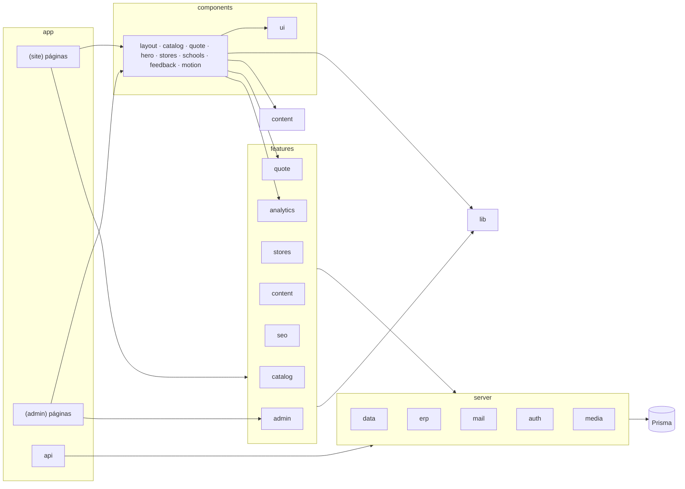

# 04 · Estructura del proyecto

## 1. Árbol de carpetas

```text
bolik-digital/
├─ CLAUDE.md                    # reglas para Claude Code
├─ README.md
├─ docs/                        # esta guía
├─ .github/workflows/ci.yml     # lint, typecheck, test, build, lighthouse
├─ prisma/
│  ├─ schema.prisma
│  ├─ migrations/
│  └─ seed/                     # datos JSON + schema.ts (Zod); los lee DATA_SOURCE=fixtures y los carga seed.ts
├─ public/
│  ├─ brand/                    # logo SVG, favicon, íconos de app
│  ├─ og/                       # imagen OG por defecto
│  ├─ {INDEXNOW_KEY}.txt        # archivo de verificación de IndexNow (lo crea el deploy)
│  └─ site.webmanifest
├─ scripts/
│  ├─ sync-catalog.ts           # SMART-K66 → BD
│  ├─ retry-erp.ts              # reintenta envíos fallidos
│  ├─ build-search-index.ts     # índice JSON del buscador (también en runtime)
│  ├─ check-redirects.ts        # valida el mapa de redirecciones de Joomla
│  └─ deploy/staging-setup.ps1  # prepara el servidor de staging (BD-016, doc 15 §12)
├─ tests/
│  ├─ e2e/                      # Playwright
│  ├─ fixtures/
│  └─ integration/              # Vitest contra BolikDigital_Test
├─ src/
│  ├─ app/
│  │  ├─ layout.tsx             # raíz: html es-GT, fuentes, splash, toaster
│  │  ├─ globals.css            # importa styles/*
│  │  ├─ not-found.tsx · error.tsx · global-error.tsx
│  │  ├─ sitemap.ts · robots.ts · manifest.ts
│  │  ├─ llms.txt/route.ts · llms-full.txt/route.ts
│  │  ├─ (site)/                # grupo público (no cambia la URL)
│  │  │  ├─ layout.tsx          # header, footer, drawer de cotización, WhatsApp
│  │  │  ├─ page.tsx            # home
│  │  │  ├─ productos/
│  │  │  │  ├─ page.tsx
│  │  │  │  └─ [categoria]/
│  │  │  │     ├─ page.tsx
│  │  │  │     ├─ opengraph-image.tsx
│  │  │  │     └─ [producto]/
│  │  │  │        ├─ page.tsx
│  │  │  │        ├─ opengraph-image.tsx
│  │  │  │        └─ ficha/[sku]/route.ts   # PDF
│  │  │  ├─ p/[codigo]/route.ts             # QR → 301
│  │  │  ├─ donde-comprar/
│  │  │  │  ├─ page.tsx
│  │  │  │  └─ [departamento]/page.tsx
│  │  │  ├─ escuelas/page.tsx
│  │  │  ├─ mayoreo/page.tsx
│  │  │  ├─ empresas/page.tsx
│  │  │  ├─ kits-escolares/page.tsx
│  │  │  ├─ nuestra-historia/page.tsx
│  │  │  ├─ preguntas-frecuentes/page.tsx
│  │  │  ├─ contacto/page.tsx
│  │  │  ├─ buscar/page.tsx
│  │  │  ├─ cotizacion/
│  │  │  │  ├─ page.tsx
│  │  │  │  └─ enviada/[folio]/page.tsx
│  │  │  ├─ legal/[slug]/page.tsx
│  │  │  └─ styleguide/        # page.tsx (13 secciones) · _sections/ · _demos/ · _components/ · datos/
│  │  ├─ (admin)/admin/
│  │  │  ├─ layout.tsx          # verifica sesión, menú lateral
│  │  │  ├─ login/page.tsx
│  │  │  ├─ page.tsx            # dashboard
│  │  │  ├─ productos/ (page, [id]/page, nuevo/page)
│  │  │  ├─ tiendas/ · kits/ · cotizaciones/ · escuelas/ · distribuidores/ · mensajes/
│  │  │  ├─ contenido/ (hero, cifras, historia, actividades, faqs)
│  │  │  ├─ apariencia/ · ajustes/ · redirecciones/ · usuarios/ · auditoria/
│  │  │  └─ sincronizacion/
│  │  └─ api/
│  │     ├─ beacon/route.ts               # clics salientes
│  │     ├─ search-index/route.ts         # índice JSON del buscador
│  │     ├─ public/catalog.json/route.ts  # catálogo público para IA
│  │     └─ admin/media/route.ts          # subida de imágenes
│  ├─ components/
│  │  ├─ ui/                    # primitivas: button, dialog, sheet, popover (Radix), tabs (propio), accordion (<details>)…
│  │  ├─ layout/                # header, mobile-nav, footer, splash, section, container, breadcrumbs
│  │  ├─ feedback/              # feedback-host (en el layout), use-feedback, friendly-dialog y toaster (al primer uso), empty-state, inline-alert
│  │  ├─ motion/                # reveal, count-up, page-enter, on-route-change, motion-provider, m
│  │  ├─ hero/                  # video-hero, chapter-tabs
│  │  ├─ catalog/               # product-card (+ skeleton), category-card, filters, color-swatches, pack-selector, specs, dimensions
│  │  ├─ home/                  # audience-card (tarjetas por público de la home)
│  │  ├─ quote/                 # quote-drawer, quote-button, quote-line, quote-form
│  │  ├─ stores/                # store-list, store-map (lazy), department-picker
│  │  ├─ schools/               # activity-card, school-form, kids-decor
│  │  ├─ whatsapp/              # whatsapp-fab, whatsapp-sheet
│  │  ├─ icons/                 # logo, íconos de beneficios
│  │  └─ admin/                 # data-table, form-field, image-uploader, status-badge
│  ├─ features/                 # lógica por dominio (sin JSX de presentación pesada)
│  │  ├─ catalog/  (queries.ts, schemas.ts, search.ts, format.ts)
│  │  ├─ quote/    (store.ts, schemas.ts, actions.ts, whatsapp.ts)
│  │  ├─ stores/   (queries.ts)
│  │  ├─ schools/  (actions.ts, schemas.ts)
│  │  ├─ distributors/ · contact/
│  │  ├─ content/  (queries.ts para hero, cifras, hitos, faqs, apariencia)
│  │  ├─ admin/    (actions por entidad)
│  │  ├─ analytics/(events.ts, track.ts)
│  │  └─ seo/      (metadata.ts, jsonld.ts, indexnow.ts, llms.ts)
│  ├─ server/                   # solo servidor ("server-only")
│  │  ├─ db.ts                  # PrismaClient singleton
│  │  ├─ data/                  # funciones con caché + tags, tipos de vista y fuente (fixtures | db: BD-037, BD-032)
│  │  │  ├─ fixtures/ · db/      # las dos fuentes; settings-view.ts comparte el mapeo de ajustes
│  │  │  └─ sitemap.ts · llms.ts · search.ts   # datos del sitemap, /llms.txt y el buscador
│  │  ├─ erp/                   # gateway.ts, smartk66.ts, noop.ts
│  │  ├─ mail/                  # transport.ts, templates/
│  │  ├─ auth/                  # session.ts (iron-session), password.ts, guards.ts (requireRole)
│  │  ├─ media/                 # process-image.ts (sharp)
│  │  ├─ folio.ts · rate-limit.ts · audit.ts
│  ├─ lib/                      # utilidades puras
│  │  ├─ constants.ts           # estados, tipos, presets (reemplazan enums)
│  │  ├─ cache-tags.ts · slug.ts · format.ts · cn.ts · image-loader.ts · contrast.ts
│  │  ├─ form-schemas.ts        # piezas de Zod compartidas (teléfono GT, correo, NIT, cantidad)
│  ├─ content/                  # textos de interfaz
│  │  ├─ feedback.ts            # todos los mensajes de toasts y diálogos
│  │  ├─ ui.ts                  # textos de interfaz que no son feedback (Enviando…, Guardando…)
│  │  ├─ navigation.ts          # menú y pie
│  │  └─ legal/*.md
│  ├─ styles/
│  │  ├─ tokens.css · backgrounds.css · motion.css · base.css
│  ├─ env.ts                    # variables validadas con Zod
│  └─ proxy.ts | middleware.ts  # redirecciones legadas + protección admin
├─ next.config.ts
├─ tailwind/postcss config
├─ vitest.config.mts · vitest.integration.config.mts · playwright.config.ts
└─ package.json
```

> **Nota de versión:** en las versiones más recientes de Next.js el archivo `middleware.ts` pasó a llamarse `proxy.ts`. Usa el nombre que indique la documentación de la versión instalada; el contenido es el mismo.

## 2. Mapa de módulos



Reglas:
1. `components/*` no importa `server/*` (los datos llegan como props desde páginas Server Components). Excepción: `import type` de los tipos de vista de `src/server/data/types.ts` (se borra al compilar; no arrastra código de servidor).
2. Todo archivo en `server/` empieza con `import "server-only"`.
3. `features/*/actions.ts` son la única puerta de escritura desde el sitio público.
4. `lib/*` no tiene efectos secundarios ni imports de React.

## 3. Convenciones de nombres

| Elemento | Convención | Ejemplo |
|---|---|---|
| Archivos | kebab-case | `product-card.tsx` |
| Componentes | PascalCase | `ProductCard` |
| Hooks | `use-` + kebab | `use-quote.ts` → `useQuote` |
| Server Actions | verbo + entidad | `submitQuote`, `updateProduct` |
| Consultas | `get`/`list` + entidad | `getProductBySlug`, `listStoresByDepartment` |
| Tags de caché | `entidad` o `entidad:slug` | `products`, `product:bolik-ultra` |
| Rutas | español, kebab, sin acentos | `/donde-comprar`, `/nuestra-historia` |
| Eventos de analítica | `snake_case` en inglés corto | `quote_submit`, `retailer_click` |
| Constantes | SCREAMING_SNAKE | `QUOTE_STATUS` |

## 4. Archivos base que se crean primero (ticket BD-001 a BD-016)

1. `src/env.ts` — variables tipadas.
2. `src/styles/tokens.css` — colores, tipos, espacios, sombras, z-index (ver `starter/`).
3. `src/styles/motion.css` — duraciones, curvas, utilidades de animación.
4. `src/styles/backgrounds.css` — presets de fondo.
5. `src/lib/constants.ts` — estados y tipos.
6. `src/lib/cache-tags.ts` — nombres de tags.
7. `src/server/db.ts` — cliente Prisma.
8. `src/components/layout/section.tsx` — contenedor de sección con fondo configurable.
9. `src/components/feedback/*` — toasts y diálogos. Desde un componente cliente: `const { toast, dialog } = useFeedback()` y `toast(feedback.quote.added(...), { onAction })`. `FeedbackHost` (en el layout) carga sonner y Radix Dialog al primer uso: nunca importes `sonner` directo en una página.
10. `src/components/ui/{dialog,sheet,popover}.tsx` — overlays sobre Radix (~10 KB gzip el Dialog). En piezas de todas las páginas (menú móvil del header, BD-041) se cargan al primer uso, como el toaster; en una sola página (filtros, mapa) se importan donde se usan. La clase `js` de `<html>` (script del layout raíz) indica que hay JS: lo que se oculta o anima solo con JS depende de ella. Ojo: un Sheet o Dialog modal pone `aria-hidden` a todo lo de fuera, incluidas las regiones `aria-live` de `FeedbackHost`; un toast lanzado con un sheet abierto (drawer de cotización, BD-071) debe probarse con lector de pantalla.
11. `src/app/layout.tsx` — raíz (BD-040): `lang="es-GT"`, `rootMetadata` de `features/seo/metadata.ts`, «Saltar al contenido» y un solo script en `<head>` (`app/head-script.ts`): la clase `js` y la decisión del splash (BD-043), que lee `data-splash-enabled` de `<html>` (ajuste `splash_enabled`). El overlay (`components/layout/splash.tsx`) va al inicio de `<body>`, decorativo; su CSS está en `motion.css`. El script se escribe a mano como texto (no con `Function.toString()`) y tiene pruebas unitarias en jsdom; sus constantes (`SPLASH_KEY`, duraciones) están en `lib/splash.ts`. Cada grupo pone su `<main id="contenido">` con `components/layout/main-content.tsx`; fuera de los grupos, `not-found.tsx` y `global-error.tsx` ponen el suyo. Las páginas no usan `<main>`.
12. `src/components/layout/header.tsx` — header (BD-041): Server Component con islas cliente pequeñas (`header-scroll`, `products-menu`, `quote-link`, `mobile-menu`). El Sheet del menú móvil (`mobile-menu-sheet.tsx`) se descarga al primer toque. Los datos (categorías, WhatsApp) los pasa `(site)/layout.tsx`. Presupuesto: el header suma ~2.2 KB gzip; las páginas de 150 KB quedan con ~1.3 KB de margen, así que una isla nueva en el header se mide antes (tras BD-044, ~0.7 KB).
13. `src/components/layout/footer.tsx` y `floating-actions.tsx` — pie y flotantes (BD-042): Server Components sin JS. El NAP, el teléfono (`tel:`), Facebook y WhatsApp salen de `SiteSetting` vía `(site)/layout.tsx`. Los flotantes se ocultan solo con CSS (`motion.css`: `body[data-scroll-locked]` con un sheet abierto, `:has(input:focus)` con el teclado) y el pie reserva su alto. Sus textos van en `content/footer.ts` y no en `content/ui.ts`: `ui.ts` lo importan islas cliente y todo su contenido viaja en el JS de cada página; un texto que solo usa un Server Component va en su propio archivo.
14. `src/components/motion/*` — movimiento de todas las páginas (BD-044): `RevealObserver` (reveals A-21; marcado `data-reveal` y `--i`; el CSS oculta solo con `data-reveal-ready`), `PageEnter` (entrada A-02 al cambiar de ruta, en `(site)/layout.tsx`; no hay `template.tsx`) y `CountUp` (cifras A-20, solo donde se use). Los dos primeros van en todas las páginas: +0.6 KB gzip (146.3 → 146.9 KB). **Reaccionar a un cambio de ruta = `OnRouteChange`** (`components/motion/on-route-change.tsx`), nunca `usePathname` suelto en algo que envuelva contenido: con Cache Components se suspende en rutas con parámetros que no conoce el build y, sin `Suspense`, el build falla. Lo usan `PageEnter` y los menús del header.
15. `src/components/motion/motion-provider.tsx` y `m.ts` — Motion diferido (BD-045, docs/09 §7): `LazyMotion strict` con las funciones por `import()`, `m.*` y `AnimatePresence` desde `m.ts`, presets en `src/lib/motion.ts`. Solo en lo que se carga al interactuar (drawer, grilla); `tests/e2e/motion-lazy.spec.ts` comprueba que la home no descarga Motion.
16. `src/app/(site)/styleguide/page.tsx` — vitrina de todo lo anterior (BD-026): una sección por archivo en `_sections/` (carpetas con `_`: privadas, sin ruta), demos cliente en `_demos/`. Una pieza nueva del sistema se agrega a su sección en el mismo PR; si aún no existe, la sección muestra `<Pending>` con su ticket. En producción responde 404 sin sesión de admin (`server/auth/styleguide-access.ts`).

## 5. package.json (scripts)

```json
{
  "scripts": {
    "dev": "next dev",
    "build": "next build",
    "start": "node .next/standalone/server.js",
    "lint": "eslint . && prettier --check .",
    "typecheck": "tsc --noEmit",
    "test": "vitest run",
    "test:e2e": "playwright test",
    "test:int": "vitest run --config vitest.integration.config.mts",
    "test:visual": "playwright test tests/visual",
    "check:links": "tsx scripts/check-links.ts",
    "flush:indexnow": "tsx scripts/flush-indexnow.ts",
    "lhci": "lhci autorun --config=lighthouse.config.cjs",
    "db:migrate": "prisma migrate dev",
    "db:deploy": "prisma migrate deploy",
    "db:seed": "tsx scripts/db-seed.mts",
    "db:status": "prisma migrate status",
    "db:generate": "prisma generate",
    "db:reset:test": "node scripts/db-reset-test.mjs",
    "sync:catalog": "tsx scripts/sync-catalog.ts",
    "retry:erp": "tsx scripts/retry-erp.ts",
    "check:redirects": "tsx scripts/check-redirects.ts",
    "analyze": "next analyze --output",
    "check:colors": "node scripts/check-colors.mjs",
    "admin:create": "tsx scripts/create-admin.ts"
  }
}
```

> Next.js 16 ya no incluye `next lint`: se usa `eslint .` con la configuración plana (`eslint.config.mjs`) que genera `create-next-app`.

## 6. Dependencias recomendadas

| Paquete | Para qué | Carga |
|---|---|---|
| `next`, `react`, `react-dom` | Base | — |
| `typescript`, `@types/*` | Tipos | dev |
| `tailwindcss`, `@tailwindcss/postcss` | Estilos | build |
| `@radix-ui/*` (vía shadcn/ui) | Diálogos, tabs, acordeón, popover | por componente |
| `class-variance-authority`, `clsx`, `tailwind-merge` | Variantes de componentes | pequeño |
| `lucide-react` | Íconos | por ícono |
| `motion` | Drawer, modales, listas | diferida (`LazyMotion`) |
| `sonner` | Toasts | pequeño |
| `zustand` | Cotización del visitante | pequeño |
| `react-hook-form`, `@hookform/resolvers`, `zod` | Formularios y validación | por formulario |
| `fuse.js` | Búsqueda | diferida (al enfocar) |
| `leaflet`, `react-leaflet` | Mapa de tiendas | diferida (al hacer visible) |
| `@prisma/client`, `prisma` | BD | servidor |
| `iron-session`, `bcryptjs` | Sesión y contraseñas del admin | servidor |
| `sharp` | Imágenes | servidor |
| `nodemailer` | Correo | servidor |
| `@react-pdf/renderer` | PDF de ficha técnica | servidor |
| `pino` | Logs | servidor |
| `@next/third-parties` | GA4 | diferida |
| — (integrado en Next 16.1+: `next analyze`) | `pnpm analyze` | — |
| `vitest`, `@testing-library/react`, `@playwright/test`, `@axe-core/playwright`, `@lhci/cli` | Pruebas | dev |
| `tsx`, `eslint`, `prettier`, `prettier-plugin-tailwindcss`, `husky`, `lint-staged` | Herramientas | dev |

Instala siempre la **versión estable más reciente** y fija versiones exactas en `package.json` (`save-exact=true` en `.npmrc`).
