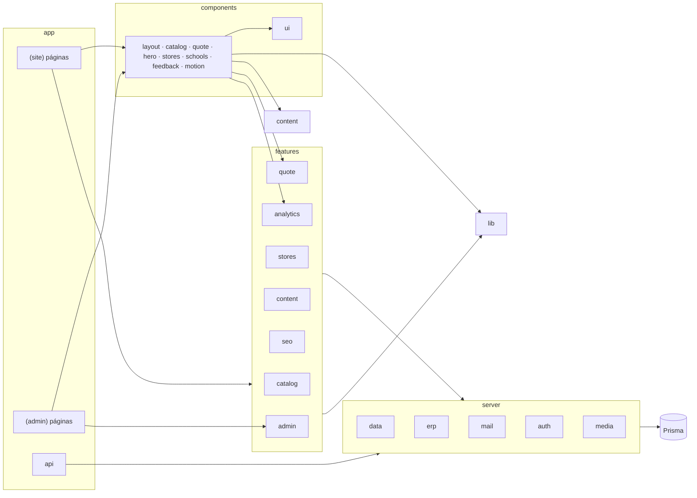

# 04 · Estructura del proyecto

## 1. Árbol de carpetas

```text
bolik-digital/
├─ CLAUDE.md                    # reglas para Claude Code
├─ README.md
├─ docs/                        # esta guía
├─ .github/workflows/ci.yml     # lint, typecheck, test, build, lighthouse
├─ prisma/
│  ├─ schema.prisma
│  ├─ migrations/
│  └─ seed/                     # seed.ts + datos JSON (productos, tiendas, contenido)
├─ public/
│  ├─ brand/                    # logo SVG, favicon, íconos de app
│  ├─ og/                       # imagen OG por defecto
│  ├─ {INDEXNOW_KEY}.txt        # archivo de verificación de IndexNow (lo crea el deploy)
│  └─ site.webmanifest
├─ scripts/
│  ├─ sync-catalog.ts           # SMART-K66 → BD
│  ├─ retry-erp.ts              # reintenta envíos fallidos
│  ├─ build-search-index.ts     # índice JSON del buscador (también en runtime)
│  └─ check-redirects.ts        # valida el mapa de redirecciones de Joomla
├─ tests/
│  ├─ e2e/                      # Playwright
│  ├─ fixtures/
│  └─ lighthouserc.json
├─ src/
│  ├─ app/
│  │  ├─ layout.tsx             # raíz: html es-GT, fuentes, splash, toaster
│  │  ├─ globals.css            # importa styles/*
│  │  ├─ not-found.tsx · error.tsx · global-error.tsx
│  │  ├─ sitemap.ts · robots.ts · manifest.ts
│  │  ├─ llms.txt/route.ts · llms-full.txt/route.ts
│  │  ├─ (site)/                # grupo público (no cambia la URL)
│  │  │  ├─ layout.tsx          # header, footer, drawer de cotización, WhatsApp
│  │  │  ├─ template.tsx        # animación de entrada por página
│  │  │  ├─ page.tsx            # home
│  │  │  ├─ productos/
│  │  │  │  ├─ page.tsx
│  │  │  │  └─ [categoria]/
│  │  │  │     ├─ page.tsx
│  │  │  │     ├─ opengraph-image.tsx
│  │  │  │     └─ [producto]/
│  │  │  │        ├─ page.tsx
│  │  │  │        ├─ opengraph-image.tsx
│  │  │  │        └─ ficha/[sku]/route.ts   # PDF
│  │  │  ├─ p/[codigo]/route.ts             # QR → 301
│  │  │  ├─ donde-comprar/
│  │  │  │  ├─ page.tsx
│  │  │  │  └─ [departamento]/page.tsx
│  │  │  ├─ escuelas/page.tsx
│  │  │  ├─ mayoreo/page.tsx
│  │  │  ├─ empresas/page.tsx
│  │  │  ├─ kits-escolares/page.tsx
│  │  │  ├─ nuestra-historia/page.tsx
│  │  │  ├─ preguntas-frecuentes/page.tsx
│  │  │  ├─ contacto/page.tsx
│  │  │  ├─ buscar/page.tsx
│  │  │  ├─ cotizacion/
│  │  │  │  ├─ page.tsx
│  │  │  │  └─ enviada/[folio]/page.tsx
│  │  │  ├─ legal/[slug]/page.tsx
│  │  │  └─ styleguide/page.tsx
│  │  ├─ (admin)/admin/
│  │  │  ├─ layout.tsx          # verifica sesión, menú lateral
│  │  │  ├─ login/page.tsx
│  │  │  ├─ page.tsx            # dashboard
│  │  │  ├─ productos/ (page, [id]/page, nuevo/page)
│  │  │  ├─ tiendas/ · kits/ · cotizaciones/ · escuelas/ · distribuidores/ · mensajes/
│  │  │  ├─ contenido/ (hero, cifras, historia, actividades, faqs)
│  │  │  ├─ apariencia/ · ajustes/ · redirecciones/ · usuarios/ · auditoria/
│  │  │  └─ sincronizacion/
│  │  └─ api/
│  │     ├─ beacon/route.ts               # clics salientes
│  │     ├─ search-index/route.ts         # índice JSON del buscador
│  │     ├─ public/catalog.json/route.ts  # catálogo público para IA
│  │     └─ admin/media/route.ts          # subida de imágenes
│  ├─ components/
│  │  ├─ ui/                    # primitivas (shadcn/Radix): button, dialog, sheet, tabs, accordion…
│  │  ├─ layout/                # header, mobile-nav, footer, splash, section, container, breadcrumbs
│  │  ├─ feedback/              # friendly-dialog, toaster, empty-state, inline-alert
│  │  ├─ motion/                # reveal, count-up, ink-stroke, lazy-motion-provider
│  │  ├─ hero/                  # video-hero, chapter-tabs
│  │  ├─ catalog/               # product-card, category-card, filters, color-swatches, pack-selector, specs, dimensions
│  │  ├─ quote/                 # quote-drawer, quote-button, quote-line, quote-form
│  │  ├─ stores/                # store-list, store-map (lazy), department-picker
│  │  ├─ schools/               # activity-card, school-form, kids-decor
│  │  ├─ whatsapp/              # whatsapp-fab, whatsapp-sheet
│  │  ├─ icons/                 # logo, íconos de beneficios
│  │  └─ admin/                 # data-table, form-field, image-uploader, status-badge
│  ├─ features/                 # lógica por dominio (sin JSX de presentación pesada)
│  │  ├─ catalog/  (queries.ts, schemas.ts, search.ts, format.ts)
│  │  ├─ quote/    (store.ts, schemas.ts, actions.ts, whatsapp.ts)
│  │  ├─ stores/   (queries.ts)
│  │  ├─ schools/  (actions.ts, schemas.ts)
│  │  ├─ distributors/ · contact/
│  │  ├─ content/  (queries.ts para hero, cifras, hitos, faqs, apariencia)
│  │  ├─ admin/    (actions por entidad)
│  │  ├─ analytics/(events.ts, track.ts)
│  │  └─ seo/      (metadata.ts, jsonld.ts, indexnow.ts, llms.ts)
│  ├─ server/                   # solo servidor ("server-only")
│  │  ├─ db.ts                  # PrismaClient singleton
│  │  ├─ data/                  # consultas con caché + tags
│  │  ├─ erp/                   # gateway.ts, smartk66.ts, noop.ts
│  │  ├─ mail/                  # transport.ts, templates/
│  │  ├─ auth/                  # session.ts (iron-session), password.ts, guards.ts (requireRole)
│  │  ├─ media/                 # process-image.ts (sharp)
│  │  ├─ folio.ts · rate-limit.ts · audit.ts
│  ├─ lib/                      # utilidades puras
│  │  ├─ constants.ts           # estados, tipos, presets (reemplazan enums)
│  │  ├─ cache-tags.ts · slug.ts · format.ts · cn.ts · image-loader.ts
│  ├─ content/                  # textos de interfaz
│  │  ├─ feedback.ts            # todos los mensajes de toasts y diálogos
│  │  ├─ navigation.ts          # menú y pie
│  │  └─ legal/*.md
│  ├─ styles/
│  │  ├─ tokens.css · backgrounds.css · motion.css · base.css
│  ├─ env.ts                    # variables validadas con Zod
│  └─ proxy.ts | middleware.ts  # redirecciones legadas + protección admin
├─ next.config.ts
├─ tailwind/postcss config
├─ vitest.config.ts · playwright.config.ts
└─ package.json
```

> **Nota de versión:** en las versiones más recientes de Next.js el archivo `middleware.ts` pasó a llamarse `proxy.ts`. Usa el nombre que indique la documentación de la versión instalada; el contenido es el mismo.

## 2. Mapa de módulos



Reglas:
1. `components/*` no importa `server/*` (los datos llegan como props desde páginas Server Components).
2. Todo archivo en `server/` empieza con `import "server-only"`.
3. `features/*/actions.ts` son la única puerta de escritura desde el sitio público.
4. `lib/*` no tiene efectos secundarios ni imports de React.

## 3. Convenciones de nombres

| Elemento | Convención | Ejemplo |
|---|---|---|
| Archivos | kebab-case | `product-card.tsx` |
| Componentes | PascalCase | `ProductCard` |
| Hooks | `use-` + kebab | `use-quote.ts` → `useQuote` |
| Server Actions | verbo + entidad | `submitQuote`, `updateProduct` |
| Consultas | `get`/`list` + entidad | `getProductBySlug`, `listStoresByDepartment` |
| Tags de caché | `entidad` o `entidad:slug` | `products`, `product:bolik-ultra` |
| Rutas | español, kebab, sin acentos | `/donde-comprar`, `/nuestra-historia` |
| Eventos de analítica | `snake_case` en inglés corto | `quote_submit`, `retailer_click` |
| Constantes | SCREAMING_SNAKE | `QUOTE_STATUS` |

## 4. Archivos base que se crean primero (ticket BD-001 a BD-016)

1. `src/env.ts` — variables tipadas.
2. `src/styles/tokens.css` — colores, tipos, espacios, sombras, z-index (ver `starter/`).
3. `src/styles/motion.css` — duraciones, curvas, utilidades de animación.
4. `src/styles/backgrounds.css` — presets de fondo.
5. `src/lib/constants.ts` — estados y tipos.
6. `src/lib/cache-tags.ts` — nombres de tags.
7. `src/server/db.ts` — cliente Prisma.
8. `src/components/layout/section.tsx` — contenedor de sección con fondo configurable.
9. `src/components/feedback/*` — toasts y diálogos.
10. `src/app/(site)/styleguide/page.tsx` — vitrina de todo lo anterior.

## 5. package.json (scripts)

```json
{
  "scripts": {
    "dev": "next dev",
    "build": "next build",
    "start": "node .next/standalone/server.js",
    "lint": "eslint . && prettier --check .",
    "typecheck": "tsc --noEmit",
    "test": "vitest run",
    "test:e2e": "playwright test",
    "test:int": "vitest run --config vitest.integration.config.ts",
    "test:visual": "playwright test tests/visual",
    "check:links": "tsx scripts/check-links.ts",
    "flush:indexnow": "tsx scripts/flush-indexnow.ts",
    "lhci": "lhci autorun --config=tests/lighthouserc.json",
    "db:migrate": "prisma migrate dev",
    "db:deploy": "prisma migrate deploy",
    "db:seed": "tsx prisma/seed/seed.ts",
    "db:studio": "prisma studio",
    "sync:catalog": "tsx scripts/sync-catalog.ts",
    "retry:erp": "tsx scripts/retry-erp.ts",
    "check:redirects": "tsx scripts/check-redirects.ts",
    "analyze": "next analyze --output",
    "check:colors": "node scripts/check-colors.mjs",
    "admin:create": "tsx scripts/create-admin.ts"
  }
}
```

> Next.js 16 ya no incluye `next lint`: se usa `eslint .` con la configuración plana (`eslint.config.mjs`) que genera `create-next-app`.

## 6. Dependencias recomendadas

| Paquete | Para qué | Carga |
|---|---|---|
| `next`, `react`, `react-dom` | Base | — |
| `typescript`, `@types/*` | Tipos | dev |
| `tailwindcss`, `@tailwindcss/postcss` | Estilos | build |
| `@radix-ui/*` (vía shadcn/ui) | Diálogos, tabs, acordeón, popover | por componente |
| `class-variance-authority`, `clsx`, `tailwind-merge` | Variantes de componentes | pequeño |
| `lucide-react` | Íconos | por ícono |
| `motion` | Drawer, modales, listas | diferida (`LazyMotion`) |
| `sonner` | Toasts | pequeño |
| `zustand` | Cotización del visitante | pequeño |
| `react-hook-form`, `@hookform/resolvers`, `zod` | Formularios y validación | por formulario |
| `fuse.js` | Búsqueda | diferida (al enfocar) |
| `leaflet`, `react-leaflet` | Mapa de tiendas | diferida (al hacer visible) |
| `@prisma/client`, `prisma` | BD | servidor |
| `iron-session`, `bcryptjs` | Sesión y contraseñas del admin | servidor |
| `sharp` | Imágenes | servidor |
| `nodemailer` | Correo | servidor |
| `@react-pdf/renderer` | PDF de ficha técnica | servidor |
| `pino` | Logs | servidor |
| `@next/third-parties` | GA4 | diferida |
| — (integrado en Next 16.1+: `next analyze`) | `pnpm analyze` | — |
| `vitest`, `@testing-library/react`, `@playwright/test`, `@axe-core/playwright`, `@lhci/cli` | Pruebas | dev |
| `tsx`, `eslint`, `prettier`, `prettier-plugin-tailwindcss`, `husky`, `lint-staged` | Herramientas | dev |

Instala siempre la **versión estable más reciente** y fija versiones exactas en `package.json` (`save-exact=true` en `.npmrc`).
