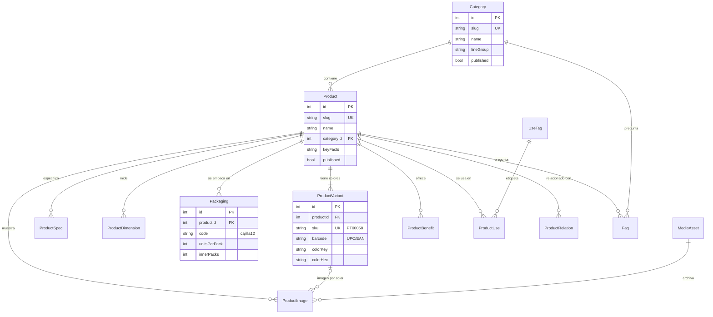
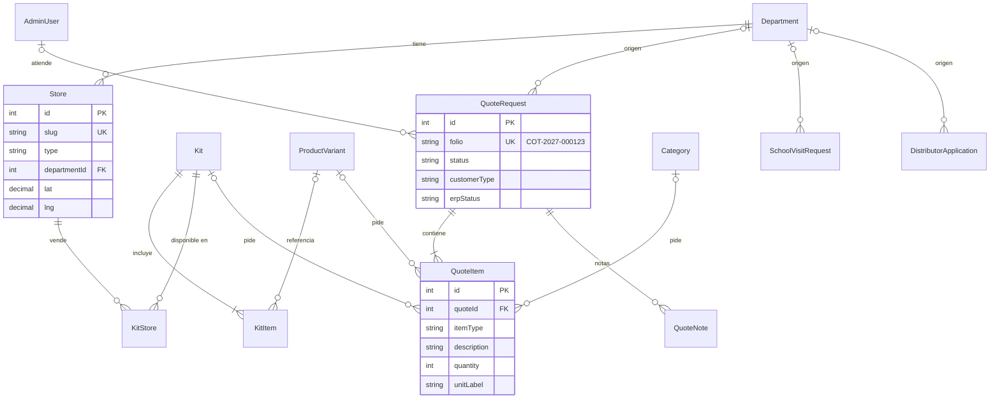
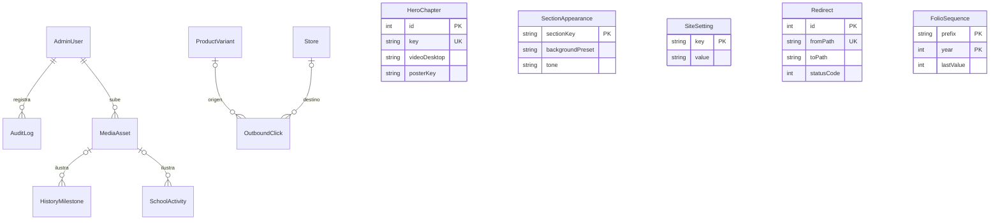

# 05 · Base de datos

Base nueva **`BolikDigital`** en SQL Server, accedida con **Prisma 7**. El esquema completo y validado está en `starter/prisma/schema.prisma`.

## 1. Diagrama entidad-relación

### Catálogo



### Tiendas, kits y solicitudes



### Contenido, SEO y procesos



Tablas independientes (sin relaciones): `SiteStat`, `SiteSetting`, `SectionAppearance`, `Redirect`, `NotFoundLog`, `SyncRun`, `IndexNowSubmission`, `ContactMessage`, `FolioSequence`.

## 2. Diccionario de datos (resumen)

| Tabla | Para qué | Columnas clave | Notas |
|---|---|---|---|
| `AdminUser` | Usuarios del admin | `email` UK, `passwordHash`, `role` (admin/editor/ventas), `failedLogins`, `lockedUntil` | bcrypt coste 12 |
| `AuditLog` | Bitácora de cambios del admin | `action`, `entity`, `entityId`, `diff` (JSON) | Se escribe en cada mutación |
| `MediaAsset` | Archivo subido | `key` UK, `width`, `height`, `blurDataUrl` | Los anchos generados se derivan de `key` |
| `Category` | Línea de producto | `slug` UK, `lineGroup`, `intro` (SEO) | Bolígrafos, Lápices, Marcadores… |
| `Product` | Producto comercial | `slug` UK, `keyFacts` (JSON array), `safetyWarning` | Contenido editorial |
| `ProductVariant` | Color/SKU de SAP | `sku` UK, `barcode` (índice), `colorKey`, `colorHex`, `erpActive` | `@@unique([productId, colorKey])` |
| `ProductSpec` | Especificación clave/valor | `groupName`, `label`, `value` | Flexible para cualquier categoría |
| `ProductDimension` | Medidas para el diagrama | `partKey`, `valueMm`, `tolerance` | body 145.83, cap 60.15… |
| `Packaging` | Presentaciones | `code`, `unitsPerPack`, `innerPacks`, medidas, peso | blister1/3/5, cajilla12, fardo |
| `ProductImage` | Imagen de producto | `variantId?`, `kind`, `alt` | `alt` obligatorio |
| `ProductBenefit` | Beneficio con ícono | `iconKey`, `title` | Tapa ventilada, baja viscosidad… |
| `UseTag` / `ProductUse` | Usos (Escolar, Oficina, Manualidades) | — | Filtro en catálogo |
| `ProductRelation` | Productos relacionados | `fromId`, `toId` | "Completa tu estuche" |
| `Faq` | Preguntas frecuentes | `scope`, `categoryId?`, `productId?` | Alimenta FAQPage y `llms.txt` |
| `Department` | Departamentos de GT (+ El Salvador) | `slug` UK, `lat`, `lng`, `intro` | 22 + SV |
| `Store` | Punto de venta | `type`, `departmentId`, `lat/lng`, `onlineShopUrl`, `isVerified` | Lista validada por Ventas |
| `Kit` / `KitItem` / `KitStore` | Kits escolares | `season`, `suggestedPrice`, `priceVisible` | Precio solo si se aprueba |
| `QuoteRequest` | Cotización | `folio` UK, `status`, `customerType`, UTM, `erpStatus`, `erpAttempts` | Corazón comercial |
| `QuoteItem` | Línea de cotización | `itemType`, `description` (copia), `quantity`, `unitLabel` | La copia de texto conserva lo pedido aunque cambie el catálogo |
| `QuoteNote` | Notas internas de Ventas | `authorId`, `text` | — |
| `SchoolVisitRequest` | Solicitud de visita escolar | `folio` UK, `schoolName`, `level`, `municipality` | — |
| `DistributorApplication` | Solicitud de distribuidor | `folio` UK, `businessType`, `branches`, `monthlyVolume` | — |
| `ContactMessage` | Mensaje de contacto | `subject`, `message` | — |
| `FolioSequence` | Correlativos por prefijo y año | PK (`prefix`, `year`), `lastValue` | Ver §4 |
| `HeroChapter` | Capítulos del hero | `key`, textos, CTA, videos, póster | 4 registros |
| `SiteStat` | Cifras de la franja | `value`, `suffix`, `label`, `sourceNote` | `sourceNote` documenta de dónde sale |
| `HistoryMilestone` | Línea de tiempo | `year`, `title`, `isVerified` | Solo se publican verificados en producción |
| `SchoolActivity` | Actividades de escuelas | `colorKey`, `iconKey` | — |
| `SectionAppearance` | Fondo por sección | `sectionKey` PK, `backgroundPreset`, `tone` | Fondos configurables |
| `SiteSetting` | Ajustes clave/valor | `key` PK, `value` | WhatsApp, teléfono, redes, correo de ventas, splash |
| `Redirect` | Redirecciones 301 | `fromPath` UK, `toPath`, `hits` | Incluye mapa de Joomla |
| `NotFoundLog` | Rutas que dieron 404 | `path` UK, `hits` | Para crear redirecciones |
| `OutboundClick` | Clics a WhatsApp, tiendas, mapas, PDF | `kind`, `target`, `variantId?`, `storeId?` | KPI independiente de GA4 |
| `SyncRun` | Ejecuciones de sincronización | `kind`, `status`, contadores, `errors` | Visible en admin |
| `IndexNowSubmission` | Cola de URLs a notificar | `url`, `status` | Ver doc 11 |

### Valores permitidos (reemplazan a los `enum`)

Defínelos en `src/lib/constants.ts` y valida con Zod (`z.enum(QUOTE_STATUS)`):

```ts
export const ROLES = ["admin", "editor", "ventas"] as const;
export const LINE_GROUPS = ["escritura", "escolar", "arte", "oficina"] as const;
export const STORE_TYPES = ["cadena", "libreria", "distribuidor"] as const;
export const CUSTOMER_TYPES = ["libreria", "distribuidor", "colegio", "universidad", "empresa", "otro"] as const;
export const QUOTE_STATUS = ["nueva", "en_proceso", "cotizada", "ganada", "perdida", "spam"] as const;
export const ERP_STATUS = ["pendiente", "enviada", "error", "omitida"] as const;
export const QUOTE_ITEM_TYPES = ["variante", "kit", "categoria", "personalizado"] as const;
export const PACKAGING_CODES = ["blister1", "blister3", "blister5", "cajilla12", "fardo"] as const;
export const BACKGROUND_PRESETS = ["paper", "soft", "dots", "grid", "lines", "ink", "brand", "navy", "sun"] as const;
export const FAQ_SCOPES = ["global", "home", "category", "product", "mayoreo", "escuelas", "empresas", "tiendas"] as const;
export const CLICK_KINDS = ["whatsapp", "retailer", "maps", "phone", "pdf"] as const;
```

## 3. Configuración de Prisma 7 con SQL Server

En Prisma 7 la URL ya **no va en `schema.prisma`**. Va en `prisma.config.ts` (para migraciones) y el cliente se crea con el adaptador `@prisma/adapter-mssql`.

```bash
pnpm add @prisma/client @prisma/adapter-mssql
pnpm add -D prisma dotenv
```

```ts
// prisma.config.ts
import "dotenv/config";
import { defineConfig, env } from "prisma/config";

export default defineConfig({
  schema: "prisma/schema.prisma",
  migrations: { path: "prisma/migrations", seed: "tsx prisma/seed/seed.ts" },
  datasource: { url: env("DATABASE_URL") },
});
```

```ts
// src/server/db.ts
import "server-only";
import { PrismaMssql } from "@prisma/adapter-mssql";
import { PrismaClient } from "@/generated/prisma/client";
import { env } from "@/env";

const globalForPrisma = globalThis as unknown as { prisma?: PrismaClient };

function createClient() {
  const adapter = new PrismaMssql(env.DATABASE_URL);
  return new PrismaClient({ adapter, log: env.APP_ENV === "development" ? ["warn", "error"] : ["error"] });
}

export const db = globalForPrisma.prisma ?? createClient();
if (env.APP_ENV !== "production") globalForPrisma.prisma = db;
```

> `PrismaMssql` acepta la cadena de conexión (`sqlserver://host:1433;database=…;user=…;password=…;encrypt=true;trustServerCertificate=true`) o un objeto de configuración del driver `mssql` (`server`, `port`, `database`, `user`, `password`, `options`). Con certificados internos autofirmados usa `trustServerCertificate=true`.

## 4. Folios correlativos

Formato: `COT-2027-000123` (cotizaciones), `ESC-2027-000045` (escuelas), `DIS-2027-000012` (distribuidores). Se reinician cada año. Se generan **dentro de la misma transacción** que crea la solicitud para que nunca se repitan:

```ts
// src/server/folio.ts
import "server-only";
import type { Prisma } from "@/generated/prisma/client";

export async function nextFolio(tx: Prisma.TransactionClient, prefix: "COT" | "ESC" | "DIS") {
  const year = new Date().getFullYear();
  // MERGE atómico: crea el contador del año o lo incrementa, y devuelve el valor nuevo
  const rows = await tx.$queryRaw<{ lastValue: number }[]>`
    MERGE FolioSequence WITH (HOLDLOCK) AS t
    USING (SELECT ${prefix} AS prefix, ${year} AS year) AS s
      ON t.prefix = s.prefix AND t.year = s.year
    WHEN MATCHED THEN UPDATE SET lastValue = t.lastValue + 1
    WHEN NOT MATCHED THEN INSERT (prefix, year, lastValue) VALUES (s.prefix, s.year, 1)
    OUTPUT inserted.lastValue;`;
  const n = rows[0].lastValue;
  return `${prefix}-${year}-${String(n).padStart(6, "0")}`;
}
```

Uso:

```ts
const quote = await db.$transaction(async (tx) => {
  const folio = await nextFolio(tx, "COT");
  return tx.quoteRequest.create({ data: { folio, ...datos, items: { create: lineas } } });
});
```

## 5. Índices y rendimiento

- Ya definidos en el esquema: búsquedas por `status + createdAt`, `erpStatus`, `departmentId + published`, `categoryId + published + sortOrder`, `barcode`, `kind + createdAt` (clics).
- El sitio público casi no consulta la BD en tiempo real: las páginas se prerenderizan y quedan en caché. La BD trabaja en el build, al revalidar y en el admin.
- `OutboundClick` crece rápido: conservar 18 meses y archivar/borrar con una tarea mensual.

## 6. Datos iniciales (seeds)

`prisma/seed/` contiene JSON por entidad y `seed.ts` los inserta de forma **idempotente** (`upsert` por `slug`/`sku`/`key`):

| Archivo | Contenido inicial | Fuente |
|---|---|---|
| `departments.json` | 22 departamentos de Guatemala + El Salvador con lat/lng | Dato público |
| `categories.json` | Bolígrafos, Lápices y lápices de colores, Crayones de cera, Marcadores, Pegamentos y silicón, Borradores y sacapuntas, Tijeras/reglas/geometría, Artículos publicitarios | Catálogo actual de bolik66.com |
| `products.json` | **Bolik Ultra** con 3 variantes reales: PT00058 azul (UPC 759364663092), PT00059 negro (UPC 759364663108), PT00060 rojo (UPC **por confirmar**: la ficha técnica repite el del negro). Especificaciones, medidas y empaques de la ficha técnica | Fichas técnicas de Mercadeo |
| `stores.json` | Walmart, La Torre, Unimarck, Econosuper, La Barata, Librerías Progreso, Fátima, Platino, Marlon, Paper Distribuciones, almacenes Ariana, Baluc, Gala (Guatemala); Tulán, San Bartolomé, Victoria, Nueva Esperanza, San Miguel (Quetzaltenango); Cano Recinos (Huehuetenango); Milita (Chiquimula); Xocomil, Rayo de Luz (Sololá); A y M, Tulán (Mazatenango); Cervantes (San Salvador). `isVerified = false` hasta que Ventas valide direcciones | Página "Dónde comprar" actual |
| `content.json` | Capítulos del hero, cifras (con `sourceNote`), hitos (1966 y 2026 verificados; intermedios `isVerified = false`), actividades escolares, FAQs, apariencia por sección, ajustes | `docs/17-copys.md` |
| `kits.json` | 3 kits 2027 (`published = false` hasta aprobación) | `docs/17-copys.md` |
| `admin.json` | Usuario admin inicial (contraseña desde variable `SEED_ADMIN_PASSWORD`) | — |

### Datos técnicos del Bolik Ultra (de las fichas)

| Campo | Valor |
|---|---|
| Descripción | Bolígrafo fabricado con tintas elásticas para un deslizamiento suave en el papel. Punta de níquel que permite a la bola de carburo de tungsteno un mejor rodamiento. |
| Tipo de punta | Mediana 1.0 mm |
| Tinta | Viscosidad baja; resistente al agua y a la luz |
| Materiales | Punta de níquel, cuerpo de resina plástica |
| Forma | Hexagonal |
| Origen | Fabricado y empacado por Industrias Bolik, S.A., Guatemala |
| Medidas | Cuerpo 145.83 mm · tapa 60.15 mm · largo de punta 4.35 mm · diámetro de punta 2.69 mm · marca de 8.27 mm (±1 mm) |
| Cajilla | 12 unidades · 161.52 × 67.70 × 21.98 mm · 90 g |
| Caja master | 100 cajillas · 354 × 225 × 340 mm |
| Beneficios | Puntas de última generación · tapa ventilada · baja viscosidad · resistente al agua y a la luz |
| Usos | Escolar · Oficina · Manualidades |
| Advertencia | Uso bajo supervisión de un adulto con niños menores de 3 años. Contiene partes pequeñas que pueden ser ingeridas o inhaladas. Evitar temperaturas superiores a 45 °C y exposición directa a los rayos solares. Almacenar en un lugar seco y ventilado. |

## 7. Migraciones

1. Desarrollo: `pnpm db:migrate --name <cambio>` genera SQL en `prisma/migrations`. **Revisa el SQL** antes de hacer commit.
2. Staging y producción: `pnpm db:deploy` (aplica migraciones pendientes) en el pipeline, **antes** de reiniciar el servicio.
3. Cambios destructivos (borrar o renombrar columnas) se hacen en dos despliegues: primero agregar y migrar datos, después borrar.
4. Índices filtrados o columnas especiales que Prisma no expresa se agregan editando el SQL de la migración.

## 8. Mapeo con SAP (vía SMART-K66)

Contrato propuesto para que el equipo de SMART-K66 lo implemente:

```http
GET /api/web/articulos?marca=BOLIK&desde=2026-10-01T00:00:00Z
Authorization: ApiKey ***

200 OK
[
  {
    "itemCode": "PT00058",
    "itemName": "BOLIGRAFO BOLIK ULTRA AZUL CAJILLA 12",
    "barcode": "759364663092",
    "active": true,
    "salesUnit": "CAJILLA",
    "unitsPerSalesUnit": 12,
    "updatedAt": "2026-10-20T15:02:11Z"
  }
]
```

```http
POST /api/web/prospectos
Authorization: ApiKey ***
Content-Type: application/json

{
  "folio": "COT-2027-000123",
  "tipoCliente": "libreria",
  "organizacion": "Librería El Estudiante",
  "contacto": "Ana López",
  "telefono": "5555-0000",
  "correo": "ana@ejemplo.com",
  "departamento": "Quetzaltenango",
  "lineas": [
    { "itemCode": "PT00058", "presentacion": "cajilla12", "cantidad": 20, "descripcion": "Bolik Ultra Azul · Cajilla de 12" }
  ],
  "notas": "Preventa escolar"
}

201 Created
{ "referencia": "OPP-45812" }
```

| Campo SAP (SMART-K66) | Campo en BolikDigital |
|---|---|
| `itemCode` | `ProductVariant.sku` |
| `itemName` | `ProductVariant.erpName` |
| `barcode` | `ProductVariant.barcode` |
| `active` | `ProductVariant.erpActive` (si es `false`, la variante se oculta) |
| `referencia` (respuesta) | `QuoteRequest.erpRef` |

## 9. Retención y respaldos

| Dato | Retención |
|---|---|
| Solicitudes (cotizaciones, escuelas, distribuidores, contacto) | 24 meses; después se anonimizan (se borran nombre, teléfono y correo) |
| `OutboundClick` | 18 meses |
| `AuditLog` | 24 meses |
| `NotFoundLog` | Se limpia cada 6 meses |

Respaldo completo diario y de log de transacciones cada hora (política del DBA). Prueba de restauración trimestral (ticket BD-143).
