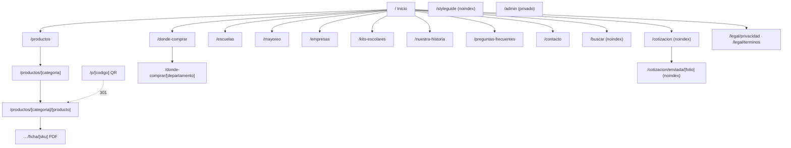

# 06 · Vistas

Estructura de cada vista del sitio público y del admin. Las animaciones mencionadas (`A-xx`) están detalladas en `docs/09-animaciones.md`; los eventos de analítica (`ev:`) en `docs/12-performance-y-kpis.md`; los textos en `docs/17-copys.md`.

## 1. Mapa del sitio



## 2. Estructura global (todas las páginas públicas)

```text
┌──────────────────────────────────────────────┐
│ Enlace "Saltar al contenido" (visible al foco)│
│ Splash (solo 1.ª visita de la sesión) A-01   │
├──────────────────────────────────────────────┤
│ Header sticky: Logo · Menú · Buscar ·        │
│ Mi cotización (contador) · Cotizar           │
├──────────────────────────────────────────────┤
│ <main id="contenido"> (template.tsx A-02)    │
│   Breadcrumbs (excepto home)                 │
│   Secciones de la página                     │
│   CTA final de página                        │
├──────────────────────────────────────────────┤
│ Footer                                       │
├──────────────────────────────────────────────┤
│ Flotantes: WhatsApp (desktop) · barra de     │
│ acciones (móvil) · Drawer "Mi cotización"    │
│ Toaster · FriendlyDialog                     │
└──────────────────────────────────────────────┘
```

### Header
- **Móvil (< 1024 px):** logo a la izquierda; a la derecha Buscar, Mi cotización (con contador) y menú hamburguesa. El menú abre un **sheet** desde la derecha (A-08) con: Productos, Soluciones (Colegios, Universidades, Empresas, Librerías, Distribuidores), Bolik en tu escuela, Dónde comprar, Historia, Contacto, y un botón grande "Cotizar al por mayor".
- **Desktop:** logo · navegación central (Productos con mega-menú de líneas, Soluciones, Escuelas, Dónde comprar, Historia) · Buscar · Mi cotización · botón "Cotizar al por mayor".
- Sticky con fondo blanco; al hacer scroll hacia abajo se compacta (altura 72 → 60 px, A-07); nunca se oculta (la cotización debe estar siempre a mano).
- `top: env(safe-area-inset-top)`; altura reservada para evitar CLS.

### Footer
- Logo, frase de marca y "Una marca de Grupo K-66".
- Columnas: Productos (líneas), Soluciones, Bolik (historia, escuelas, preguntas frecuentes), Contacto.
- **NAP consistente** (mismo texto en todo el sitio y en JSON-LD): dirección 6a. Avenida 6-31, zona 2, San José Villa Nueva, Guatemala · PBX (502) 6628-2600 · horario.
- Redes sociales, enlaces legales, "Hecho en Guatemala desde 1966".

### Flotantes
- **WhatsApp (desktop):** botón circular abajo a la derecha; abre `WhatsAppSheet` con mensaje contextual (página/producto actual).
- **Barra móvil:** fija abajo con 2 botones: WhatsApp y Cotizar (o "Mi cotización (3)" cuando hay líneas). Respeta `safe-area-inset-bottom`. Se oculta cuando el teclado está abierto.
- **Drawer de cotización:** desde la derecha en desktop, desde abajo (bottom sheet) en móvil.

## 3. Vistas públicas

### 3.0 Splash (primera visita)
- Fondo `--navy` con puntos sutiles, logo al centro que se dibuja (trazo de tinta) y aparece la frase "60 años · 1966–2026". Duración total **2 s**, luego se desvanece y revela el hero.
- Solo la **primera visita de la sesión**; no aparece al navegar entre páginas ni al volver. Se puede saltar con clic, toque o Escape. Con `prefers-reduced-motion`: fundido de 400 ms.
- El HTML del hero ya está debajo: no retrasa el contenido para Google ni el LCP. Detalle técnico en `docs/09-animaciones.md#splash`.

### 3.1 `/` Inicio
**Busca posicionar:** "Bolik", "lapiceros Bolik", "útiles escolares Guatemala", "fábrica de lapiceros Guatemala".
**Render:** estático · **JSON-LD:** `Organization`, `WebSite` (con `SearchAction`), `FAQPage`.
**Title:** `Bolik · Útiles escolares y de oficina hechos en Guatemala desde 1966`

| # | Sección | Contenido y componentes | Móvil | Desktop | Animación |
|---|---|---|---|---|---|
| 1 | **Hero con capítulos de video** | `VideoHero`: video de fondo + capa oscura; chip "60 años · Hecho en Guatemala"; `h1` "De la materia prima a tu primer trazo." con subrayado de tinta; texto y CTA que cambian por capítulo; 4 pestañas Planta · Aula · Oficina · Librería con barra de progreso | Video vertical 4:5 o solo póster; pestañas con scroll horizontal; CTA a ancho completo | Video 16:9; texto a la izquierda, pestañas abajo | A-10 crossfade, A-11 subrayado, A-12 cambio de texto, A-13 progreso |
| 2 | **Cifras** | `StatsBand` sobre `--blue`: 60 años · 150+ productos · 1,800+ puntos de venta · 22 departamentos (desde `SiteStat`) | 2 × 2 | 4 columnas | A-20 conteo |
| 3 | **Soluciones** | "Un Bolik para cada etapa": 5 tarjetas de color (Colegios, Universidades, Empresas, Librerías, Distribuidores) que llevan a su página o abren cotización | Carrusel con *scroll snap* | 5 columnas | A-21 reveal escalonado, A-30 hover |
| 4 | **Catálogo destacado** | Buscador grande + chips de línea + 8 `CategoryCard` | 2 columnas | 4 columnas | A-21, A-30 |
| 5 | **Bolik Ultra** | `ProductSpotlight`: ilustración/foto, 4 beneficios, chips de color con código, CTAs "Ver ficha" y "Dónde comprar" | Apilado | 2 columnas | A-31 cambio de color |
| 6 | **Bolik en tu escuela** (estilo infantil) | Fondo `sun`, título en Baloo 2, 3 cifras, 4 actividades en tarjetas inclinadas, CTA "Lleva Bolik a tu escuela" | 1 columna | 4 columnas | A-40 tarjetas, A-41 garabatos |
| 7 | **Mayoreo y empresas** | 2 tarjetas grandes: Librerías y distribuidores (azul) · Empresas y universidades (navy) | Apiladas | 2 columnas | A-21 |
| 8 | **Dónde comprar** | Selector de departamento (lleva a `/donde-comprar/[dep]`), botones Walmart y La Torre, 4 tiendas destacadas | Apilado | 2 columnas | A-21 |
| 9 | **Kits escolares 2027** | 3 `KitCard` (si están publicados) | Carrusel | 3 columnas | A-21 |
| 10 | **Historia** | 4 hitos verificados + enlace "Conoce nuestra historia" | Línea vertical | Línea horizontal | A-50 trazo de línea |
| 11 | **Preguntas frecuentes** | 6 preguntas (scope `home`) en acordeón | — | Centrado 860 px | A-35 acordeón |
| 12 | **CTA final** | "¿Compras por mayor?" + Cotizar + WhatsApp | — | — | — |

**Eventos:** `hero_chapter_view`, `hero_cta_click`, `solution_click`, `category_click`, `search_open`, `retailer_click`, `quote_open`.

### 3.2 `/productos` Catálogo
**Busca posicionar:** "útiles escolares Bolik", "catálogo Bolik".
**Render:** estático, filtros en cliente · **JSON-LD:** `CollectionPage` + `ItemList` + `BreadcrumbList`.

1. Encabezado: breadcrumbs, `h1` "Catálogo Bolik", bajada, buscador.
2. Barra de filtros sticky bajo el header: **Línea** (Escritura, Escolar, Arte, Oficina), **Uso** (Escolar, Oficina, Manualidades), **Color** (cuando aplica). En móvil, botón "Filtros" que abre un sheet con contador de resultados en vivo.
3. Resultados: grilla de `ProductCard` (imagen 1:1, chip de línea, nombre, colores disponibles como puntos, "Ver producto"). Contador "12 productos".
4. Estado vacío amable: "No hay productos con esos filtros" + botón "Quitar filtros".
5. Bloque SEO al final: texto corto sobre la marca y enlaces a cada categoría.

Los filtros se reflejan en la URL (`?linea=escolar&uso=oficina`) con `history.replaceState` para poder compartir, pero la URL **canónica** es siempre `/productos` (sin parámetros). Animación: A-22 reordenar grilla, A-32 sheet de filtros.

### 3.3 `/productos/[categoria]` Categoría
**Busca posicionar:** "marcadores de pizarra Guatemala", "lápices de colores Guatemala", etc.
**Render:** estático con `generateStaticParams` · **JSON-LD:** `CollectionPage`, `ItemList`, `BreadcrumbList`, `FAQPage` (si hay FAQs).

1. Breadcrumbs · `h1` con el nombre de la categoría + palabra clave ("Marcadores para pizarra") · bajada (`Category.shortText`).
2. Productos de la categoría (grilla).
3. "Datos clave" de la categoría (3–5 viñetas, útiles para IA).
4. Texto introductorio SEO (`Category.intro`, 150–300 palabras).
5. FAQs de la categoría.
6. CTA: Cotizar esta línea por mayor · Dónde comprar.

### 3.4 `/productos/[categoria]/[producto]` Ficha de producto
**Busca posicionar:** "Bolik Ultra", "bolígrafo Bolik Ultra azul", "PT00058".
**Render:** estático · **JSON-LD:** `Product` (con `gtin12`, `sku`, `color`, `brand`, `manufacturer`, `additionalProperty` para especificaciones; **sin** `offers` ni reseñas), `BreadcrumbList`, `FAQPage`.
**Variantes:** una sola URL por producto; el color se elige en la página y se refleja en `?color=rojo` (canónica sin parámetro).

```text
┌ Breadcrumbs ─────────────────────────────────────────────┐
├──────────────────────────────┬───────────────────────────┤
│ Galería (sticky en desktop)  │ Chip de línea             │
│  imagen principal 1:1        │ h1 Bolik Ultra            │
│  miniaturas: principal,      │ Tagline + descripción     │
│  punta, trazo, blister,      │ Selector de color (SKU)   │
│  cajilla                     │ Selector de presentación  │
│                              │ Cantidad + total unidades │
│                              │ [Agregar a mi cotización] │
│                              │ [Dónde comprar] [Walmart↗]│
│                              │ WhatsApp con contexto     │
├──────────────────────────────┴───────────────────────────┤
│ Datos clave (5 viñetas con respuesta directa)            │
│ Beneficios con íconos · Usos (chips)                      │
│ Tabs: Especificaciones · Medidas · Para distribuidores ·  │
│       Seguridad                                           │
│ Presentaciones (tarjetas) + tabla de códigos por color    │
│ Descargar ficha técnica PDF (por color)                   │
│ Preguntas frecuentes                                      │
│ Completa tu estuche (relacionados)                        │
│ CTA final                                                 │
└──────────────────────────────────────────────────────────┘
```

- **Medidas:** diagrama SVG del bolígrafo con cotas; al tocar una parte se resalta y muestra su valor (A-33). Accesible: tabla equivalente debajo.
- **Para distribuidores:** códigos de barras, medidas y peso de cajilla, caja master (100 cajillas), unidades por empaque. Botón "Cotizar por mayor".
- **Seguridad:** advertencia completa de la ficha técnica.
- En móvil, la barra inferior cambia a: "Agregar a cotización" + WhatsApp.
- **Eventos:** `product_view`, `color_select`, `pack_select`, `quote_add`, `retailer_click`, `whatsapp_open`, `pdf_download`, `dimension_open`.

### 3.5 `/p/[codigo]` Acceso por QR
Route handler: busca la variante por `sku` o `barcode` y responde **301** a `/productos/{categoria}/{producto}?color={colorKey}&utm_source=qr&utm_medium=empaque`. Si no existe, 302 a `/buscar?q={codigo}`.

### 3.6 `/buscar`
**noindex, follow.** Campo grande enfocado, resultados en vivo (Fuse.js con índice de `/api/search-index`), búsqueda por nombre, sinónimo ("lapicero" = "bolígrafo"), código SKU o código de barras. Si hay coincidencia exacta de código, muestra la tarjeta destacada "¿Buscas el Bolik Ultra Azul (PT00058)?". Sugerencias cuando no hay resultados. Atajo de teclado `/` abre el buscador en desktop.

### 3.7 `/donde-comprar`
**Busca posicionar:** "dónde comprar lapiceros Bolik", "librerías Guatemala útiles escolares".
**Render:** estático · **JSON-LD:** `ItemList` de `Store` (tipo `Store` con `address` y `geo` solo si `isVerified`).

1. `h1` "Encuentra Bolik cerca de ti" + bajada.
2. Franja **Compra en línea**: Walmart Guatemala ↗, La Torre ↗ (`ev:retailer_click`).
3. Filtros: Departamento (select), buscar tienda por nombre, "Usar mi ubicación" (pide permiso; si se acepta, ordena por distancia; si se niega, mensaje amable).
4. Dos columnas en desktop: lista (cadenas primero, luego librerías) + **mapa Leaflet** que se carga solo al entrar en pantalla (A-34 pines). En móvil, lista y botón "Ver mapa" que abre el mapa a pantalla completa.
5. Cada tienda: nombre, tipo, municipio, dirección (si verificada), botones "Cómo llegar" (Google Maps) y "Comprar en línea" si aplica.
6. Enlaces a cada departamento (SEO local).
7. CTA: "¿Tienes una librería? Vende Bolik" → `/mayoreo#distribuidor`.

### 3.8 `/donde-comprar/[departamento]`
**Busca posicionar:** "útiles escolares en Quetzaltenango", "lapiceros Bolik Huehuetenango".
Una página por departamento con tiendas (se generan solo los departamentos con al menos una tienda publicada; el resto no se indexa). Estructura: `h1` "Dónde comprar Bolik en {Departamento}" · texto local (`Department.intro`) · lista y mapa centrado en el departamento · departamentos cercanos · CTA de distribuidor ("¿No hay tienda cerca? Sé distribuidor Bolik").

### 3.9 `/escuelas` Bolik en tu escuela (estilo infantil)
**Busca posicionar:** "talleres de escritura para escuelas Guatemala", "actividades escolares Bolik".
Toda la página usa la sub-paleta kids y Baloo 2 en títulos.

1. Hero amarillo con garabatos SVG animados (A-41) y `h1` "¡Aprender a escribir es una aventura!".
2. Cifras grandes (escuelas visitadas, niños, útiles donados).
3. Actividades (tarjetas de color inclinadas, A-40).
4. Galería de fotos (con permisos), `loading="lazy"`.
5. Cómo funciona una visita (4 pasos numerados reales: solicitas, coordinamos fecha, visitamos, entregamos material).
6. **Formulario "Lleva Bolik a tu escuela"**: colegio, nivel, número aproximado de alumnos, departamento, municipio, nombre, teléfono o correo, mes preferido. Éxito con diálogo festivo (A-60 confeti ligero).
7. Kits escolares (enlace) y FAQ de escuelas.

### 3.10 `/mayoreo` Librerías y distribuidores
**Busca posicionar:** "lapiceros por mayor Guatemala", "distribuidor de útiles escolares Guatemala".
1. `h1` "Compra Bolik por mayor, directo de fábrica".
2. Beneficios (precio por cajilla y fardo, ejecutivo por zona, preventa escolar, cotización por WhatsApp).
3. Cómo cotizar en 3 pasos (agrega productos → envía datos → recibe precio).
4. Presentaciones explicadas (blister, cajilla 12, fardo 100 cajillas).
5. Productos más pedidos por librerías (6 tarjetas con "Agregar a mi cotización").
6. `#distribuidor` **Formulario "Quiero ser distribuidor"**.
7. FAQ de mayoreo.

### 3.11 `/empresas` Empresas y universidades
**Busca posicionar:** "lapiceros personalizados Guatemala", "bolígrafos con logo Guatemala".
1. `h1` "Bolígrafos personalizados con el logo de tu empresa".
2. Usos (eventos, ferias, kits de bienvenida, universidades).
3. Productos personalizables (tarjetas).
4. Proceso en 4 pasos (cotizas, envías logo, apruebas muestra digital, producimos).
5. Pedido mínimo (desde `SiteSetting`).
6. Formulario de cotización con tipo "Empresa" preseleccionado y campo "¿Tienes el logo listo?".
7. FAQ.

### 3.12 `/kits-escolares`
Kits por nivel (Preprimaria, Primaria, Básicos y diversificado) con contenido, precio sugerido si `priceVisible`, librerías donde está disponible y botón "Cotizar para mi colegio". Si no hay kits publicados, la página muestra "Próximamente" y queda `noindex`.

### 3.13 `/nuestra-historia`
`h1` "60 años escribiendo con Guatemala" · línea de tiempo completa (solo hitos verificados, A-50) · "Hecho en Guatemala": la planta y el proceso (4 pasos del hero en versión ampliada) · cifras de la planta · CTA. **JSON-LD:** `AboutPage` + `Organization` con `foundingDate: "1966-06"`.

### 3.14 `/preguntas-frecuentes`
Todas las FAQs agrupadas por tema (Productos, Dónde comprar, Mayoreo, Escuelas, Empresas) con buscador interno y anclas por pregunta. **JSON-LD:** `FAQPage`.

### 3.15 `/contacto`
Datos NAP, horario, mapa estático de la planta (imagen, no iframe), formulario de contacto (asunto, nombre, correo o teléfono, mensaje), accesos rápidos: "¿Quieres cotizar?" → cotización, "¿Eres un colegio?" → escuelas.

### 3.16 `/cotizacion` Mi cotización
**noindex.** Página completa equivalente al drawer:
1. Lista de líneas (producto, color, presentación, cantidad editable con stepper, quitar con "Deshacer" A-36).
2. Agregar más: buscador rápido de productos por nombre o código.
3. Formulario: tipo de cliente, institución, nombre, teléfono o correo (uno obligatorio), departamento, municipio, notas.
4. Botón "Enviar cotización" (estado de carga) → diálogo de éxito con folio (A-60) → redirige a `/cotizacion/enviada/[folio]`.
5. Estado vacío: ilustración, "Tu cotización está vacía" y accesos a Catálogo, Más pedidos por librerías, Kits.

### 3.17 `/cotizacion/enviada/[folio]`
**noindex, dinámica.** Confirmación con folio, resumen, qué sigue ("Un ejecutivo de {departamento} te contactará en un día hábil"), botón "Escribir por WhatsApp con mi folio", "Seguir viendo productos". Solo muestra datos si el folio coincide con la cookie de la sesión que lo creó; si no, mensaje genérico (no expone datos de otros).

### 3.18 `/legal/[slug]`
Privacidad y términos en Markdown (`src/content/legal`). Indexables, enlazadas en el pie y en formularios.

### 3.19 `404` y `500`
- **404:** ilustración amable (lapicero sin tinta), "No encontramos esta página", buscador, enlaces a Catálogo, Dónde comprar, Inicio. Registra la ruta en `NotFoundLog`.
- **500 / error:** "Algo salió mal de nuestro lado", botón "Intentar de nuevo" (`reset()`), WhatsApp y teléfono.

### 3.20 `/styleguide`
**noindex.** Ver `docs/08-styleguide.md#vista-styleguide`.

## 4. Admin (`/admin`)

**Dinámico, sin caché, `noindex`, fuera del sitemap.** Layout: menú lateral colapsable (desktop), menú inferior (móvil), encabezado con usuario y "Ver sitio". Todas las tablas con búsqueda, filtros, paginación y estados vacíos. Toda acción muestra toast y, si es destructiva, confirmación.

| Vista | Ruta | Roles | Contenido |
|---|---|---|---|
| Login | `/admin/login` | — | Correo, contraseña, mensaje de bloqueo tras 5 intentos |
| Dashboard | `/admin` | todos | Cotizaciones nuevas, pendientes de ERP, solicitudes de escuelas y distribuidores, clics a tiendas y WhatsApp (7/30 días), última sincronización, accesos rápidos |
| Productos | `/admin/productos` | admin, editor | Tabla con estado (publicado, borrador, inactivo en SAP), filtros por categoría |
| Editar producto | `/admin/productos/[id]` | admin, editor | Tabs: General · Variantes (SKU y código de barras de SAP en solo lectura) · Especificaciones · Medidas · Empaques · Imágenes (subir, ordenar con arrastre, alt obligatorio) · Beneficios y usos · Relacionados · Preguntas · SEO (vista previa de Google) · Publicar |
| Categorías | `/admin/categorias` | admin, editor | Textos SEO, imagen, orden |
| Tiendas | `/admin/tiendas` | admin, editor, ventas | CRUD, marcar verificada, elegir ubicación en mapa |
| Kits | `/admin/kits` | admin, editor | Contenido, precio, visibilidad, tiendas |
| Cotizaciones | `/admin/cotizaciones` | admin, ventas | Tabla por estado, asignar, cambiar estado, notas internas, reintentar envío a SAP, exportar CSV |
| Escuelas / Distribuidores / Mensajes | `/admin/escuelas` … | admin, ventas | Bandejas con estados y exportación |
| Contenido | `/admin/contenido/*` | admin, editor | Hero (capítulos, videos, pósters), cifras, historia, actividades, FAQs |
| Apariencia | `/admin/apariencia` | admin, editor | Fondo por sección con vista previa en vivo |
| Ajustes | `/admin/ajustes` | admin | WhatsApp, teléfono, redes, correos de notificación, splash on/off, pedido mínimo de personalizados |
| Redirecciones | `/admin/redirecciones` | admin | CRUD + lista de 404 más frecuentes con botón "Crear redirección" |
| Sincronización | `/admin/sincronizacion` | admin | Historial de `SyncRun`, botón "Sincronizar ahora" |
| Usuarios | `/admin/usuarios` | admin | CRUD, roles, desbloquear |
| Auditoría | `/admin/auditoria` | admin | Bitácora filtrable |

**Vista previa:** cada formulario de contenido tiene "Ver en el sitio" (abre la página en una pestaña nueva tras guardar).
