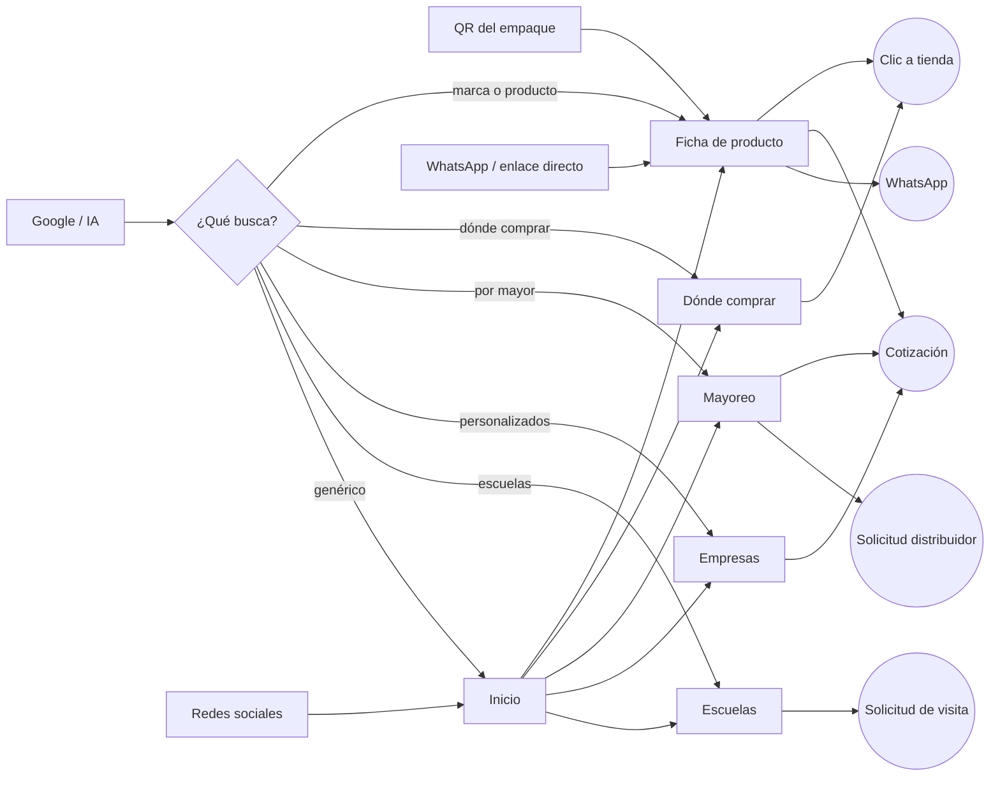
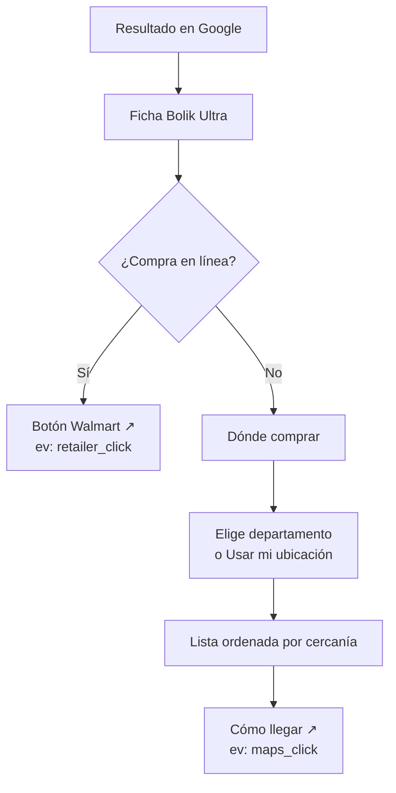
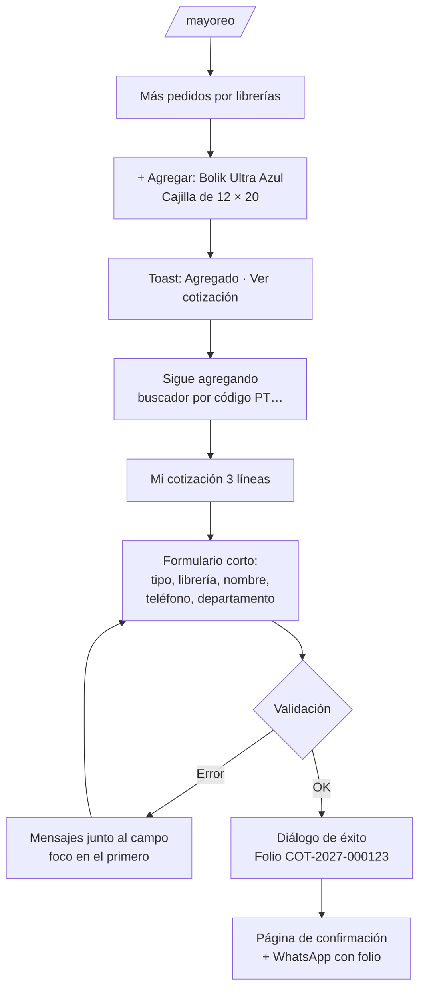
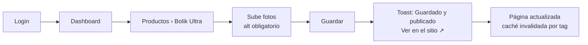

# 07 · Flujos de usuario

Cada flujo indica el **punto de entrada** más probable, los pasos y la **meta**. Al final están las reglas de eficiencia que todos los flujos deben cumplir.

## 1. Mapa general de intenciones

## 2. Flujos por público

### 2.1 Mamá o papá: "¿Dónde compro el Bolik Ultra cerca?"
Entrada: Google móvil ("bolik ultra azul" o "lapiceros bolik dónde comprar").

**Meta:** clic a tienda en **≤ 3 toques** desde la ficha.

### 2.2 Mamá o papá: lista escolar
Entrada: campaña de temporada o home → "Kits escolares".
1. Elige nivel del hijo (Preprimaria / Primaria / Básicos).
2. Ve contenido del kit y precio sugerido (si está visible).
3. "Ver librerías con este kit" → dónde comprar filtrado.
**Meta:** clic a tienda. **Alternativa:** "Escríbenos por WhatsApp" con el nombre del kit.

### 2.3 Librería: cotización de mayoreo (flujo principal de negocio)
Entrada: Google ("lapiceros por mayor Guatemala") → `/mayoreo`, o Inicio → "Librerías".

**Meta:** cotización enviada en **≤ 90 s** y **≤ 6 campos**. Los datos del cliente se recuerdan en el navegador (con su permiso implícito al marcar "Recordar mis datos") para la próxima cotización.

### 2.4 Distribuidor nuevo
Entrada: `/donde-comprar` ("¿Tienes una librería?") o `/mayoreo#distribuidor`.
1. Lee beneficios y requisitos.
2. Llena: negocio, tipo, sucursales, volumen mensual, departamento, municipio, contacto.
3. Diálogo de éxito con folio `DIS-…` y tiempo de respuesta (5 días hábiles).

### 2.5 Empresa o universidad: personalizados
Entrada: Google ("lapiceros con logo Guatemala") → `/empresas`.
1. Ve productos personalizables y proceso.
2. "Cotizar personalizados" abre la cotización con tipo "Empresa" y una línea "personalizado" (producto + cantidad aproximada).
3. Envía → folio → "Un ejecutivo te pedirá tu logo".

### 2.6 Docente o director: visita escolar
Entrada: redes sociales, Inicio → "Bolik en tu escuela".
1. Ve actividades y fotos.
2. Formulario (6 campos).
3. Diálogo festivo con folio `ESC-…`.

### 2.7 Consumidor curioso: QR del empaque
Entrada: escanea el QR del blister → `/p/PT00058` → 301 a la ficha con color azul seleccionado.
1. Ve datos clave y medidas.
2. Descubre otros productos ("Completa tu estuche").
**Meta:** visita a una segunda página o clic a tienda.

### 2.8 Mercadeo: actualizar contenido

### 2.9 Ventas: atender una cotización
1. Recibe correo "Nueva cotización COT-2027-000123 · Librería El Estudiante · Quetzaltenango" con enlace directo.
2. En el admin: se asigna, cambia estado a "En proceso", agrega nota.
3. Si `erpStatus = error`: "Reintentar envío a SAP".
4. Al cerrar: estado "Ganada" o "Perdida" (alimenta los KPIs).

## 3. Flujos de eficiencia (los atajos)

Diseñados para el usuario que vuelve o que ya sabe lo que quiere.

| Atajo | Cómo funciona | Ahorro |
|---|---|---|
| **Buscar por código** | Escribir `PT00058` o el código de barras en el buscador abre directo la ficha con ese color | 3 pasos → 1 |
| **QR → ficha** | `/p/[codigo]` con color preseleccionado | Sin búsqueda |
| **Agregar sin salir** | En tarjetas de mayoreo y fichas, "Agregar" no navega: toast + contador | Sin recargas |
| **Cantidad rápida** | Stepper con valores sugeridos por presentación (cajillas: 5, 10, 20, 50) | Menos tecleo |
| **Recordar mis datos** | Opcional; guarda tipo, institución, nombre, teléfono y departamento en `localStorage` | Formulario precargado |
| **Repetir cotización** | En la página de confirmación: "Copiar esta cotización como nueva" (se guarda la última en el navegador) | Reorden en 2 toques |
| **WhatsApp con contexto** | El mensaje incluye producto, código, presentación y cantidad, o el folio | Ventas no pregunta de nuevo |
| **Usar mi ubicación** | Ordena tiendas por distancia | Sin elegir departamento |
| **Tecla `/`** | Abre el buscador en desktop | — |
| **Filtros en URL** | Compartir `/productos?linea=escolar` con un colega | — |
| **Departamento recordado** | El último departamento elegido se preselecciona en Dónde comprar y en formularios | — |

## 4. Reglas de eficiencia (aplican a todo flujo)

1. **Máximo 3 toques** desde cualquier ficha hasta: tienda, WhatsApp o "agregar a cotización".
2. **Formularios de ≤ 6 campos visibles**; lo opcional se muestra con "Agregar más detalles".
3. **Teclados correctos en móvil:** `inputMode="tel"` para teléfono, `type="email"`, `autoComplete` en todos (`organization`, `name`, `tel`, `email`, `address-level1`).
4. **Validación al salir del campo**, no mientras se escribe; mensajes junto al campo; al enviar con errores, foco en el primer error y anuncio para lector de pantalla.
5. **Nunca perder lo escrito:** la cotización persiste en `localStorage`; los formularios guardan borrador en `sessionStorage`.
6. **Respuesta inmediata:** todo clic muestra un cambio visual en < 100 ms (estado presionado, spinner en el botón, toast).
7. **Siempre una salida humana:** en errores y estados vacíos, ofrecer WhatsApp y teléfono.
8. **Sin bloqueos innecesarios:** sin registro para cotizar, sin captcha visible (salvo que aparezca spam), sin pop-ups de entrada (el splash solo dura 2 s y se puede saltar).
9. **Pulgar primero:** acciones principales en la mitad inferior de la pantalla en móvil (barra inferior, botones a ancho completo).
10. **Volver atrás funciona:** drawer y modales se cierran con el botón Atrás del celular (se agrega una entrada de historial al abrir).

## 5. Puntos de fricción a vigilar (medir en Clarity y GA4)

| Punto | Señal | Acción si falla |
|---|---|---|
| Hero → scroll | Rebote alto en home móvil | Reducir altura del hero, mover CTA |
| Ficha → agregar | Muchas vistas, pocos `quote_add` | Revisar claridad del selector de presentación |
| Cotización → envío | `quote_form_start` sin `quote_submit` | Quitar campos, revisar errores frecuentes |
| Dónde comprar | Búsquedas sin resultados por departamento | Pedir a Ventas tiendas de esa zona |
| Buscador | Búsquedas sin resultado (`search_no_results`) | Agregar sinónimos o productos |
