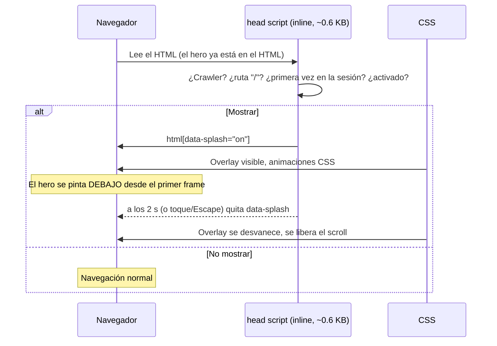
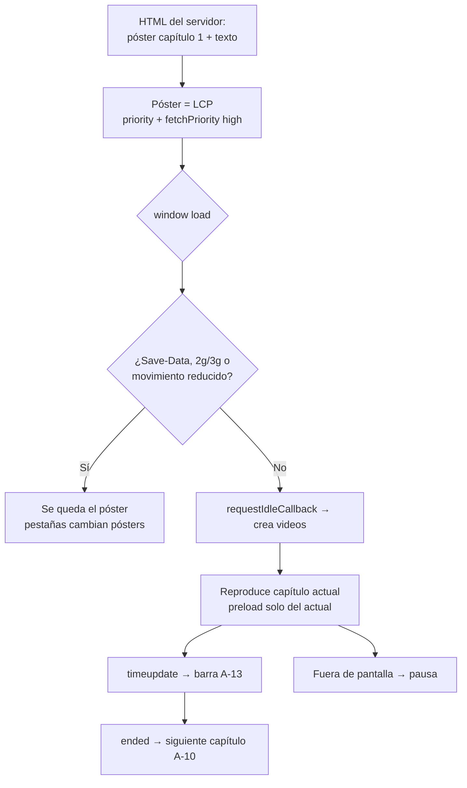

# 09 · Animaciones

Objetivo: que el sitio se sienta **suave, fluido y vivo**, sin costar rendimiento. Las animaciones explican qué pasó (algo se agregó, algo cambió, algo se abrió), no decoran por decorar.

## 1. Principios

1. **Solo `transform` y `opacity`** (y `stroke-dashoffset` / `clip-path` en SVG). Así el navegador anima en la GPU sin recalcular el layout: 60 fps incluso en celulares de gama media.
2. **CSS primero.** Transiciones y keyframes en CSS para casi todo. La librería **Motion** (`motion/react`) solo para: drawer de cotización, diálogos, listas que se reordenan y la salida de líneas de la cotización. Se carga con `LazyMotion` + `domAnimation` y `m.*`, nunca `motion.*` completo.
3. **Duraciones cortas y consistentes** (tokens de `motion.css`): 90 ms presionar · 160 ms hover · 240 ms entradas · 420 ms drawer/modal/reveal · 700 ms crossfade y trazos · 2 s splash.
4. **Curvas con intención:** `--ease-out` para entrar, `--ease-in` para salir, `--ease-in-out` para cambios de estado, `--ease-spring` para celebrar (contador, éxito).
5. **Visible sin JavaScript.** Ninguna sección empieza oculta en el HTML. Los reveals solo ocultan si `<html>` tiene la clase `js` y tienen red de seguridad a los 2.5 s.
6. **Movimiento reducido:** con `prefers-reduced-motion: reduce` no hay desplazamientos ni rebotes; solo cambios de opacidad cortos. El video no se reproduce solo.
7. **Nada bloquea la interacción.** Ninguna animación impide hacer clic; el splash se puede saltar.
8. **Una sola cosa protagonista a la vez.** En cada pantalla anima lo que el usuario acaba de hacer o lo que acaba de aparecer, no todo junto.

## 2. Catálogo de animaciones

| ID | Nombre | Dónde | Cómo | Duración / curva | Reducido |
|---|---|---|---|---|---|
| A-01 | Splash | Primera visita, home | Overlay navy; cuadro azul `scale-in`, trazo amarillo se dibuja, palabra `fade-up`, salida `opacity` | 2000 ms total | Fundido 500 ms |
| A-02 | Entrada de página | `template.tsx` | `fade-up` 16 px del `<main>` | 240 ms out | Solo opacidad |
| A-03 | Presionar | Botones, tarjetas | `scale(.97)` | 90 ms out | Igual (no desplaza) |
| A-04 | Error de campo | Inputs al enviar con error | `shake` 6 px | 360 ms in-out | Sin shake, solo borde |
| A-05 | Contador "pop" | Badge de cotización | `scale 1 → 1.18 → 1` | 420 ms spring | Sin escala |
| A-06 | Hover de enlace | Enlaces de texto | Subrayado que crece desde la izquierda (`scaleX` de un pseudo-elemento) | 160 ms out | Subrayado fijo |
| A-07 | Header compacto | Scroll > 80 px | Cambia altura visual con `transform: translateY` del contenido y sombra con `opacity` de un pseudo-elemento | 240 ms | Instantáneo |
| A-08 | Sheet / drawer | Menú móvil, cotización, filtros, mapa | Desliza `translateX(100%) → 0` (desktop) o `translateY(100%) → 0` (móvil) + overlay `opacity` | 420 ms out / 240 ms in | Solo opacidad |
| A-09 | Diálogo | FriendlyDialog | `scale(.96) → 1` + `opacity` (desktop); bottom sheet en móvil | 240 ms out | Solo opacidad |
| A-10 | Crossfade del hero | Cambio de capítulo | Capas apiladas con `opacity` | 700 ms in-out | Instantáneo, sin video |
| A-11 | Subrayado de tinta | `h1` del hero, títulos destacados | `stroke-dashoffset` de SVG | 700 ms out, 400 ms de retraso | Subrayado fijo |
| A-12 | Texto del capítulo | Hero | `fade-up` del bloque de texto (se fuerza con `key`) | 240 ms out | Solo opacidad |
| A-13 | Progreso del capítulo | Pestañas del hero | `transform: scaleX(progreso)` | lineal, por `timeupdate` | Barra oculta |
| A-20 | Conteo de cifras | Franja de cifras, escuelas | Número de 0 al valor con `requestAnimationFrame` (ease-out cúbica) | 1100 ms | Número final directo |
| A-21 | Reveal escalonado | Tarjetas de secciones | `fade-up` con retraso `--i × 60 ms` al entrar en pantalla | 420 ms out | Visible directo |
| A-22 | Reordenar grilla | Filtros del catálogo | Motion `layout` en las tarjetas (FLIP) | 320 ms out | Sin layout animation |
| A-30 | Elevar tarjeta | Hover en tarjetas (solo `hover: hover`) | `translateY(-4px)` + sombra vía `opacity` de pseudo-elemento | 160 ms out | Sin elevar |
| A-31 | Cambio de color | Ficha y spotlight | Crossfade de imagen (`opacity`) + anillo del swatch con `scale` | 240 ms in-out | Solo opacidad |
| A-32 | Sheet de filtros | Catálogo móvil | = A-08 | 420 ms | Opacidad |
| A-33 | Cota interactiva | Diagrama de medidas | Línea de cota con `stroke-dashoffset` y etiqueta `fade-in` | 320 ms out | Estático |
| A-34 | Pines del mapa | Dónde comprar | Pines caen con `translateY(-8px) → 0` escalonado; pin activo con `scale(1.15)` | 240 ms spring | Estático |
| A-35 | Acordeón | FAQs | Radix + `grid-template-rows: 0fr → 1fr`* y rotación del ícono + | 240 ms in-out | Instantáneo |
| A-36 | Quitar línea | Cotización | Motion `AnimatePresence`: `opacity` y `x` hacia la derecha, luego colapso de altura | 280 ms | Solo opacidad |
| A-40 | Tarjetas infantiles | Escuelas | Rotación ±1.5° en reposo; hover `rotate(0) scale(1.03)` | 240 ms spring | Sin rotación |
| A-41 | Garabatos | Fondo de escuelas | SVG que se dibuja una vez al entrar + `float` lento de figuras | 1.2 s una vez; float 5 s loop | Estático |
| A-50 | Línea de tiempo | Historia | Línea con `scaleX`/`scaleY` desde el origen + hitos con A-21 | 700 ms out | Estático |
| A-60 | Éxito | Diálogo de envío | Check SVG que se dibuja + círculo con `scale` spring; escuelas: confeti ligero (12 piezas CSS) | 600 ms | Check estático |
| A-70 | Skeleton | Carga en cliente | Brillo `translateX` | 1.2 s loop | Sin brillo |

\* `grid-template-rows` no es `transform`, pero solo afecta al contenido del acordeón abierto (un elemento) y es la técnica estándar; está permitido **solo** en el acordeón.

<a id="splash"></a>

## 3. Splash (A-01)

**Requisito:** al cargar la web, durante 2 s se muestra una vista con fondo y logo animado; al terminar aparece el hero.

**Cómo se implementa sin dañar SEO ni velocidad:**



Decisiones:
- **Solo en la primera visita de la sesión y solo si se aterriza en `/`.** Quien llega desde Google a una ficha de producto busca un dato; un splash ahí aumenta el rebote. (Se puede activar en todas las páginas con el ajuste `splash_scope`, pero no se recomienda.)
- **Nunca a crawlers** (Googlebot, Bingbot, bots de IA, previsualizadores de enlaces de WhatsApp/Facebook).
- **Cero React:** un script inline en `<head>` y CSS. No depende de la hidratación, así que no se queda "pegado" si el JS tarda.
- **Saltable** con toque, clic o Escape. `aria-hidden` en el overlay (es decorativo; el contenido real ya está en la página).
- **Configurable:** `splash_enabled` en `SiteSetting` (admin › Ajustes).
- Código completo: `starter/src/components/layout/splash.tsx`.

## 4. Transiciones entre páginas

1. **`template.tsx`** en `(site)`: envuelve `children` en `<div className="page-enter">`. Se vuelve a montar en cada navegación, así cada página entra con A-02.
2. **Prefetch:** los `<Link>` de Next precargan las páginas visibles; la navegación se siente instantánea.
3. **Scroll:** Next restaura el scroll al volver; al ir a una página nueva, sube al inicio.
4. **View Transitions (opcional, mejora progresiva):** para la imagen del producto (tarjeta del catálogo → galería de la ficha) se puede usar la integración de View Transitions de React/Next si está estable en la versión instalada. Si no lo está, no se implementa: A-02 es suficiente.

## 5. Hero con video (A-10 a A-13)

Código de referencia: `starter/src/components/hero/video-hero.tsx`.



Reglas del video:
- MP4 H.264, sin audio, `muted playsInline`, 8–15 s, ≤ 6 MB (desktop) y ≤ 3 MB (móvil vertical).
- El texto nunca va "quemado" en el video.
- Capa oscura (`hero__shade`) que garantiza contraste AA del texto sobre cualquier cuadro.
- Botón de pausa visible (requisito de accesibilidad para contenido en movimiento de más de 5 s).

## 6. Reveals al hacer scroll (A-21)

```tsx
// En cualquier Server Component:
<ul className="grid gap-4 md:grid-cols-3">
  {items.map((item, i) => (
    <li key={item.id} data-reveal style={{ "--i": i } as React.CSSProperties}>…</li>
  ))}
</ul>
```

Un solo `RevealObserver` (cliente, montado en el layout del sitio) observa todos los `[data-reveal]` y les pone `data-revealed` al entrar en pantalla. El CSS hace el resto. Código: `starter/src/components/motion/reveal-observer.tsx`.

Límites: máximo 8 elementos escalonados por grupo (después, mismo retraso). No usar en el contenido arriba del pliegue (el hero y la primera sección se ven de inmediato).

## 7. Motion (librería) sin inflar el bundle

```tsx
// src/components/motion/lazy-motion-provider.tsx
"use client";
import { LazyMotion } from "motion/react";
const loadFeatures = () => import("./motion-features").then((m) => m.default);
export function MotionProvider({ children }: { children: React.ReactNode }) {
  return <LazyMotion features={loadFeatures} strict>{children}</LazyMotion>;
}

// src/components/motion/motion-features.ts
import { domAnimation } from "motion/react";
export default domAnimation;
```

- Se usa `m.div` (no `motion.div`) dentro del provider.
- El provider envuelve **solo** el drawer de cotización, los diálogos y la grilla filtrable; no todo el sitio.
- Presets en `src/lib/motion.ts`:

```ts
export const spring = { type: "spring", stiffness: 380, damping: 32, mass: 0.9 } as const;
export const drawer = { initial: { x: "100%" }, animate: { x: 0 }, exit: { x: "100%" }, transition: spring };
export const sheet = { initial: { y: "100%" }, animate: { y: 0 }, exit: { y: "100%" }, transition: spring };
export const fadeScale = {
  initial: { opacity: 0, scale: 0.96 }, animate: { opacity: 1, scale: 1 }, exit: { opacity: 0, scale: 0.98 },
  transition: { duration: 0.24, ease: [0.22, 1, 0.36, 1] },
};
export const lineExit = { exit: { opacity: 0, x: 24, transition: { duration: 0.2 } } };
```

- Con `useReducedMotion()` de Motion, los presets se reemplazan por solo opacidad.

## 8. Rendimiento de las animaciones (verificación)

- Chrome DevTools › Performance: grabar abrir/cerrar drawer y cambio de capítulo; no debe haber tareas largas (> 50 ms) ni "Layout" en los frames de animación.
- Rendering › "Paint flashing": solo debe repintar el elemento animado.
- `will-change` solo durante la animación (agregar al iniciar, quitar al terminar); nunca permanente en muchos elementos.
- Probar en un Android de gama media (o CPU 4× más lenta en DevTools): 60 fps en hero, drawer y reveals.
- INP ≤ 200 ms en interacciones con animación (agregar a cotización, cambiar color, abrir menú).
