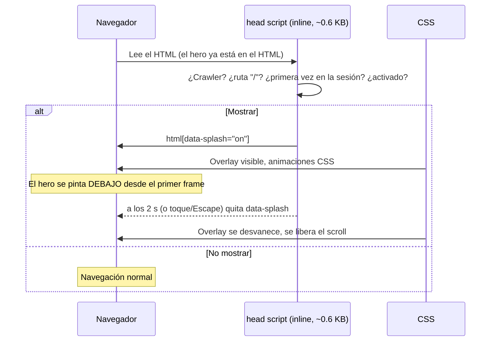
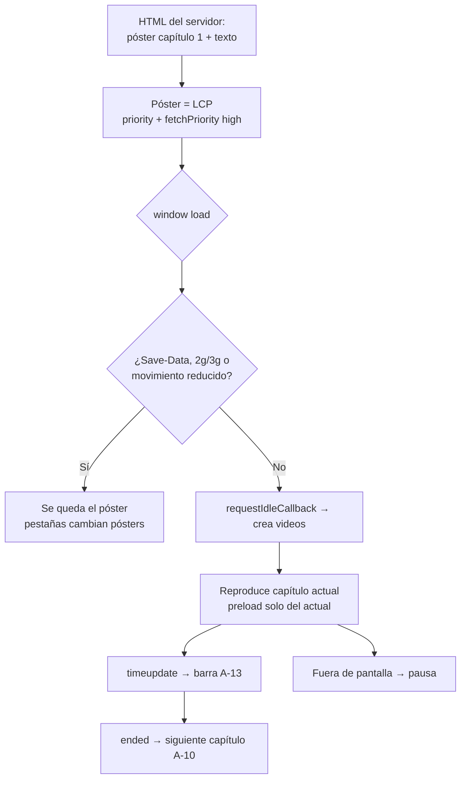

# 09 · Animaciones

Objetivo: que el sitio se sienta **suave, fluido y vivo**, sin costar rendimiento. Las animaciones explican qué pasó (algo se agregó, algo cambió, algo se abrió), no decoran por decorar.

## 1. Principios

1. **Solo `transform` y `opacity`** (y `stroke-dashoffset` / `clip-path` en SVG). Así el navegador anima en la GPU sin recalcular el layout: 60 fps incluso en celulares de gama media.
2. **CSS primero.** Transiciones y keyframes en CSS para casi todo. La librería **Motion** (`motion/react`) solo para: drawer de cotización, diálogos, listas que se reordenan y la salida de líneas de la cotización. Se carga con `LazyMotion` + `domAnimation` y `m.*`, nunca `motion.*` completo.
3. **Duraciones cortas y consistentes** (tokens de `motion.css`): 90 ms presionar · 160 ms hover · 240 ms entradas · 420 ms drawer/modal/reveal · 700 ms crossfade y trazos · 2 s splash.
4. **Curvas con intención:** `--ease-out` para entrar, `--ease-in` para salir, `--ease-in-out` para cambios de estado, `--ease-spring` para celebrar (contador, éxito).
5. **Visible sin JavaScript.** Ninguna sección empieza oculta en el HTML. Los reveals solo ocultan cuando `RevealObserver` está listo (`data-reveal-ready` en `<html>`, BD-044) y nunca lo que ya está a la vista o recibe el foco.
6. **Movimiento reducido:** con `prefers-reduced-motion: reduce` no hay desplazamientos ni rebotes; solo cambios de opacidad cortos. El video no se reproduce solo.
7. **Nada bloquea la interacción.** Ninguna animación impide hacer clic; el splash se puede saltar.
8. **Una sola cosa protagonista a la vez.** En cada pantalla anima lo que el usuario acaba de hacer o lo que acaba de aparecer, no todo junto.

## 2. Catálogo de animaciones

| ID | Nombre | Dónde | Cómo | Duración / curva | Reducido |
|---|---|---|---|---|---|
| A-01 | Splash | Primera visita, home | Overlay navy; wordmark `fade-up`, trazo amarillo se dibuja debajo, salida `opacity` | 2000 ms total | Logo quieto 500 ms |
| A-02 | Entrada de página | `PageEnter` (cambio de ruta) | `fade-up` 16 px del contenido del `<main>` | 240 ms out | Solo opacidad |
| A-03 | Presionar | Botones, tarjetas | `scale(.97)` | 90 ms out | Igual (no desplaza) |
| A-04 | Error de campo | Inputs al enviar con error | `shake` 6 px | 360 ms in-out | Sin shake, solo borde |
| A-05 | Contador "pop" | Badge de cotización | `scale 1 → 1.18 → 1` | 420 ms spring | Sin escala |
| A-06 | Hover de enlace | Enlaces de texto | Subrayado que crece desde la izquierda (`scaleX` de un pseudo-elemento) | 160 ms out | Subrayado fijo |
| A-07 | Header compacto | Scroll > 80 px | Cambia altura visual con `transform: translateY` del contenido y sombra con `opacity` de un pseudo-elemento | 240 ms | Instantáneo |
| A-08 | Sheet / drawer | Menú móvil, cotización, filtros, mapa | Desliza `translateX(100%) → 0` (desktop) o `translateY(100%) → 0` (móvil) + overlay `opacity` | 420 ms out / 240 ms in | Solo opacidad |
| A-09 | Diálogo | FriendlyDialog | `scale(.96) → 1` + `opacity` (desktop); bottom sheet en móvil | 240 ms out | Solo opacidad |
| A-10 | Crossfade del hero | Cambio de capítulo | Capas apiladas con `opacity` | 700 ms in-out | Instantáneo, sin video |
| A-11 | Subrayado de tinta | `h1` del hero, títulos destacados | `stroke-dashoffset` de SVG | 700 ms out, 400 ms de retraso | Subrayado fijo |
| A-12 | Texto del capítulo | Hero | `fade-up` del bloque de texto (se fuerza con `key`) | 240 ms out | Solo opacidad |
| A-13 | Progreso del capítulo | Pestañas del hero | `transform: scaleX(progreso)` | lineal, por `timeupdate` | Barra oculta |
| A-20 | Conteo de cifras | Franja de cifras, escuelas | Número de 0 al valor con `requestAnimationFrame` (ease-out cúbica) | 1100 ms | Número final directo |
| A-21 | Reveal escalonado | Tarjetas de secciones | `fade-up` con retraso `--i × 60 ms` al entrar en pantalla | 420 ms out | Visible directo |
| A-22 | Reordenar grilla | Filtros del catálogo | Motion `layout` en las tarjetas (FLIP) | 320 ms out | Sin layout animation |
| A-30 | Elevar tarjeta | Hover en tarjetas (solo `hover: hover`) | `translateY(-4px)` + sombra vía `opacity` de pseudo-elemento | 160 ms out | Sin elevar |
| A-31 | Cambio de color | Ficha y spotlight | Crossfade de imagen (`opacity`) + anillo del swatch con `scale` | 240 ms in-out | Solo opacidad |
| A-32 | Sheet de filtros | Catálogo móvil | = A-08 | 420 ms | Opacidad |
| A-33 | Cota interactiva | Diagrama de medidas | Línea de cota con `stroke-dashoffset` y etiqueta `fade-in` | 320 ms out | Estático |
| A-34 | Pines del mapa | Dónde comprar | Pines caen con `translateY(-8px) → 0` escalonado; pin activo con `scale(1.15)` | 240 ms spring | Estático |
| A-35 | Acordeón | FAQs | `<details>` + `::details-content` (`block-size`)* y rotación del ícono + | 240 ms in-out | Instantáneo |
| A-36 | Quitar línea | Cotización | Motion `AnimatePresence`: `opacity` y `x` hacia la derecha; al terminar, las de abajo suben (sin animar la altura; `layout` necesitaría `domMax`) | 240 ms (`--dur-base`) | Solo opacidad |
| A-40 | Tarjetas infantiles | Escuelas | Rotación ±1.5° en reposo; hover `rotate(0) scale(1.03)` | 240 ms spring | Sin rotación |
| A-41 | Garabatos | Fondo de escuelas | SVG que se dibuja una vez al entrar + `float` lento de figuras | 1.2 s una vez; float 5 s loop | Estático |
| A-50 | Línea de tiempo | Historia | Línea con `scaleX`/`scaleY` desde el origen + hitos con A-21 | 700 ms out | Estático |
| A-60 | Éxito | Diálogo de envío | Check SVG que se dibuja + círculo con `scale` spring; escuelas: confeti ligero (12 piezas CSS) | 600 ms | Check estático |
| A-70 | Skeleton | Carga en cliente | Brillo `translateX` | 1.2 s loop | Sin brillo |
| A-71 | Spinner | Botón cargando (BD-021) | Giro `rotate` del arco (`.spin`, `--dur-spin`) | 800 ms loop | Quieto; el texto «Enviando…» anuncia la carga |

\* Con `<details>` nativo (BD-025) la técnica equivalente es `::details-content` con `block-size` e `interpolate-size: allow-keywords`; donde no hay soporte, abre al instante. `grid-template-rows` no es `transform`, pero solo afecta al contenido del acordeón abierto (un elemento) y es la técnica estándar; está permitido **solo** en el acordeón.

<a id="splash"></a>

## 3. Splash (A-01)

**Requisito:** al cargar la web, durante 2 s se muestra una vista con fondo y logo animado; al terminar aparece el hero.

**Cómo se implementa sin dañar SEO ni velocidad:**



Decisiones:
- **Solo en la primera visita de la sesión y solo si se aterriza en `/` sin ancla.** Quien llega desde Google a una ficha de producto (o a una sección de la home) busca un dato; un splash ahí aumenta el rebote. Si el navegador prerenderiza la página, espera a que se active.
- **Nunca a crawlers** (Googlebot, Bingbot, bots de IA, previsualizadores de enlaces de WhatsApp/Facebook).
- **Cero React:** un script inline en `<head>` y CSS. No depende de la hidratación, así que no se queda "pegado" si el JS tarda.
- **Saltable** con toque, clic, cualquier tecla, la rueda o un scroll (BD-043: cualquier tecla; con Tab el foco avanza y el overlay ya se está yendo). Al saltarlo sale con un fundido de 240 ms que ya no captura clics. No bloquea el scroll: `overflow: hidden` cambiaba el ancho de la página al quitarse (CLS). `aria-hidden` en el overlay (es decorativo; el contenido real ya está en la página).
- **Movimiento reducido:** el logo quieto 500 ms y se quita sin transición (las reglas globales de reducido dejan las animaciones en 1 ms).
- **Marca (BD-043):** wordmark oficial BOLIK® en blanco sobre navy y un trazo amarillo que se dibuja debajo; sin el «cuadro azul» del starter (docs/02: no hay isotipo aprobado) y sin texto (un SVG en línea no compite como LCP). Medido: LCP móvil 2170 ms con splash y 2211 ms sin él (mediana de 3; elemento LCP: el `<h1>` en ambos).
- **Configurable:** `splash_enabled` en `SiteSetting` (admin › Ajustes).
- Código: `src/app/head-script.ts` (decisión, con pruebas en jsdom), `src/components/layout/splash.tsx` (overlay) y `motion.css` (estilos). Lighthouse: el LCP no cambia, el Speed Index sube (~1.0 → ~2.0 s, el overlay tapa la página) y la nota de Rendimiento queda igual (0.96–0.99).

## 4. Transiciones entre páginas

1. **`PageEnter`** (`components/motion/page-enter.tsx`) en `(site)/layout.tsx`, junto al contenedor `#pagina` que pinta el servidor: al cambiar la ruta (no los filtros de la URL) anima `.page-enter` antes de pintar y la quita al terminar, así cada página entra con A-02. La primera carga no se anima (no retrasa el LCP) y sin JS nunca. No se usa `template.tsx` (BD-044): la plantilla de `(site)` solo se vuelve a montar cuando cambia el primer segmento, y `/productos/a → /productos/b` no entraría.
2. **Prefetch:** los `<Link>` de Next precargan las páginas visibles; la navegación se siente instantánea.
3. **Scroll:** Next restaura el scroll al volver; al ir a una página nueva, sube al inicio.
4. **View Transitions (opcional, mejora progresiva):** para la imagen del producto (tarjeta del catálogo → galería de la ficha) se puede usar la integración de View Transitions de React/Next si está estable en la versión instalada. Si no lo está, no se implementa: A-02 es suficiente.

## 5. Hero con video (A-10 a A-13)

Código de referencia: `starter/src/components/hero/video-hero.tsx`.



Reglas del video:
- MP4 H.264, sin audio, `muted playsInline`, 8–15 s, ≤ 6 MB (desktop) y ≤ 3 MB (móvil vertical).
- El texto nunca va "quemado" en el video.
- Capa oscura (`hero__shade`) que garantiza contraste AA del texto sobre cualquier cuadro.
- Botón de pausa visible (requisito de accesibilidad para contenido en movimiento de más de 5 s).

## 6. Reveals al hacer scroll (A-21)

```tsx
// En cualquier Server Component:
<ul className="grid gap-4 md:grid-cols-3">
  {items.map((item, i) => (
    <li key={item.id} data-reveal style={{ "--i": i } as React.CSSProperties}>…</li>
  ))}
</ul>
```

Un solo `RevealObserver` (cliente, montado en el layout del sitio) observa todos los `[data-reveal]` y les pone `data-revealed` al entrar en pantalla. El CSS hace el resto. Código: `src/components/motion/reveal-observer.tsx` (BD-044), con tres cambios sobre el starter:
- El CSS solo oculta con `data-reveal-ready` en `<html>`, que el observer pone después de revelar lo que ya está en pantalla o arriba. Antes ocultaba con la clase `js` (desde el `<head>`): en una red lenta, quien bajaba antes de hidratar veía huecos.
- Un `MutationObserver` toma los `[data-reveal]` que llegan después (otra página, grilla filtrada), antes de pintarse y con la misma regla.
- Sin la «red de seguridad» de 2.5 s: revelaba todo lo de abajo y apagaba la animación al bajar. Sin `IntersectionObserver`, o al imprimir, todo se ve.

Cifras (A-20): `CountUp` (`components/motion/count-up.tsx`). El HTML trae el número final (sin JS, buscador y lector de pantalla, que siempre oye el final). Una copia invisible reserva el ancho y el número animado va encima (CLS 0). Si ya está en pantalla al montarse o con movimiento reducido, no cuenta.

Límites: máximo 8 elementos escalonados por grupo (después, mismo retraso; el CSS usa `min(var(--i), 7)`). `data-reveal` va en un envoltorio, no en la tarjeta con `.lift`: la transición del reveal le ganaría a la del hover. Lo ya visible se revela con `data-revealed="instant"` (sin transición) y lo que recibe el foco con Tab se revela en el acto. No usar en el contenido arriba del pliegue (el hero y la primera sección se ven de inmediato).

## 7. Motion (librería) sin inflar el bundle

Motion 14 (`motion/react`), instalado en BD-045. Código en `src/components/motion/`:

```tsx
// motion-provider.tsx (cliente): LazyMotion strict + MotionConfig
const loadAnimation = () => import("./motion-features").then((mod) => mod.default); // domAnimation
const loadLayout = () => import("./motion-features-layout").then((mod) => mod.default); // domMax
export function MotionProvider({ children, layout = false }) {
  return (
    <LazyMotion features={layout ? loadLayout : loadAnimation} strict>
      <MotionConfig reducedMotion={simulado ? "always" : "user"}>{children}</MotionConfig>
    </LazyMotion>
  );
}

// En un componente (fuera de src/components/motion):
import { AnimatePresence, m } from "@/components/motion/m";
import { MotionProvider } from "@/components/motion/motion-provider";
import { lineExit } from "@/lib/motion";
```

- Se usa `m.div` (no `motion.div`) dentro del provider. ESLint lo exige: fuera de `src/components/motion` no se importa `motion/react` (se usa `components/motion/m.ts`) y dentro no se importa el componente `motion` completo; con `strict`, Motion además lanza un error si aparece (solo en desarrollo). Tampoco se permite `import()` de Motion fuera de esa carpeta.
- El provider envuelve **solo** el drawer de cotización, los diálogos que lo necesiten y la grilla filtrable; no todo el sitio. `layout` carga `domMax` (animaciones de layout, A-22), que pesa más; el resto usa `domAnimation`.
- Lo que usa Motion se carga al interactuar (`dynamic()` o `import()`), como la demo A-36 de `/styleguide`: así ni el núcleo de Motion entra en el JS inicial. Lo vigila `tests/e2e/motion-lazy.spec.ts` (la home no descarga ningún script con Motion). Peso al primer uso (Motion 14.6.0, gzip, medido con la demo A-36): ≈ 50 KB (núcleo de `m.*` ≈ 30.5 KB, funciones `domAnimation` ≈ 14.8 KB, provider y `AnimatePresence` ≈ 5 KB); `domMax` pesa más. **Choca con BD-071** («abrir el drawer no carga más de 30 KB»): el drawer puede usar el `Sheet` con CSS (A-08, ya existe) y Motion solo para quitar líneas (A-36), o revisar ese criterio.
- `layout` es fijo por instancia del provider (LazyMotion carga sus funciones una vez).
- Presets en `src/lib/motion.ts` (`spring`, `drawer`, `sheet`, `fadeScale`, `lineExit`): duraciones y curvas son los tokens de `motion.css` en segundos (`DUR`, `EASE`; una prueba exige que coincidan; el resorte de drawer y sheet no tiene duración) y solo animan transform y opacidad. Todos cambian la opacidad: con movimiento reducido es lo único que queda.
- Movimiento reducido: `MotionConfig reducedMotion="user"` deja solo la opacidad cuando el sistema lo pide; el interruptor de `/styleguide` lo fuerza con `"always"`.

## 8. Rendimiento de las animaciones (verificación)

- Chrome DevTools › Performance: grabar abrir/cerrar drawer y cambio de capítulo; no debe haber tareas largas (> 50 ms) ni "Layout" en los frames de animación.
- Rendering › "Paint flashing": solo debe repintar el elemento animado.
- `will-change` solo durante la animación (agregar al iniciar, quitar al terminar); nunca permanente en muchos elementos.
- Probar en un Android de gama media (o CPU 4× más lenta en DevTools): 60 fps en hero, drawer y reveals.
- INP ≤ 200 ms en interacciones con animación (agregar a cotización, cambiar color, abrir menú).
