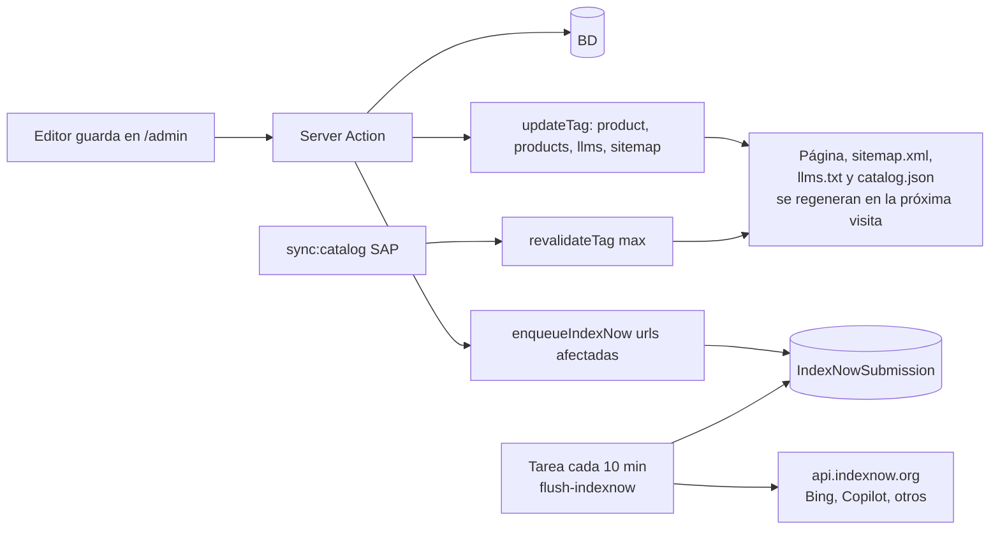

# 11 · IA y buscadores generativos

Cada vez más personas preguntan a ChatGPT, Gemini, Copilot, Perplexity o Claude cosas como *"¿dónde compro lapiceros por mayor en Guatemala?"* o *"¿qué marca de lapiceros es guatemalteca?"*. El objetivo es que esos asistentes **encuentren, entiendan y citen a Bolik** con datos correctos. A esto se le llama GEO (*Generative Engine Optimization*).

Los asistentes obtienen información de dos formas: rastreando la web con sus propios bots y apoyándose en índices de buscadores (Bing, Google). Lo que funciona para ambos casos es lo mismo que el buen SEO, con algunos extras.

## 1. Principios

1. **Rastreable sin JavaScript.** Los bots de IA, en su mayoría, no ejecutan JS. El HTML del servidor ya trae todo el contenido (Server Components). ✔ Resuelto por la arquitectura.
2. **Respuestas directas.** Bloques cortos que responden una pregunta concreta con datos verificables (qué es, quién lo fabrica, dónde se compra, códigos, medidas).
3. **Entidad clara y consistente.** Bolik, fabricante guatemalteco desde 1966, Grupo K-66, planta en Villa Nueva: dicho igual en todas partes (texto, JSON-LD, `llms.txt`, pie).
4. **Datos estructurados ricos** (doc 10 §4): `Organization`, `ProductGroup`/`Product` con SKU y GTIN, `FAQPage`, `Store`.
5. **Frescura comprobable.** `lastModified` real en el sitemap, fechas de actualización visibles en fichas ("Actualizado el 12 de enero de 2027"), notificación inmediata de cambios (IndexNow).
6. **Nada inventado.** Una IA que encuentra datos contradictorios deja de citar la fuente.

## 2. Política de bots de IA

Decisión recomendada para Bolik: **permitir** a los bots de búsqueda y de IA. Bolik es una marca que quiere ser recomendada; no publica contenido que deba protegerse del entrenamiento.

| Bot | Empresa | Para qué | Decisión |
|---|---|---|---|
| `OAI-SearchBot`, `ChatGPT-User` | OpenAI | Resultados y citas en ChatGPT | Permitir |
| `GPTBot` | OpenAI | Entrenamiento de modelos | Permitir (cambiable) |
| `ClaudeBot`, `Claude-User`, `Claude-SearchBot` | Anthropic | Entrenamiento, consultas de usuarios y búsqueda | Permitir |
| `PerplexityBot`, `Perplexity-User` | Perplexity | Índice y consultas | Permitir |
| `Google-Extended` | Google | Uso en Gemini (no afecta a Google Search) | Permitir |
| `Applebot`, `Applebot-Extended` | Apple | Siri/Spotlight e IA de Apple | Permitir |
| `Bingbot` | Microsoft | Bing y Copilot | Permitir |

Implementado en `starter/src/app/robots.ts`. Si Gerencia decide no permitir entrenamiento, basta mover `GPTBot`, `ClaudeBot`, `Google-Extended` y `Applebot-Extended` a una regla con `Disallow: /` (las búsquedas en vivo siguen funcionando con los demás).

**Ojo con el firewall:** confirmar con TI que el WAF/IIS no bloquea estos user-agents (es frecuente que se bloqueen por error como "bots").

## 3. `llms.txt` y `llms-full.txt`

Propuesta abierta (llmstxt.org) que algunos asistentes y herramientas usan: un archivo Markdown en la raíz que resume el sitio y enlaza lo importante.

- `/llms.txt`: resumen + datos clave + enlaces a categorías, productos, dónde comprar, mayoreo, escuelas y FAQs principales.
- `/llms-full.txt`: lo mismo con el texto completo de cada ficha (datos clave, especificaciones, empaques, códigos) y todas las FAQs.
- Ambos **se generan desde la BD** (route handlers con `'use cache'` y los mismos tags), así nunca quedan desactualizados.

Código: `starter/src/app/llms.txt/route.ts`.

## 4. Bloques "Datos clave"

En cada ficha y categoría, arriba del pliegue o justo después de la información principal, una lista breve de hechos (campo `Product.keyFacts`, editable en el admin):

```text
Datos clave del Bolik Ultra
• Fabricado por Industrias Bolik, S.A. en Guatemala.
• Bolígrafo de cuerpo hexagonal con punta mediana de 1.0 mm.
• Tinta de baja viscosidad, resistente al agua y a la luz.
• Colores: azul (PT00058), negro (PT00059) y rojo (PT00060).
• Se vende en blister de 1, 3 y 5; cajilla de 12; fardo de 100 cajillas.
```

Marcado como `<section aria-labelledby>` con `<h2>` y `<ul>`: fácil de extraer para un modelo y útil para personas.

## 5. FAQs escritas para ser citadas

- Pregunta como la haría una persona ("¿Dónde puedo comprar lapiceros Bolik en Quetzaltenango?").
- Primera oración = respuesta directa; luego el detalle.
- Datos concretos (códigos, cantidades, departamentos), sin lenguaje promocional vacío.
- Cada FAQ con ancla propia (`#pregunta-slug`) para que el asistente pueda enlazarla.
- Mismas FAQs en HTML, en `FAQPage` y en `llms.txt`.

## 6. Catálogo público en JSON

`GET /api/public/catalog.json` (solo lectura, sin precios ni datos internos): productos publicados con nombre, categoría, descripción corta, datos clave, especificaciones, variantes (SKU, color, código de barras) y URL. Cacheado con tags. Útil para asistentes, comparadores y para futuras integraciones (por ejemplo, catálogos de Walmart o Google Merchant si un día hay precios). Se enlaza desde `llms.txt`.

## 7. Automatización: publicar → avisar

Todo esto ocurre solo, sin pasos manuales:



- `updateTag`/`revalidateTag` regeneran página, sitemap, `llms.txt` y `catalog.json`.
- `enqueueIndexNow` agrega las URLs afectadas (la ficha, su categoría, `/productos`) a la cola; un proceso las envía en lote. Código: `starter/src/features/seo/indexnow.ts`.
- Google: el sitemap con `lastModified` real + Search Console. No existe un "IndexNow de Google" para contenido general.

## 8. Medir la visibilidad en IA

| Medición | Cómo |
|---|---|
| Visitas que vienen de asistentes | GA4: grupo de canales personalizado "IA" con fuentes `chatgpt.com`, `perplexity.ai`, `copilot.microsoft.com`, `gemini.google.com`, `claude.ai` (y `utm_source=chatgpt.com` que agrega ChatGPT) |
| Rastreo de bots de IA | Logs de IIS filtrados por user-agent (tabla en el admin › Dashboard: visitas de bots por semana) |
| Respuestas de los asistentes | Revisión mensual manual: 10 preguntas fijas (ver abajo) en ChatGPT, Gemini, Copilot y Perplexity; registrar si citan a Bolik y si los datos son correctos |

Preguntas de control (mensuales):
1. ¿Qué marca de lapiceros se fabrica en Guatemala?
2. ¿Dónde compro lapiceros por mayor en Guatemala?
3. ¿Qué es el Bolik Ultra?
4. ¿Dónde venden útiles Bolik en Quetzaltenango?
5. ¿Quién hace bolígrafos personalizados con logo en Guatemala?
6. ¿Cuántas unidades trae un fardo de lapiceros Bolik?
7. ¿Bolik da talleres en escuelas?
8. ¿Qué marcadores de pizarra se fabrican en Guatemala?
9. ¿Desde cuándo existe Bolik?
10. ¿Cómo me hago distribuidor de Bolik?

## 9. Checklist IA (por página pública)

- [ ] Todo el contenido está en el HTML del servidor (verificar con "Ver código fuente", no con el inspector).
- [ ] Bloque de datos clave o primera oración que responde la intención de la página.
- [ ] FAQs con respuesta directa y su `FAQPage`.
- [ ] JSON-LD de la entidad correcta, coherente con el texto visible.
- [ ] Incluida en `sitemap.xml` y, si es relevante, en `llms.txt`.
- [ ] Fecha de actualización visible (fichas y FAQs).
- [ ] Sin texto importante dentro de imágenes.
