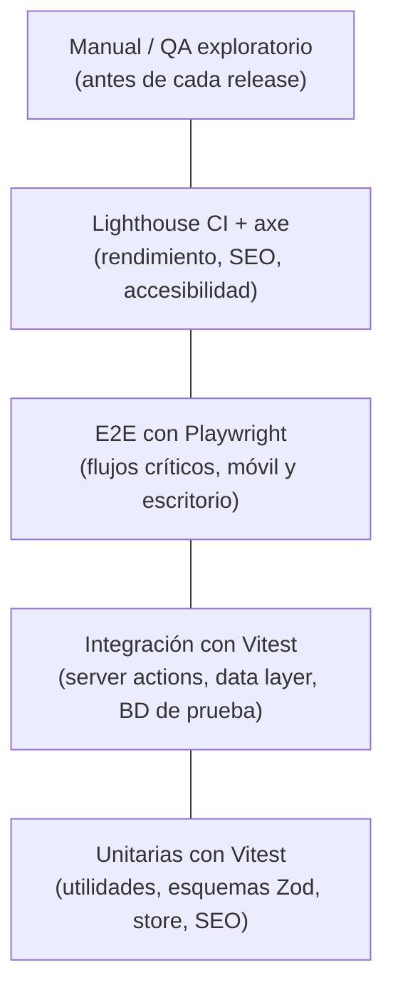

# 13 · Pruebas y calidad

Regla: **ningún ticket se cierra sin su prueba** (ver "Definición de terminado" en `CLAUDE.md`). Las pruebas corren en local y en CI; un PR con pruebas en rojo no se fusiona.

## 1. Pirámide de pruebas



| Nivel | Herramienta | Dónde | Cuándo corre | Meta |
|---|---|---|---|---|
| Estático | `tsc --noEmit`, ESLint, Prettier | todo | pre-commit + CI | 0 errores |
| Unitarias | Vitest 5 + Testing Library | `src/**/*.test.ts(x)` | pre-push + CI | ≥ 80 % de líneas en `src/lib`, `src/features/*/schema.ts`, `src/features/seo` |
| Integración | Vitest + SQL Server de prueba (Docker) | `tests/integration` | CI | Todas las server actions de formularios |
| E2E | Playwright 1.64 | `tests/e2e` | CI (contra `pnpm build && pnpm start`) | 100 % de los flujos críticos |
| Accesibilidad | `@axe-core/playwright` | dentro de E2E | CI | 0 violaciones serias/críticas |
| Rendimiento/SEO | Lighthouse CI 0.15 | `tests/lighthouserc.json` | CI + nocturno | Doc 12 §1 |
| Visual | Playwright `toHaveScreenshot` sobre `/styleguide` | `tests/visual` | CI | 0 diferencias no aprobadas |
| Enlaces y redirecciones | `scripts/check-redirects.ts`, `scripts/check-links.ts` | — | CI + antes del corte | 0 rotos |

## 2. Configuración

### Vitest (`vitest.config.mts`)

```ts
import { fileURLToPath } from "node:url";
import react from "@vitejs/plugin-react";
import { defineConfig } from "vitest/config";

export default defineConfig({
  plugins: [react()],
  resolve: {
    tsconfigPaths: true, // alias @/ nativo de Vite (sin vite-tsconfig-paths)
    alias: { "server-only": fileURLToPath(new URL("./tests/stubs/server-only.ts", import.meta.url)) },
  },
  test: {
    environment: "jsdom", // las pruebas puras declaran // @vitest-environment node (más rápidas)
    setupFiles: ["./tests/setup.ts"],
    include: ["src/**/*.test.{ts,tsx}"],
    coverage: {
      provider: "v8",
      include: ["src/lib/**/*.{ts,tsx}", "src/features/*/{schema,schemas}.ts", "src/features/seo/**/*.{ts,tsx}"],
      exclude: ["**/*.test.{ts,tsx}"],
      thresholds: { lines: 80 },
    },
  },
});
```

`.mts` para que Node la cargue como ESM. El umbral se aplica en `pnpm test:coverage`, que corre en el `pre-push` y en CI.

Integración en un proyecto aparte (`vitest.integration.config.mts`, `environment: "node"`, `include: ["tests/integration/**/*.test.ts"]`) con `DATABASE_URL` apuntando a una base `bolik_test` que se recrea con `prisma migrate reset --force` antes de la suite.

SQL Server local para pruebas:

```bash
docker run -d --name bolik-sql -e ACCEPT_EULA=Y -e MSSQL_SA_PASSWORD='Bolik_Test_2026!' \
  -p 1433:1433 mcr.microsoft.com/mssql/server:2022-latest
```

### Playwright (`playwright.config.ts`)

```ts
import { defineConfig, devices } from "@playwright/test";

export default defineConfig({
  testDir: "./tests",
  testMatch: ["e2e/**/*.spec.ts", "visual/**/*.spec.ts"],
  fullyParallel: true,
  retries: process.env.CI ? 2 : 0,
  reporter: [["html", { open: "never" }], ["list"]],
  use: { baseURL: process.env.E2E_BASE_URL ?? "http://localhost:3000", trace: "on-first-retry" },
  projects: [
    { name: "movil", use: { ...devices["Pixel 7"] } },        // primero: el sitio es mobile first
    { name: "escritorio", use: { ...devices["Desktop Chrome"] } },
    { name: "iphone", use: { ...devices["iPhone 14"] }, grep: /@critico/ },
  ],
  webServer: { command: "pnpm start", url: "http://localhost:3000", reuseExistingServer: !process.env.CI },
});
```

Datos E2E: `pnpm db:seed --profile e2e` carga categorías, 6 productos (incluye Bolik Ultra con sus 3 variantes), 2 departamentos con 4 tiendas, 1 kit y FAQs. `ERP_MODE=noop` y `SMTP_MODE=file` (los correos se escriben en `tmp/mails/*.eml` para poder verificarlos).

El splash se desactiva en E2E con `sessionStorage.setItem("bolik_splash","1")` en un `addInitScript` global, salvo en su prueba específica.

## 3. Pruebas unitarias (qué probar)

| Módulo | Casos |
|---|---|
| `features/quote/store.ts` | agregar línea; sumar cantidad si se repite SKU + empaque; quitar; cambiar cantidad (mín. 1, máx. 9999); persistencia y migración de versión; vaciar tras enviar |
| `features/quote/schema.ts` (Zod) | teléfono GT (8 dígitos, acepta `+502`, espacios y guiones); NIT opcional con formato válido o "CF"; correo; al menos 1 línea; máximo 50 líneas; honeypot vacío |
| `features/seo/jsonld.tsx` | `productLd` incluye `hasVariant` con `sku` y `gtin12` solo si el código es válido; sin `offers`; `storesLd` omite `geo` si no está verificada |
| `features/seo/metadata.ts` | canonical absoluto; título con plantilla; `noindex` respetado; descripción ≤ 160 caracteres |
| `features/seo/legacy-redirects.ts` + `proxy.ts` | cada URL de la tabla del doc 10 §6 → destino esperado; conserva `utm_*`; decodifica `%20` y mayúsculas |
| `lib/format.ts` · `lib/slug.ts` | números y fechas `es-GT` (hora de Guatemala); teléfonos GT (`normalizeGtPhone`, `formatPhone`); `slugify` con tildes y ñ |
| `lib/whatsapp.ts` | mensaje prellenado con producto, SKU, empaque y URL; codificación correcta |
| `lib/image-loader.ts` | elige el ancho generado más cercano hacia arriba; nunca un ancho inexistente |
| `content/feedback.ts` | todas las funciones devuelven título y texto no vacíos (prueba de humo) |
| `components/motion/count-up.tsx` | con `prefers-reduced-motion` muestra el valor final sin animar |

## 4. Pruebas de integración

| Server action / módulo | Casos |
|---|---|
| `submitQuote` | crea `QuoteRequest` + `QuoteItem`; folio `COT-2026-000001` y consecutivo; dos envíos simultáneos no duplican folio (`Promise.all` de 20); envía correo interno y acuse; con `ERP_MODE=smartk66` y API caída deja `erpStatus = "pendiente"` sin fallar al usuario |
| `submitSchoolVisit`, `submitDistributor`, `submitContact` | validación servidor; folio `ESC`/`DIS`; límite de 5 envíos por IP en 10 min |
| `server/folio.ts` | cambio de año reinicia el consecutivo |
| `server/data/*` | solo devuelve `published = true`; orden; relaciones |
| Acciones del admin | sin sesión → error; rol `ventas` no edita productos; guarda `AuditLog`; llama `updateTag` (mock) y `enqueueIndexNow` |
| `scripts/sync-catalog.ts` | con API simulada (MSW): crea, actualiza, desactiva variantes; registra `SyncRun`; no pisa campos editoriales |
| Subida de medios | genera 6 anchos + blur; rechaza > 10 MB y tipos no permitidos |

## 5. Pruebas E2E (flujos críticos)

Etiqueta `@critico` = corre también en iPhone y bloquea el release.

| Archivo | Flujo | Verificaciones clave |
|---|---|---|
| `home.spec.ts` @critico | Abrir `/` | H1 visible; hero con póster; capítulos navegables con teclado; CTA "Cotizar" abre drawer; sin errores de consola |
| `splash.spec.ts` | Primera visita a `/` | `html[data-splash="on"]` y desaparece en ≤ 2.3 s; segunda visita sin splash; `Escape` lo salta; en `/productos` nunca aparece; con UA `Googlebot` nunca aparece |
| `catalogo.spec.ts` | `/productos` → filtro → categoría → ficha | filtros sin recarga; URL con `?uso=`; breadcrumbs; JSON-LD presente |
| `ficha.spec.ts` @critico | Ficha Bolik Ultra | cambiar color cambia imagen y SKU visible; elegir empaque; agregar a cotización muestra toast y badge; WhatsApp abre con mensaje correcto |
| `cotizacion.spec.ts` @critico | Agregar 2 productos → `/cotizacion` → enviar | validaciones amigables; diálogo de éxito con folio; `/cotizacion/enviada`; carrito vacío; correo en `tmp/mails` |
| `cotizacion-error.spec.ts` | Servidor responde 500 (route intercept) | diálogo de error amigable; datos del formulario se conservan; botón reintentar |
| `buscador.spec.ts` | Abrir con `/` o ícono; buscar "ultra", "pt00058", "759364663092", "crayon" (sin tilde) | resultados correctos; vacío muestra sugerencias |
| `donde-comprar.spec.ts` @critico | Elegir departamento; "usar mi ubicación" (geolocalización simulada) | lista filtrada; enlace "Cómo llegar" con coordenadas; mapa carga solo al verse |
| `qr.spec.ts` | `/p/PT00058` | 301 a la ficha con `?color=azul` |
| `redirecciones.spec.ts` | Todas las URL de Joomla del mapa | 301 y destino 200 |
| `escuelas.spec.ts`, `mayoreo.spec.ts`, `contacto.spec.ts` | Envío de formularios | diálogo de éxito y registro en BD |
| `admin.spec.ts` | Login, crear producto, publicar, ver en sitio; cambiar estado de cotización | sesión; la ficha aparece sin redeploy (caché invalidada) |
| `seo.spec.ts` | Cada ruta pública | un solo H1; `<title>` y `description` únicos; canonical; `robots` correcto; `sitemap.xml`, `robots.txt`, `llms.txt` responden 200 |
| `sin-js.spec.ts` | `javaScriptEnabled: false` | home, catálogo y ficha muestran contenido completo; formularios muestran el mensaje "activa JavaScript o escríbenos por WhatsApp" |

Ejemplo:

```ts
// tests/e2e/cotizacion.spec.ts
import { test, expect } from "@playwright/test";
import AxeBuilder from "@axe-core/playwright";

test("@critico enviar cotización desde la ficha", async ({ page }) => {
  await page.goto("/productos/boligrafos/bolik-ultra");
  await page.getByRole("radio", { name: "Negro" }).check();
  await page.getByRole("radio", { name: /Cajilla de 12/ }).check();
  await page.getByRole("button", { name: "Agregar a cotización" }).click();
  await expect(page.getByRole("status")).toContainText("Agregado");
  await expect(page.getByTestId("quote-badge")).toHaveText("1");

  await page.goto("/cotizacion");
  await page.getByLabel("Nombre").fill("Ana Pérez");
  await page.getByLabel("Teléfono").fill("5555 1234");
  await page.getByLabel("Correo").fill("ana@example.com");
  await page.getByLabel("Departamento").selectOption("guatemala");
  await page.getByRole("button", { name: "Enviar cotización" }).click();

  const dialog = page.getByRole("dialog");
  await expect(dialog).toContainText(/COT-\d{4}-\d{6}/);
  const a11y = await new AxeBuilder({ page }).withTags(["wcag2a", "wcag2aa"]).analyze();
  expect(a11y.violations.filter((v) => ["serious", "critical"].includes(v.impact ?? ""))).toEqual([]);
});
```

## 6. Accesibilidad

- axe en cada spec E2E (helper `expectNoA11yViolations(page)`).
- Manual, antes de cada release: navegar home → ficha → cotización **solo con teclado**; probar con lector de pantalla (NVDA en Windows, VoiceOver en iPhone) los diálogos, toasts (`aria-live`) y el hero.
- Contraste ≥ 4.5:1 en texto (los tokens del doc 02 ya cumplen; no inventar colores).
- Zoom 200 % sin scroll horizontal; objetivos táctiles ≥ 44 × 44 px.
- `prefers-reduced-motion`: sin splash animado, sin video automático, reveals instantáneos.

## 7. Lighthouse CI

`starter/tests/lighthouserc.json` (incluido): 5 URLs, 3 corridas cada una, preset móvil, aserciones del doc 12 y `budget.json`. En CI corre contra el build de producción con datos de seed. Un fallo en SEO (< 100) o en rendimiento (< 90 en home, < 95 en el resto) bloquea el PR.

## 8. Regresión visual

`tests/visual/styleguide.spec.ts` toma capturas de cada sección de `/styleguide` (botones, tarjetas, formularios, diálogos, toasts, fondos) en móvil y escritorio, con animaciones desactivadas (`animations: "disabled"`). Si un cambio es intencional: `pnpm test:visual --update-snapshots` y el PR lo explica.

## 9. QA manual (antes de cada release)

Dispositivos mínimos: Android de gama media (Chrome), iPhone (Safari), Windows (Edge y Chrome), una tablet. Red: "Fast 4G" y "Slow 4G" en DevTools.

- [ ] Splash: aparece una vez, dura 2 s, se puede saltar, no aparece al recargar en la misma sesión.
- [ ] Hero: póster inmediato, video suave, capítulos cambian sin saltos, pausa al salir de pantalla.
- [ ] Todas las acciones dan un mensaje amigable (matriz del doc 08): agregar, quitar, enviar, error, sin conexión, copiar, ubicación denegada.
- [ ] Formularios: errores claros en español, sin perder datos, teclado numérico en teléfono.
- [ ] Imágenes nítidas en pantallas retina y sin saltos de diseño.
- [ ] Textos: sin "lorem", sin datos inventados, tildes correctas.
- [ ] Enlaces externos (Walmart, La Torre, Maps, WhatsApp, Facebook) abren en pestaña nueva y funcionan.
- [ ] Admin: los cambios aparecen en el sitio en menos de 1 minuto.
- [ ] 404 amigable con buscador; 500 amigable con WhatsApp.

## 10. Checklist de release

- [ ] CI en verde (tipos, lint, unit, integración, E2E, axe, Lighthouse, visual).
- [ ] `pnpm check:redirects` y `pnpm check:links` sin errores contra el entorno de staging.
- [ ] Migraciones probadas en una copia de la BD de producción.
- [ ] Respaldo de BD y de `D:\bolik\media` antes de desplegar.
- [ ] Variables de entorno de producción revisadas (`APP_ENV=production`, `ERP_MODE`, SMTP, `INDEXNOW_KEY`, `SESSION_SECRET`).
- [ ] QA manual completo y firmado en el ticket del release.
- [ ] Plan de reversión listo (doc 15 §8).
