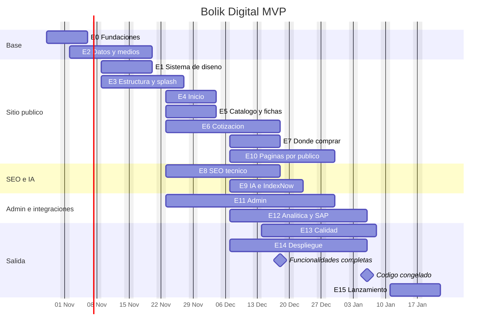

# 14 · Plan de acción

Plan para construir el MVP en **tickets pequeños**, cada uno con pasos, criterios de aceptación, dependencias y estimación. Es solo trabajo de **desarrollo**: los textos, fotos, videos, datos de tiendas y aprobaciones los entregan otras áreas y aquí solo aparecen como *dependencias externas*.

- Inicio: **miércoles 28 de octubre de 2026** · Lanzamiento: **lunes 11 de enero de 2027**.
- Los tickets también están en `tickets.csv` (para importarlos a GitHub Projects, Jira, Azure Boards o Trello).
- La numeración deja huecos por épica para insertar tickets nuevos sin renumerar.

> **Decisiones del equipo (28 oct 2026)**
> - Se implementa el **alcance completo** (los 117 tickets y los nuevos que surjan). La tabla del §7 ("núcleo") queda solo como referencia; no se pospone nada a una fase posterior y la fecha se ajusta al alcance, no al revés.
> - Equipo: un desarrollador trabajando con Claude Code.
> - Ramas `master` (producción, tags SemVer) y `develop` (integración); detalle en `CLAUDE.md` § Ramas, releases y tickets.
> - En GitHub (`Alex-Gallardo/web-bolik-60`) hay un milestone por sprint, y solo los tickets del sprint en curso se abren como Issues. Este documento y `tickets.csv` son el backlog maestro.

## 1. Cómo leer un ticket

| Campo | Significado |
|---|---|
| **ID** | `BD-NNN`. Úsalo en la rama (`feat/BD-062-ficha-variantes`) y en el commit (`feat(ficha): selector de color [BD-062]`). |
| **Sprint** | Semana(s) en que se hace. |
| **Días** | Días ideales de un desarrollador junior **trabajando con Claude Code** (incluye pruebas). 0.25 = 2 h. |
| **Prioridad** | MoSCoW: **Must** (sin esto no se lanza), **Should** (importante, se puede mover una semana), **Could** (si sobra tiempo). |
| **Depende de** | Tickets que deben estar terminados antes. |
| **Docs** | Documentos de esta guía que hay que leer (y pasarle a Claude Code). |
| **Pista** | **A** = sitio público / frontend · **B** = datos, admin, integraciones e infraestructura. |

### Definición de listo para empezar (DoR)
- Las dependencias están terminadas (o hay un *mock* acordado).
- Los docs citados están leídos y no hay preguntas abiertas que bloqueen.
- Si necesita datos de otra área (textos, fotos), ya existen o se usa el seed marcado como provisional.

### Definición de terminado (DoD)
- Cumple **todos** los criterios de aceptación.
- `pnpm typecheck`, `pnpm lint`, `pnpm test` y las E2E afectadas en verde; Lighthouse CI sin regresiones.
- Probado en móvil (390 px) y escritorio; con teclado; con movimiento reducido.
- Toda acción del usuario muestra su mensaje de `feedback.ts`.
- PR revisado y fusionado a `develop`; desplegado en staging.
- Si cambió algo de la guía (decisión, ruta, tabla), el doc correspondiente se actualizó en el mismo PR.

## 2. Equipo y capacidad

La suma de todos los tickets es **86.75 días-persona** (Must 77 · Should 8.5 · Could 1.25). Entre el 28 de octubre y el 8 de enero hay **50 días hábiles** por persona (descontando feriados de fin de año).

| Escenario | Viable para el 11 de enero | Cómo |
|---|---|---|
| **Recomendado: 2 desarrolladores** (pista A y pista B) + apoyo puntual de TI (servidor, DNS, BD) | **Sí**, con margen para imprevistos | Cada sprint tiene ~20 días de capacidad (2 × 10). Ver tabla §3. |
| **1 desarrollador** | **No** con este alcance | Aun recortando al **núcleo** (§7, ~71 días) el lanzamiento realista sería alrededor del **10 de febrero de 2027**. |

Si solo hay una persona, la decisión (de Gerencia, no del desarrollador) es: sumar un segundo desarrollador desde S1, o mover la fecha y lanzar el núcleo. **No** se recortan pruebas ni rendimiento para ganar tiempo: es mejor lanzar con menos páginas que con un sitio lento o con errores.

## 3. Calendario de sprints

| Sprint | Fechas | Objetivo | Días (A / B) |
|---|---|---|---|
| **S0** | mié 28 oct – vie 6 nov 2026 | Fundaciones, CI y staging | 9.25 (4.25 / 5) |
| **S1** | lun 9 nov – vie 20 nov | Sistema de diseño, datos, estructura global | 15.25 (9.25 / 6) |
| **S2** | lun 23 nov – vie 4 dic | Home, catálogo, ficha, cotización, SEO base | 19.5 (11.25 / 8.25) |
| **S3** | lun 7 dic – vie 18 dic | Dónde comprar, páginas por público, admin, IA · **congelamiento de funcionalidades** | 20.5 (10 / 10.5) |
| **S4** | lun 21 dic – vie 8 ene 2027 | Estabilización, pruebas, contenido, producción · feriados 24-25 dic y 31 dic-1 ene · **código congelado el 6 ene** | 19.25 (7.5 / 11.75) |
| **S5** | lun 11 ene – vie 22 ene 2027 | **Lanzamiento** e hipercuidado | 3 (1 / 2) |

### Hitos

| Fecha | Hito | Se verifica con |
|---|---|---|
| vie 6 nov | Repositorio, CI y staging funcionando | Despliegue de BD-016 visible en staging |
| vie 20 nov | `/styleguide`, layout global, splash y datos con seed | Revisión de `/styleguide` en staging |
| vie 4 dic | Sitio navegable: home, catálogo, ficha, cotización de punta a punta | Demo interna en staging; Lighthouse móvil ≥ 90 |
| vie 18 dic | **Funcionalidades completas** (no entra nada nuevo) | Todos los Must de S0–S3 cerrados |
| mié 6 ene | **Código congelado**, versión candidata en staging | Ensayo del corte (BD-151) + QA (BD-135) firmados |
| lun 11 ene | **Lanzamiento** | Runbook del doc 16 |
| vie 22 ene | Fin del hipercuidado | Reporte de cierre (BD-153) |

## 4. Mapa del plan

### Ruta crítica
`BD-001 → BD-010 → BD-030 → BD-031 → BD-032 → BD-062 → BD-070 → BD-071 → BD-072 → BD-073 → BD-075 → BD-131 → BD-135 → BD-151 → BD-152`

Si algo de esta cadena se atrasa más de 2 días, se avisa el mismo día y se recorta primero lo **Could**, luego lo **Should**.

### Dependencias externas (no son tickets de desarrollo, pero bloquean)

| Qué | Quién lo entrega | Necesario para | Fecha límite |
|---|---|---|---|
| Servidor Windows de staging y producción, Node LTS, IIS con ARR/URL Rewrite | TI | BD-016, BD-140 | 4 nov / 7 dic |
| Bases `BolikDigital_Stg` y `BolikDigital` + usuarios SQL | DBA | BD-016, BD-140 | 4 nov / 7 dic |
| Cuenta SMTP `web@bolik66.com` | TI | BD-074 | 27 nov |
| Endpoints de SMART-K66 (`/api/web/articulos`, `/api/web/prospectos`) | TI / SMART-K66 | BD-036, BD-128 | 18 dic (si no, modo `noop`) |
| Textos, fotos, videos del hero, tiendas verificadas, datos de kits | Otras áreas | BD-150 (mientras tanto: seed provisional) | 18 dic |
| Acceso a Search Console, GA4, DNS de bolik66.com | TI / dueño de la cuenta | BD-096, BD-125, BD-152 | 18 dic |
| Exportación de URLs con tráfico del sitio actual | Dueño de Search Console | BD-094 | 4 dic |

## 5. Resumen por épica

| Épica | Nombre | Tickets | Días |
|---|---|---|---|
| E0 | Fundaciones del repositorio | 16 | 8.75 |
| E1 | Sistema de diseño y /styleguide | 8 | 6 |
| E2 | Datos, medios e integración base | 7 | 7.5 |
| E3 | Estructura global, splash y movimiento | 7 | 3.75 |
| E4 | Inicio | 6 | 4 |
| E5 | Catálogo, fichas y búsqueda | 8 | 7.5 |
| E6 | Cotización y formularios | 8 | 7 |
| E7 | Dónde comprar | 4 | 3 |
| E8 | SEO técnico | 8 | 4.25 |
| E9 | IA y automatización de indexación | 5 | 2.25 |
| E10 | Páginas por público e institucionales | 8 | 4.75 |
| E11 | Panel administrativo | 11 | 11 |
| E12 | Analítica e integración SAP | 4 | 2.25 |
| E13 | Calidad y pruebas | 6 | 6.5 |
| E14 | Despliegue y operación | 6 | 4 |
| E15 | Lanzamiento e hipercuidado | 5 | 4.25 |
| | **Total** | **117** | **86.75** |

## 6. Tickets

### E0 · Fundaciones del repositorio

#### BD-001 · Crear el proyecto Next.js 16 y el repositorio

**Sprint** S0 · **Días** 0.5 · **Prioridad** Must · **Pista** A · **Depende de** — · **Docs** 01, 04

Proyecto base con TypeScript, Tailwind v4, App Router, carpeta src y pnpm.

**Pasos**

1. `pnpm create next-app@latest bolik-digital --ts --tailwind --eslint --app --src-dir --import-alias "@/*" --use-pnpm`
2. Agregar `.nvmrc` (Node LTS ≥ 20.9) y `.npmrc` con `save-exact=true`.
3. Copiar `CLAUDE.md` a la raíz y `docs/` a `/docs`.
4. Primer commit en la rama `master`; crear la rama `develop`.

**Criterios de aceptación**

- [ ] `pnpm dev` abre la página por defecto.
- [ ] `pnpm build` termina sin errores.
- [ ] `CLAUDE.md` y `docs/` están en el repo.

#### BD-002 · TypeScript estricto, ESLint y Prettier

**Sprint** S0 · **Días** 0.5 · **Prioridad** Must · **Pista** A · **Depende de** BD-001 · **Docs** 04

Reglas de calidad que Claude Code y el junior deben respetar desde el primer día.

**Pasos**

1. `tsconfig.json`: `strict`, `noUncheckedIndexedAccess`, `noImplicitOverride`.
2. `eslint.config.mjs`: `next/core-web-vitals`, `next/typescript`, regla `no-restricted-imports` que prohíbe `framer-motion` y `motion/react` fuera de `src/components/motion`.
3. Prettier + `prettier-plugin-tailwindcss`.
4. Scripts `lint`, `typecheck` del doc 04 §5.

**Criterios de aceptación**

- [ ] `pnpm lint` y `pnpm typecheck` pasan.
- [ ] Importar `motion/react` en una página da error de lint.

#### BD-003 · Ganchos de git: Husky, lint-staged y commits convencionales

**Sprint** S0 · **Días** 0.25 · **Prioridad** Should · **Pista** A · **Depende de** BD-002 · **Docs** 18

Evita subir código sin formato o con errores de tipos.

**Pasos**

1. Instalar `husky`, `lint-staged`, `@commitlint/cli`, `@commitlint/config-conventional`.
2. pre-commit: lint-staged (eslint --fix + prettier en archivos cambiados).
3. pre-push: `pnpm typecheck && pnpm test`.

**Criterios de aceptación**

- [ ] Un commit con mensaje `cambios` es rechazado; `feat(home): hero` se acepta.

#### BD-004 · next.config.ts base

**Sprint** S0 · **Días** 0.5 · **Prioridad** Must · **Pista** A · **Depende de** BD-001 · **Docs** 03, 15

Configuración de producción: Cache Components, salida standalone, loader de imágenes y cabeceras.

**Pasos**

1. Copiar `starter/next.config.ts`.
2. Verificar `cacheComponents: true`, `output: "standalone"`, `images.loader: "custom"`, `poweredByHeader: false`, `typedRoutes: true`.
3. Dejar las cabeceras de seguridad en modo report-only hasta BD-142.

**Criterios de aceptación**

- [ ] `pnpm build` genera `.next/standalone/server.js`.
- [ ] La respuesta no incluye `X-Powered-By`.

#### BD-005 · Variables de entorno tipadas

**Sprint** S0 · **Días** 0.5 · **Prioridad** Must · **Pista** B · **Depende de** BD-001 · **Docs** 03 §9

Si falta una variable, la app falla al arrancar con un mensaje claro.

**Pasos**

1. Copiar `starter/src/env.ts` y `starter/.env.example`.
2. Crear `.env.local` (no se sube a git).
3. Prohibir `process.env` fuera de `src/env.ts` (regla de lint).

**Criterios de aceptación**

- [ ] Quitar `DATABASE_URL` hace fallar `pnpm dev` con el nombre de la variable.
- [ ] `.env.local` está en `.gitignore`.

#### BD-006 · Estructura de carpetas

**Sprint** S0 · **Días** 0.25 · **Prioridad** Must · **Pista** A · **Depende de** BD-001 · **Docs** 04 §1

Crear el árbol de carpetas acordado para que todo tenga un lugar.

**Pasos**

1. Crear las carpetas del doc 04 §1 con un `README.md` corto en `features/`, `server/` y `components/`.
2. Crear los grupos de rutas `(site)` y `(admin)`.

**Criterios de aceptación**

- [ ] El árbol coincide con el doc 04.
- [ ] `pnpm build` sigue pasando.

#### BD-007 · Tokens CSS, movimiento y fondos

**Sprint** S0 · **Días** 0.5 · **Prioridad** Must · **Pista** A · **Depende de** BD-006 · **Docs** 02, 08, 09

Base visual: colores, tipos, espacios, duraciones, curvas y fondos.

**Pasos**

1. Copiar `starter/src/styles/*` y `starter/src/app/globals.css`.
2. Comprobar que las clases `bg-blue`, `text-ink`, `rounded-lg`, `shadow-md` funcionan.
3. No crear colores fuera de los tokens.

**Criterios de aceptación**

- [ ] Una página de prueba usa los tokens y se ve igual que la demo HTML.
- [ ] No hay variables CSS que se refieran a sí mismas.

#### BD-008 · Fuentes con next/font

**Sprint** S0 · **Días** 0.25 · **Prioridad** Must · **Pista** A · **Depende de** BD-007 · **Docs** 02, 12

Bricolage Grotesque y DM Sans en todo el sitio; Baloo 2 solo en `/escuelas`.

**Pasos**

1. `src/app/fonts.ts` con `next/font/google`, `display: "swap"`, `subsets: ["latin"]`, variables `--font-bricolage`, `--font-dm-sans`, `--font-baloo`.
2. Aplicar Baloo 2 solo en el layout de escuelas.

**Criterios de aceptación**

- [ ] La home descarga como máximo 4 archivos woff2.
- [ ] Sin peticiones a fonts.googleapis.com en el navegador.

#### BD-009 · Utilidades y constantes base

**Sprint** S0 · **Días** 0.5 · **Prioridad** Must · **Pista** A · **Depende de** BD-006 · **Docs** 04, 05

Funciones puras reutilizables con sus pruebas.

**Pasos**

1. `lib/cn.ts`, `lib/format.ts` (es-GT), `lib/slugify.ts`, `lib/whatsapp.ts`.
2. Copiar `lib/constants.ts` y `lib/cache-tags.ts` del starter.
3. Pruebas unitarias de cada función (doc 13 §3).

**Criterios de aceptación**

- [ ] `pnpm test` pasa con cobertura ≥ 80 % en `src/lib`.

#### BD-010 · Prisma 7 con SQL Server

**Sprint** S0 · **Días** 1 · **Prioridad** Must · **Pista** B · **Depende de** BD-005 · **Docs** 05 §4

Conexión a la BD con el adaptador oficial y el primer esquema.

**Pasos**

1. Levantar SQL Server local con Docker (doc 13 §2).
2. Instalar `prisma`, `@prisma/client`, `@prisma/adapter-mssql`.
3. Copiar `prisma.config.ts`, `prisma/schema.prisma` y `src/server/db.ts` del doc 05/starter.
4. `pnpm db:migrate --name init` y `pnpm prisma generate`.

**Criterios de aceptación**

- [ ] Existe la migración inicial en `prisma/migrations`.
- [ ] `pnpm db:studio` muestra todas las tablas.
- [ ] `db` solo se importa desde `src/server/**` (`import "server-only"`).

#### BD-011 · Logs y manejo de errores

**Sprint** S0 · **Días** 0.5 · **Prioridad** Must · **Pista** B · **Depende de** BD-005 · **Docs** 03, 15

Errores con contexto en el servidor y pantallas amigables para el visitante.

**Pasos**

1. `server/log.ts` con `pino` (JSON en producción, legible en desarrollo).
2. `app/(site)/error.tsx`, `app/global-error.tsx` con el texto de `feedback.system`.
3. Cada server action registra errores con un `requestId` que también se muestra al usuario.

**Criterios de aceptación**

- [ ] Un error forzado muestra la pantalla amigable y deja una línea de log con `requestId`.

#### BD-012 · Configurar Vitest

**Sprint** S0 · **Días** 0.5 · **Prioridad** Must · **Pista** A · **Depende de** BD-002 · **Docs** 13 §2

Pruebas unitarias e integración listas para usar.

**Pasos**

1. Instalar `vitest`, `@vitejs/plugin-react`, `vite-tsconfig-paths`, `jsdom`, `@testing-library/react`.
2. Crear `vitest.config.ts` y `vitest.integration.config.ts` del doc 13.

**Criterios de aceptación**

- [ ] `pnpm test` y `pnpm test:int` corren (aunque sea con una prueba de ejemplo).

#### BD-013 · Configurar Playwright y axe

**Sprint** S0 · **Días** 0.5 · **Prioridad** Must · **Pista** A · **Depende de** BD-001 · **Docs** 13 §2

Pruebas de punta a punta en móvil y escritorio.

**Pasos**

1. `pnpm create playwright` y `@axe-core/playwright`.
2. Copiar `playwright.config.ts` del doc 13.
3. Helper `tests/e2e/helpers.ts` con `expectNoA11yViolations` y `skipSplash`.

**Criterios de aceptación**

- [ ] `pnpm test:e2e` corre una prueba de humo en los 2 proyectos.

#### BD-014 · Integración continua

**Sprint** S0 · **Días** 1 · **Prioridad** Must · **Pista** B · **Depende de** BD-012, BD-013 · **Docs** 13, 15

Cada PR se valida solo.

**Pasos**

1. Pipeline (GitHub Actions o Azure DevOps): install con caché de pnpm → typecheck → lint → test → build → test:e2e → lhci.
2. Servicio SQL Server en el pipeline para integración/E2E.
3. Publicar el `.next/standalone` como artefacto.
4. Protección de rama: PR obligatorio + CI en verde.

**Criterios de aceptación**

- [ ] Un PR con un error de tipos queda en rojo.
- [ ] El artefacto descargado arranca con `node server.js`.

#### BD-015 · Lighthouse CI con presupuestos

**Sprint** S0 · **Días** 0.5 · **Prioridad** Must · **Pista** B · **Depende de** BD-014 · **Docs** 12, 13 §7

Rendimiento y SEO vigilados en cada PR.

**Pasos**

1. Copiar `starter/tests/lighthouserc.json`.
2. Agregar el paso `pnpm lhci` al pipeline.

**Criterios de aceptación**

- [ ] Un PR que agrega 200 KB de JS a la home falla.
- [ ] El reporte queda adjunto al PR.

#### BD-016 · Entorno de staging en IIS

**Sprint** S0 · **Días** 1 · **Prioridad** Must · **Pista** B · **Depende de** BD-004, BD-014 · **Docs** 15

Un lugar real donde probar desde la primera semana (con apoyo de TI).

**Pasos**

1. Sitio IIS `staging-bolik` (solo red interna o con IP permitida) con ARR + URL Rewrite hacia `localhost:3100`.
2. Servicio Windows `BolikDigital-Staging` (NSSM o PM2) ejecutando `node server.js`.
3. BD `BolikDigital_Stg`; carpeta `D:\bolik-stg\media`.
4. Despliegue manual del artefacto de BD-014 siguiendo doc 15 §5.

**Criterios de aceptación**

- [ ] `https://staging.bolik66.com` (o la URL interna) muestra la app con HTTPS.
- [ ] `X-Robots-Tag: noindex` presente en staging.

### E1 · Sistema de diseño y /styleguide

#### BD-020 · Componente Section con fondos configurables

**Sprint** S1 · **Días** 0.5 · **Prioridad** Must · **Pista** A · **Depende de** BD-007 · **Docs** 08 §3

Toda sección del sitio usa `Section` con fondo y tono elegibles.

**Pasos**

1. `components/layout/section.tsx` y `container.tsx` (código en doc 08).
2. Props: `bg` (9 presets), `tone`, `spacing`, `id`, `as`.
3. Leer la apariencia por sección desde `SectionAppearance` cuando exista `appearanceKey`.

**Criterios de aceptación**

- [ ] Los 9 fondos se ven en `/styleguide`.
- [ ] Cambiar el fondo en BD cambia la sección sin tocar código.

#### BD-021 · Botones

**Sprint** S1 · **Días** 0.5 · **Prioridad** Must · **Pista** A · **Depende de** BD-007 · **Docs** 08 §2

Botón único con variantes para todo el sitio.

**Pasos**

1. `components/ui/button.tsx` con `cva`: primary, secondary, outline, ghost, whatsapp, danger; tamaños sm, md, lg; `loading`; `asChild`.
2. Clase `.press` (A-01) y foco visible.

**Criterios de aceptación**

- [ ] Contraste AA en todas las variantes.
- [ ] `loading` deshabilita y anuncia "Enviando…" a lectores de pantalla.

#### BD-022 · Controles de formulario

**Sprint** S1 · **Días** 1 · **Prioridad** Must · **Pista** A · **Depende de** BD-021 · **Docs** 08 §2

Patrón único de formularios con React Hook Form y Zod.

**Pasos**

1. `Field` (label, ayuda, error con `aria-describedby`), `Input`, `Textarea`, `Select`, `RadioCards`, `Checkbox`, `PhoneInput` (+502, teclado numérico), `QuantityStepper`.
2. Error con animación `.shake` (A-12) y foco al primer error.

**Criterios de aceptación**

- [ ] Navegable solo con teclado.
- [ ] Errores en español desde `feedback.forms`.

#### BD-023 · Tarjetas, badges, chips y skeletons

**Sprint** S1 · **Días** 1 · **Prioridad** Must · **Pista** A · **Depende de** BD-021 · **Docs** 08 §2

Piezas de catálogo y listas.

**Pasos**

1. `ProductCard`, `CategoryCard`, `AudienceCard`, `StoreCard`, `Badge`, `Chip`, `Skeleton`.
2. Imágenes con proporción fija y `sizes` correctos.

**Criterios de aceptación**

- [ ] CLS 0 al cargar una grilla de 12 tarjetas.
- [ ] Efecto `.lift` solo con hover real (`@media (hover:hover)`).

#### BD-024 · Alertas amigables: Toaster y FriendlyDialog

**Sprint** S1 · **Días** 1 · **Prioridad** Must · **Pista** A · **Depende de** BD-021 · **Docs** 08 §4

Toda acción del usuario tiene un mensaje claro y amable.

**Pasos**

1. `components/feedback/toaster.tsx` (sonner, abajo-centro en móvil).
2. `FriendlyDialog` (Radix Dialog) con ilustración, título, texto, acción principal y secundaria.
3. Hook `useFeedback()` que toma los textos de `content/feedback.ts`.
4. Aviso de "sin conexión" y "conexión recuperada".

**Criterios de aceptación**

- [ ] Cada fila de la matriz del doc 08 §4 tiene un ejemplo en `/styleguide`.
- [ ] Toasts anunciados con `aria-live`.

#### BD-025 · Overlays: Sheet, Dialog, Tabs, Accordion

**Sprint** S1 · **Días** 0.5 · **Prioridad** Must · **Pista** A · **Depende de** BD-021 · **Docs** 08, 09

Componentes de Radix/shadcn con nuestras animaciones.

**Pasos**

1. Agregar con `pnpm dlx shadcn@latest add dialog sheet tabs accordion popover`.
2. Reemplazar sus animaciones por los presets del doc 09.

**Criterios de aceptación**

- [ ] Escape cierra; el foco vuelve al disparador.
- [ ] Con `prefers-reduced-motion` aparecen sin desplazamiento.

#### BD-026 · Vista /styleguide

**Sprint** S1 · **Días** 1 · **Prioridad** Must · **Pista** A · **Depende de** BD-020, BD-021, BD-022, BD-023, BD-024, BD-025 · **Docs** 08 §6

Vitrina interna con todos los componentes reales.

**Pasos**

1. `app/(site)/styleguide/page.tsx` con las 13 secciones del doc 08 §6.
2. `noindex`, fuera del sitemap, bloqueada en robots.
3. En producción solo visible con sesión de admin.

**Criterios de aceptación**

- [ ] Todas las secciones renderizan sin errores de consola.
- [ ] En producción sin sesión responde 404.

#### BD-027 · Logo e ilustraciones

**Sprint** S1 · **Días** 0.5 · **Prioridad** Must · **Pista** A · **Depende de** BD-007 · **Docs** 02

Logo como componente SVG y las ilustraciones de los diálogos.

**Pasos**

1. `components/brand/logo.tsx` con variantes `full`, `mark`, `mono`, `inverse`.
2. Ilustraciones SVG en línea (éxito, error, vacío, sin conexión) optimizadas con SVGO.

**Criterios de aceptación**

- [ ] Cada SVG pesa < 4 KB.
- [ ] El logo tiene `aria-label="Bolik"`.

### E2 · Datos, medios e integración base

#### BD-030 · Esquema completo y migraciones

**Sprint** S0 · **Días** 0.5 · **Prioridad** Must · **Pista** B · **Depende de** BD-010 · **Docs** 05

Todas las tablas del MVP.

**Pasos**

1. Usar `starter/prisma/schema.prisma` completo.
2. `pnpm db:migrate --name schema_mvp`.
3. Revisar índices del doc 05 §6.

**Criterios de aceptación**

- [ ] `prisma validate` OK.
- [ ] La migración se aplica en una BD vacía y en staging.

#### BD-031 · Seeds con datos reales

**Sprint** S1 · **Días** 1.5 · **Prioridad** Must · **Pista** B · **Depende de** BD-030 · **Docs** 05 §7, 17

Datos reales para desarrollar y probar (nada de lorem).

**Pasos**

1. `prisma/seed/*.json`: categorías, productos (Bolik Ultra y su ficha), variantes y empaques, tiendas reales, departamentos, FAQs, contenido de la home, admin inicial.
2. Perfiles `--profile dev` y `--profile e2e`.
3. El seed es idempotente (`upsert`).

**Criterios de aceptación**

- [ ] `pnpm db:seed` dos veces seguidas no duplica datos.
- [ ] El Bolik Ultra tiene PT00058/59/60 con sus códigos de barras.

#### BD-032 · Capa de datos con Cache Components

**Sprint** S1 · **Días** 1.5 · **Prioridad** Must · **Pista** B · **Depende de** BD-031 · **Docs** 03 §5

Consultas de lectura cacheadas con tags.

**Pasos**

1. `server/data/{products,categories,stores,content,faqs,sitemap,llms,search}.ts`.
2. Cada función con `'use cache'`, `cacheLife('max')` y `cacheTag` de `lib/cache-tags.ts`.
3. Devolver tipos de vista (`ProductView`, `StoreView`) en lugar de modelos de Prisma.

**Criterios de aceptación**

- [ ] El build prerenderiza las páginas públicas sin consultar la BD en cada petición.
- [ ] Pruebas de integración de las funciones.

#### BD-033 · Folios consecutivos

**Sprint** S1 · **Días** 0.5 · **Prioridad** Must · **Pista** B · **Depende de** BD-030 · **Docs** 05 §5

COT/ESC/DIS-AAAA-NNNNNN sin duplicados.

**Pasos**

1. Copiar `starter/src/server/folio.ts`.
2. Prueba de concurrencia: 20 envíos simultáneos.

**Criterios de aceptación**

- [ ] 20 folios distintos y consecutivos.
- [ ] El 1 de enero reinicia el consecutivo.

#### BD-034 · Procesamiento de imágenes

**Sprint** S1 · **Días** 1.5 · **Prioridad** Must · **Pista** B · **Depende de** BD-030 · **Docs** 03 §7

Imágenes rápidas: se procesan una sola vez al subir.

**Pasos**

1. `server/media/process-image.ts`: sharp → WebP en 320/480/640/960/1280/1920 + `blurDataURL` + hash.
2. Guardar en `MEDIA_DIR` y registrar `MediaAsset`.
3. `lib/image-loader.ts` (starter) y `images.loaderFile` en `next.config.ts`.
4. Script `scripts/import-media.ts` para cargar en lote las fotos actuales.

**Criterios de aceptación**

- [ ] Una foto de 4 MB genera 6 archivos y la de 640 pesa < 60 KB.
- [ ] `next/image` pide el ancho correcto según `sizes`.

#### BD-035 · Gateway del ERP

**Sprint** S1 · **Días** 1 · **Prioridad** Must · **Pista** B · **Depende de** BD-030 · **Docs** 03 §6, 05 §9

La web nunca depende de que SAP o SMART-K66 estén arriba.

**Pasos**

1. `server/erp/gateway.ts` (interfaz), `noop.ts`, `smartk66.ts` (fetch con timeout 8 s y 3 reintentos con backoff).
2. Seleccionar por `ERP_MODE`.
3. Mocks con MSW para pruebas.

**Criterios de aceptación**

- [ ] Con `ERP_MODE=noop` todo funciona.
- [ ] Con la API simulada caída, la cotización se guarda con `erpStatus = pendiente`.

#### BD-036 · Sincronización del catálogo con SAP

**Sprint** S4 · **Días** 1 · **Prioridad** Should · **Pista** B · **Depende de** BD-035, BD-032 · **Docs** 03 §6

Códigos, nombres, códigos de barras y estado activo vienen de SAP.

**Pasos**

1. `scripts/sync-catalog.ts`: lee `/api/web/articulos`, actualiza `ProductVariant`, nunca pisa campos editoriales.
2. Registra `SyncRun` con conteos.
3. Llama `revalidateTag(tag, 'max')` en lo que cambió.

**Criterios de aceptación**

- [ ] Un artículo inactivo en SAP se marca `inactivo` y sale del sitio.
- [ ] El resultado aparece en `/admin/sincronizacion`.

### E3 · Estructura global, splash y movimiento

#### BD-040 · Layout raíz del sitio

**Sprint** S1 · **Días** 0.5 · **Prioridad** Must · **Pista** A · **Depende de** BD-008, BD-024 · **Docs** 06 §2

HTML base, metadatos raíz y proveedores mínimos.

**Pasos**

1. `app/layout.tsx`: `<html lang="es-GT">`, fuentes, `rootMetadata`, enlace "Saltar al contenido".
2. `app/(site)/layout.tsx`: Header, `<main id="contenido">`, Footer, Toaster, RevealObserver.
3. Script del splash en `<head>`.

**Criterios de aceptación**

- [ ] Una sola etiqueta `<main>` por página.
- [ ] JS compartido ≤ 90 KB gzip.

#### BD-041 · Header y menú móvil

**Sprint** S1 · **Días** 1 · **Prioridad** Must · **Pista** A · **Depende de** BD-040, BD-025 · **Docs** 06 §2

Navegación principal con acceso a buscar y a la cotización.

**Pasos**

1. Header fijo que se compacta al bajar (A-20) y se oculta/aparece por dirección de scroll en móvil.
2. Badge de cotización con `badge-pop` (A-05).
3. Menú móvil en `Sheet` con enlaces grandes y CTA de WhatsApp.

**Criterios de aceptación**

- [ ] Sin CLS al compactarse.
- [ ] El menú se cierra al navegar y devuelve el foco.

#### BD-042 · Footer y botones flotantes

**Sprint** S1 · **Días** 0.5 · **Prioridad** Must · **Pista** A · **Depende de** BD-040 · **Docs** 06 §2

Pie con datos de la empresa y flotantes de WhatsApp y volver arriba.

**Pasos**

1. Footer con dirección, teléfono, redes, enlaces legales, razón social desde `SiteSetting`.
2. Botón WhatsApp flotante (se oculta cuando el drawer o el teclado están abiertos).

**Criterios de aceptación**

- [ ] Teléfono con `tel:` y WhatsApp con mensaje prellenado.
- [ ] Los flotantes no tapan el CTA principal en móvil.

#### BD-043 · Splash de 2 segundos

**Sprint** S1 · **Días** 0.5 · **Prioridad** Must · **Pista** A · **Depende de** BD-040 · **Docs** 09 §splash

Animación del logo antes del hero, sin afectar SEO ni LCP.

**Pasos**

1. Copiar `starter/src/components/layout/splash.tsx`.
2. Inyectar el script en `<head>` y el SVG al inicio del `<body>`.
3. Leer `splash_enabled` de `SiteSetting` en `data-splash-enabled`.

**Criterios de aceptación**

- [ ] Prueba E2E `splash.spec.ts` en verde.
- [ ] Lighthouse no cambia el LCP con splash activo vs. inactivo (± 100 ms).

#### BD-044 · Revelado al hacer scroll, cifras y transiciones

**Sprint** S1 · **Días** 0.5 · **Prioridad** Must · **Pista** A · **Depende de** BD-040 · **Docs** 09

Movimiento suave hecho con CSS.

**Pasos**

1. Copiar `reveal-observer.tsx` y `count-up.tsx`.
2. Transición de entrada de página con `.page-enter`.

**Criterios de aceptación**

- [ ] Sin JS el contenido se ve completo.
- [ ] Con movimiento reducido no hay animaciones.

#### BD-045 · MotionProvider diferido

**Sprint** S1 · **Días** 0.25 · **Prioridad** Must · **Pista** A · **Depende de** BD-040 · **Docs** 09

Motion solo donde CSS no alcanza.

**Pasos**

1. `components/motion/provider.tsx` con `LazyMotion` + `domAnimation` (carga diferida) y presets.
2. Solo `m.*` en componentes.

**Criterios de aceptación**

- [ ] Motion no aparece en el JS inicial de la home (bundle analyzer).

#### BD-046 · Páginas 404 y 500

**Sprint** S2 · **Días** 0.5 · **Prioridad** Must · **Pista** B · **Depende de** BD-040, BD-032 · **Docs** 06 §3.19, 10 §6

Errores amables que ayudan a seguir navegando.

**Pasos**

1. `not-found.tsx`: busca redirección en BD (tabla `Redirect`); si no hay, registra `NotFoundLog` y muestra buscador + categorías.
2. `error.tsx` con WhatsApp y "Reintentar".

**Criterios de aceptación**

- [ ] Una URL vieja registrada en `Redirect` responde 301.
- [ ] Las demás registran el 404 con contador.

### E4 · Inicio

#### BD-050 · Hero con video por capítulos

**Sprint** S2 · **Días** 1.5 · **Prioridad** Must · **Pista** A · **Depende de** BD-032, BD-034, BD-044 · **Docs** 06 §3.1, 09

El hero de la demo, llevado a producción.

**Pasos**

1. Copiar `starter/src/components/hero/video-hero.tsx`.
2. Datos desde `HeroChapter` (título, texto, CTA, póster, video).
3. Póster del capítulo 1 con `priority` (es el LCP).
4. Video solo tras `load`, en ocioso y sin Save-Data/2g/3g/movimiento reducido.

**Criterios de aceptación**

- [ ] LCP de la home ≤ 2.0 s en Lighthouse móvil.
- [ ] Capítulos navegables con flechas del teclado.
- [ ] El video se pausa fuera de pantalla.

#### BD-051 · Soluciones por público y categorías

**Sprint** S2 · **Días** 0.5 · **Prioridad** Must · **Pista** A · **Depende de** BD-023, BD-032 · **Docs** 06 §3.1

Accesos rápidos a lo que busca cada visitante.

**Pasos**

1. "Un Bolik para cada etapa": 5 tarjetas (Colegios, Universidades, Empresas, Librerías, Distribuidores) y 8 categorías con buscador grande (doc 06 §3.1, secciones 3–4).
2. Eventos `solution_click` y `category_click`.

**Criterios de aceptación**

- [ ] Las tarjetas enlazan a rutas reales.
- [ ] Revelado escalonado (A-30).

#### BD-052 · Producto estrella y cifras

**Sprint** S2 · **Días** 0.5 · **Prioridad** Must · **Pista** A · **Depende de** BD-051 · **Docs** 06 §3.1

Bolik Ultra destacado y cifras de la empresa.

**Pasos**

1. Bloque del Ultra con colores, empaques y CTA "Cotizar" / "Dónde comprar".
2. Cifras desde `SiteStat` con `CountUp`.

**Criterios de aceptación**

- [ ] El servidor renderiza los números finales (SEO).
- [ ] Solo se muestran cifras con `isVerified = true`.

#### BD-053 · Dónde comprar, escuelas e historia en la home

**Sprint** S2 · **Días** 0.5 · **Prioridad** Must · **Pista** A · **Depende de** BD-051 · **Docs** 06 §3.1

Resúmenes que llevan a las páginas internas.

**Pasos**

1. Resumen de puntos de venta con cadenas y compra en línea.
2. Bloque de escuelas con estilo infantil.
3. Bloque de historia (1966 → hoy).

**Criterios de aceptación**

- [ ] Los enlaces externos llevan `rel="noopener"` y registran `retailer_click`.

#### BD-054 · FAQ, CTA final y apariencia por sección

**Sprint** S2 · **Días** 0.5 · **Prioridad** Must · **Pista** A · **Depende de** BD-051, BD-020 · **Docs** 06 §3.1

Cierre de la home y fondos editables.

**Pasos**

1. Bloque de kits escolares (solo si hay kits publicados).
2. 6 FAQs (scope `home`) con `FAQPage`.
3. CTA final a cotización y WhatsApp.
4. Cada sección lee su fondo desde `SectionAppearance`.

**Criterios de aceptación**

- [ ] Cambiar el fondo en el admin se refleja en la home tras guardar.

#### BD-055 · Ajuste de rendimiento de la home

**Sprint** S2 · **Días** 0.5 · **Prioridad** Must · **Pista** A · **Depende de** BD-050, BD-054 · **Docs** 12

La home cumple los presupuestos.

**Pasos**

1. Bundle analyzer; mover a carga diferida lo que no se ve arriba.
2. Lighthouse móvil 3 corridas.

**Criterios de aceptación**

- [ ] JS inicial ≤ 120 KB gzip.
- [ ] Rendimiento ≥ 90, SEO 100, CLS ≤ 0.05.

### E5 · Catálogo, fichas y búsqueda

#### BD-060 · Catálogo /productos

**Sprint** S2 · **Días** 1 · **Prioridad** Must · **Pista** A · **Depende de** BD-023, BD-032 · **Docs** 06 §3.2

Todos los productos con filtros por uso.

**Pasos**

1. Server Component con la grilla completa.
2. Isla cliente para filtros (uso, línea, color) que actualiza la URL (`?uso=oficina`) sin recargar.
3. Estado vacío amigable.

**Criterios de aceptación**

- [ ] Filtrar no hace peticiones al servidor.
- [ ] La URL con filtros se puede compartir.

#### BD-061 · Página de categoría

**Sprint** S2 · **Días** 0.5 · **Prioridad** Must · **Pista** A · **Depende de** BD-060 · **Docs** 06 §3.3, 10

Página optimizada para búsquedas como "crayones de cera Guatemala".

**Pasos**

1. Intro SEO desde `Category`, grilla, FAQs de la categoría, enlaces a categorías hermanas.
2. `generateStaticParams` para las 8 categorías.

**Criterios de aceptación**

- [ ] Título y descripción únicos.
- [ ] BreadcrumbList válido.

#### BD-062 · Ficha de producto: información y variantes

**Sprint** S2 · **Días** 2 · **Prioridad** Must · **Pista** A · **Depende de** BD-061, BD-034 · **Docs** 06 §3.4

La página más importante para SEO y cotización.

**Pasos**

1. Galería (A-40) con zoom en escritorio y deslizamiento en móvil.
2. Selector de color → cambia imagen, SKU, código de barras y URL (`?color=`).
3. Selector de empaque (blister 1/3/5, cajilla 12, fardo).
4. Datos clave, especificaciones, beneficios, usos.
5. Botones: Agregar a cotización, WhatsApp, Dónde comprar.

**Criterios de aceptación**

- [ ] Todo el contenido está en el HTML del servidor.
- [ ] Cambiar color no recarga la página.
- [ ] JSON-LD `ProductGroup` con variantes válido.

#### BD-063 · Ficha: medidas, relacionados y dónde comprar

**Sprint** S2 · **Días** 1 · **Prioridad** Should · **Pista** A · **Depende de** BD-062 · **Docs** 06 §3.4

Información de apoyo para decidir.

**Pasos**

1. Diagrama de medidas desde `ProductDimension` (evento `dimension_open`).
2. Productos relacionados (`ProductRelation`).
3. Bloque "Dónde comprar este producto" (cadenas + enlace al localizador).

**Criterios de aceptación**

- [ ] El diagrama es accesible (tabla alternativa).

#### BD-064 · PDF de ficha técnica

**Sprint** S4 · **Días** 1 · **Prioridad** Could · **Pista** A · **Depende de** BD-062 · **Docs** 06 §3.4

Descarga de la ficha técnica generada desde la BD.

**Pasos**

1. Route handler `/productos/[categoria]/[producto]/ficha.pdf` con `@react-pdf/renderer`.
2. Cacheado con el tag del producto.

**Criterios de aceptación**

- [ ] El PDF refleja los datos actuales.
- [ ] Evento `pdf_download`.

#### BD-065 · Acceso por QR /p/[codigo]

**Sprint** S2 · **Días** 0.25 · **Prioridad** Must · **Pista** B · **Depende de** BD-062 · **Docs** 06 §3.5

El QR del empaque abre la ficha correcta.

**Pasos**

1. `/p/[codigo]` busca la variante por SKU o código de barras y responde 301 a la ficha con `?color=`.

**Criterios de aceptación**

- [ ] `/p/PT00058` → ficha del Ultra azul.
- [ ] Código inexistente → 404 amigable.

#### BD-066 · Buscador

**Sprint** S2 · **Días** 1.5 · **Prioridad** Must · **Pista** B · **Depende de** BD-032, BD-025 · **Docs** 06 §3.6, 07

Búsqueda instantánea por nombre, código o código de barras.

**Pasos**

1. `/api/search-index` (JSON cacheado con tags).
2. Overlay con atajo `/` y `Ctrl+K`; Fuse.js se carga al enfocar.
3. Normalizar tildes; sinónimos (lapicero = bolígrafo).
4. Página `/buscar?q=` (noindex) como respaldo sin JS.

**Criterios de aceptación**

- [ ] "ultra", "pt00058", "759364663092" y "crayon" encuentran resultados.
- [ ] Sin resultados: sugerencias + WhatsApp.

#### BD-067 · WhatsApp contextual

**Sprint** S2 · **Días** 0.25 · **Prioridad** Must · **Pista** A · **Depende de** BD-009 · **Docs** 07

Mensajes prellenados según dónde esté el visitante.

**Pasos**

1. `lib/whatsapp.ts` con plantillas (producto, cotización, general) y número desde `SiteSetting`.

**Criterios de aceptación**

- [ ] El mensaje incluye producto, SKU, empaque y URL.
- [ ] Evento `whatsapp_open`.

### E6 · Cotización y formularios

#### BD-070 · Estado de la cotización

**Sprint** S2 · **Días** 0.5 · **Prioridad** Must · **Pista** A · **Depende de** BD-024 · **Docs** 07 §2.3

Lista de productos a cotizar que se guarda en el navegador.

**Pasos**

1. Copiar `starter/src/features/quote/store.ts`.
2. Acciones: agregar, quitar, cambiar cantidad, vaciar; badge en el header.

**Criterios de aceptación**

- [ ] Recargar la página conserva la lista.
- [ ] Pruebas unitarias del doc 13 §3.

#### BD-071 · Drawer de cotización

**Sprint** S2 · **Días** 1 · **Prioridad** Must · **Pista** A · **Depende de** BD-070, BD-045 · **Docs** 06, 09

Ver y editar la cotización sin salir de la página.

**Pasos**

1. Sheet lateral (escritorio) / inferior (móvil) cargado al primer uso.
2. Editar cantidades, quitar con deshacer (toast), ir a enviar.

**Criterios de aceptación**

- [ ] Abrir el drawer no carga más de 30 KB adicionales.
- [ ] Deshacer restaura la línea.

#### BD-072 · Página /cotizacion y formulario

**Sprint** S2 · **Días** 1 · **Prioridad** Must · **Pista** A · **Depende de** BD-071, BD-022 · **Docs** 06 §3.16

Formulario corto para pedir la cotización.

**Pasos**

1. Tipo de cliente (librería, empresa, institución, otro) que ajusta los campos.
2. Borrador del formulario guardado en `sessionStorage`.
3. Esquema Zod compartido cliente/servidor (`features/quote/schema.ts`).

**Criterios de aceptación**

- [ ] Formulario completo en ≤ 6 campos obligatorios.
- [ ] Teclado numérico en teléfono.

#### BD-073 · Enviar cotización (server action)

**Sprint** S2 · **Días** 1.5 · **Prioridad** Must · **Pista** B · **Depende de** BD-072, BD-033, BD-035 · **Docs** 03 §6

Guardar, notificar y enviar a SAP sin hacer esperar al visitante.

**Pasos**

1. `features/quote/actions.ts` → `submitQuote`: Zod, honeypot, tiempo mínimo, rate limit, folio, transacción.
2. `after()` para correos y ERP (no bloquean la respuesta).
3. Devolver `{ ok, folio }` o errores por campo.

**Criterios de aceptación**

- [ ] Respuesta en < 800 ms con SMTP y ERP lentos.
- [ ] Pruebas de integración del doc 13 §4.

#### BD-074 · Correos de notificación

**Sprint** S2 · **Días** 1 · **Prioridad** Must · **Pista** B · **Depende de** BD-073 · **Docs** 17

Ventas recibe la cotización y el cliente un acuse.

**Pasos**

1. `server/mail/transport.ts` (nodemailer; `SMTP_MODE=file` en desarrollo).
2. Plantillas HTML simples y compatibles con Outlook: interna y acuse.

**Criterios de aceptación**

- [ ] El correo interno incluye folio, cliente, líneas y enlace al admin.
- [ ] El acuse no contiene datos internos.

#### BD-075 · Confirmación de envío

**Sprint** S3 · **Días** 0.5 · **Prioridad** Must · **Pista** A · **Depende de** BD-073 · **Docs** 06 §3.17

Cierre claro con folio y siguientes pasos.

**Pasos**

1. Diálogo de éxito con folio (ilustración + confeti ligero CSS, A-15).
2. `/cotizacion/enviada/[folio]` (noindex, dinámica) con resumen y botón WhatsApp.

**Criterios de aceptación**

- [ ] El carrito queda vacío.
- [ ] Evento `quote_submit`.

#### BD-076 · Formularios de escuelas, distribuidores y contacto

**Sprint** S3 · **Días** 1 · **Prioridad** Must · **Pista** B · **Depende de** BD-073 · **Docs** 06

Mismo patrón, distinto destino.

**Pasos**

1. Server actions `submitSchoolVisit`, `submitDistributor`, `submitContact` reutilizando validación y anti-spam.
2. Folios ESC y DIS; correo a la bandeja correspondiente.

**Criterios de aceptación**

- [ ] Cada formulario muestra su diálogo de éxito.
- [ ] Registros visibles en el admin.

#### BD-077 · Anti-spam compartido

**Sprint** S3 · **Días** 0.5 · **Prioridad** Must · **Pista** B · **Depende de** BD-073 · **Docs** 03 §8

Proteger formularios sin captcha molesto.

**Pasos**

1. `server/rate-limit.ts`: 5 envíos/10 min por hash de IP (memoria + respaldo en BD).
2. Honeypot y tiempo mínimo de 3 s.

**Criterios de aceptación**

- [ ] El sexto envío en 10 min recibe un mensaje amable.
- [ ] Un bot que llena el honeypot recibe éxito falso y no se guarda.

### E7 · Dónde comprar

#### BD-080 · Dónde comprar: lista y filtros

**Sprint** S3 · **Días** 1 · **Prioridad** Must · **Pista** A · **Depende de** BD-032, BD-023 · **Docs** 06 §3.7

Encontrar una tienda cercana en segundos.

**Pasos**

1. Selector de departamento, lista de tiendas, cadenas con compra en línea.
2. "Cómo llegar" abre Maps con coordenadas.

**Criterios de aceptación**

- [ ] Funciona sin JS (lista completa).
- [ ] Eventos `store_filter`, `maps_click`, `retailer_click`.

#### BD-081 · Mapa y "cerca de mí"

**Sprint** S3 · **Días** 1 · **Prioridad** Should · **Pista** A · **Depende de** BD-080 · **Docs** 06 §3.7

Mapa interactivo que no pesa en la carga inicial.

**Pasos**

1. `react-leaflet` cargado cuando el mapa entra en pantalla.
2. Geolocalización opcional: ordena por distancia; si se niega, mensaje amable.

**Criterios de aceptación**

- [ ] El JS del mapa no está en la carga inicial.
- [ ] Permiso denegado muestra el selector de departamento.

#### BD-082 · Páginas por departamento

**Sprint** S3 · **Días** 0.5 · **Prioridad** Must · **Pista** A · **Depende de** BD-080 · **Docs** 06 §3.8, 10

Una página por departamento con tiendas (SEO local).

**Pasos**

1. `/donde-comprar/[departamento]` con `generateStaticParams`.
2. JSON-LD `ItemList` de `Store`.

**Criterios de aceptación**

- [ ] Solo se generan departamentos con al menos 1 tienda.
- [ ] Títulos tipo "Dónde comprar Bolik en Quetzaltenango".

#### BD-083 · Registro de clics salientes

**Sprint** S3 · **Días** 0.5 · **Prioridad** Must · **Pista** A · **Depende de** BD-030 · **Docs** 12 §4

Medir cuántas personas van a una tienda o cadena.

**Pasos**

1. `/api/beacon` (POST, `sendBeacon`) → `OutboundClick` con destino, producto, departamento.
2. Sin datos personales; responde 204.

**Criterios de aceptación**

- [ ] Un clic a Walmart crea una fila.
- [ ] El endpoint rechaza cuerpos > 2 KB.

### E8 · SEO técnico

#### BD-090 · Metadatos en todas las rutas

**Sprint** S2 · **Días** 1 · **Prioridad** Must · **Pista** B · **Depende de** BD-032 · **Docs** 10 §3

Título, descripción, canonical y Open Graph correctos.

**Pasos**

1. Copiar `features/seo/metadata.ts`; `generateMetadata` en cada página.
2. `opengraph-image` por producto y categoría (imagen generada con el nombre y la foto).

**Criterios de aceptación**

- [ ] Títulos y descripciones únicos en todo el sitio (prueba `seo.spec.ts`).
- [ ] Canonical absoluto con `www`.

#### BD-091 · Datos estructurados JSON-LD

**Sprint** S2 · **Días** 0.5 · **Prioridad** Must · **Pista** B · **Depende de** BD-090 · **Docs** 10 §4

Datos que Google y las IA entienden.

**Pasos**

1. Copiar `features/seo/jsonld.tsx` y usarlo en cada plantilla.
2. Validar con la Prueba de resultados enriquecidos y validator.schema.org.

**Criterios de aceptación**

- [ ] 0 errores en las plantillas: home, categoría, ficha, FAQ, dónde comprar.
- [ ] Capturas de la validación adjuntas al ticket.

#### BD-092 · sitemap.xml y robots.txt

**Sprint** S2 · **Días** 0.25 · **Prioridad** Must · **Pista** B · **Depende de** BD-032 · **Docs** 10 §5

Mapa del sitio con fechas reales y reglas para bots.

**Pasos**

1. Copiar `app/sitemap.ts` y `app/robots.ts`.

**Criterios de aceptación**

- [ ] El sitemap solo incluye páginas publicadas e indexables.
- [ ] En staging robots bloquea todo.

#### BD-093 · Migas de pan y enlazado interno

**Sprint** S2 · **Días** 0.5 · **Prioridad** Must · **Pista** B · **Depende de** BD-061 · **Docs** 10 §7

Ayuda a usuarios y buscadores a entender la jerarquía.

**Pasos**

1. Componente `Breadcrumbs` visible + `BreadcrumbList`.
2. Bloques de enlaces relacionados (categorías hermanas, productos relacionados, departamentos).

**Criterios de aceptación**

- [ ] Ninguna página pública queda a más de 3 clics de la home.

#### BD-094 · Redirecciones desde el sitio Joomla

**Sprint** S3 · **Días** 1 · **Prioridad** Must · **Pista** B · **Depende de** BD-046 · **Docs** 10 §6

No perder el posicionamiento ganado por el sitio actual.

**Pasos**

1. Rastrear el sitio actual (Screaming Frog o script) y exportar URLs con tráfico desde Search Console.
2. Completar `features/seo/legacy-redirects.ts` y la tabla `Redirect`.
3. `scripts/check-redirects.ts`: verifica 301 y destino 200.

**Criterios de aceptación**

- [ ] 100 % de las URLs con tráfico redirigen a una página equivalente.
- [ ] `pnpm check:redirects` en verde.

#### BD-095 · Pruebas automáticas de SEO

**Sprint** S3 · **Días** 0.5 · **Prioridad** Must · **Pista** A · **Depende de** BD-090, BD-013 · **Docs** 13 §5

Que nadie rompa el SEO sin darse cuenta.

**Pasos**

1. `seo.spec.ts` y `sin-js.spec.ts` del doc 13.

**Criterios de aceptación**

- [ ] Corren en CI y bloquean el PR si fallan.

#### BD-096 · Search Console y Bing Webmaster

**Sprint** S5 · **Días** 0.25 · **Prioridad** Must · **Pista** A · **Depende de** BD-152 · **Docs** 10 §8

Dar de alta y enviar el sitemap el día del lanzamiento.

**Pasos**

1. Verificar la propiedad por DNS (con TI).
2. Enviar `sitemap.xml` en ambos.
3. Cambio de dirección no aplica (mismo dominio).

**Criterios de aceptación**

- [ ] Sitemap procesado sin errores en ambos.
- [ ] Inspección de URL de home y ficha: "La URL está en Google" o en cola.

#### BD-097 · SEO de imágenes

**Sprint** S2 · **Días** 0.25 · **Prioridad** Must · **Pista** B · **Depende de** BD-034 · **Docs** 10 §8

Imágenes que también posicionan.

**Pasos**

1. `alt` obligatorio en `ProductImage` (desde el admin).
2. Nombre de archivo descriptivo (`bolik-ultra-azul-1.webp`).
3. Imágenes de producto en el sitemap.

**Criterios de aceptación**

- [ ] Ninguna `` sin `alt` (axe).

### E9 · IA y automatización de indexación

#### BD-100 · llms.txt y llms-full.txt

**Sprint** S3 · **Días** 0.5 · **Prioridad** Should · **Pista** B · **Depende de** BD-032 · **Docs** 11 §3

Resumen del sitio para asistentes de IA.

**Pasos**

1. Copiar `app/llms.txt/route.ts`; crear `app/llms-full.txt/route.ts`.
2. Cachear con los mismos tags.

**Criterios de aceptación**

- [ ] Responden 200 con `text/markdown`.
- [ ] Cambiar un producto actualiza el archivo.

#### BD-101 · Catálogo público en JSON

**Sprint** S3 · **Días** 0.5 · **Prioridad** Should · **Pista** B · **Depende de** BD-032 · **Docs** 11 §6

Datos de producto legibles por máquinas.

**Pasos**

1. `/api/public/catalog.json` sin precios ni datos internos.
2. Enlazado desde `llms.txt`.

**Criterios de aceptación**

- [ ] El JSON valida contra el tipo `PublicCatalog`.
- [ ] No expone campos internos (prueba).

#### BD-102 · IndexNow

**Sprint** S3 · **Días** 0.5 · **Prioridad** Should · **Pista** B · **Depende de** BD-030 · **Docs** 11 §7

Avisar a Bing y otros apenas cambie algo.

**Pasos**

1. Archivo de clave en `public/`.
2. `features/seo/indexnow.ts` (starter) y `scripts/flush-indexnow.ts`.
3. Llamar `enqueueIndexNow` desde las acciones del admin.

**Criterios de aceptación**

- [ ] Publicar un producto encola sus URLs.
- [ ] El flush marca `enviada` con respuesta 200/202.

#### BD-103 · Datos clave, anclas de FAQ y fechas visibles

**Sprint** S3 · **Días** 0.5 · **Prioridad** Must · **Pista** A · **Depende de** BD-062 · **Docs** 11 §4–5

Contenido fácil de citar.

**Pasos**

1. Bloque "Datos clave" desde `Product.keyFacts`.
2. Cada FAQ con ancla propia.
3. "Actualizado el …" en fichas y FAQs (desde `updatedAt`).

**Criterios de aceptación**

- [ ] Checklist IA del doc 11 §9 completo en ficha y categoría.

#### BD-104 · Canal de IA en analítica y bots en logs

**Sprint** S4 · **Días** 0.25 · **Prioridad** Could · **Pista** B · **Depende de** BD-125 · **Docs** 11 §8

Medir cuánto tráfico llega desde asistentes.

**Pasos**

1. Grupo de canales "IA" en GA4.
2. Consulta de logs de IIS por user-agent de bots de IA (script).

**Criterios de aceptación**

- [ ] El canal aparece en GA4.
- [ ] El script lista visitas de bots por semana.

### E10 · Páginas por público e institucionales

#### BD-105 · Bolik en tu escuela

**Sprint** S3 · **Días** 1 · **Prioridad** Must · **Pista** A · **Depende de** BD-076, BD-020 · **Docs** 06 §3.9

Página con estilo infantil y formulario de visita.

**Pasos**

1. Layout con Baloo 2 y subpaleta infantil.
2. Actividades desde `SchoolActivity`.
3. Formulario de visita (BD-076).

**Criterios de aceptación**

- [ ] Animaciones lúdicas (A-50…) solo con transform/opacity.
- [ ] Lighthouse ≥ 95.

#### BD-106 · Mayoreo y distribuidores

**Sprint** S3 · **Días** 0.5 · **Prioridad** Must · **Pista** A · **Depende de** BD-076 · **Docs** 06 §3.10

Información para librerías y solicitud de distribuidor.

**Pasos**

1. Empaques y ventajas, pasos para ser distribuidor, formulario.

**Criterios de aceptación**

- [ ] CTA a cotización con tipo "librería" preseleccionado.

#### BD-107 · Empresas y universidades

**Sprint** S3 · **Días** 0.5 · **Prioridad** Must · **Pista** A · **Depende de** BD-072 · **Docs** 06 §3.11

Bolígrafos personalizados con logo.

**Pasos**

1. Proceso, pedido mínimo (`SiteSetting`), CTA a cotización tipo "empresa".

**Criterios de aceptación**

- [ ] El pedido mínimo se edita desde el admin.

#### BD-108 · Kits escolares

**Sprint** S4 · **Días** 1 · **Prioridad** Should · **Pista** A · **Depende de** BD-070 · **Docs** 06 §3.12

Kits por grado que se agregan completos a la cotización.

**Pasos**

1. Lista de kits desde `Kit` + `KitItem`; precio solo si `priceVisible`.
2. Sin kits publicados: "Próximamente" y `noindex`.
3. "Agregar kit" agrega una línea tipo kit.

**Criterios de aceptación**

- [ ] Kits con `published = false` no aparecen ni en sitemap.

#### BD-109 · Nuestra historia

**Sprint** S4 · **Días** 0.5 · **Prioridad** Should · **Pista** A · **Depende de** BD-044 · **Docs** 06 §3.13

Línea de tiempo desde 1966.

**Pasos**

1. Hitos desde `HistoryMilestone`; solo los verificados muestran fecha exacta.

**Criterios de aceptación**

- [ ] Revelado por hito sin CLS.

#### BD-110 · Preguntas frecuentes

**Sprint** S3 · **Días** 0.5 · **Prioridad** Must · **Pista** A · **Depende de** BD-103 · **Docs** 06 §3.14

Todas las FAQs agrupadas.

**Pasos**

1. Acordeón por grupo con anclas; `FAQPage`.

**Criterios de aceptación**

- [ ] El contenido de las respuestas está en el HTML aunque el acordeón esté cerrado.

#### BD-111 · Contacto

**Sprint** S3 · **Días** 0.5 · **Prioridad** Must · **Pista** A · **Depende de** BD-076 · **Docs** 06 §3.15

Datos de contacto y formulario.

**Pasos**

1. Mapa estático (imagen), horarios, teléfono, WhatsApp, formulario.

**Criterios de aceptación**

- [ ] Sin librerías de mapa en esta página.

#### BD-112 · Páginas legales

**Sprint** S3 · **Días** 0.25 · **Prioridad** Must · **Pista** A · **Depende de** BD-040 · **Docs** 06 §3.18

Privacidad, términos y cookies.

**Pasos**

1. `/legal/[slug]` desde BD (texto entregado por Legal).

**Criterios de aceptación**

- [ ] Enlazadas desde el footer y los formularios.

### E11 · Panel administrativo

#### BD-114 · Acceso al admin (iron-session)

**Sprint** S2 · **Días** 1 · **Prioridad** Must · **Pista** B · **Depende de** BD-030 · **Docs** 03 §8, 01 ADR-08

Inicio de sesión seguro para el equipo interno.

**Pasos**

1. Copiar `starter/src/server/auth/*`.
2. `/admin/login` con server action, bloqueo tras 5 intentos.
3. `requireRole()` en cada página y acción; `proxy.ts` redirige sin cookie.
4. Script `pnpm admin:create` para el primer usuario.

**Criterios de aceptación**

- [ ] Sin sesión, `/admin/*` redirige a login.
- [ ] Rol `ventas` no puede editar productos (prueba).
- [ ] Cookie `httpOnly`, `secure`, `sameSite=lax`.

#### BD-115 · Layout del admin y dashboard

**Sprint** S3 · **Días** 1 · **Prioridad** Must · **Pista** A · **Depende de** BD-114 · **Docs** 06 §4, 12 §6

Panel con indicadores principales.

**Pasos**

1. Menú lateral/inferior, encabezado con usuario.
2. Tarjetas del doc 12 §6 (consultas directas, sin caché).

**Criterios de aceptación**

- [ ] Carga del dashboard < 1 s con datos de prueba.

#### BD-116 · Editor de productos

**Sprint** S3 · **Días** 2.5 · **Prioridad** Must · **Pista** B · **Depende de** BD-115, BD-034 · **Docs** 06 §4

Crear y editar fichas completas sin tocar código.

**Pasos**

1. Tabs del doc 06 §4; SKU y código de barras solo lectura.
2. Subir y ordenar imágenes con `alt` obligatorio.
3. Guardar → `updateTag` + `enqueueIndexNow` + `AuditLog`.
4. Vista previa de Google (título y descripción).

**Criterios de aceptación**

- [ ] Publicar un producto lo muestra en el sitio en < 1 min sin redeploy.
- [ ] Toast en cada guardado; confirmación al despublicar.

#### BD-117 · Categorías y FAQs

**Sprint** S3 · **Días** 0.5 · **Prioridad** Must · **Pista** A · **Depende de** BD-115 · **Docs** 06 §4

Textos SEO de categorías y preguntas frecuentes.

**Pasos**

1. CRUD con orden por arrastre.

**Criterios de aceptación**

- [ ] Cambios invalidan los tags correctos.

#### BD-118 · Tiendas

**Sprint** S4 · **Días** 1 · **Prioridad** Must · **Pista** B · **Depende de** BD-115 · **Docs** 06 §4

Mantener el localizador al día.

**Pasos**

1. CRUD, marcar verificada, elegir ubicación en mapa.
2. Importar/exportar CSV.

**Criterios de aceptación**

- [ ] Importar 200 tiendas en < 10 s con reporte de errores por fila.

#### BD-119 · Bandeja de cotizaciones

**Sprint** S3 · **Días** 1.5 · **Prioridad** Must · **Pista** B · **Depende de** BD-115, BD-073 · **Docs** 06 §4, 07 §2.9

Ventas atiende cotizaciones desde un solo lugar.

**Pasos**

1. Tabla por estado con filtros; detalle con líneas; asignar, cambiar estado, notas.
2. Reintentar envío a SAP; exportar CSV.

**Criterios de aceptación**

- [ ] Cambiar estado registra `AuditLog`.
- [ ] Exportación con tildes correctas en Excel (UTF-8 con BOM).

#### BD-120 · Bandejas de escuelas, distribuidores y mensajes

**Sprint** S4 · **Días** 0.5 · **Prioridad** Must · **Pista** B · **Depende de** BD-119 · **Docs** 06 §4

Mismo patrón que cotizaciones.

**Pasos**

1. Reutilizar la tabla y el detalle genéricos.

**Criterios de aceptación**

- [ ] Estados y exportación funcionan en las 3 bandejas.

#### BD-121 · Contenido, apariencia y ajustes

**Sprint** S4 · **Días** 1.5 · **Prioridad** Must · **Pista** B · **Depende de** BD-115, BD-050 · **Docs** 06 §4

Hero, cifras, historia, actividades, fondos por sección y ajustes.

**Pasos**

1. Formularios de contenido con "Ver en el sitio".
2. Apariencia: fondo por sección con vista previa.
3. Ajustes: WhatsApp, teléfonos, redes, correos, splash on/off, pedido mínimo.

**Criterios de aceptación**

- [ ] Apagar el splash desde ajustes lo desactiva en la siguiente visita.

#### BD-122 · Biblioteca de medios

**Sprint** S4 · **Días** 0.5 · **Prioridad** Must · **Pista** B · **Depende de** BD-034, BD-115 · **Docs** 06 §4

Subir y reutilizar imágenes y videos.

**Pasos**

1. Grilla con búsqueda; subida con progreso; validación de tipo y tamaño.

**Criterios de aceptación**

- [ ] Archivo inválido → mensaje amable; nunca se guarda.

#### BD-123 · Redirecciones y 404

**Sprint** S4 · **Días** 0.5 · **Prioridad** Must · **Pista** B · **Depende de** BD-046, BD-115 · **Docs** 10 §6

Corregir enlaces rotos sin desplegar.

**Pasos**

1. CRUD de `Redirect`; lista de 404 frecuentes con "Crear redirección".

**Criterios de aceptación**

- [ ] Una redirección creada funciona de inmediato.

#### BD-124 · Usuarios, auditoría y sincronización

**Sprint** S4 · **Días** 0.5 · **Prioridad** Should · **Pista** B · **Depende de** BD-114, BD-036 · **Docs** 06 §4

Administración del propio panel.

**Pasos**

1. CRUD de usuarios y roles, desbloquear.
2. Bitácora filtrable.
3. Historial de `SyncRun` y "Sincronizar ahora".

**Criterios de aceptación**

- [ ] Solo el rol admin ve estas vistas.

### E12 · Analítica e integración SAP

#### BD-125 · GA4, Clarity y función track()

**Sprint** S3 · **Días** 0.5 · **Prioridad** Must · **Pista** A · **Depende de** BD-040 · **Docs** 12 §4

Medición sin afectar la velocidad.

**Pasos**

1. `features/analytics/track.ts`; GA4 con `@next/third-parties`; Clarity con `lazyOnload`.
2. Solo en producción (`APP_ENV`).

**Criterios de aceptación**

- [ ] Ningún script de analítica en el JS inicial bloqueante.
- [ ] Eventos visibles en DebugView.

#### BD-126 · Web Vitals de usuarios reales

**Sprint** S3 · **Días** 0.25 · **Prioridad** Must · **Pista** A · **Depende de** BD-125 · **Docs** 12 §5

Saber cómo carga el sitio en teléfonos reales.

**Pasos**

1. `web-vitals.tsx` con `useReportWebVitals` → evento `web_vital`.

**Criterios de aceptación**

- [ ] LCP, INP, CLS y TTFB llegan a GA4 con la ruta.

#### BD-127 · Eventos de analítica en toda la interfaz

**Sprint** S4 · **Días** 0.5 · **Prioridad** Must · **Pista** B · **Depende de** BD-125 · **Docs** 12 §4

Completar la tabla de eventos.

**Pasos**

1. Agregar `track()` en cada punto del doc 12 §4.
2. Prueba E2E que intercepta `track` y valida nombres.

**Criterios de aceptación**

- [ ] 25 eventos implementados sin datos personales.

#### BD-128 · Conexión real con SMART-K66

**Sprint** S4 · **Días** 1 · **Prioridad** Should · **Pista** B · **Depende de** BD-035 · **Docs** 05 §9

Cuando TI publique la API, activar el modo real.

**Pasos**

1. Probar contrato con TI en staging.
2. `ERP_MODE=smartk66`; `scripts/retry-erp.ts` para pendientes.

**Criterios de aceptación**

- [ ] Una cotización de staging crea el prospecto en SAP de pruebas.
- [ ] Si la API no está lista, queda en `noop` y el ticket pasa a Fase 1.1.

### E13 · Calidad y pruebas

#### BD-130 · Completar pruebas unitarias e integración

**Sprint** S4 · **Días** 1.5 · **Prioridad** Must · **Pista** B · **Depende de** BD-073, BD-116 · **Docs** 13 §3–4

Cobertura de lo que puede romperse.

**Pasos**

1. Implementar las tablas del doc 13 §3 y §4 que falten.

**Criterios de aceptación**

- [ ] Cobertura ≥ 80 % en `src/lib` y `src/features`.
- [ ] Suite de integración < 3 min.

#### BD-131 · Suite E2E de flujos críticos

**Sprint** S4 · **Días** 1.5 · **Prioridad** Must · **Pista** A · **Depende de** BD-075, BD-080 · **Docs** 13 §5

Los flujos que generan negocio, probados en móvil y escritorio.

**Pasos**

1. Todos los archivos de la tabla del doc 13 §5.

**Criterios de aceptación**

- [ ] Todos los `@critico` en verde en Pixel 7, iPhone 14 y escritorio.

#### BD-132 · Revisión de accesibilidad manual

**Sprint** S4 · **Días** 0.5 · **Prioridad** Must · **Pista** A · **Depende de** BD-131 · **Docs** 13 §6

Lo que axe no detecta.

**Pasos**

1. Recorrido con teclado y lector de pantalla; zoom 200 %.

**Criterios de aceptación**

- [ ] Hallazgos corregidos o documentados con ticket.

#### BD-133 · Regresión visual de /styleguide

**Sprint** S4 · **Días** 0.5 · **Prioridad** Should · **Pista** A · **Depende de** BD-026 · **Docs** 13 §8

Detectar cambios visuales no deseados.

**Pasos**

1. `tests/visual/styleguide.spec.ts` con capturas por sección en móvil y escritorio.

**Criterios de aceptación**

- [ ] Corre en CI; un cambio de color en un token hace fallar la prueba.

#### BD-134 · Auditoría final de rendimiento

**Sprint** S4 · **Días** 1 · **Prioridad** Must · **Pista** A · **Depende de** BD-055, BD-121 · **Docs** 12

Cumplir los presupuestos con contenido real.

**Pasos**

1. Lighthouse en staging con datos y medios reales.
2. WebPageTest móvil desde Latinoamérica.

**Criterios de aceptación**

- [ ] Todas las páginas cumplen el doc 12 §1–2.

#### BD-135 · QA manual en dispositivos

**Sprint** S4 · **Días** 1.5 · **Prioridad** Must · **Pista** A · **Depende de** BD-131 · **Docs** 13 §9

Probar como lo hará la gente.

**Pasos**

1. Checklist del doc 13 §9 en los dispositivos mínimos.
2. Registrar y corregir hallazgos.

**Criterios de aceptación**

- [ ] Checklist firmado en el ticket; 0 errores bloqueantes.

### E14 · Despliegue y operación

#### BD-140 · Servidor de producción

**Sprint** S3 · **Días** 1 · **Prioridad** Must · **Pista** B · **Depende de** BD-016 · **Docs** 15 §2–4

IIS + Node listos para el tráfico real (con TI).

**Pasos**

1. Mismo esquema que staging: servicio `BolikDigital`, sitio IIS, TLS, HTTP/2, compresión, `/media` estático.
2. Usuario de Windows con permisos mínimos.

**Criterios de aceptación**

- [ ] El servicio se reinicia solo tras un fallo y tras reiniciar Windows.

#### BD-141 · Pipeline de despliegue

**Sprint** S3 · **Días** 1 · **Prioridad** Must · **Pista** B · **Depende de** BD-014, BD-140 · **Docs** 15 §5

Desplegar con un solo comando y poder volver atrás.

**Pasos**

1. Agente de build dentro de la red interna (el build lee la BD); un build por entorno.
2. Script `deploy.ps1`: copiar artefacto a `releases/<fecha>`, `prisma migrate deploy`, cambiar enlace `current`, reiniciar servicio, prueba de humo.
3. Conservar las 5 últimas versiones; `rollback.ps1` (doc 15 §8).

**Criterios de aceptación**

- [ ] Despliegue a staging en < 5 min.
- [ ] Volver a la versión anterior en < 2 min.

#### BD-142 · Cabeceras de seguridad y CSP

**Sprint** S3 · **Días** 0.5 · **Prioridad** Must · **Pista** B · **Depende de** BD-004 · **Docs** 15 §6

Proteger el sitio sin romper la analítica.

**Pasos**

1. Cabeceras y CSP del doc 15 §6 en `next.config.ts` (primero como Report-Only en staging).
2. HSTS en IIS.
3. Revisar la consola en todas las plantillas con GA4, Clarity y el mapa activos.

**Criterios de aceptación**

- [ ] securityheaders.com: nota A.
- [ ] Sin errores de CSP en consola.

#### BD-143 · Respaldos y prueba de restauración

**Sprint** S4 · **Días** 0.5 · **Prioridad** Must · **Pista** B · **Depende de** BD-140 · **Docs** 15 §7

Poder recuperar datos y medios.

**Pasos**

1. Respaldos de BD (DBA) y de `D:\bolik\media` (robocopy nocturno).
2. Restaurar en staging y verificar.

**Criterios de aceptación**

- [ ] Restauración documentada con tiempos reales.

#### BD-144 · Monitoreo y alertas

**Sprint** S4 · **Días** 0.5 · **Prioridad** Must · **Pista** B · **Depende de** BD-140 · **Docs** 15 §9

Enterarse antes que los usuarios.

**Pasos**

1. `/api/health` (app + BD).
2. Monitor de disponibilidad cada minuto con alerta por correo/Teams.
3. Rotación de logs.

**Criterios de aceptación**

- [ ] Detener el servicio genera alerta en < 3 min.

#### BD-145 · Tareas programadas

**Sprint** S4 · **Días** 0.5 · **Prioridad** Must · **Pista** B · **Depende de** BD-102, BD-036 · **Docs** 15 §10

Procesos que corren solos.

**Pasos**

1. Programador de tareas de Windows: `flush:indexnow` (10 min), `sync:catalog` (diario 5:30), `retry:erp` (15 min), limpieza de logs.

**Criterios de aceptación**

- [ ] Cada tarea registra su resultado; fallas generan alerta.

### E15 · Lanzamiento e hipercuidado

#### BD-150 · Importar contenido final

**Sprint** S4 · **Días** 1 · **Prioridad** Must · **Pista** B · **Depende de** BD-121 · **Docs** 16

Cargar textos, fotos y tiendas entregados por las otras áreas.

**Pasos**

1. Importar por script o admin; verificar con checklist de datos (códigos, teléfonos, direcciones).

**Criterios de aceptación**

- [ ] 0 textos de ejemplo en producción (búsqueda de "lorem", "ejemplo", "XXXX").

#### BD-151 · Ensayo general del corte

**Sprint** S4 · **Días** 0.5 · **Prioridad** Must · **Pista** B · **Depende de** BD-141, BD-094 · **Docs** 16 §3–5

Practicar el lanzamiento completo en staging.

**Pasos**

1. Seguir el runbook del doc 16 §5 cronometrando cada paso.

**Criterios de aceptación**

- [ ] Runbook ajustado con tiempos reales.

#### BD-152 · Lanzamiento

**Sprint** S5 · **Días** 0.5 · **Prioridad** Must · **Pista** A · **Depende de** BD-151, BD-135, BD-143, BD-144 · **Docs** 16

Poner el sitio nuevo en www.bolik66.com.

**Pasos**

1. Criterios go/no-go del doc 16 §4 (viernes 8).
2. Runbook del doc 16 §5 (lunes 11 de enero, 6:00).

**Criterios de aceptación**

- [ ] Checklist post-lanzamiento del doc 16 §6 completo.

#### BD-153 · Hipercuidado (2 semanas)

**Sprint** S5 · **Días** 2 · **Prioridad** Must · **Pista** B · **Depende de** BD-152 · **Docs** 16 §7

Vigilar y corregir rápido después del lanzamiento.

**Pasos**

1. Revisión diaria: errores, 404, Search Console, Web Vitals, cotizaciones, correos.

**Criterios de aceptación**

- [ ] Errores críticos resueltos en < 24 h.
- [ ] Reporte de cierre al final de la semana 2.

#### BD-154 · Retrospectiva y backlog de Fase 2

**Sprint** S5 · **Días** 0.25 · **Prioridad** Should · **Pista** A · **Depende de** BD-153 · **Docs** 01

Aprender y ordenar lo que sigue.

**Pasos**

1. Retrospectiva técnica; pasar Could y pendientes a Fase 2.

**Criterios de aceptación**

- [ ] Backlog de Fase 2 priorizado.

## 7. Escenario de un solo desarrollador: el núcleo

El núcleo suma **71.25 días** (93 tickets): con dos desarrolladores es el plan de contingencia si algo se atrasa; con uno solo es el alcance mínimo para lanzar. Se posponen a las semanas 2–4 después del lanzamiento:

| Ticket | Qué se pospone | Mientras tanto |
|---|---|---|
| BD-003 | Ganchos de git: Husky, lint-staged y commits convencionales | — |
| BD-027 | Logo e ilustraciones | — |
| BD-036 | Sincronización del catálogo con SAP | catálogo inicial por seed; SAP en Fase 1.1 |
| BD-063 | Ficha: medidas, relacionados y dónde comprar | — |
| BD-064 | PDF de ficha técnica | — |
| BD-081 | Mapa y "cerca de mí" | — |
| BD-097 | SEO de imágenes | — |
| BD-100 | llms.txt y llms-full.txt | — |
| BD-101 | Catálogo público en JSON | — |
| BD-102 | IndexNow | — |
| BD-104 | Canal de IA en analítica y bots en logs | — |
| BD-108 | Kits escolares | — |
| BD-109 | Nuestra historia | — |
| BD-117 | Categorías y FAQs | categorías y FAQs se editan con seed/Prisma Studio |
| BD-118 | Tiendas | tiendas se cargan con script de importación CSV |
| BD-120 | Bandejas de escuelas, distribuidores y mensajes | — |
| BD-121 | Contenido, apariencia y ajustes | contenido de home y ajustes por seed; splash se apaga por variable |
| BD-122 | Biblioteca de medios | — |
| BD-123 | Redirecciones y 404 | redirecciones nuevas por seed |
| BD-124 | Usuarios, auditoría y sincronización | — |
| BD-126 | Web Vitals de usuarios reales | — |
| BD-128 | Conexión real con SMART-K66 | — |
| BD-133 | Regresión visual de /styleguide | — |
| BD-145 | Tareas programadas | solo `flush:indexnow` si BD-102 entra |

Si a la mitad de S2 la ruta crítica va atrasada más de 3 días, se activa el núcleo: los tickets de esta tabla salen del sprint y pasan al backlog post-lanzamiento.

## 8. Ritual semanal (15 minutos)

- **Lunes:** elegir los tickets de la semana (respetando dependencias); revisar dependencias externas.
- **Diario:** mover tickets en el tablero; avisar bloqueos el mismo día.
- **Viernes:** desplegar a staging, correr Lighthouse y E2E completos, demo corta de lo terminado.
