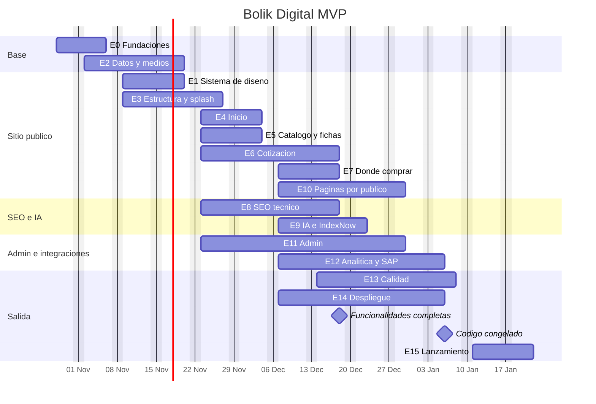

# 14 · Plan de acción

Plan para construir el MVP en **tickets pequeños**, cada uno con pasos, criterios de aceptación, dependencias y estimación. Es solo trabajo de **desarrollo**: los textos, fotos, videos, datos de tiendas y aprobaciones los entregan otras áreas y aquí solo aparecen como *dependencias externas*.

- Inicio: **miércoles 28 de octubre de 2026** · Lanzamiento: **lunes 11 de enero de 2027**.
- Los tickets también están en `tickets.csv` (para importarlos a GitHub Projects, Jira, Azure Boards o Trello).
- La numeración deja huecos por épica para insertar tickets nuevos sin renumerar.

> **Decisiones del equipo (28 oct 2026)**
> - Se implementa el **alcance completo** (los 117 tickets y los nuevos que surjan). La tabla del §7 ("núcleo") queda solo como referencia; no se pospone nada a una fase posterior y la fecha se ajusta al alcance, no al revés.
> - Equipo: un desarrollador trabajando con Claude Code.
> - Ramas `master` (producción, tags SemVer) y `develop` (integración); detalle en `CLAUDE.md` § Ramas, releases y tickets.
> - En GitHub (`Alex-Gallardo/web-bolik-60`) hay un milestone por sprint, y solo los tickets del sprint en curso se abren como Issues. Este documento y `tickets.csv` son el backlog maestro.

## 1. Cómo leer un ticket

| Campo | Significado |
|---|---|
| **ID** | `BD-NNN`. Úsalo en la rama (`feat/BD-062-ficha-variantes`) y en el commit (`feat(ficha): selector de color [BD-062]`). |
| **Sprint** | Semana(s) en que se hace. |
| **Días** | Días ideales de un desarrollador junior **trabajando con Claude Code** (incluye pruebas). 0.25 = 2 h. |
| **Prioridad** | MoSCoW: **Must** (sin esto no se lanza), **Should** (importante, se puede mover una semana), **Could** (si sobra tiempo). |
| **Depende de** | Tickets que deben estar terminados antes. |
| **Docs** | Documentos de esta guía que hay que leer (y pasarle a Claude Code). |
| **Pista** | **A** = sitio público / frontend · **B** = datos, admin, integraciones e infraestructura. |

### Definición de listo para empezar (DoR)
- Las dependencias están terminadas (o hay un *mock* acordado).
- Los docs citados están leídos y no hay preguntas abiertas que bloqueen.
- Si necesita datos de otra área (textos, fotos), ya existen o se usa el seed marcado como provisional.

### Definición de terminado (DoD)
- Cumple **todos** los criterios de aceptación.
- `pnpm typecheck`, `pnpm lint`, `pnpm test` y las E2E afectadas en verde; Lighthouse CI sin regresiones.
- Probado en móvil (390 px) y escritorio; con teclado; con movimiento reducido.
- Toda acción del usuario muestra su mensaje de `feedback.ts`.
- PR revisado y fusionado a `develop`; desplegado en staging.
- Si cambió algo de la guía (decisión, ruta, tabla), el doc correspondiente se actualizó en el mismo PR.

## 2. Equipo y capacidad

La suma de todos los tickets es **89.75 días-persona** (Must 80 · Should 8.5 · Could 1.25). Entre el 28 de octubre y el 8 de enero hay **50 días hábiles** por persona (descontando feriados de fin de año).

| Escenario | Viable para el 11 de enero | Cómo |
|---|---|---|
| **Recomendado: 2 desarrolladores** (pista A y pista B) + apoyo puntual de TI (servidor, DNS, BD) | **Sí**, con margen para imprevistos | Cada sprint tiene ~20 días de capacidad (2 × 10). Ver tabla §3. |
| **1 desarrollador** | **No** con este alcance | Aun recortando al **núcleo** (§7, ~74 días) el lanzamiento realista sería alrededor del **10 de febrero de 2027**. |

Si solo hay una persona, la decisión (de Gerencia, no del desarrollador) es: sumar un segundo desarrollador desde S1, o mover la fecha y lanzar el núcleo. **No** se recortan pruebas ni rendimiento para ganar tiempo: es mejor lanzar con menos páginas que con un sitio lento o con errores.

## 3. Calendario de sprints

| Sprint | Fechas | Objetivo | Días (A / B) |
|---|---|---|---|
| **S0** | mié 28 oct – vie 6 nov 2026 | Fundaciones, CI y staging | 9.75 (4.25 / 5.5) |
| **S1** | lun 9 nov – vie 20 nov | Sistema de diseño, datos, estructura global | 16.25 (9.25 / 7) |
| **S2** | lun 23 nov – vie 4 dic | Home, catálogo, ficha, cotización, SEO base | 22.5 (12.75 / 9.75) |
| **S3** | lun 7 dic – vie 18 dic | Dónde comprar, páginas por público, admin, IA · **congelamiento de funcionalidades** | 20.5 (10 / 10.5) |
| **S4** | lun 21 dic – vie 8 ene 2027 | Estabilización, pruebas, contenido, producción · feriados 24-25 dic y 31 dic-1 ene · **código congelado el 6 ene** | 19.25 (7.5 / 11.75) |
| **S5** | lun 11 ene – vie 22 ene 2027 | **Lanzamiento** e hipercuidado | 3 (1 / 2) |

### Hitos

| Fecha | Hito | Se verifica con |
|---|---|---|
| vie 6 nov | Repositorio, CI y staging funcionando | Despliegue de BD-016 visible en staging |
| vie 20 nov | `/styleguide`, layout global, splash y datos con seed | Revisión de `/styleguide` en staging |
| vie 4 dic | Sitio navegable: home, catálogo, ficha, cotización de punta a punta | Demo interna en staging; Lighthouse móvil ≥ 90 |
| vie 18 dic | **Funcionalidades completas** (no entra nada nuevo) | Todos los Must de S0–S3 cerrados |
| mié 6 ene | **Código congelado**, versión candidata en staging | Ensayo del corte (BD-151) + QA (BD-135) firmados |
| lun 11 ene | **Lanzamiento** | Runbook del doc 16 |
| vie 22 ene | Fin del hipercuidado | Reporte de cierre (BD-153) |

## 4. Mapa del plan

### Ruta crítica
`BD-001 → BD-010 → BD-030 → BD-031 → BD-032 → BD-062 → BD-070 → BD-071 → BD-072 → BD-073 → BD-075 → BD-131 → BD-135 → BD-151 → BD-152`

Si algo de esta cadena se atrasa más de 2 días, se avisa el mismo día y se recorta primero lo **Could**, luego lo **Should**.

### Dependencias externas (no son tickets de desarrollo, pero bloquean)

| Qué | Quién lo entrega | Necesario para | Fecha límite |
|---|---|---|---|
| Servidor Windows de staging y producción, Node LTS, IIS con ARR/URL Rewrite | TI | BD-016, BD-140 | 4 nov / 7 dic |
| Bases `BolikDigital_Stg` y `BolikDigital` + usuarios SQL | DBA | BD-016, BD-140 | 4 nov / 7 dic |
| Cuenta SMTP `web@bolik66.com` | TI | BD-074 | 27 nov |
| Endpoints de SMART-K66 (`/api/web/articulos`, `/api/web/prospectos`) | TI / SMART-K66 | BD-036, BD-128 | 18 dic (si no, modo `noop`) |
| Textos, fotos, videos del hero, tiendas verificadas, datos de kits | Otras áreas | BD-150 (mientras tanto: seed provisional) | 18 dic |
| Acceso a Search Console, GA4, DNS de bolik66.com | TI / dueño de la cuenta | BD-096, BD-125, BD-152 | 18 dic |
| Exportación de URLs con tráfico del sitio actual | Dueño de Search Console | BD-094 | 4 dic |
| Exportación de artículos de SAP (código PT, descripción, código de barras) | Sistemas | BD-038 | 23 nov |

## 5. Resumen por épica

| Épica | Nombre | Tickets | Días |
|---|---|---|---|
| E0 | Fundaciones del repositorio | 17 | 9.25 |
| E1 | Sistema de diseño y /styleguide | 8 | 6 |
| E2 | Datos, medios e integración base | 9 | 10 |
| E3 | Estructura global, splash y movimiento | 7 | 3.75 |
| E4 | Inicio | 7 | 5.5 |
| E5 | Catálogo, fichas y búsqueda | 8 | 7.5 |
| E6 | Cotización y formularios | 8 | 7 |
| E7 | Dónde comprar | 4 | 3 |
| E8 | SEO técnico | 8 | 4.25 |
| E9 | IA y automatización de indexación | 5 | 2.25 |
| E10 | Páginas por público e institucionales | 8 | 4.75 |
| E11 | Panel administrativo | 11 | 11 |
| E12 | Analítica e integración SAP | 4 | 2.25 |
| E13 | Calidad y pruebas | 6 | 6.5 |
| E14 | Despliegue y operación | 6 | 4 |
| E15 | Lanzamiento e hipercuidado | 5 | 4.25 |
| | **Total** | **121** | **91.25** |

## 6. Tickets

### E0 · Fundaciones del repositorio

#### BD-001 · Crear el proyecto Next.js 16 y el repositorio

**Sprint** S0 · **Días** 0.5 · **Prioridad** Must · **Pista** A · **Depende de** — · **Docs** 01, 04

Proyecto base con TypeScript, Tailwind v4, App Router, carpeta src y pnpm.

**Pasos**

1. `pnpm create next-app@latest bolik-digital --ts --tailwind --eslint --app --src-dir --import-alias "@/*" --use-pnpm`
2. Agregar `.nvmrc` (Node LTS ≥ 20.9) y `.npmrc` con `save-exact=true`.
3. Copiar `CLAUDE.md` a la raíz y `docs/` a `/docs`.
4. Primer commit en la rama `master`; crear la rama `develop`.

**Criterios de aceptación**

- [ ] `pnpm dev` abre la página por defecto.
- [ ] `pnpm build` termina sin errores.
- [ ] `CLAUDE.md` y `docs/` están en el repo.

#### BD-002 · TypeScript estricto, ESLint y Prettier

**Sprint** S0 · **Días** 0.5 · **Prioridad** Must · **Pista** A · **Depende de** BD-001 · **Docs** 04

Reglas de calidad que Claude Code y el junior deben respetar desde el primer día.

**Pasos**

1. `tsconfig.json`: `strict`, `noUncheckedIndexedAccess`, `noImplicitOverride`.
2. `eslint.config.mjs`: `next/core-web-vitals`, `next/typescript`, regla `no-restricted-imports` que prohíbe `framer-motion` y `motion/react` fuera de `src/components/motion`.
3. Prettier + `prettier-plugin-tailwindcss`.
4. Scripts `lint`, `typecheck` del doc 04 §5.

**Criterios de aceptación**

- [ ] `pnpm lint` y `pnpm typecheck` pasan.
- [ ] Importar `motion/react` en una página da error de lint.

#### BD-003 · Ganchos de git: Husky, lint-staged y commits convencionales

**Sprint** S0 · **Días** 0.25 · **Prioridad** Should · **Pista** A · **Depende de** BD-002 · **Docs** 18

Evita subir código sin formato o con errores de tipos.

**Pasos**

1. Instalar `husky`, `lint-staged`, `@commitlint/cli`, `@commitlint/config-conventional`.
2. pre-commit: lint-staged (eslint --fix + prettier en archivos cambiados).
3. pre-push: `pnpm typecheck && pnpm test:coverage` (aplica el umbral de cobertura).

**Criterios de aceptación**

- [ ] Un commit con mensaje `cambios` es rechazado; `feat(home): hero` se acepta.

#### BD-004 · next.config.ts base

**Sprint** S0 · **Días** 0.5 · **Prioridad** Must · **Pista** A · **Depende de** BD-001 · **Docs** 03, 15

Configuración de producción: Cache Components, salida standalone, loader de imágenes y cabeceras.

**Pasos**

1. Copiar `starter/next.config.ts`.
2. Verificar `cacheComponents: true`, `output: "standalone"`, `images.loader: "custom"`, `poweredByHeader: false`, `typedRoutes: true`.
3. Dejar las cabeceras de seguridad en modo report-only hasta BD-142.

**Criterios de aceptación**

- [ ] `pnpm build` genera `.next/standalone/server.js`.
- [ ] La respuesta no incluye `X-Powered-By`.

#### BD-005 · Variables de entorno tipadas

**Sprint** S0 · **Días** 0.5 · **Prioridad** Must · **Pista** B · **Depende de** BD-001 · **Docs** 03 §9

Si falta una variable, la app falla al arrancar con un mensaje claro.

**Pasos**

1. Copiar `starter/src/env.ts` y `starter/.env.example`.
2. Crear `.env.local` (no se sube a git).
3. Prohibir `process.env` fuera de `src/env.ts` (regla de lint).

**Criterios de aceptación**

- [ ] Quitar `DATABASE_URL` hace fallar `pnpm dev` con el nombre de la variable.
- [ ] `.env.local` está en `.gitignore`.

#### BD-006 · Estructura de carpetas

**Sprint** S0 · **Días** 0.25 · **Prioridad** Must · **Pista** A · **Depende de** BD-001 · **Docs** 04 §1

Crear el árbol de carpetas acordado para que todo tenga un lugar.

**Pasos**

1. Crear las carpetas del doc 04 §1 con un `README.md` corto en `features/`, `server/` y `components/`.
2. Crear los grupos de rutas `(site)` y `(admin)`.

**Criterios de aceptación**

- [ ] El árbol coincide con el doc 04.
- [ ] `pnpm build` sigue pasando.

#### BD-007 · Tokens CSS, movimiento y fondos

**Sprint** S0 · **Días** 0.5 · **Prioridad** Must · **Pista** A · **Depende de** BD-006 · **Docs** 02, 08, 09

Base visual: colores, tipos, espacios, duraciones, curvas y fondos.

**Pasos**

1. Copiar `starter/src/styles/*` y `starter/src/app/globals.css`.
2. Comprobar que las clases `bg-blue`, `text-ink`, `rounded-lg`, `shadow-md` funcionan.
3. No crear colores fuera de los tokens.

**Criterios de aceptación**

- [ ] Una página de prueba usa los tokens y se ve igual que la demo HTML.
- [ ] No hay variables CSS que se refieran a sí mismas.

#### BD-008 · Fuentes con next/font

**Sprint** S0 · **Días** 0.25 · **Prioridad** Must · **Pista** A · **Depende de** BD-007 · **Docs** 02, 12

Bricolage Grotesque y DM Sans en todo el sitio; Baloo 2 solo en `/escuelas`.

**Pasos**

1. `src/app/fonts.ts` con `next/font/google`, `display: "swap"`, `subsets: ["latin"]`, variables `--font-bricolage`, `--font-dm-sans`, `--font-baloo`.
2. Aplicar Baloo 2 solo en el layout de escuelas.

**Criterios de aceptación**

- [ ] La home descarga como máximo 4 archivos woff2.
- [ ] Sin peticiones a fonts.googleapis.com en el navegador.

#### BD-009 · Utilidades y constantes base

**Sprint** S0 · **Días** 0.5 · **Prioridad** Must · **Pista** A · **Depende de** BD-006 · **Docs** 04, 05

Funciones puras reutilizables con sus pruebas.

**Pasos**

1. `lib/cn.ts`, `lib/format.ts` (es-GT), `lib/slug.ts` (`slugify`), `lib/whatsapp.ts`.
2. Copiar `lib/constants.ts` y `lib/cache-tags.ts` del starter.
3. Pruebas unitarias de cada función (doc 13 §3).

**Criterios de aceptación**

- [ ] `pnpm test` pasa con cobertura ≥ 80 % en `src/lib`.

#### BD-010 · Prisma 7 con SQL Server

**Sprint** S0 · **Días** 1 · **Prioridad** Must · **Pista** B · **Depende de** BD-005 · **Docs** 05 §4

Conexión a la BD con el adaptador oficial y el primer esquema.

**Pasos**

1. Levantar SQL Server local con Docker (doc 13 §2).
2. Instalar `prisma`, `@prisma/client`, `@prisma/adapter-mssql`.
3. Copiar `prisma.config.ts`, `prisma/schema.prisma` y `src/server/db.ts` del doc 05/starter.
4. `pnpm db:migrate --name init` y `pnpm prisma generate`.

**Criterios de aceptación**

- [ ] Existe la migración inicial en `prisma/migrations`.
- [ ] `pnpm db:status` dice que la base está al día y una prueba de integración lee y escribe. *(Prisma Studio 7 no soporta SQL Server: se verifica con `pnpm db:status` y la prueba de integración; para explorar la base, SSMS o la extensión SQL Server de VS Code.)*
- [ ] `db` solo se importa desde `src/server/**` (`import "server-only"`).

#### BD-011 · Logs y manejo de errores

**Sprint** S0 · **Días** 0.5 · **Prioridad** Must · **Pista** B · **Depende de** BD-005 · **Docs** 03, 15

Errores con contexto en el servidor y pantallas amigables para el visitante.

**Pasos**

1. `server/log.ts` con `pino` (JSON en producción, legible en desarrollo).
2. `app/(site)/error.tsx`, `app/global-error.tsx` con el texto de `feedback.system`.
3. Cada server action registra errores con un `requestId` que también se muestra al usuario.

**Criterios de aceptación**

- [ ] Un error forzado muestra la pantalla amigable y deja una línea de log con `requestId`.

#### BD-012 · Configurar Vitest

**Sprint** S0 · **Días** 0.5 · **Prioridad** Must · **Pista** A · **Depende de** BD-002 · **Docs** 13 §2

Pruebas unitarias e integración listas para usar.

**Pasos**

1. Instalar `vitest`, `@vitest/coverage-v8`, `@vitejs/plugin-react`, `jsdom`, `@testing-library/react` (los alias de tsconfig son nativos de Vite: `resolve.tsconfigPaths`).
2. Crear `vitest.config.mts` y `vitest.integration.config.mts` del doc 13.

**Criterios de aceptación**

- [ ] `pnpm test` y `pnpm test:int` corren (aunque sea con una prueba de ejemplo).

#### BD-013 · Configurar Playwright y axe

**Sprint** S0 · **Días** 0.5 · **Prioridad** Must · **Pista** A · **Depende de** BD-001 · **Docs** 13 §2

Pruebas de punta a punta en móvil y escritorio.

**Pasos**

1. `pnpm create playwright` y `@axe-core/playwright`.
2. Copiar `playwright.config.ts` del doc 13.
3. Helper `tests/e2e/helpers.ts` con `expectNoA11yViolations` y `skipSplash`.

**Criterios de aceptación**

- [ ] `pnpm test:e2e` corre una prueba de humo en los 2 proyectos.

#### BD-014 · Integración continua

**Sprint** S0 · **Días** 1 · **Prioridad** Must · **Pista** B · **Depende de** BD-012, BD-013 · **Docs** 13, 15

Cada PR se valida solo.

**Pasos**

1. Pipeline (GitHub Actions o Azure DevOps): install con caché de pnpm → typecheck → lint → test → build → test:e2e → lhci.
2. Servicio SQL Server en el pipeline para integración/E2E.
3. Publicar el `.next/standalone` como artefacto.
4. Protección de rama: PR obligatorio + CI en verde.

**Criterios de aceptación**

- [ ] Un PR con un error de tipos queda en rojo.
- [ ] El artefacto descargado arranca con `node server.js`.

#### BD-015 · Lighthouse CI con presupuestos

**Sprint** S0 · **Días** 0.5 · **Prioridad** Must · **Pista** B · **Depende de** BD-014 · **Docs** 12, 13 §7

Rendimiento y SEO vigilados en cada PR.

**Pasos**

1. Copiar `starter/tests/lighthouserc.json` (hecho como `lighthouse.config.cjs` en la raíz).
2. Agregar el paso `pnpm lhci` al pipeline.

**Criterios de aceptación**

- [ ] Un PR que agrega 200 KB de JS a la home falla.
- [ ] El reporte queda adjunto al PR.

#### BD-016 · Entorno de staging en IIS

**Sprint** S0 · **Días** 1 · **Prioridad** Must · **Pista** B · **Depende de** BD-004, BD-014 · **Docs** 15

Un lugar real donde probar desde la primera semana (con apoyo de TI).

**Pasos**

1. Sitio IIS `staging-bolik` (solo red interna o con IP permitida) con ARR + URL Rewrite hacia `localhost:3100`.
2. Servicio Windows `BolikDigital-Staging` (NSSM o PM2) ejecutando `node server.js`.
3. BD `BolikDigital_Stg`; carpeta `D:\bolik-stg\media`.
4. Build en el agente interno (o a mano) con las variables de staging, armado según doc 15 §5, y despliegue manual. El artefacto de la CI (BD-014) no sirve: lleva `NEXT_PUBLIC_SITE_URL=http://localhost:3100` fijo.
5. Revisión previa de solo lectura del servidor (`staging-preflight.ps1`), que comparte máquina con SQL Server y SMART-K66.

**Criterios de aceptación**

- [ ] `https://staging.bolik66.com` (o la URL interna) muestra la app con HTTPS.
- [ ] `X-Robots-Tag: noindex` presente en staging.

**Avance (10 nov 2026)**

El código está listo. Los criterios se cumplen al ejecutarlo en `K66-APPS`, que hace TI. El Issue se cierra con el resultado del `curl` de doc 15 §12.

- Cuatro scripts en `scripts/deploy/`:
  - `staging-preflight.ps1`: solo lectura y sin credenciales.
  - `staging-setup.ps1`, que ahora acepta `-AllowedIps`.
  - `staging-build.ps1`: migra, siembra, construye y empaca con el `staging.env` del servicio.
  - `staging-deploy.ps1`: release nuevo, prueba de humo en Node y en IIS, y vuelta atrás automática.
  El procedimiento está en doc 15 §12.
- **Datos de ejemplo en staging hasta BD-038:** `pnpm db:seed --profile dev --allow-sample-data`. Solo corre con `APP_ENV=staging` y la base `BolikDigital_Stg` (no otra `…_Stg`, porque el SQL Server se comparte con SMART-K66); nunca en producción ni con los perfiles `e2e` o `prod`.
  - Este perfil sincroniza con los JSON y pisa lo editado en el admin de staging.
  - Al llegar el catálogo real, el DBA recrea `BolikDigital_Stg` y se siembra con `--profile prod`.
- **Servidor compartido.** ARR se configura para todo el servidor (`responseBufferLimit=0`, `preserveHostHeader`). El preflight lista los sitios que ya hacen proxy, como la API de SMART-K66, para confirmarlo con TI antes del setup.
- **DNS.** `bolik66.com` tiene un comodín público: `staging.bolik66.com` ya resuelve al hosting actual (10 nov 2026). Hace falta un registro propio, interno o público, hacia `K66-APPS`.
- **Fuera de esta PC.** Desde aquí no se llega a `K66-APPS` (ni DNS ni el puerto 1433). El paquete se construye en el propio servidor.

#### BD-017 · Base de datos local de desarrollo (SQL Server 2022 Express)

**Sprint** S0 · **Días** 0.5 · **Prioridad** Must · **Pista** B · **Depende de** — · **Docs** 05, 13 · *Ticket nuevo (1 nov 2026)*

La conexión a la base real llega casi al final del proyecto y BD-010/BD-030 están en la ruta crítica: una base local con el mismo motor evita retrabajo (al final solo cambia `DATABASE_URL`).

**Pasos**

1. `scripts/dev/sqlserver-local.ps1` (PowerShell como administrador, una vez, idempotente): descarga e instala SQL Server 2022 Express Core firmado por Microsoft, autenticación mixta, TCP 1433 (sin abrir el firewall).
2. Crea `BolikDigital_Dev`, `BolikDigital_Shadow` y `BolikDigital_Test`, el login `bolik_app` (db_owner) y desactiva `sa`.
3. Escribe las tres cadenas en `.env.local` con una contraseña generada que no se muestra.

**Criterios de aceptación**

- [ ] El script se puede correr de nuevo sin romper nada.
- [ ] Ningún secreto en el repo.
- [ ] Sin privilegios, `localhost:1433` responde y `bolik_app` se conecta a las tres bases.

### E1 · Sistema de diseño y /styleguide

#### BD-020 · Componente Section con fondos configurables

**Sprint** S1 · **Días** 0.5 · **Prioridad** Must · **Pista** A · **Depende de** BD-007 · **Docs** 08 §3

Toda sección del sitio usa `Section` con fondo y tono elegibles.

**Pasos**

1. `components/layout/section.tsx` y `container.tsx` (código en doc 08).
2. Props: `bg` (9 presets), `tone`, `spacing`, `id`, `as`.
3. Leer la apariencia por sección desde `SectionAppearance` cuando exista `appearanceKey`.

**Criterios de aceptación**

- [ ] Los 9 fondos se ven en `/styleguide`.
- [ ] Cambiar el fondo en BD cambia la sección sin tocar código.

#### BD-021 · Botones

**Sprint** S1 · **Días** 0.5 · **Prioridad** Must · **Pista** A · **Depende de** BD-007 · **Docs** 08 §2

Botón único con variantes para todo el sitio.

**Pasos**

1. `components/ui/button.tsx` con `cva` y las variantes de doc 08 §2 (primary, accent, dark, outline, ghost-light, whatsapp, link) más `danger` para el admin; tamaños sm, md, lg; `block`; íconos; `loading`; `asChild`.
2. Clase `.press` (A-03) y foco visible.

**Criterios de aceptación**

- [ ] Contraste AA en todas las variantes.
- [ ] `loading` deshabilita y anuncia "Enviando…" a lectores de pantalla.

#### BD-022 · Controles de formulario

**Sprint** S1 · **Días** 1 · **Prioridad** Must · **Pista** A · **Depende de** BD-021 · **Docs** 08 §2

Patrón único de formularios con React Hook Form y Zod.

**Pasos**

1. `Field` (label, ayuda, error con `aria-describedby`), `Input`, `Textarea`, `Select`, `RadioCards`, `Checkbox`, `PhoneInput` (+502, teclado numérico), `QuantityStepper`.
2. Error con animación `.shake` (A-04) y foco al primer error.

**Criterios de aceptación**

- [ ] Navegable solo con teclado.
- [ ] Errores en español desde `feedback.forms`.

#### BD-023 · Tarjetas, badges, chips y skeletons

**Sprint** S1 · **Días** 1 · **Prioridad** Must · **Pista** A · **Depende de** BD-021 · **Docs** 08 §2

Piezas de catálogo y listas.

**Pasos**

1. `ProductCard`, `CategoryCard`, `AudienceCard`, `StoreCard`, `Badge`, `Chip`, `Skeleton`.
2. Imágenes con proporción fija y `sizes` correctos.

**Criterios de aceptación**

- [ ] CLS 0 al cargar una grilla de 12 tarjetas.
- [ ] Efecto `.lift` solo con hover real (`@media (hover:hover)`).

#### BD-024 · Alertas amigables: Toaster y FriendlyDialog

**Sprint** S1 · **Días** 1 · **Prioridad** Must · **Pista** A · **Depende de** BD-021 · **Docs** 08 §4

Toda acción del usuario tiene un mensaje claro y amable.

**Pasos**

1. `components/feedback/toaster.tsx` (sonner, abajo-centro en móvil).
2. `FriendlyDialog` (Radix Dialog) con ilustración, título, texto, acción principal y secundaria.
3. Hook `useFeedback()` que toma los textos de `content/feedback.ts`.
4. Aviso de "sin conexión" y "conexión recuperada".

**Criterios de aceptación**

- [ ] Cada fila de la matriz del doc 08 §4 tiene un ejemplo en `/styleguide`.

**Notas de BD-027**

- `components/brand/illustration.tsx` tiene éxito, error/404 (lapicero), vacío, sin resultados y sin conexión. Doc 08 §4 pide además para `FriendlyDialog` una nube con gota roja (error) y un signo de pregunta amarillo (confirmación): agregarlas aquí si el diálogo las usa.
- [ ] Toasts anunciados con `aria-live`.

#### BD-025 · Overlays: Sheet, Dialog, Tabs, Accordion

**Sprint** S1 · **Días** 0.5 · **Prioridad** Must · **Pista** A · **Depende de** BD-021 · **Docs** 08, 09

Componentes de Radix/shadcn con nuestras animaciones.

**Pasos**

1. Dialog, Sheet y Popover sobre Radix, con la estructura de shadcn escrita a mano (sin `tailwind-merge`).
2. Tabs propio y Accordion con `
`: contenido en el HTML y visible sin JS (docs/11 §1). Decisión aprobada en BD-025.
3. Animaciones con los presets del doc 09.

**Criterios de aceptación**

- [ ] Escape cierra; el foco vuelve al disparador.
- [ ] Con `prefers-reduced-motion` aparecen sin desplazamiento.

#### BD-026 · Vista /styleguide

**Sprint** S1 · **Días** 1 · **Prioridad** Must · **Pista** A · **Depende de** BD-020, BD-021, BD-022, BD-023, BD-024, BD-025 · **Docs** 08 §6

Vitrina interna con todos los componentes reales.

**Pasos**

1. `app/(site)/styleguide/page.tsx` con las 13 secciones del doc 08 §6.
2. `noindex`, fuera del sitemap, bloqueada en robots.
3. En producción solo visible con sesión de admin.

**Criterios de aceptación**

- [ ] Todas las secciones renderizan sin errores de consola.
- [ ] En producción sin sesión responde 404.

#### BD-027 · Logo e ilustraciones

**Sprint** S1 · **Días** 0.5 · **Prioridad** Must · **Pista** A · **Depende de** BD-007 · **Docs** 02

Logo como componente SVG y las ilustraciones de los diálogos.

**Pasos**

1. `components/brand/logo.tsx` con el logo oficial de Mercadeo: variantes `full`, `inverse` y `wordmark` (BOLIK® en un color; el logo no tiene isotipo, así que no hay `mark`). Archivos optimizados con SVGO en `public/brand`.
2. Ilustraciones SVG en línea (éxito, error, vacío, sin resultados, sin conexión).

**Criterios de aceptación**

- [ ] Cada ilustración y el wordmark pesan < 4 KB; el archivo del logo completo, ≤ 25 KB (7 KB gzip: el trazo de crayón oficial no baja más sin perder detalle).
- [ ] El logo tiene `aria-label="Bolik"`.

### E2 · Datos, medios e integración base

#### BD-030 · Esquema completo y migraciones

**Sprint** S0 · **Días** 0.5 · **Prioridad** Must · **Pista** B · **Depende de** BD-010 · **Docs** 05

Todas las tablas del MVP.

**Pasos**

1. Usar `starter/prisma/schema.prisma` completo.
2. `pnpm db:migrate --name schema_mvp`.
3. Revisar índices del doc 05 §6.

**Criterios de aceptación**

- [ ] `prisma validate` OK.
- [ ] La migración se aplica en una BD vacía y en staging.

#### BD-031 · Seeds con datos reales

**Sprint** S1 · **Días** 1.5 · **Prioridad** Must · **Pista** B · **Depende de** BD-030, BD-037 · **Docs** 05 §6, 17

Datos reales para desarrollar y probar (nada de lorem).

**Pasos**

1. Cargar en la base los `prisma/seed/*.json` de BD-037 (categorías, productos, variantes y empaques, tiendas, departamentos, FAQs, contenido de la home) más el admin inicial. Lo marcado `sample` no se carga en producción.
2. Perfiles `--profile dev` y `--profile e2e` (cargan también lo `sample`) y `--profile prod` (staging con base y producción: sin lo `sample` ni relaciones hacia ello).
3. CI: levantar `scripts/ci/sqlserver.sh` también en los trabajos Build y E2E, con `migrate deploy` y `pnpm db:seed --profile e2e`, cuando la CI construya con `DATA_SOURCE=db` (con Cache Components el build prerenderiza leyendo la BD; con la fuente de ejemplo de BD-037 no la necesita). *Pasó a BD-032, que es cuando la CI construye con `db`; aquí el seed se prueba en el trabajo Integración.*
4. El seed es idempotente (`upsert`).

**Cómo quedó (6 nov 2026)**

- `pnpm db:seed [--profile dev|e2e|prod]` (`scripts/db-seed.mts`): `dev` y `e2e` cargan todo y **sincronizan** con los JSON (actualizan, quitan las partes que ya no están y despublican los ejemplos y variantes que salieron; nunca borran variantes); `prod` **solo crea lo que falta**, sin ejemplos ni relaciones, FAQs o líneas de kit hacia ellos, no pisa lo editado en el admin y omite (con aviso) un producto cuyo SKU ya pertenece a otro. `dev`/`e2e` solo siembran bases `…_Dev` o `…_Test` y nunca con `APP_ENV` `staging` o `production`. La única excepción es staging hasta el catálogo real: `--profile dev --allow-sample-data` funciona con `APP_ENV=staging` y la base `BolikDigital_Stg` (BD-016).
- `prod` vuelve a crear lo que se **borró** en el admin (y duplica lo renombrado con slug nuevo): el admin despublica en lugar de borrar (BD-116 a BD-118, BD-121).
- `e2e` carga lo mismo que `dev` (lo que ya prueban las E2E con `fixtures`), no un subconjunto.
- Admin inicial desde `SEED_ADMIN_EMAIL` y `SEED_ADMIN_PASSWORD` (≥ 12 caracteres, bcrypt coste 12), sin `admin.json`; se crea una sola vez y volver a sembrar no cambia su contraseña.
- Migración `seed_claves_naturales`: claves únicas en `ProductSpec`, `ProductBenefit`, `ProductImage` (`productId` + `mediaId`), `KitItem` (`kitId` + `description`) y `key` en `Faq`, `HistoryMilestone` y `SchoolActivity`; `isSample` en `Product`, `Kit` y `SchoolActivity`.
- El esquema de los seeds valida el dígito verificador de cada código de barras (`src/lib/gtin.ts`). El UPC del PT00060 sale del catálogo 2026-2027: 759364663115.

**Notas de la revisión de BD-030**

- Sin clave natural única (no admiten `upsert`): `ProductSpec`, `ProductBenefit`, `ProductImage`, `KitItem`, `Faq`, `HistoryMilestone`, `SchoolActivity`. Agregar en este ticket una migración con, por ejemplo, `@@unique([productId, groupName, label])`, `@@unique([productId, iconKey])` y una columna `key` única en `Faq`, `HistoryMilestone` y `SchoolActivity`; si no, volver a sembrar duplica filas o pisa lo editado en el admin.
- Columna `sample` (o `isSample`, `Boolean @default(false)`) en `Product`, `SchoolActivity` y `Kit`, igual que en los JSON de BD-037: el perfil de producción no carga lo marcado y omite las relaciones (`ProductRelation`, `related`) hacia productos de ejemplo. Sin ella, la fuente `db` no puede distinguir los ejemplos.

**Criterios de aceptación**

- [ ] `pnpm db:seed` dos veces seguidas no duplica datos.
- [ ] El Bolik Ultra tiene PT00058/59/60 con sus códigos de barras.

#### BD-032 · Capa de datos con Cache Components

**Sprint** S1 · **Días** 1.5 · **Prioridad** Must · **Pista** B · **Depende de** BD-031, BD-037 · **Docs** 03 §5

Consultas de lectura cacheadas con tags.

**Pasos**

1. La interfaz, los tipos de vista y las funciones cacheadas de `server/data/` ya existen (BD-037): este ticket agrega la fuente `db` con Prisma y las funciones que falten (`sitemap`, `llms`, `search`).
2. Cada función con `'use cache'`, `cacheLife('max')` y `cacheTag` de `lib/cache-tags.ts`.
3. Devolver tipos de vista (`ProductView`, `StoreView`) en lugar de modelos de Prisma.
4. La batería de contrato de BD-037 pasa contra `BolikDigital_Test`.
5. CI (paso 3 de BD-031): el trabajo Integración siembra la base de pruebas, construye con `DATA_SOURCE=db` y sirve ese build con la base desconectada.

**Cómo quedó (6 nov 2026)**

- `server/data/db/source.ts` con las reglas de la fuente de ejemplo; pasa la batería de contrato contra `BolikDigital_Test` y da exactamente las mismas vistas que `fixtures` con los mismos datos. `settings-view.ts` comparte el mapeo de ajustes (un ajuste obligatorio que falte da un error claro).
- Nuevas: `listSitemapEntries()` (fechas reales: la ficha toma la más reciente entre producto y variantes, la categoría la de sus productos; sin fechas con `fixtures`; solo departamentos con tiendas), `getLlmsData()` (con `listPublishedFaqs()`: nunca FAQs de un producto o categoría oculta) y `getSearchIndex()`, con sus tags.
- Un ajuste opcional guardado vacío cuenta como ausente (no tumba el sitio).
- `serverExternalPackages: ["@prisma/adapter-mssql"]`: Turbopack no puede empaquetar la cadena del driver. «Artefacto en Windows» comprueba que el adaptador (con `mssql` y `tedious`) carga desde el paquete.
- CI (paso 5): en lugar de Build y E2E (el trabajo E2E corre dentro del contenedor de Playwright, sin Docker), el trabajo **Integración** siembra la base de pruebas, hace `pnpm build` con `DATA_SOURCE=db` y sirve ese build con la base desconectada (`scripts/ci/smoke-db-build.sh`). Build, E2E y Lighthouse siguen con `fixtures`: las dos fuentes cumplen el mismo contrato.

**Criterios de aceptación**

- [ ] El build prerenderiza las páginas públicas sin consultar la BD en cada petición.
- [ ] Pruebas de integración de las funciones.

#### BD-033 · Folios consecutivos

**Sprint** S1 · **Días** 0.5 · **Prioridad** Must · **Pista** B · **Depende de** BD-030 · **Docs** 05 §4

COT/ESC/DIS-AAAA-NNNNNN sin duplicados.

**Pasos**

1. Copiar `starter/src/server/folio.ts`. *(Versión vigente: `src/server/folio.ts`; la del starter toma el año del reloj del servidor.)*
2. Prueba de concurrencia: 20 envíos simultáneos.

**Criterios de aceptación**

- [ ] 20 folios distintos y consecutivos.
- [ ] El 1 de enero reinicia el consecutivo.

**Cómo quedó (8 nov 2026)**

- `src/server/folio.ts` (`nextFolio(tx, prefijo)`, MERGE con HOLDLOCK dentro de la transacción de la solicitud) y `src/lib/folio.ts` (formato, regex, prefijos y año). Cambios frente al starter: el año sale de la **hora de Guatemala** (`folioYear`), no del reloj del servidor; se valida el prefijo y el tope de 999 999 por año.
- Integración: 20 en paralelo (hasta 10 a la vez, el pool de mssql) que retienen el bloqueo 100 ms tras el MERGE: quedan en fila, sin interbloqueos (*deadlocks*) y con 20 folios distintos y consecutivos; cambio de año, prefijos independientes, sin huecos cuando la solicitud falla y el tope de 999 999 sin avanzar el contador.

#### BD-034 · Procesamiento de imágenes

**Sprint** S1 · **Días** 1.5 · **Prioridad** Must · **Pista** B · **Depende de** BD-030 · **Docs** 03 §7

Imágenes rápidas: se procesan una sola vez al subir.

**Pasos**

1. `server/media/process-image.ts`: sharp → WebP en 320/480/640/960/1280/1920 + `blurDataURL` + hash.
2. Guardar en `MEDIA_DIR` y registrar `MediaAsset`.
3. `lib/image-loader.ts` (starter) y `images.loaderFile` en `next.config.ts`.
4. Script `scripts/import-media.mts` para cargar en lote las fotos actuales.

**Criterios de aceptación**

- [ ] Una foto de 4 MB genera 6 archivos y la de 640 pesa < 60 KB.
- [ ] `next/image` pide el ancho correcto según `sizes`.

**Cómo quedó (9 nov 2026)**

- `src/server/media/process-image.ts` (sharp 0.35.5): decodifica el original una sola vez y de ese maestro saca 6 WebP calidad 75 sin agrandar (si la foto es más chica, los anchos mayores quedan del tamaño original), `blurDataURL`, medidas enderezadas por EXIF y color dominante (sobre blanco, para los PNG transparentes); convierte a sRGB; sin metadatos en la salida (ni GPS). Clave con hash de 8 dígitos del contenido y de los parámetros (`products/bolik-ultra-azul-a1b2c3d4`): si cambian la calidad o los anchos, cambia la clave. Si los 6 archivos ya existen no los reescribe; cada archivo se escribe con otro nombre y se renombra, y si algo falla borra lo que creó. Rechaza con `MediaError` lo que no es imagen o está dañado (JPEG cortado), HEIC, SVG, GIF y animaciones, más de 25 MB y más de 50 MP. `src/server/data/media.ts` registra `MediaAsset` (idempotente; no pisa el alt editado).
- `pnpm import:media <carpeta> [--folder products] [--remoto]` (`scripts/import-media.mts`): por defecto solo corre contra una base `…_Dev` o `…_Test` con `APP_ENV=development`; para staging o producción se corre en ese servidor (con su `MEDIA_DIR`) y con `--remoto`, para que archivos y filas queden en el mismo entorno.
- sharp en el paquete: Next lo copia al standalone, pero con el binario de la máquina que construye. `supportedArchitectures` (pnpm) instala también el de Windows y `outputFileTracingIncludes` lo mete al paquete; el trabajo «Artefacto en Windows» genera un WebP con sharp desde el paquete.
- `src/app/media/[...path]/route.ts`: sirve `/media` desde `MEDIA_DIR` donde no hay IIS (desarrollo, `start:local`, CI), solo los WebP que genera el procesador (`…-{ancho}.webp`, en minúsculas), sin salir de la carpeta ni seguir enlaces simbólicos, y en *streaming*; en el servidor lo sirve IIS. `start:local` resuelve un `MEDIA_DIR` relativo antes de cambiar de carpeta.
- Criterios: una foto de ~4 MB da 6 archivos y la de 640 pesa < 60 KB (prueba con sharp); `next/image` pide el ancho correcto (prueba con `getImageProps` y, en Chromium, 360 px DPR 2 → 960 y 1280 px → 640).
- Las fotos de ejemplo (del catálogo 2026-2027) se importan solo a `./.media` y a la base local: nunca al repo.

**Nota de BD-031:** `ProductImage` es única por `[productId, mediaId]`: una misma foto no se repite dentro de un producto (para varias variantes, una fila por foto con `variantId` nulo). Fotos de ejemplo: las del catálogo 2026-2027, solo en `MEDIA_DIR` local, nunca en el repo.

#### BD-035 · Gateway del ERP

**Sprint** S1 · **Días** 1 · **Prioridad** Must · **Pista** B · **Depende de** BD-030 · **Docs** 03 §5, 05 §8

La web nunca depende de que SAP o SMART-K66 estén arriba.

**Pasos**

1. `server/erp/gateway.ts` (interfaz), `noop.ts`, `smartk66.ts` (fetch con timeout 8 s y 3 reintentos con backoff).
2. Seleccionar por `ERP_MODE`.
3. Mocks con MSW para pruebas.

**Criterios de aceptación**

- [ ] Con `ERP_MODE=noop` todo funciona.
- [ ] Con la API simulada caída, la cotización se guarda con `erpStatus = pendiente`.

**Cómo quedó (7 nov 2026)**

- `server/erp/types.ts` (interfaz: `createLead`, `listArticles`; devuelven resultado y nunca lanzan), `noop.ts`, `smartk66.ts` y `gateway.ts` (`getErpGateway()` por `ERP_MODE`). El cliente: timeout de 8 s por intento (encabezados y cuerpo), 3 reintentos con backoff exponencial y azar solo para lo pasajero (red caída, timeout, corte a media respuesta, 5xx, 429, 408 y 409); 401/403 es `unauthorized` (clave vencida: aviso a operación), otro 4xx es `rejected`, y un JSON mal formado `invalid-response`, sin reintento; `Idempotency-Key` con el folio; sin seguir redirecciones; respuestas validadas con Zod; mensajes fijos, sin datos personales ni la clave. `ERP_BASE_URL` solo admite `http`/`https`.
- `server/erp/send-quote.ts` → `sendQuoteToErp(quoteId)`: lee la cotización (`server/data/quote-erp.ts`), la manda y guarda el resultado. `erpStatus`: `enviada` (con `erpRef`), `omitida` (noop), **`pendiente`** (fallo pasajero: la reintenta la tarea) o **`error`** (rechazo o respuesta fuera del contrato: la revisa una persona). Antes de llamar, la cotización se **reclama** (compare-and-set sobre `erpAttempts`): dos procesos nunca la mandan a la vez, y nada baja a una `enviada`. `erpAttempts` cuenta envíos, no peticiones HTTP (un envío son hasta 4).
- Pruebas con MSW (`msw@3.0.3`): unitarias del cliente y de integración de `sendQuoteToErp` contra `BolikDigital_Test`.

#### BD-036 · Sincronización del catálogo con SAP

**Sprint** S4 · **Días** 1 · **Prioridad** Should · **Pista** B · **Depende de** BD-035, BD-032 · **Docs** 03 §6

Códigos, nombres, códigos de barras y estado activo vienen de SAP.

**Pasos**

1. `scripts/sync-catalog.ts`: lee `/api/web/articulos`, actualiza `ProductVariant`, nunca pisa campos editoriales.
2. Registra `SyncRun` con conteos.
3. Llama `revalidateTag(tag, 'max')` en lo que cambió.

**Criterios de aceptación**

- [ ] Un artículo inactivo en SAP se marca `inactivo` y sale del sitio.
- [ ] El resultado aparece en `/admin/sincronizacion`.

#### BD-037 · Fuente de datos de ejemplo

**Sprint** S1 · **Días** 1 · **Prioridad** Must · **Pista** B · **Depende de** BD-030 · **Docs** 03, 05 §6, 17 · *Ticket nuevo (3 nov 2026)*

El frontend avanza sin esperar la base: las páginas leen de `src/server/data`, que hoy sirve datos de ejemplo y después SQL Server, sin cambiar ninguna página.

**Pasos**

1. `DATA_SOURCE=fixtures|db` en `src/env.schema.ts` y `.env.example`: `fixtures` por defecto; `db` exige `DATABASE_URL`; en producción solo se permite `db`.
2. Tipos de vista en `src/server/data/types.ts` (`ProductView`, `ProductCardView`, `CategoryView`, `StoreView`, `DepartmentView`, `FaqView`, contenido de la home y ajustes), nunca modelos de Prisma.
3. Datos en `prisma/seed/*.json` con el formato del seed (BD-031), validados con Zod: el Bolik Ultra completo (doc 05 §6 y doc 17), categorías, departamentos, tiendas, FAQs, hero, cifras, historia, actividades, kits y ajustes. Lo que no está en doc 17 sale de la demo (`docs/referencia/demo`) y queda marcado `sample` o `isVerified = false`.
4. Funciones de lectura en `src/server/data/` con `'use cache'`, `cacheLife('max')` y `cacheTag` de `lib/cache-tags.ts`, que delegan en la fuente elegida.
5. Pruebas de contrato: la misma batería corre contra la fuente de ejemplo (unitarias) y, en BD-032, contra Prisma (integración).

**Criterios de aceptación**

- [ ] Con `DATA_SOURCE=fixtures`, `pnpm build` y las páginas funcionan sin SQL Server.
- [ ] `APP_ENV=production` con `DATA_SOURCE=fixtures` no arranca.
- [ ] La batería de contrato pasa con la fuente de ejemplo.

#### BD-038 · Catálogo real 2026-2027

**Sprint** S2 · **Días** 1.5 · **Prioridad** Must · **Pista** B · **Depende de** BD-031 · **Docs** 05 §6, 17 · *Ticket nuevo (6 nov 2026)*

Los productos reales del catálogo impreso 2026-2027 reemplazan a los 24 productos de ejemplo de la demo.

**Pasos**

1. Transcribir del catálogo (PDF de Mercadeo, fuera del repo) los ~50 productos y ~140 variantes de color: nombre, línea, colores, códigos de barras y unidades de empaque. Cada código pasa la validación del dígito verificador.
2. Emparejar cada variante con su código SAP (PT…) usando el código de barras como puente, con la exportación de artículos de SAP. Sin código SAP no se carga como real: no se inventa.
3. Ampliar `PACKAGING_CODES` con las presentaciones del catálogo (estuche, bolsa, bote, tubo, blíster de 4, six pack…) y revisar las categorías contra las líneas del catálogo.
4. Decidir cómo se muestran las marcas del grupo (Fabik, Coloreto, EcoBol, K-Pen).
5. Quitar los productos de ejemplo que el catálogo real ya cubre (el seed `dev` los despublica en las bases que ya los tienen).
6. Con el perfil `prod`, una categoría sin productos reales no debe quedar publicada (página vacía en el sitemap).

**Criterios de aceptación**

- [ ] Cada producto del catálogo con su código SAP está en `products.json` sin `sample`.
- [ ] Todos los códigos de barras pasan la validación y `pnpm db:seed` dos veces no duplica datos.

### E3 · Estructura global, splash y movimiento

#### BD-040 · Layout raíz del sitio

**Sprint** S1 · **Días** 0.5 · **Prioridad** Must · **Pista** A · **Depende de** BD-008, BD-024 · **Docs** 06 §2

HTML base, metadatos raíz y proveedores mínimos.

**Pasos**

1. `app/layout.tsx`: `<html lang="es-GT">`, fuentes, `rootMetadata`, enlace "Saltar al contenido".
2. `app/(site)/layout.tsx`: Header, `<main id="contenido">`, Footer, Toaster, RevealObserver.
3. Script del splash en `<head>`.

**Criterios de aceptación**

- [ ] Una sola etiqueta `<main>` por página.
- [ ] JS inicial dentro del presupuesto de docs/12 §2 (home ≤ 165 KB, resto ≤ 150 KB; lo vigila Lighthouse CI). El criterio original de 90 KB compartidos no es alcanzable con Next 16 + React 19 (~132 KB de runtime); BD-040 no suma JS: 140.6 KB compartidos antes y después.

#### BD-041 · Header y menú móvil

**Sprint** S1 · **Días** 1 · **Prioridad** Must · **Pista** A · **Depende de** BD-040, BD-025 · **Docs** 06 §2

Navegación principal con acceso a buscar y a la cotización.

**Pasos**

1. Header fijo que se compacta al bajar (A-07). Nunca se oculta (docs/06 §2: la cotización siempre a mano; decisión de BD-041).
2. Badge de cotización con `badge-pop` (A-05).
3. Menú móvil en `Sheet` con enlaces grandes y CTA de WhatsApp.

**Criterios de aceptación**

- [ ] Sin CLS al compactarse.
- [ ] El menú se cierra al navegar y devuelve el foco.

#### BD-042 · Footer y botones flotantes

**Sprint** S1 · **Días** 0.5 · **Prioridad** Must · **Pista** A · **Depende de** BD-040 · **Docs** 06 §2

Pie con datos de la empresa y flotantes de WhatsApp y volver arriba.

**Pasos**

1. Footer con dirección, teléfono, redes, enlaces legales, razón social desde `SiteSetting` (Server Component, sin JS; el NAP completo del doc 06 en `settings.json`, el mismo de `/contacto` y el JSON-LD).
2. Botón WhatsApp flotante (escritorio) y barra de acciones abajo (móvil: WhatsApp y Cotizar), con el mensaje general prellenado. Se ocultan con CSS cuando el drawer o el teclado están abiertos. «Cotizar» de la barra es fijo: el contador ya está en el header (decisión de BD-042, por presupuesto de JS).
3. «Volver arriba»: enlace en el pie y flotante pasada una pantalla (`data-scrolled-far` de `header-scroll.tsx`).

**Criterios de aceptación**

- [ ] Teléfono con `tel:` y WhatsApp con mensaje prellenado.
- [ ] Los flotantes no tapan el CTA principal en móvil.

#### BD-043 · Splash de 2 segundos

**Sprint** S1 · **Días** 0.5 · **Prioridad** Must · **Pista** A · **Depende de** BD-040 · **Docs** 09 §splash

Animación del logo antes del hero, sin afectar SEO ni LCP.

**Pasos**

1. Adaptar `starter/src/components/layout/splash.tsx` a la marca: wordmark oficial y trazo amarillo, sin el «cuadro azul» ni texto (decisión de BD-043; docs/09 §3).
2. Inyectar el script en `<head>` (`app/head-script.ts`, junto a la clase `js`) y el SVG al inicio del `<body>`. Se salta con toque, clic, tecla o rueda; no bloquea el scroll.
3. Leer `splash_enabled` de `SiteSetting` en `data-splash-enabled`.

**Criterios de aceptación**

- [ ] Prueba E2E `splash.spec.ts` en verde.
- [ ] Lighthouse no cambia el LCP con splash activo vs. inactivo (± 100 ms).

#### BD-044 · Revelado al hacer scroll, cifras y transiciones

**Sprint** S1 · **Días** 0.5 · **Prioridad** Must · **Pista** A · **Depende de** BD-040 · **Docs** 09

Movimiento suave hecho con CSS.

**Pasos**

1. `reveal-observer.tsx` y `count-up.tsx` desde el starter, con las mejoras de BD-044 (docs/09 §6): ocultar solo con `data-reveal-ready`, `MutationObserver`, sin la red de 2.5 s; cifra sin CLS.
2. Transición de entrada de página con `.page-enter`: `PageEnter` en `(site)/layout.tsx` al cambiar de ruta, sin animar la primera carga (docs/09 §4; no `template.tsx`).

**Criterios de aceptación**

- [ ] Sin JS el contenido se ve completo.
- [ ] Con movimiento reducido no hay animaciones.

#### BD-045 · MotionProvider diferido

**Sprint** S1 · **Días** 0.25 · **Prioridad** Must · **Pista** A · **Depende de** BD-040 · **Docs** 09

Motion solo donde CSS no alcanza.

**Pasos**

1. `components/motion/motion-provider.tsx` con `LazyMotion strict` + `domAnimation` (o `domMax` con `layout`) por `import()`, `MotionConfig reducedMotion` y presets en `lib/motion.ts` con los tokens de `motion.css` (Motion 14.6.0, BD-045).
2. Solo `m.*` en componentes, desde `components/motion/m.ts` (regla de ESLint). Guardián E2E: la home no descarga Motion.

**Criterios de aceptación**

- [ ] Motion no aparece en el JS inicial de la home (bundle analyzer).

#### BD-046 · Páginas 404 y 500

**Sprint** S2 · **Días** 0.5 · **Prioridad** Must · **Pista** B · **Depende de** BD-040, BD-037 · **Docs** 06 §3.19, 10 §6

Errores amables que ayudan a seguir navegando.

**Pasos**

1. `not-found.tsx`: busca redirección en BD (tabla `Redirect`); si no hay, registra `NotFoundLog` y muestra buscador + categorías. Conserva su `<MainContent>` (BD-040: queda fuera de los layouts de grupo) y revisa que no salga el `<title>` de Next en inglés.
2. `error.tsx` con WhatsApp y "Reintentar".

**Criterios de aceptación**

- [ ] Una URL vieja registrada en `Redirect` responde 301.
- [ ] Las demás registran el 404 con contador.

**Cómo quedó (7 nov 2026)**

- Redirecciones en `proxy.ts` con **301** (o el estado guardado) en un solo salto: el mapa vive en memoria (`server/seo/redirects.ts`), se recarga cada 60 s sin bloquear peticiones (tras arrancar, las peticiones esperan juntas la primera carga, como mucho 5 s), resuelve cadenas y descarta ciclos, destinos externos y claves repetidas. `permanentRedirect()` en la 404 daba 308 y la volvía dinámica. Rutas normalizadas en `lib/redirect-path.ts`: minúsculas, sin barra final, acentos codificados siempre igual, query ordenada y sin parámetros de seguimiento (`utm_*`, `gclid`, `fbclid`…) ni `_rsc`; si la query no está en la tabla, se busca la ruta sola. La barra final la quita el proxy después de la tabla (`skipTrailingSlashRedirect`): `/viejo/` va al destino en un salto. El proxy lee `Redirect` con su propio cliente de Prisma (`server/data/proxy-db.ts`): se compila en otro bundle y no comparte el de la app; los errores de Prisma se distinguen por `code`, nunca por `instanceof`.
- 404 estática: leer la petición en ella volvía «prerender parcial» **todas** las rutas (la 404 forma parte del árbol de cada una). Por eso registra con un script mínimo (`app/not-found-beacon.ts`) que avisa a `/api/not-found`; los 404 y los usos de cada redirección se cuentan en memoria y se escriben en lote cada 30 s (`server/seo/hit-log.ts`, tope de 500 rutas por lote; la limpieza de `NotFoundLog` va con BD-145). `/api/not-found` solo cuenta avisos del mismo sitio (`Sec-Fetch-Site`), con cuerpo de hasta 4 KB, y del referer guarda solo origen y ruta. Una navegación en el cliente (`<Link>`) a una ruta inexistente no ejecuta el script: esos 404 internos no se cuentan.
- 404 con enlaces a Inicio, Catálogo, Dónde comprar y las líneas de producto; el buscador queda para BD-066. Un solo `<meta name="robots">` (el de Next).
- 500 con reintentar, WhatsApp (si hay número) y teléfono (`data-contact-*` del layout de `(site)`); sin número, el texto no promete WhatsApp. La 404 dice «Revisa el catálogo…» hasta que BD-066 traiga el buscador (doc 17).

### E4 · Inicio

#### BD-050 · Hero con video por capítulos

**Sprint** S2 · **Días** 1.5 · **Prioridad** Must · **Pista** A · **Depende de** BD-037, BD-034, BD-044 · **Docs** 06 §3.1, 09

El hero de la demo, llevado a producción.

**Pasos**

1. Copiar `starter/src/components/hero/video-hero.tsx`.
2. Datos desde `HeroChapter` (título, texto, CTA, póster, video).
3. Póster del capítulo 1 con `priority` (es el LCP).
4. Video solo tras `load`, en ocioso y sin Save-Data/2g/3g/movimiento reducido.

**Notas de BD-037**

- Doc 17 §2 define un CTA secundario por capítulo («Nuestra historia», «Bolik en tu escuela»…) que ni `HeroChapter` ni `HeroChapterView` tienen: agregar el campo en el modelo, en `content.json` y en la vista en este ticket. Los `hint` y `eyebrow` de `content.json` vienen de la demo y están por validar.

**Criterios de aceptación**

- [ ] ~~LCP de la home ≤ 2.0 s en Lighthouse móvil~~: **pasó a BD-055** (decisión del 10 nov 2026). Con el póster del hero como LCP, la CI midió 3.06 s (mejor de 3); el límite de la home queda en **3.2 s temporal** en `lighthouse.config.cjs`.
- [ ] Lighthouse no simula `navigator.connection`: confirmar que el video no se pide durante la medición (contaría en `resource-summary:total:count ≤ 25` y en los bytes).
- [ ] Capítulos navegables con flechas del teclado.
- [ ] El video se pausa fuera de pantalla.

**Cómo quedó (10 nov 2026)**

- **Componentes.** `components/hero/video-hero.tsx` (servidor) arma el chip, el único h1 con el subrayado A-11 y los atributos de cada póster con `getImageProps`. El póster 1 lleva `<link rel="preload" fetchpriority="high">` (`preload` de react-dom) e ``: el `preload` de `next/image` en Next 16 no pone prioridad y Chrome lo pedía como *Low*. `hero-player.tsx` (cliente) maneja capas, video, texto y pestañas. Detalle en doc 09 §5.
- **Video.** Llega tras `load` y en tiempo ocioso; nunca con movimiento reducido, Save-Data ni 2g/3g (`video-policy.ts`). En móvil solo hay video si el capítulo trae el vertical; sin él, solo el póster. Hay un solo `<video>`, el del capítulo actual. Un video que falla deja el póster. Botón de pausa solo cuando el capítulo tiene video, absoluto (no mueve el diseño). Pausa fuera de pantalla. Si se activa el movimiento reducido con la página abierta, el video se va. El corte entre móvil y escritorio es `md` (48rem), el mismo del diseño.
- **Pestañas.** Patrón ARIA con flechas, Inicio y Fin, contadas desde la pestaña que tiene el foco. Los cuatro paneles (texto y CTA) están en el HTML: sin JS se ven todos; con JS, solo el activo (`.js .hero-chapter`). Con el foco dentro del hero, el video no avanza solo, así el foco no se pierde (WCAG 2.4.3). Sin `aria-live`: con el avance automático anunciaría cada capítulo.
- **CTA secundario.** Migración `hero_cta_secundario`: `secondaryCtaLabel` y `secondaryCtaHref`, siempre un enlace interno, en el seed, en las dos fuentes y en `HeroChapterView`. El CTA de cotización enlaza a `/cotizacion?tipo=…` hasta el drawer (BD-071). Los CTA llevan `data-event="hero_cta_click"` y las pestañas `hero_chapter_view`, para conectarlos con la analítica.
- **Medios de ejemplo.** Las ilustraciones y videos de la demo no van al repo.
  - `prisma/seed/media.json` guarda solo claves y medidas. El seed (`dev` y `e2e`) registra MediaAsset; `prod` quita póster y videos marcados `sampleMedia`.
  - `pnpm media:samples <carpeta>` pone los archivos en `MEDIA_DIR`.
  - `scripts/ci/sample-media.mjs` deja reemplazos con la misma clave en la CI (`serve-artifact.sh`) y en `start:local`.
  - La ruta `/media` de Node sirve también `video/*.mp4` con `Range` (`lib/http-range.ts`); en el servidor los sirve IIS.
- **JS de la home: 163.7 KB** (presupuesto de 165). Para caber, los pósters no usan el componente `Image` (que pesa en el navegador) y el hero usa `buttonVariants` sin `Button asChild`; las variantes pasaron a `ui/button-variants.ts`.
- **LCP** (Lighthouse móvil, mejor de 3):
  - CI: 3.06 s. En local: 3.1 s; la home de `develop` (marcador de texto), 2.33 s.
  - Sin splash da lo mismo (3.16–3.21 s): el splash no es la causa.
  - En un navegador real sin limitar la red, el póster se pinta a los 0.36–0.39 s.
  - El resto es de la simulación (Lantern): la descarga compartida con 164 KB de JS y dos fuentes precargadas, y el JS que corre antes del primer pintado.
  - Decisión: límite temporal de 3.2 s; el objetivo de 2.0 s pasa a BD-055, con el hero nuevo (BD-056).

#### BD-051 · Soluciones por público y categorías

**Sprint** S2 · **Días** 0.5 · **Prioridad** Must · **Pista** A · **Depende de** BD-023, BD-037 · **Docs** 06 §3.1

Accesos rápidos a lo que busca cada visitante.

**Pasos**

1. "Un Bolik para cada etapa": 5 tarjetas (Colegios, Universidades, Empresas, Librerías, Distribuidores) y 8 categorías con buscador grande (doc 06 §3.1, secciones 3–4).
2. Eventos `solution_click` y `category_click`.

**Criterios de aceptación**

- [ ] Las tarjetas enlazan a rutas reales. *(Los enlaces apuntan a las rutas definitivas, pero las páginas llegan con su ticket y hasta entonces dan 404: `/productos`, `/productos/[categoria]` y `?linea=` en BD-060 y BD-061, `/buscar` en BD-066 y `/escuelas`, `/empresas` y `/mayoreo` con las páginas por público de E10. Se marca cuando existan.)*
- [ ] Revelado escalonado (A-21) y elevación al pasar el mouse (A-30). *(Decía «A-30»; en doc 09 el escalonado es A-21 y A-30 la elevación: doc 06 pide los dos.)*

**Cómo quedó (11 nov 2026)**

- `components/home/solutions-section.tsx`: «Un Bolik para cada etapa». Un h2 y las 5 `AudienceCard` (h3) con sus rutas de doc 17. En móvil es un carrusel con `scroll-snap` que no desborda la página; desde `lg`, 3 columnas, y desde `xl`, 5 (a 1024 px «Universidades» no cabía).
- `components/home/catalog-section.tsx`: «Encuentra lo que necesitas».
  - Buscador grande: `<form role="search" action="/buscar" method="get">` con `<label>` real, `name="q"` y el placeholder de doc 17. Funciona sin JS; `/buscar` llega con BD-066.
  - Chips de las líneas que tienen categorías, enlazados a `/productos?linea=…` (filtro de BD-060).
  - Las 8 `CategoryCard`: 2 columnas en móvil, 4 desde `lg`.
  - «Ver todo el catálogo».
- **«Más de 150 útiles»** solo aparece cuando Mercadeo publica la cifra `productos` (SiteStat). Mientras tanto: «Útiles para la escuela, la oficina y la casa.».
- **Animación y eventos:**
  - Revelado A-21 en cada `<li>` y elevación A-30 en las tarjetas.
  - En el carrusel de móvil, el revelado no es escalonado: la tarjeta que entra al deslizar no espera su turno. Es escalonado desde `lg`.
  - `data-event` (`solution_click`, `category_click`, `search_open`) queda listo para la analítica, con claves estables (`data-audience="colegios"`). `AudienceCard` y `CategoryCard` aceptan `data-*`.
- **Validación del buscador:** la búsqueda vacía o corta la resuelve `/buscar` (BD-066) con su propio mensaje; el formulario no usa la validación nativa del navegador.
- **Fondos editables desde el admin:** `home.solutions` (paper) y `home.catalog` (soft).
- **Sin JS nuevo:** todo son Server Components y un formulario HTML.
- **Orden provisional:** hero, soluciones y catálogo. Se ajusta en BD-056.

#### BD-052 · Producto estrella y cifras

**Sprint** S2 · **Días** 0.5 · **Prioridad** Must · **Pista** A · **Depende de** BD-051 · **Docs** 06 §3.1

Bolik Ultra destacado y cifras de la empresa.

**Pasos**

1. Bloque del Ultra con colores, empaques y CTA «Ver ficha» / «Dónde comprar» (doc 17; decía «Cotizar»).
2. Cifras desde `SiteStat` con `CountUp`.

**Notas de BD-037**

- Los beneficios del Ultra en `products.json` siguen doc 05 §6; doc 17 §2 lista otros (incluye «Cuerpo hexagonal que no rueda»). Conciliar con Mercadeo antes de mostrarlos en la home.

**Criterios de aceptación**

- [ ] El servidor renderiza los números finales (SEO).
- [ ] Solo se muestran cifras validadas: `SiteStat.published = true`. *(Decía `isVerified`, que `SiteStat` no tiene: su validación es `published`, y las «(validar)» de doc 17 están en `false`.)*

**Cómo quedó (11 nov 2026)**

- **`components/home/stats-band.tsx`: franja de cifras** sobre el azul de marca, justo después del hero (orden de doc 06).
  - Muestra las cifras publicadas con `CountUp` (A-20); el número final va en el HTML.
  - Con menos de 4 quedan centradas: hoy solo «60 años escribiendo con Guatemala». Sin ninguna, no hay franja.
- **`components/home/product-spotlight.tsx`: el producto `featured` (Bolik Ultra)** después del catálogo destacado.
  - Eyebrow «Nuestro bolígrafo estrella»: «El favorito de Guatemala» está por validar.
  - Chips de color con su código («Azul · PT00058»), fijos: el cambio de color A-31 va en la ficha (BD-062), cuando haya fotos.
  - Presentaciones y CTA «Ver ficha» y «Dónde comprar» (doc 17).
  - Los beneficios son los 3 en que coinciden `products.json` y doc 17. El cuarto («Baja viscosidad» o «Cuerpo hexagonal que no rueda») espera a Mercadeo; se agrega en `spotlight.benefitKeys`.
  - Sin foto, una ilustración SVG con los colores de las variantes. Cuando haya foto, `` con `getImageProps`, sin JS de `Image`.
- **JS de la home: 164.3 KB** (`CountUp` sumó 0.4 KB). Queda menos de 1 KB de margen para BD-053 y BD-054.
- **Orden de la home:** hero, cifras, soluciones, catálogo y Ultra. Se ajusta en BD-056.

#### BD-053 · Dónde comprar, escuelas e historia en la home

> **Nota de BD-052:** la home está en 164.3 KB de JS (presupuesto de 165). Este ticket va con Server Components y sin JS nuevo; medir con `pnpm lhci` antes del PR.

**Sprint** S2 · **Días** 0.5 · **Prioridad** Must · **Pista** A · **Depende de** BD-051 · **Docs** 06 §3.1

Resúmenes que llevan a las páginas internas.

**Pasos**

1. Resumen de puntos de venta con cadenas y compra en línea.
2. Bloque de escuelas con estilo infantil.
3. Bloque de historia (1966 → hoy).

**Criterios de aceptación**

- [ ] Los enlaces externos llevan `rel="noopener"` y registran `retailer_click`.

**Cómo quedó (12 nov 2026)**

Las cuatro secciones son Server Components sin JS nuevo: la home sigue en 164.3 KB y el LCP local da 3.11 s.

- **`components/home/schools-section.tsx` · «Bolik en tu escuela»** (sección 6).
  - Fondo `sun`, texto y botón de doc 17, y botón a `/escuelas`.
  - Actividades en tarjetas inclinadas ±1.5° que se enderezan al pasar el mouse (A-40, `.kids-tilt`; sin rotación con movimiento reducido), con texto AA por color.
  - Un garabato que se dibuja al entrar en pantalla (A-41, `.scribble`). doc 09 pide 1.2 s; se usa `--dur-slower` (700 ms), el token más cercano.
  - Sobre `sun` el anillo de foco es de tinta (`--focus` en `backgrounds.css`): el amarillo no se veía.
  - Sin Baloo 2: la home ya usa dos familias (CLAUDE.md), así que Baloo queda para `/escuelas`.
  - Sin las «3 cifras» de doc 06: no hay datos.
  - Las actividades de la demo son `sample`: en producción el bloque queda con texto y botón.
- **`components/home/wholesale-section.tsx` · «Mayoreo y empresas»** (sección 7, que no estaba en ningún ticket y se sumó aquí). Dos tarjetas con los textos de doc 17 y CTA a `/mayoreo` y `/empresas` (`solution_click` con `data-audience`, como las tarjetas de público).
- **Pendiente aparte (resuelto en BD-054):** varias secciones de BD-051 a BD-053 fijaban colores de texto (`text-ink`, `text-blue`) que no se adaptaban si el admin elegía un fondo oscuro en `SectionAppearance`. BD-054 los cambió por tokens que siguen el tono.
- **`components/home/where-to-buy-section.tsx` · «Bolik está cerca de ti»** (sección 8).
  - Selector de departamento: formulario GET a `/donde-comprar?departamento=…` (sin JS).
  - «Comprar en Walmart» y «Comprar en La Torre», con la URL de los datos de las tiendas (solo `https://`): `target="_blank"`, `rel="noopener noreferrer"`, aviso para lector de pantalla y `data-event="retailer_click"` con `data-retailer` (doc 12 §4). El clic se marca; registrarlo es trabajo del beacon de analítica (BD-083 y E12).
  - «Ver todas las tiendas».
  - Sin las «4 tiendas destacadas»: no hay campo para marcarlas. Va en un ticket de datos cuando Ventas las elija.
- **`components/home/history-section.tsx` · «60 años escribiendo con Guatemala»** (sección 10).
  - Solo los hitos verificados (hoy 1966 y 2026).
  - Línea de tiempo vertical en móvil y horizontal desde `md` (como mucho 3 columnas en `md`), trazada al revelarse (A-50, `.timeline-line`; completa sin JS o con movimiento reducido).
  - El año va dentro del h3 del hito.
  - Botón «Conoce nuestra historia».

#### BD-054 · FAQ, CTA final y apariencia por sección

> **Nota de BD-052:** la home está en 164.3 KB de JS (presupuesto de 165). El acordeón de las FAQ es `
` nativo (sin JS); medir con `pnpm lhci` antes del PR.

**Sprint** S2 · **Días** 0.5 · **Prioridad** Must · **Pista** A · **Depende de** BD-051, BD-020 · **Docs** 06 §3.1

Cierre de la home y fondos editables.

**Pasos**

1. Bloque de kits escolares (solo si hay kits publicados).
2. 6 FAQs (scope `home`) con `FAQPage`.
3. CTA final a cotización y WhatsApp.
4. Cada sección lee su fondo desde `SectionAppearance`.

**Criterios de aceptación**

- [ ] Cambiar el fondo en el admin se refleja en la home tras guardar.

**Implementado (BD-054)**

Las tres secciones nuevas son Server Components sin JS: la home sigue en 164.3 KB y el LCP local da entre 3.06 y 3.14 s (límite temporal 3.2 s).

- **`components/home/kits-section.tsx` · «Kits escolares 2027»** (sección 9, entre dónde comprar e historia).
  - Solo si `kits_enabled` está activo (el mismo ajuste que decide «Familias» en el pie) y hay kits publicados. Hoy `kits_enabled = false`: no sale.
  - Tres tarjetas con nivel, descripción y contenido, sin precio (lo muestra `/kits-escolares` si Mercadeo lo aprueba). Carrusel en móvil y 3 columnas desde `md`. Botón «Ver kits escolares».
- **`components/home/faq-section.tsx` · «Preguntas frecuentes»** (sección 11).
  - Las 6 de scope `home` en el acordeón `
` (abre de a una), centrado a 860 px, y «Ver todas las preguntas».
  - JSON-LD `FAQPage` con el mismo texto. `features/seo/jsonld.tsx` nace aquí con `JsonLd` (escapa `<`) y `faqPageJsonLd`; BD-091 lo amplía.
- **`components/home/final-cta-section.tsx` · «¿Compras por mayor?»** (sección 12), sobre `brand`.
  - «Armar mi cotización» a `/cotizacion` (`quote_open`; el parámetro `lines` de docs/12 lo pone BD-127 desde el store de la cotización) y «Escribir por WhatsApp» (`whatsapp_open`, `context=general`, mensaje general del sitio hasta BD-067).
  - Sin número válido en los ajustes no hay botón de WhatsApp, como en el header.
- **Fondos editables.** Las 11 secciones de la home después del hero tienen `appearanceKey` (nuevas: `home.kits`, `home.faq`, `home.final-cta`).
  - Tokens por tono en `tokens.css`: `--heading` (títulos y etiquetas) y `--accent-text` (eyebrows, años, íconos). En `data-tone="dark"` pasan a blanco y amarillo.
  - `data-tone="light"` dentro de una sección oscura restaura los valores claros (`--text-light`, `--muted-light`, `--line-light`): lo usan las tarjetas blancas (categoría, kit, tienda). Las reglas de títulos y enlaces del tono oscuro usan `var(--heading)`, así que la tarjeta clara también los recupera.
  - Sobre `brand`, `--muted` es `--on-dark`: `--on-dark-muted` sobre azul da 3.97:1.
  - Se quitaron los colores fijos de BD-051 a BD-053 (`text-ink`, `text-blue`). El botón `outline` y el `link` siguen el tono.
  - E2E: con todas las secciones en navy y en brand, la home pasa axe y el título de una tarjeta blanca no toma el color de su fondo (axe deja un contraste de 1:1 como «incompleto», por eso se compara aparte).
- **Criterio «cambiar el fondo en el admin»:** el editor llega con BD-121 (y el login con BD-115). Aquí se prueba la lectura: una prueba de integración guarda un `SectionAppearance` en la base de pruebas y la fuente lo devuelve; la sección lo pinta con su tono (unitaria). Se cierra en BD-121.

#### BD-055 · Ajuste de rendimiento de la home

**Sprint** S2 · **Días** 0.5 · **Prioridad** Must · **Pista** A · **Depende de** BD-050, BD-054, BD-056 · **Docs** 12

La home cumple los presupuestos.

**Pasos**

1. Bundle analyzer; mover a carga diferida lo que no se ve arriba.
2. Lighthouse móvil 3 corridas.

**Criterios de aceptación**

- [ ] JS inicial ≤ 165 KB transferidos (docs/12 §2; el runtime de Next 16 ya ocupa ~146 KB).
- [ ] Rendimiento ≥ 90, SEO 100, CLS ≤ 0.05.
- [ ] LCP de la home ≤ 2.0 s en Lighthouse móvil (viene de BD-050): bajar `largest-contentful-paint` de la home de 3200 (temporal) a 2000 en `lighthouse.config.cjs`.

**Nota de BD-050:** tras el hero, la home queda en **163.7 KB** de JS: solo hay 1.3 KB de margen para BD-051 a 054. El LCP (el póster del capítulo 1) medido en local con Lantern sale de 2.9 s (2.3 s con el marcador de texto de `develop`). Ese tiempo no viene del póster, que se pide primero con prioridad alta y pesa ~13 KB en móvil:
- la descarga compite con ~160 KB de JS y dos fuentes precargadas (~78 KB);
- y el JS que corre antes del primer pintado alarga el render.
Puntos a revisar: `preload` de las fuentes (¿solo la del h1?) y qué JS de la home puede cargarse después. El splash no influye: sin él el LCP medido es el mismo. La CI midió 3.06 s (mejor de 3) con el póster del hero de video como LCP; con el hero nuevo (BD-056), ese póster deja de ser el LCP.

**Nota de BD-056:** el LCP ya es el texto del h1 del hero principal y no hay imagen precargada. Aun así, Lantern da unos 3.04 s, contra un LCP observado de 0.49 s (igual al FCP): el 84 % es «render delay» (2.57 s), porque todo lo que se pide antes del LCP observado (JS de la página y las dos fuentes precargadas, ~240 KB) comparte el ancho de banda simulado. Lo que mueve el número es pedir menos antes del primer pintado: precargar solo la fuente del h1 (o ninguna, el h1 pinta con la de reserva por `display: swap`) y diferir el JS que no hace falta arriba.

#### BD-056 · Hero principal nuevo

**Sprint** S2 · **Días** 1.5 · **Prioridad** Must · **Pista** A · **Depende de** BD-050 · **Docs** 06 §3.1, 09, 12 · *Ticket nuevo (10 nov 2026)*

Un hero visualmente atractivo e impactante abre la home; el hero de video por capítulos (BD-050) pasa a ser una sección más abajo.

**Pasos**

1. Definir con el usuario el diseño del hero nuevo (lo detalla al empezar el ticket).
2. El hero nuevo lleva el único h1 de la home y el elemento LCP.
3. El hero de video pasa a ser la sección 3 o 4 (por definir):
   - su título baja a h2;
   - sus pósters dejan de precargarse y de pedirse con prioridad alta (`loading="lazy"`);
   - el video sigue llegando después de `load` y solo cuando la sección está cerca de la pantalla.
4. Actualizar doc 06 §3.1 (orden de las secciones) y doc 09 §5.

**Criterios de aceptación**

- [ ] Un solo h1 en la home, en el hero nuevo.
- [ ] La sección de video no pide pósters ni video en la carga inicial.
- [ ] LCP de la home ≤ 2.0 s en Lighthouse móvil, junto con BD-055.
- [ ] Visible sin JavaScript y con movimiento reducido respetado.

**Implementado (BD-056)**

Diseño elegido con el usuario: tipográfico con ilustración, el video como sección 3 y el mismo h1.

- **`components/home/main-hero.tsx` · hero principal** (sección 1). Server Component sin JS, sobre `brand` (`home.hero`) y a pantalla completa menos el header.
  - Chip, el único h1 con el subrayado de tinta (A-11), el texto de marca (primera frase de la descripción de la home) y los CTA «Ver productos» y «Cotizar por mayor» (`hero_cta_click` con `data-cta`).
  - El Bolik Ultra ilustrado (`UltraIllustration`, los colores de sus variantes), decorativo. Entra con fade-up solo con JS (`.js .hero-art`); con movimiento reducido, solo opacidad.
  - El LCP es el texto del h1: no se precarga ninguna imagen.
- **`components/hero/video-hero.tsx` · «Así nace un Bolik»** (sección 3, después de las cifras).
  - El título es un h2; el chip y el subrayado pasaron al hero principal. Sin capítulos publicados, la sección no se dibuja.
  - Pósters con `loading="lazy"`, sin `fetchpriority` ni `preload`.
  - `hero-player.tsx` monta póster y video solo después de `load` y cuando la sección entra en pantalla (`IntersectionObserver` sin margen). Con 300 px de margen la sección ya estaba «cerca» al abrir, porque empieza justo debajo del pliegue. E2E: sin desplazarse no se pide nada de `/media/hero/` ni `/media/video/`; al llegar a la sección, sí.
  - Sin JS, la sección queda sobre navy, sin póster, con los cuatro capítulos y sus CTA.
- **LCP:** Lighthouse móvil da 3.04 a 3.34 s (representativo 3.04 s); en el navegador real es de 0.49 s, igual al FCP. Lantern lo estima alto por el «render delay» (2.57 s): el h1 comparte el ancho de banda con unos 164 KB de JS y las dos fuentes precargadas. El límite temporal de 3.2 s sigue; el criterio de 2.0 s se cierra en BD-055.

### E5 · Catálogo, fichas y búsqueda

#### BD-060 · Catálogo /productos

**Sprint** S2 · **Días** 1 · **Prioridad** Must · **Pista** A · **Depende de** BD-023, BD-037 · **Docs** 06 §3.2

Todos los productos con filtros por uso.

**Pasos**

1. Server Component con la grilla completa.
2. Isla cliente para filtros (uso, línea, color) que actualiza la URL (`?uso=oficina`) sin recargar.
3. Estado vacío amigable.

**Criterios de aceptación**

- [ ] Filtrar no hace peticiones al servidor.
- [ ] La URL con filtros se puede compartir.

#### BD-061 · Página de categoría

**Sprint** S2 · **Días** 0.5 · **Prioridad** Must · **Pista** A · **Depende de** BD-060 · **Docs** 06 §3.3, 10

Página optimizada para búsquedas como "crayones de cera Guatemala".

**Pasos**

1. Intro SEO desde `Category`, grilla, FAQs de la categoría, enlaces a categorías hermanas.
2. `generateStaticParams` para las 8 categorías.

**Criterios de aceptación**

- [ ] Título y descripción únicos.
- [ ] BreadcrumbList válido.

#### BD-062 · Ficha de producto: información y variantes

**Sprint** S2 · **Días** 2 · **Prioridad** Must · **Pista** A · **Depende de** BD-061, BD-034 · **Docs** 06 §3.4

La página más importante para SEO y cotización.

**Pasos**

1. Galería (A-40) con zoom en escritorio y deslizamiento en móvil.
2. Selector de color → cambia imagen, SKU, código de barras y URL (`?color=`).
3. Selector de empaque (blister 1/3/5, cajilla 12, fardo).
4. Datos clave, especificaciones, beneficios, usos.
5. Botones: Agregar a cotización, WhatsApp, Dónde comprar.

**Criterios de aceptación**

- [ ] Todo el contenido está en el HTML del servidor.
- [ ] Cambiar color no recarga la página.
- [ ] JSON-LD `ProductGroup` con variantes válido.

#### BD-063 · Ficha: medidas, relacionados y dónde comprar

**Sprint** S2 · **Días** 1 · **Prioridad** Should · **Pista** A · **Depende de** BD-062 · **Docs** 06 §3.4

Información de apoyo para decidir.

**Pasos**

1. Diagrama de medidas desde `ProductDimension` (evento `dimension_open`).
2. Productos relacionados (`ProductRelation`).
3. Bloque "Dónde comprar este producto" (cadenas + enlace al localizador).

**Criterios de aceptación**

- [ ] El diagrama es accesible (tabla alternativa).

#### BD-064 · PDF de ficha técnica

**Sprint** S4 · **Días** 1 · **Prioridad** Could · **Pista** A · **Depende de** BD-062 · **Docs** 06 §3.4

Descarga de la ficha técnica generada desde la BD.

**Pasos**

1. Route handler `/productos/[categoria]/[producto]/ficha.pdf` con `@react-pdf/renderer`.
2. Cacheado con el tag del producto.

**Criterios de aceptación**

- [ ] El PDF refleja los datos actuales.
- [ ] Evento `pdf_download`.

#### BD-065 · Acceso por QR /p/[codigo]

**Sprint** S2 · **Días** 0.25 · **Prioridad** Must · **Pista** B · **Depende de** BD-062 · **Docs** 06 §3.5

El QR del empaque abre la ficha correcta.

**Pasos**

1. `/p/[codigo]` busca la variante por SKU o código de barras y responde 301 a la ficha con `?color=`.

**Criterios de aceptación**

- [ ] `/p/PT00058` → ficha del Ultra azul.
- [ ] Código inexistente → 404 amigable.

#### BD-066 · Buscador

**Sprint** S2 · **Días** 1.5 · **Prioridad** Must · **Pista** B · **Depende de** BD-032, BD-025 · **Docs** 06 §3.6, 07

Búsqueda instantánea por nombre, código o código de barras.

**Pasos**

1. `/api/search-index` (JSON cacheado con tags).
2. Overlay con atajo `/` y `Ctrl+K`; Fuse.js se carga al enfocar.
3. Normalizar tildes; sinónimos (lapicero = bolígrafo).
4. Página `/buscar?q=` (noindex) como respaldo sin JS.

**Criterios de aceptación**

- [ ] "ultra", "pt00058", "759364663092" y "crayon" encuentran resultados.
- [ ] Sin resultados: sugerencias + WhatsApp.

**Nota de BD-046:** agregar el buscador a la página 404 (`app/not-found.tsx`), sin volverla dinámica.

#### BD-067 · WhatsApp contextual

**Sprint** S2 · **Días** 0.25 · **Prioridad** Must · **Pista** A · **Depende de** BD-009 · **Docs** 07

Mensajes prellenados según dónde esté el visitante.

**Pasos**

1. `lib/whatsapp.ts` con plantillas (producto, cotización, general) y número desde `SiteSetting`.

**Criterios de aceptación**

- [ ] El mensaje incluye producto, SKU, empaque y URL.
- [ ] Evento `whatsapp_open`.

### E6 · Cotización y formularios

#### BD-070 · Estado de la cotización

**Sprint** S2 · **Días** 0.5 · **Prioridad** Must · **Pista** A · **Depende de** BD-024 · **Docs** 07 §2.3

Lista de productos a cotizar que se guarda en el navegador.

**Pasos**

1. Copiar `starter/src/features/quote/store.ts`.
2. Acciones: agregar, quitar, cambiar cantidad, vaciar; badge en el header: `useQuoteCount` (`features/quote/quote-count.ts`) pasa de leer `localStorage` a un selector del store, sin tocar el header (BD-041).

**Criterios de aceptación**

- [ ] Recargar la página conserva la lista.
- [ ] Pruebas unitarias del doc 13 §3.

#### BD-071 · Drawer de cotización

**Sprint** S2 · **Días** 1 · **Prioridad** Must · **Pista** A · **Depende de** BD-070, BD-045 · **Docs** 06, 09

Ver y editar la cotización sin salir de la página.

**Pasos**

1. Sheet lateral (escritorio) / inferior (móvil) cargado al primer uso. Ojo (BD-045): Motion pesa ≈ 50 KB gzip al primer uso; con el criterio de 30 KB, el drawer usa el `Sheet` con CSS (A-08) y Motion queda para A-36, o se revisa el criterio (docs/09 §7).
2. Editar cantidades, quitar con deshacer (toast), ir a enviar.
3. Si el presupuesto de JS lo permite, «Cotizar» de la barra móvil (BD-042) pasa a «Mi cotización (n)» y abre el drawer.

**Criterios de aceptación**

- [ ] Abrir el drawer no carga más de 30 KB adicionales.
- [ ] Deshacer restaura la línea.

#### BD-072 · Página /cotizacion y formulario

**Sprint** S2 · **Días** 1 · **Prioridad** Must · **Pista** A · **Depende de** BD-071, BD-022 · **Docs** 06 §3.16

Formulario corto para pedir la cotización.

**Pasos**

1. Tipo de cliente (librería, empresa, institución, otro) que ajusta los campos.
2. Borrador del formulario guardado en `sessionStorage`.
3. Esquema Zod compartido cliente/servidor (`features/quote/schema.ts`).

**Notas de BD-022 (peso)**

- Medido en `/styleguide/componentes`: React Hook Form + resolver + Zod completo suman **53 KB gzip** en el navegador (Zod es la mayor parte). Sobre la base de ~146 KB, una página con formulario quedaría cerca de 200 KB, por encima del presupuesto de 150 KB (CLAUDE.md, docs/12 §2). Antes de construir este formulario, decidir y medir con `pnpm lhci`: (a) cargar la isla del formulario con `dynamic()` al interactuar o al hacerse visible, (b) pasar las piezas de `lib/form-schemas.ts` a `zod/mini` en el cliente, o (c) validar en el cliente con las reglas de React Hook Form y dejar Zod solo en el servidor. Aplica igual a BD-076 (escuelas, distribuidores, contacto).

**Criterios de aceptación**

- [ ] Formulario completo en ≤ 6 campos obligatorios.
- [ ] Teclado numérico en teléfono.

#### BD-073 · Enviar cotización (server action)

**Sprint** S2 · **Días** 1.5 · **Prioridad** Must · **Pista** B · **Depende de** BD-072, BD-033, BD-035 · **Docs** 03 §6

Guardar, notificar y enviar a SAP sin hacer esperar al visitante.

**Pasos**

1. `features/quote/actions.ts` → `submitQuote`: Zod, honeypot, tiempo mínimo, rate limit, folio, transacción.
2. `after()` para correos y ERP (no bloquean la respuesta).
3. Devolver `{ ok, folio }` o errores por campo.

**Notas de la revisión de BD-030**

- Índices para las claves foráneas que crecen: `QuoteItem.quoteId`, `QuoteNote.quoteId`, `QuoteRequest.assignedToId` (SQL Server no las indexa solo).
- Recortar en Zod o en `src/server` lo que llega del navegador antes de insertar: `landingPath` (300), `utmSource`/`utmMedium` (80), `utmCampaign` (120); si no, el INSERT falla con *would be truncated*.
- En SQL directo usar `SYSUTCDATETIME()`: el default `CURRENT_TIMESTAMP` es la hora local del servidor.

**Criterios de aceptación**

- [ ] Respuesta en < 800 ms con SMTP y ERP lentos.

- [ ] Pruebas de integración del doc 13 §4.

**Nota de BD-033:** el folio se pide dentro de la misma `db.$transaction` que crea la cotización y sus líneas (`nextFolio(tx, "COT")`, `src/server/folio.ts`); la validación de un folio que llega de la URL (`/cotizacion/enviada/[folio]`) pasa el texto a mayúsculas y usa `FOLIO_REGEX` de `src/lib/folio.ts`. El bloqueo del contador dura hasta el commit: pedir el folio justo antes del `create` (después de validar y leer), nada de correo ni ERP dentro de la transacción y `db.$transaction(fn, { maxWait: 5_000, timeout: 10_000 })`; no atrapar los errores de `nextFolio` dentro de la transacción.

**Nota de BD-035:** después de guardar, `after(() => sendQuoteToErp(quote.id))` (`server/erp/send-quote.ts`), solo si el ajuste `erp_enabled` no es `"false"` (interruptor del admin; con él apagado, `erpStatus = omitida`). El gateway solo mira `ERP_MODE`. Una llamada puede tardar hasta ~36 s con SMART-K66 caído (4 intentos de 8 s más esperas): no bloquea al visitante porque va en `after()` y no retiene transacción ni conexión de Prisma.

#### BD-074 · Correos de notificación

**Sprint** S2 · **Días** 1 · **Prioridad** Must · **Pista** B · **Depende de** BD-073 · **Docs** 17

Ventas recibe la cotización y el cliente un acuse.

**Pasos**

1. `server/mail/transport.ts` (nodemailer; `SMTP_MODE=file` en desarrollo).
2. Plantillas HTML simples y compatibles con Outlook: interna y acuse.

**Criterios de aceptación**

- [ ] El correo interno incluye folio, cliente, líneas y enlace al admin.
- [ ] El acuse no contiene datos internos.

#### BD-075 · Confirmación de envío

**Sprint** S3 · **Días** 0.5 · **Prioridad** Must · **Pista** A · **Depende de** BD-073 · **Docs** 06 §3.17

Cierre claro con folio y siguientes pasos.

**Pasos**

1. Diálogo de éxito con folio (ilustración + confeti ligero CSS, A-15).
2. `/cotizacion/enviada/[folio]` (noindex, dinámica) con resumen y botón WhatsApp.

**Criterios de aceptación**

- [ ] El carrito queda vacío.
- [ ] Evento `quote_submit`.

#### BD-076 · Formularios de escuelas, distribuidores y contacto

**Sprint** S3 · **Días** 1 · **Prioridad** Must · **Pista** B · **Depende de** BD-073 · **Docs** 06

Mismo patrón, distinto destino.

**Pasos**

1. Server actions `submitSchoolVisit`, `submitDistributor`, `submitContact` reutilizando validación y anti-spam.
2. Folios ESC y DIS; correo a la bandeja correspondiente.

**Criterios de aceptación**

- [ ] Cada formulario muestra su diálogo de éxito.
- [ ] Registros visibles en el admin.

#### BD-077 · Anti-spam compartido

**Sprint** S3 · **Días** 0.5 · **Prioridad** Must · **Pista** B · **Depende de** BD-073 · **Docs** 03 §8

Proteger formularios sin captcha molesto.

**Pasos**

1. `server/rate-limit.ts`: 5 envíos/10 min por hash de IP (memoria + respaldo en BD).
2. Honeypot y tiempo mínimo de 3 s.

**Criterios de aceptación**

- [ ] El sexto envío en 10 min recibe un mensaje amable.
- [ ] Un bot que llena el honeypot recibe éxito falso y no se guarda.

### E7 · Dónde comprar

#### BD-080 · Dónde comprar: lista y filtros

> **Nota de BD-053:** el selector de la home es un formulario GET a `/donde-comprar?departamento=<slug>`, para que funcione sin JS. Esta página lleva ese parámetro a `/donde-comprar/<slug>` (BD-082) con un 308, o filtra la lista.

**Sprint** S3 · **Días** 1 · **Prioridad** Must · **Pista** A · **Depende de** BD-037, BD-023 · **Docs** 06 §3.7

Encontrar una tienda cercana en segundos.

**Pasos**

1. Selector de departamento, lista de tiendas, cadenas con compra en línea.
2. "Cómo llegar" abre Maps con coordenadas.

**Criterios de aceptación**

- [ ] Funciona sin JS (lista completa).
- [ ] Eventos `store_filter`, `maps_click`, `retailer_click`.

#### BD-081 · Mapa y "cerca de mí"

**Sprint** S3 · **Días** 1 · **Prioridad** Should · **Pista** A · **Depende de** BD-080 · **Docs** 06 §3.7

Mapa interactivo que no pesa en la carga inicial.

**Pasos**

1. `react-leaflet` cargado cuando el mapa entra en pantalla.
2. Geolocalización opcional: ordena por distancia; si se niega, mensaje amable.

**Criterios de aceptación**

- [ ] El JS del mapa no está en la carga inicial.
- [ ] Permiso denegado muestra el selector de departamento.

#### BD-082 · Páginas por departamento

**Sprint** S3 · **Días** 0.5 · **Prioridad** Must · **Pista** A · **Depende de** BD-080 · **Docs** 06 §3.8, 10

Una página por departamento con tiendas (SEO local).

**Pasos**

1. `/donde-comprar/[departamento]` con `generateStaticParams`.
2. JSON-LD `ItemList` de `Store`.

**Criterios de aceptación**

- [ ] Solo se generan departamentos con al menos 1 tienda.
- [ ] Títulos tipo "Dónde comprar Bolik en Quetzaltenango".

#### BD-083 · Registro de clics salientes

**Sprint** S3 · **Días** 0.5 · **Prioridad** Must · **Pista** A · **Depende de** BD-030 · **Docs** 12 §4

Medir cuántas personas van a una tienda o cadena.

**Pasos**

1. `/api/beacon` (POST, `sendBeacon`) → `OutboundClick` con destino, producto, departamento.
2. Sin datos personales; responde 204.

**Notas de la revisión de BD-030**

- El modelo `OutboundClick` no tiene `departmentId`: agregarlo en este ticket (migración) si se va a registrar el departamento. Índices para `OutboundClick.variantId` y `storeId`.

**Criterios de aceptación**

- [ ] Un clic a Walmart crea una fila.
- [ ] El endpoint rechaza cuerpos > 2 KB.

### E8 · SEO técnico

#### BD-090 · Metadatos en todas las rutas

**Sprint** S2 · **Días** 1 · **Prioridad** Must · **Pista** B · **Depende de** BD-037 · **Docs** 10 §3

Título, descripción, canonical y Open Graph correctos.

**Pasos**

1. Copiar `features/seo/metadata.ts`; `generateMetadata` en cada página.
2. `opengraph-image` por producto y categoría (imagen generada con el nombre y la foto).

**Criterios de aceptación**

- [ ] Títulos y descripciones únicos en todo el sitio (prueba `seo.spec.ts`).
- [ ] Canonical absoluto con `www`.

#### BD-091 · Datos estructurados JSON-LD

**Sprint** S2 · **Días** 0.5 · **Prioridad** Must · **Pista** B · **Depende de** BD-090 · **Docs** 10 §4

Datos que Google y las IA entienden.

**Pasos**

1. Copiar `features/seo/jsonld.tsx` y usarlo en cada plantilla.
2. Validar con la Prueba de resultados enriquecidos y validator.schema.org.

**Criterios de aceptación**

- [ ] 0 errores en las plantillas: home, categoría, ficha, FAQ, dónde comprar.
- [ ] Capturas de la validación adjuntas al ticket.

*Nota de BD-054:* `features/seo/jsonld.tsx` ya existe con `JsonLd` (escapa `<`) y `faqPageJsonLd` (la home publica su `FAQPage`). Este ticket suma los demás tipos (Organization, WebSite, ProductGroup…) sobre esa base.

#### BD-092 · sitemap.xml y robots.txt

**Sprint** S2 · **Días** 0.25 · **Prioridad** Must · **Pista** B · **Depende de** BD-032 · **Docs** 10 §5

Mapa del sitio con fechas reales y reglas para bots.

**Pasos**

1. Copiar `app/sitemap.ts` y `app/robots.ts`.
2. `robots.txt` con `Disallow: /styleguide` y `Disallow: /admin`; ninguno de los dos en el sitemap (BD-026).

**Criterios de aceptación**

- [ ] El sitemap solo incluye páginas publicadas e indexables.
- [ ] En staging robots bloquea todo.

#### BD-093 · Migas de pan y enlazado interno

**Sprint** S2 · **Días** 0.5 · **Prioridad** Must · **Pista** B · **Depende de** BD-061 · **Docs** 10 §7

Ayuda a usuarios y buscadores a entender la jerarquía.

**Pasos**

1. Componente `Breadcrumbs` visible + `BreadcrumbList`.
2. Bloques de enlaces relacionados (categorías hermanas, productos relacionados, departamentos).

**Criterios de aceptación**

- [ ] Ninguna página pública queda a más de 3 clics de la home.

#### BD-094 · Redirecciones desde el sitio Joomla

**Sprint** S3 · **Días** 1 · **Prioridad** Must · **Pista** B · **Depende de** BD-046 · **Docs** 10 §6

No perder el posicionamiento ganado por el sitio actual.

**Pasos**

1. Rastrear el sitio actual (Screaming Frog o script) y exportar URLs con tráfico desde Search Console.
2. Completar `features/seo/legacy-redirects.ts` y la tabla `Redirect`.
3. `scripts/check-redirects.ts`: verifica 301 y destino 200.

**Nota de BD-046:** el mapa estático va en el mismo `proxy.ts`, antes de la consulta a la tabla, con las mismas rutas normalizadas (`lib/redirect-path.ts`). El matcher ya incluye extensiones (imágenes viejas); para las que no tienen equivalente, el proxy puede responder 410. El destino sale de `SITE.url` (`NEXT_PUBLIC_SITE_URL`): en staging debe ser la URL de staging, o `check:redirects` terminaría verificando producción.

**Criterios de aceptación**

- [ ] 100 % de las URLs con tráfico redirigen a una página equivalente.
- [ ] `pnpm check:redirects` en verde.

#### BD-095 · Pruebas automáticas de SEO

**Sprint** S3 · **Días** 0.5 · **Prioridad** Must · **Pista** A · **Depende de** BD-090, BD-013 · **Docs** 13 §5

Que nadie rompa el SEO sin darse cuenta.

**Pasos**

1. `seo.spec.ts` y `sin-js.spec.ts` del doc 13.

**Criterios de aceptación**

- [ ] Corren en CI y bloquean el PR si fallan.

#### BD-096 · Search Console y Bing Webmaster

**Sprint** S5 · **Días** 0.25 · **Prioridad** Must · **Pista** A · **Depende de** BD-152 · **Docs** 10 §8

Dar de alta y enviar el sitemap el día del lanzamiento.

**Pasos**

1. Verificar la propiedad por DNS (con TI).
2. Enviar `sitemap.xml` en ambos.
3. Cambio de dirección no aplica (mismo dominio).

**Criterios de aceptación**

- [ ] Sitemap procesado sin errores en ambos.
- [ ] Inspección de URL de home y ficha: "La URL está en Google" o en cola.

#### BD-097 · SEO de imágenes

**Sprint** S2 · **Días** 0.25 · **Prioridad** Must · **Pista** B · **Depende de** BD-034 · **Docs** 10 §8

Imágenes que también posicionan.

**Pasos**

1. `alt` obligatorio en `ProductImage` (desde el admin).
2. Nombre de archivo descriptivo (`bolik-ultra-azul-1.webp`).
3. Imágenes de producto en el sitemap.

**Criterios de aceptación**

- [ ] Ninguna `` sin `alt` (axe).

### E9 · IA y automatización de indexación

#### BD-100 · llms.txt y llms-full.txt

**Sprint** S3 · **Días** 0.5 · **Prioridad** Should · **Pista** B · **Depende de** BD-032 · **Docs** 11 §3

Resumen del sitio para asistentes de IA.

**Pasos**

1. Copiar `app/llms.txt/route.ts`; crear `app/llms-full.txt/route.ts`.
2. Cachear con los mismos tags.

**Criterios de aceptación**

- [ ] Responden 200 con `text/markdown`.
- [ ] Cambiar un producto actualiza el archivo.

#### BD-101 · Catálogo público en JSON

**Sprint** S3 · **Días** 0.5 · **Prioridad** Should · **Pista** B · **Depende de** BD-032 · **Docs** 11 §6

Datos de producto legibles por máquinas.

**Pasos**

1. `/api/public/catalog.json` sin precios ni datos internos.
2. Enlazado desde `llms.txt`.

**Criterios de aceptación**

- [ ] El JSON valida contra el tipo `PublicCatalog`.
- [ ] No expone campos internos (prueba).

#### BD-102 · IndexNow

**Sprint** S3 · **Días** 0.5 · **Prioridad** Should · **Pista** B · **Depende de** BD-030 · **Docs** 11 §7

Avisar a Bing y otros apenas cambie algo.

**Pasos**

1. Archivo de clave en `public/`.
2. `features/seo/indexnow.ts` (starter) y `scripts/flush-indexnow.ts`.
3. Llamar `enqueueIndexNow` desde las acciones del admin.

**Criterios de aceptación**

- [ ] Publicar un producto encola sus URLs.
- [ ] El flush marca `enviada` con respuesta 200/202.

#### BD-103 · Datos clave, anclas de FAQ y fechas visibles

**Sprint** S3 · **Días** 0.5 · **Prioridad** Must · **Pista** A · **Depende de** BD-062 · **Docs** 11 §4–5

Contenido fácil de citar.

**Pasos**

1. Bloque "Datos clave" desde `Product.keyFacts`.
2. Cada FAQ con ancla propia.
3. "Actualizado el …" en fichas y FAQs (desde `updatedAt`).

**Criterios de aceptación**

- [ ] Checklist IA del doc 11 §9 completo en ficha y categoría.

#### BD-104 · Canal de IA en analítica y bots en logs

**Sprint** S4 · **Días** 0.25 · **Prioridad** Could · **Pista** B · **Depende de** BD-125 · **Docs** 11 §8

Medir cuánto tráfico llega desde asistentes.

**Pasos**

1. Grupo de canales "IA" en GA4.
2. Consulta de logs de IIS por user-agent de bots de IA (script).

**Criterios de aceptación**

- [ ] El canal aparece en GA4.
- [ ] El script lista visitas de bots por semana.

### E10 · Páginas por público e institucionales

#### BD-105 · Bolik en tu escuela

**Sprint** S3 · **Días** 1 · **Prioridad** Must · **Pista** A · **Depende de** BD-076, BD-020 · **Docs** 06 §3.9

Página con estilo infantil y formulario de visita.

**Pasos**

1. Layout con Baloo 2 y subpaleta infantil.
2. Actividades desde `SchoolActivity`.
3. Formulario de visita (BD-076).

**Criterios de aceptación**

- [ ] Animaciones lúdicas (A-50…) solo con transform/opacity.
- [ ] Lighthouse ≥ 95.

#### BD-106 · Mayoreo y distribuidores

**Sprint** S3 · **Días** 0.5 · **Prioridad** Must · **Pista** A · **Depende de** BD-076 · **Docs** 06 §3.10

Información para librerías y solicitud de distribuidor.

**Pasos**

1. Empaques y ventajas, pasos para ser distribuidor, formulario.

**Criterios de aceptación**

- [ ] CTA a cotización con tipo "librería" preseleccionado.

#### BD-107 · Empresas y universidades

**Sprint** S3 · **Días** 0.5 · **Prioridad** Must · **Pista** A · **Depende de** BD-072 · **Docs** 06 §3.11

Bolígrafos personalizados con logo.

**Pasos**

1. Proceso, pedido mínimo (`SiteSetting`), CTA a cotización tipo "empresa".

**Criterios de aceptación**

- [ ] El pedido mínimo se edita desde el admin.

#### BD-108 · Kits escolares

**Sprint** S4 · **Días** 1 · **Prioridad** Should · **Pista** A · **Depende de** BD-070 · **Docs** 06 §3.12

Kits por grado que se agregan completos a la cotización.

**Pasos**

1. Lista de kits desde `Kit` + `KitItem`; precio solo si `priceVisible`.
2. Sin kits publicados: "Próximamente" y `noindex`.
3. "Agregar kit" agrega una línea tipo kit.

**Criterios de aceptación**

- [ ] Kits con `published = false` no aparecen ni en sitemap.

#### BD-109 · Nuestra historia

**Sprint** S4 · **Días** 0.5 · **Prioridad** Should · **Pista** A · **Depende de** BD-044 · **Docs** 06 §3.13

Línea de tiempo desde 1966.

**Pasos**

1. Hitos desde `HistoryMilestone`; solo los verificados muestran fecha exacta.

**Criterios de aceptación**

- [ ] Revelado por hito sin CLS.

#### BD-110 · Preguntas frecuentes

**Sprint** S3 · **Días** 0.5 · **Prioridad** Must · **Pista** A · **Depende de** BD-103 · **Docs** 06 §3.14

Todas las FAQs agrupadas.

**Pasos**

1. Acordeón por grupo con anclas; `FAQPage`.

**Criterios de aceptación**

- [ ] El contenido de las respuestas está en el HTML aunque el acordeón esté cerrado.

#### BD-111 · Contacto

**Sprint** S3 · **Días** 0.5 · **Prioridad** Must · **Pista** A · **Depende de** BD-076 · **Docs** 06 §3.15

Datos de contacto y formulario.

**Pasos**

1. Mapa estático (imagen), horarios, teléfono, WhatsApp, formulario.

**Criterios de aceptación**

- [ ] Sin librerías de mapa en esta página.

#### BD-112 · Páginas legales

**Sprint** S3 · **Días** 0.25 · **Prioridad** Must · **Pista** A · **Depende de** BD-040 · **Docs** 06 §3.18

Privacidad, términos y cookies.

**Pasos**

1. `/legal/[slug]` desde BD (texto entregado por Legal).

**Criterios de aceptación**

- [ ] Enlazadas desde el footer y los formularios.

### E11 · Panel administrativo

#### BD-114 · Acceso al admin (iron-session)

**Sprint** S2 · **Días** 1 · **Prioridad** Must · **Pista** B · **Depende de** BD-030 · **Docs** 03 §8, 01 ADR-08

Inicio de sesión seguro para el equipo interno.

**Pasos**

1. Copiar `starter/src/server/auth/*`.
2. `/admin/login` con server action, bloqueo tras 5 intentos.
3. `requireRole()` en cada página y acción; `proxy.ts` redirige sin cookie.
4. Script `pnpm admin:create` para el primer usuario.
5. `canViewStyleguide()` (`src/server/auth/styleguide-access.ts`) suma la sesión de admin: en producción /styleguide se ve con sesión (BD-026).

**Criterios de aceptación**

- [ ] Sin sesión, `/admin/*` redirige a login.
- [ ] Rol `ventas` no puede editar productos (prueba).
- [ ] Cookie `httpOnly`, `secure`, `sameSite=lax`.

#### BD-115 · Layout del admin y dashboard

**Sprint** S3 · **Días** 1 · **Prioridad** Must · **Pista** A · **Depende de** BD-114 · **Docs** 06 §4, 12 §6

Panel con indicadores principales.

**Pasos**

1. Menú lateral/inferior, encabezado con usuario.
2. Tarjetas del doc 12 §6 (consultas directas, sin caché).

**Criterios de aceptación**

- [ ] Carga del dashboard < 1 s con datos de prueba.

#### BD-116 · Editor de productos

**Sprint** S3 · **Días** 2.5 · **Prioridad** Must · **Pista** B · **Depende de** BD-115, BD-034 · **Docs** 06 §4

Crear y editar fichas completas sin tocar código.

**Pasos**

1. Tabs del doc 06 §4; SKU y código de barras solo lectura.
2. Subir y ordenar imágenes con `alt` obligatorio.
3. Guardar → `updateTag` + `enqueueIndexNow` + `AuditLog`.
4. Vista previa de Google (título y descripción).

**Criterios de aceptación**

- [ ] Publicar un producto lo muestra en el sitio en < 1 min sin redeploy.
- [ ] Toast en cada guardado; confirmación al despublicar.

**Nota de BD-031:** despublicar en lugar de borrar (productos, variantes, FAQs, tiendas, hitos y actividades): `pnpm db:seed --profile prod` vuelve a crear lo que falte por su clave natural.

**Nota de BD-034:** subir imágenes con `processImage` (`server/media/process-image.ts`) y `saveMediaAsset` (`server/data/media.ts`); su `MediaError` (`too-large`, `unsupported`, `too-many-pixels`, `invalid-folder`) va a un mensaje de `feedback.ts` (HEIC de iPhone: «guárdala como JPEG»). Cualquier otro error es del disco o de la base. Al guardar `ProductImage`, las fuentes de datos dejan de devolver `image: null`: armar el `ImageView` (`src` = `/media/` + `key`, ancho, alto, `blurDataUrl`, `alt`) en `db/source.ts` y en los JSON de ejemplo.

#### BD-117 · Categorías y FAQs

**Sprint** S3 · **Días** 0.5 · **Prioridad** Must · **Pista** A · **Depende de** BD-115 · **Docs** 06 §4

Textos SEO de categorías y preguntas frecuentes.

**Pasos**

1. CRUD con orden por arrastre.

**Criterios de aceptación**

- [ ] Cambios invalidan los tags correctos.

**Nota de BD-031:** `Faq.key` es obligatoria y única: el formulario la genera con `slugify` de la pregunta (y no la cambia al editar).

#### BD-118 · Tiendas

**Sprint** S4 · **Días** 1 · **Prioridad** Must · **Pista** B · **Depende de** BD-115 · **Docs** 06 §4

Mantener el localizador al día.

**Pasos**

1. CRUD, marcar verificada, elegir ubicación en mapa.
2. Importar/exportar CSV.

**Criterios de aceptación**

- [ ] Importar 200 tiendas en < 10 s con reporte de errores por fila.

#### BD-119 · Bandeja de cotizaciones

**Sprint** S3 · **Días** 1.5 · **Prioridad** Must · **Pista** B · **Depende de** BD-115, BD-073 · **Docs** 06 §4, 07 §2.9

Ventas atiende cotizaciones desde un solo lugar.

**Pasos**

1. Tabla por estado con filtros; detalle con líneas; asignar, cambiar estado, notas.
2. Reintentar envío a SAP; exportar CSV.

**Criterios de aceptación**

- [ ] Cambiar estado registra `AuditLog`.
- [ ] Exportación con tildes correctas en Excel (UTF-8 con BOM).

#### BD-120 · Bandejas de escuelas, distribuidores y mensajes

**Sprint** S4 · **Días** 0.5 · **Prioridad** Must · **Pista** B · **Depende de** BD-119 · **Docs** 06 §4

Mismo patrón que cotizaciones.

**Pasos**

1. Reutilizar la tabla y el detalle genéricos.

**Criterios de aceptación**

- [ ] Estados y exportación funcionan en las 3 bandejas.

#### BD-121 · Contenido, apariencia y ajustes

**Sprint** S4 · **Días** 1.5 · **Prioridad** Must · **Pista** B · **Depende de** BD-115, BD-050 · **Docs** 06 §4

Hero, cifras, historia, actividades, fondos por sección y ajustes.

**Pasos**

1. Formularios de contenido con "Ver en el sitio".
2. Apariencia: fondo por sección con vista previa.
3. Ajustes: WhatsApp, teléfonos, redes, correos, splash on/off, pedido mínimo.

*Nota de BD-031:* `HistoryMilestone.key` y `SchoolActivity.key` son obligatorias y únicas: el formulario las genera con `slugify` del título.

*Nota de BD-054 y BD-056:* las claves de la home son `home.hero` (hero principal; solo fondos oscuros, `brand` o `navy`: el chip y el subrayado son amarillos y sobre un fondo claro o `sun` no se ven), `home.stats`, `home.solutions`, `home.catalog`, `home.spotlight`, `home.schools`, `home.wholesale`, `home.where`, `home.kits`, `home.history`, `home.faq` y `home.final-cta` (la sección de video por capítulos no tiene fondo editable: su fondo es el póster o navy). Guardar la apariencia llama a `updateTag(TAGS.appearance)`; así se cumple el criterio pendiente de BD-054 («cambiar el fondo en el admin se refleja en la home tras guardar»). El tono se deduce del fondo: el formulario no necesita pedirlo.

**Criterios de aceptación**

- [ ] Apagar el splash desde ajustes lo desactiva en la siguiente visita.

#### BD-122 · Biblioteca de medios

**Sprint** S4 · **Días** 0.5 · **Prioridad** Must · **Pista** B · **Depende de** BD-034, BD-115 · **Docs** 06 §4

Subir y reutilizar imágenes y videos.

**Pasos**

1. Grilla con búsqueda; subida con progreso; validación de tipo y tamaño.

**Criterios de aceptación**

- [ ] Archivo inválido → mensaje amable; nunca se guarda.

**Nota de BD-034:** la subida reutiliza `processImage` y `saveMediaAsset`; la misma foto con el mismo nombre da la misma clave (no se duplica ni se reescribe). El procesamiento usa todos los núcleos unos segundos: si compite con el sitio, limitar con `sharp.concurrency()`. Videos y PDF no pasan por sharp: necesitan su propio camino. Desde BD-050 la ruta `/media` de Node sirve también `video/*.mp4` (con `Range`), pero con caché de un día porque sus nombres no llevan hash.

**Nota de BD-050:**
- Al subir un video, ponerle un hash en el nombre, como a las imágenes. Así los videos pueden ir con caché de un año, que es lo que ya hace IIS con todo `/media`; sin hash, un video reemplazado seguiría viéndose viejo.
- Cambiar un `MediaAsset` (alt, medidas, archivo) debe invalidar `TAGS.content`: el póster del hero se resuelve desde ahí.

#### BD-123 · Redirecciones y 404

**Sprint** S4 · **Días** 0.5 · **Prioridad** Must · **Pista** B · **Depende de** BD-046, BD-115 · **Docs** 10 §6

Corregir enlaces rotos sin desplegar.

**Pasos**

1. CRUD de `Redirect`; lista de 404 frecuentes con "Crear redirección".

**Criterios de aceptación**

- [ ] Una redirección creada funciona de inmediato.

**Nota de BD-046:** el mapa de redirecciones vive en memoria y se recarga cada 60 s. Es una sola instancia por proceso (en `globalThis`), así que la acción del admin puede llamar `redirectStore.invalidate()` de `server/seo/redirects.ts`, que lanza una carga nueva y descarta la que estuviera en curso: funciona de inmediato con una sola instancia de Node (doc 15). Validar `fromPath`/`toPath` con `lib/redirect-path.ts` (destino interno). La lista de 404 sale de `NotFoundLog`.

#### BD-124 · Usuarios, auditoría y sincronización

**Sprint** S4 · **Días** 0.5 · **Prioridad** Should · **Pista** B · **Depende de** BD-114, BD-036 · **Docs** 06 §4

Administración del propio panel.

**Pasos**

1. CRUD de usuarios y roles, desbloquear.
2. Bitácora filtrable.
3. Historial de `SyncRun` y "Sincronizar ahora".

**Notas de la revisión de BD-030**

- Las reglas de borrado protegen el historial (`NoAction`): un admin con auditoría, notas o cotizaciones asignadas no se borra, se desactiva (`active = false`). Lo mismo aplica a categorías, tiendas, kits y productos con referencias: el admin despublica y, si alguien intenta borrar, captura `P2003` con un mensaje de `src/content/feedback.ts`.

**Criterios de aceptación**

- [ ] Solo el rol admin ve estas vistas.

### E12 · Analítica e integración SAP

#### BD-125 · GA4, Clarity y función track()

**Sprint** S3 · **Días** 0.5 · **Prioridad** Must · **Pista** A · **Depende de** BD-040 · **Docs** 12 §4

Medición sin afectar la velocidad.

**Pasos**

1. `features/analytics/track.ts`; GA4 con `@next/third-parties`; Clarity con `lazyOnload`.
2. Solo en producción (`APP_ENV`).

**Criterios de aceptación**

- [ ] Ningún script de analítica en el JS inicial bloqueante.
- [ ] Eventos visibles en DebugView.

#### BD-126 · Web Vitals de usuarios reales

**Sprint** S3 · **Días** 0.25 · **Prioridad** Must · **Pista** A · **Depende de** BD-125 · **Docs** 12 §5

Saber cómo carga el sitio en teléfonos reales.

**Pasos**

1. `web-vitals.tsx` con `useReportWebVitals` → evento `web_vital`.

**Criterios de aceptación**

- [ ] LCP, INP, CLS y TTFB llegan a GA4 con la ruta.

#### BD-127 · Eventos de analítica en toda la interfaz

**Sprint** S4 · **Días** 0.5 · **Prioridad** Must · **Pista** B · **Depende de** BD-125 · **Docs** 12 §4

Completar la tabla de eventos.

**Pasos**

1. Agregar `track()` en cada punto del doc 12 §4.
2. Prueba E2E que intercepta `track` y valida nombres.

*Nota de BD-054:* el CTA final de la home marca `data-event="quote_open"` sin `lines`: el parámetro se toma del store de la cotización al registrar el evento.

**Criterios de aceptación**

- [ ] 25 eventos implementados sin datos personales.

#### BD-128 · Conexión real con SMART-K66

**Sprint** S4 · **Días** 1 · **Prioridad** Should · **Pista** B · **Depende de** BD-035 · **Docs** 05 §9

Cuando TI publique la API, activar el modo real.

**Pasos**

1. Probar contrato con TI en staging.
2. `ERP_MODE=smartk66`; `scripts/retry-erp.ts` para pendientes.

**Criterios de aceptación**

- [ ] Una cotización de staging crea el prospecto en SAP de pruebas.
- [ ] Si la API no está lista, queda en `noop` y el ticket pasa a Fase 1.1.

**Nota de BD-035:** el contrato del doc 05 §8 es una propuesta; la API real de SMART-K66 vive en K66-APPS bajo `/k66api/api/` (`ERP_BASE_URL`): ajustar rutas y campos en `server/erp/smartk66.ts` y sus pruebas, y confirmar con TI que respeta `Idempotency-Key`. `scripts/retry-erp.ts` reenvía con `sendQuoteToErp` las cotizaciones `pendiente` y define el límite de intentos (`erpAttempts`) a partir del cual pasan a `error`.
- La tarea solo toma `pendiente` con `erpAttempts > 0` o creadas hace más de unos minutos (las nuevas las está mandando su `after()`), sale de inmediato si `getErpGateway().mode === "noop"` (si no, todas pasarían a `omitida`), usa su propio cliente con `retries: 0` (`sendQuoteToErp(id, gateway)`), corta el lote en el primer `unavailable` y nunca corre dos veces a la vez: con SMART-K66 caído, cada envío con reintentos tarda hasta ~36 s.
- Con `unauthorized` (clave vencida) todas fallan igual: avisar a operación y reponerlas a `pendiente` cuando se cambie la clave.
- Pendiente de acordar con TI: `Retry-After` en 429/503, y si el prospecto lleva `unitLabel` y `municipality` (hoy no viajan; las líneas de kit van sin `itemCode`).

### E13 · Calidad y pruebas

#### BD-130 · Completar pruebas unitarias e integración

**Sprint** S4 · **Días** 1.5 · **Prioridad** Must · **Pista** B · **Depende de** BD-073, BD-116 · **Docs** 13 §3–4

Cobertura de lo que puede romperse.

**Pasos**

1. Implementar las tablas del doc 13 §3 y §4 que falten.

**Criterios de aceptación**

- [ ] Cobertura ≥ 80 % en `src/lib` y `src/features`.
- [ ] Suite de integración < 3 min.

#### BD-131 · Suite E2E de flujos críticos

**Sprint** S4 · **Días** 1.5 · **Prioridad** Must · **Pista** A · **Depende de** BD-075, BD-080 · **Docs** 13 §5

Los flujos que generan negocio, probados en móvil y escritorio.

**Pasos**

1. Todos los archivos de la tabla del doc 13 §5.

**Criterios de aceptación**

- [ ] Todos los `@critico` en verde en Pixel 7, iPhone 14 y escritorio.

#### BD-132 · Revisión de accesibilidad manual

**Sprint** S4 · **Días** 0.5 · **Prioridad** Must · **Pista** A · **Depende de** BD-131 · **Docs** 13 §6

Lo que axe no detecta.

**Pasos**

1. Recorrido con teclado y lector de pantalla; zoom 200 %.

**Criterios de aceptación**

- [ ] Hallazgos corregidos o documentados con ticket.

#### BD-133 · Regresión visual de /styleguide

**Sprint** S4 · **Días** 0.5 · **Prioridad** Should · **Pista** A · **Depende de** BD-026 · **Docs** 13 §8

Detectar cambios visuales no deseados.

**Pasos**

1. `tests/visual/styleguide.spec.ts` con capturas por sección en móvil y escritorio.

**Criterios de aceptación**

- [ ] Corre en CI; un cambio de color en un token hace fallar la prueba.

#### BD-134 · Auditoría final de rendimiento

**Sprint** S4 · **Días** 1 · **Prioridad** Must · **Pista** A · **Depende de** BD-055, BD-121 · **Docs** 12

Cumplir los presupuestos con contenido real.

**Pasos**

1. Lighthouse en staging con datos y medios reales.
2. WebPageTest móvil desde Latinoamérica.

**Criterios de aceptación**

- [ ] Todas las páginas cumplen el doc 12 §1–2.

#### BD-135 · QA manual en dispositivos

**Sprint** S4 · **Días** 1.5 · **Prioridad** Must · **Pista** A · **Depende de** BD-131 · **Docs** 13 §9

Probar como lo hará la gente.

**Pasos**

1. Checklist del doc 13 §9 en los dispositivos mínimos.
2. Registrar y corregir hallazgos.

**Criterios de aceptación**

- [ ] Checklist firmado en el ticket; 0 errores bloqueantes.

### E14 · Despliegue y operación

#### BD-140 · Servidor de producción

**Sprint** S3 · **Días** 1 · **Prioridad** Must · **Pista** B · **Depende de** BD-016 · **Docs** 15 §2–4

IIS + Node listos para el tráfico real (con TI).

**Pasos**

1. Mismo esquema que staging: servicio `BolikDigital`, sitio IIS, TLS, HTTP/2, compresión, `/media` estático.
2. Usuario de Windows con permisos mínimos.

**Criterios de aceptación**

- [ ] El servicio se reinicia solo tras un fallo y tras reiniciar Windows.

#### BD-141 · Pipeline de despliegue

**Sprint** S3 · **Días** 1 · **Prioridad** Must · **Pista** B · **Depende de** BD-014, BD-140 · **Docs** 15 §5

Desplegar con un solo comando y poder volver atrás.

**Pasos**

1. Agente de build dentro de la red interna (el build lee la BD); un build por entorno.
2. Script `deploy.ps1`: copiar artefacto a `releases/<fecha>`, `prisma migrate deploy`, cambiar enlace `current`, reiniciar servicio, prueba de humo.
3. Conservar las 5 últimas versiones; `rollback.ps1` (doc 15 §8).

**Criterios de aceptación**

- [ ] Despliegue a staging en < 5 min.
- [ ] Volver a la versión anterior en < 2 min.

#### BD-142 · Cabeceras de seguridad y CSP

**Sprint** S3 · **Días** 0.5 · **Prioridad** Must · **Pista** B · **Depende de** BD-004 · **Docs** 15 §6

Proteger el sitio sin romper la analítica.

**Pasos**

1. Cabeceras y CSP del doc 15 §6 en `next.config.ts` (primero como Report-Only en staging).
2. HSTS en IIS.
3. Revisar la consola en todas las plantillas con GA4, Clarity y el mapa activos.
4. Agregar un destino de reportes (`Reporting-Endpoints` + `report-to`) o pasar a `Content-Security-Policy`, y quitar la excepción de `KNOWN_CONSOLE_ERRORS` en `tests/e2e/helpers.ts` (Safari avisa que una Report-Only sin `report-to` no tiene efecto; visto en BD-013).
5. Si `script-src` deja `'unsafe-inline'` (nonce o hashes), agregar el `sha256` del script de `<head>` (`HEAD_SCRIPT` de `src/app/head-script.ts`, constante): sin él no corre ni la clase `js` ni el splash (BD-043). Igual con `NOT_FOUND_BEACON` (`src/app/not-found-beacon.ts`, el registro de 404 de BD-046). Las páginas estáticas no pueden llevar nonce.

**Criterios de aceptación**

- [ ] securityheaders.com: nota A.
- [ ] Sin errores de CSP en consola.

#### BD-143 · Respaldos y prueba de restauración

**Sprint** S4 · **Días** 0.5 · **Prioridad** Must · **Pista** B · **Depende de** BD-140 · **Docs** 15 §7

Poder recuperar datos y medios.

**Pasos**

1. Respaldos de BD (DBA) y de `D:\bolik\media` (robocopy nocturno).
2. Restaurar en staging y verificar.

**Criterios de aceptación**

- [ ] Restauración documentada con tiempos reales.

#### BD-144 · Monitoreo y alertas

**Sprint** S4 · **Días** 0.5 · **Prioridad** Must · **Pista** B · **Depende de** BD-140 · **Docs** 15 §9

Enterarse antes que los usuarios.

**Pasos**

1. `/api/health` (app + BD).
2. Monitor de disponibilidad cada minuto con alerta por correo/Teams.
3. Rotación de logs.

**Criterios de aceptación**

- [ ] Detener el servicio genera alerta en < 3 min.

#### BD-145 · Tareas programadas

**Sprint** S4 · **Días** 0.5 · **Prioridad** Must · **Pista** B · **Depende de** BD-102, BD-036 · **Docs** 15 §10

Procesos que corren solos.

**Pasos**

1. Programador de tareas de Windows: `flush:indexnow` (10 min), `sync:catalog` (diario 5:30), `retry:erp` (15 min), limpieza de logs.

**Notas de la revisión de BD-030**

- Retención de 24 meses (docs/05): anonimizar `QuoteRequest`, `SchoolVisitRequest`, `DistributorApplication` y `ContactMessage` (nombre, teléfono, correo, organización, notas y mensaje). `contactName`/`name` son NOT NULL: se reemplazan por un texto, no por NULL. Agregar `anonymizedAt` y un índice por `createdAt` para la purga. `OutboundClick`: conservar 18 meses.

**Criterios de aceptación**

- [ ] Cada tarea registra su resultado; fallas generan alerta.

**Nota de BD-046:** incluir la limpieza de `NotFoundLog` (por ejemplo, borrar las rutas con pocas visitas y sin verse en 90 días): el registro en lote limita las filas nuevas por lote, no el tamaño de la tabla.

**Nota de BD-035:** `retry:erp` cada 15 min con candado (no dos a la vez) y las reglas de la nota de BD-128.

### E15 · Lanzamiento e hipercuidado

#### BD-150 · Importar contenido final

**Sprint** S4 · **Días** 1 · **Prioridad** Must · **Pista** B · **Depende de** BD-121 · **Docs** 16

Cargar textos, fotos y tiendas entregados por las otras áreas.

**Pasos**

1. Importar por script o admin; verificar con checklist de datos (códigos, teléfonos, direcciones).

**Criterios de aceptación**

- [ ] 0 textos de ejemplo en producción (búsqueda de "lorem", "ejemplo", "XXXX").

#### BD-151 · Ensayo general del corte

**Sprint** S4 · **Días** 0.5 · **Prioridad** Must · **Pista** B · **Depende de** BD-141, BD-094 · **Docs** 16 §3–5

Practicar el lanzamiento completo en staging.

**Pasos**

1. Seguir el runbook del doc 16 §5 cronometrando cada paso.

**Criterios de aceptación**

- [ ] Runbook ajustado con tiempos reales.

#### BD-152 · Lanzamiento

**Sprint** S5 · **Días** 0.5 · **Prioridad** Must · **Pista** A · **Depende de** BD-151, BD-135, BD-143, BD-144 · **Docs** 16

Poner el sitio nuevo en www.bolik66.com.

**Pasos**

1. Criterios go/no-go del doc 16 §4 (viernes 8).
2. Runbook del doc 16 §5 (lunes 11 de enero, 6:00).

**Criterios de aceptación**

- [ ] Checklist post-lanzamiento del doc 16 §6 completo.

#### BD-153 · Hipercuidado (2 semanas)

**Sprint** S5 · **Días** 2 · **Prioridad** Must · **Pista** B · **Depende de** BD-152 · **Docs** 16 §7

Vigilar y corregir rápido después del lanzamiento.

**Pasos**

1. Revisión diaria: errores, 404, Search Console, Web Vitals, cotizaciones, correos.

**Criterios de aceptación**

- [ ] Errores críticos resueltos en < 24 h.
- [ ] Reporte de cierre al final de la semana 2.

#### BD-154 · Retrospectiva y backlog de Fase 2

**Sprint** S5 · **Días** 0.25 · **Prioridad** Should · **Pista** A · **Depende de** BD-153 · **Docs** 01

Aprender y ordenar lo que sigue.

**Pasos**

1. Retrospectiva técnica; pasar Could y pendientes a Fase 2.

**Criterios de aceptación**

- [ ] Backlog de Fase 2 priorizado.

## 7. Escenario de un solo desarrollador: el núcleo

El núcleo suma **74.25 días** (96 tickets): con dos desarrolladores es el plan de contingencia si algo se atrasa; con uno solo es el alcance mínimo para lanzar. Se posponen a las semanas 2–4 después del lanzamiento:

| Ticket | Qué se pospone | Mientras tanto |
|---|---|---|
| BD-003 | Ganchos de git: Husky, lint-staged y commits convencionales | — |
| BD-027 | Logo e ilustraciones | — |
| BD-036 | Sincronización del catálogo con SAP | catálogo inicial por seed; SAP en Fase 1.1 |
| BD-063 | Ficha: medidas, relacionados y dónde comprar | — |
| BD-064 | PDF de ficha técnica | — |
| BD-081 | Mapa y "cerca de mí" | — |
| BD-097 | SEO de imágenes | — |
| BD-100 | llms.txt y llms-full.txt | — |
| BD-101 | Catálogo público en JSON | — |
| BD-102 | IndexNow | — |
| BD-104 | Canal de IA en analítica y bots en logs | — |
| BD-108 | Kits escolares | — |
| BD-109 | Nuestra historia | — |
| BD-117 | Categorías y FAQs | categorías y FAQs se editan con seed/SSMS |
| BD-118 | Tiendas | tiendas se cargan con script de importación CSV |
| BD-120 | Bandejas de escuelas, distribuidores y mensajes | — |
| BD-121 | Contenido, apariencia y ajustes | contenido de home y ajustes por seed; splash se apaga por variable |
| BD-122 | Biblioteca de medios | — |
| BD-123 | Redirecciones y 404 | redirecciones nuevas por seed |
| BD-124 | Usuarios, auditoría y sincronización | — |
| BD-126 | Web Vitals de usuarios reales | — |
| BD-128 | Conexión real con SMART-K66 | — |
| BD-133 | Regresión visual de /styleguide | — |
| BD-145 | Tareas programadas | solo `flush:indexnow` si BD-102 entra |

Si a la mitad de S2 la ruta crítica va atrasada más de 3 días, se activa el núcleo: los tickets de esta tabla salen del sprint y pasan al backlog post-lanzamiento.

## 8. Ritual semanal (15 minutos)

- **Lunes:** elegir los tickets de la semana (respetando dependencias); revisar dependencias externas.
- **Diario:** mover tickets en el tablero; avisar bloqueos el mismo día.
- **Viernes:** desplegar a staging, correr Lighthouse y E2E completos, demo corta de lo terminado.
