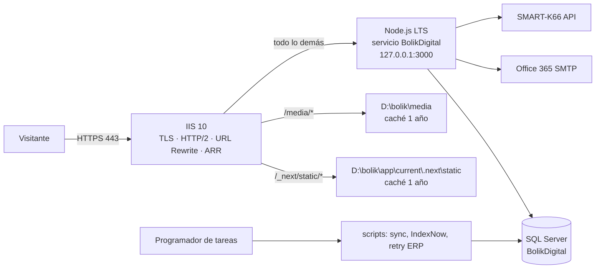
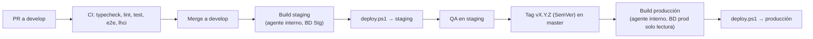

# 15 · Despliegue y operación

El sitio corre en el **IIS interno**: IIS recibe el tráfico (HTTPS, HTTP/2, redirecciones, archivos estáticos) y pasa el resto a **Node.js**, que ejecuta Next en modo `standalone` como servicio de Windows. Las tareas de servidor (Windows, IIS, DNS, certificados, SQL) se coordinan con TI; este documento dice exactamente qué se necesita.

## 1. Topología



| Entorno | URL | Servicio | Puerto | BD | Medios |
|---|---|---|---|---|---|
| Desarrollo | `http://localhost:3000` | `pnpm dev` | 3000 | Docker local | `./.media` |
| Staging | `https://staging.bolik66.com` (solo red interna o IP permitida) | `BolikDigital-Staging` | 3100 | `BolikDigital_Stg` | `D:\bolik-stg\media` |
| Producción | `https://www.bolik66.com` | `BolikDigital` | 3000 | `BolikDigital` | `D:\bolik\media` |

**Una sola instancia de Node por entorno.** La caché de Next (`'use cache'`, tags) vive en la memoria del proceso y en `.next` del release; con varias instancias habría que configurar un *cache handler* compartido (no necesario para el tráfico de Bolik).

## 2. Requisitos del servidor (pedir a TI)

- Windows Server 2019/2022, 4 vCPU, 8 GB RAM, 40 GB libres en `D:`.
- IIS 10 con: **URL Rewrite 2.1**, **Application Request Routing 3.0**, **IIS Compression** (Brotli/gzip para estáticos).
- **Node.js 22 LTS** (≥ 22.12, el mínimo de `engines` en `package.json`) instalado para todos los usuarios.
- **NSSM** (o PM2 con `pm2-installer`) para correr Node como servicio.
- Certificado TLS para `www.bolik66.com` y `bolik66.com` (y staging).
- Cuenta de servicio de Windows `svc-bolik` sin privilegios de administrador, con permisos de lectura en `D:\bolik\app` y escritura en `D:\bolik\media`, `D:\bolik\logs` y `.next` de cada release (caché y páginas que se regeneran al editar en el admin).
- Usuarios SQL: `bolik_app` (lectura/escritura de datos) y `bolik_migrator` (DDL, solo para migraciones).
- Salida HTTPS permitida hacia `smtp.office365.com:587`, `api.indexnow.org`, la API de SMART-K66 y `fonts.googleapis.com` + `fonts.gstatic.com` **solo durante el build** (next/font, ver §5).

## 3. Estructura en disco

```text
D:\bolik\
├─ app\
│  ├─ releases\
│  │  ├─ 2027-01-11_0600_a1b2c3d\   # .next/standalone + .next/static + public
│  │  └─ …                          # se conservan los 5 últimos
│  └─ current  →  releases\…        # junction (mklink /J), lo que corre el servicio
├─ config\
│  └─ production.env                # variables de entorno (solo svc-bolik y admins pueden leer)
├─ media\                           # imágenes y videos subidos (respaldado)
└─ logs\                            # logs de la app y de NSSM (rotación diaria)
```

## 4. Configurar Node e IIS (una vez por entorno)

### 4.1 Servicio de Windows con NSSM

```powershell
nssm install BolikDigital "C:\Program Files\nodejs\node.exe"
nssm set BolikDigital AppParameters "--env-file=D:\bolik\config\production.env server.js"
nssm set BolikDigital AppDirectory "D:\bolik\app\current"
nssm set BolikDigital AppEnvironmentExtra "NODE_ENV=production" "PORT=3000" "HOSTNAME=127.0.0.1"
nssm set BolikDigital ObjectName ".\svc-bolik" "<contraseña>"
nssm set BolikDigital AppStdout "D:\bolik\logs\app.log"
nssm set BolikDigital AppStderr "D:\bolik\logs\app-error.log"
nssm set BolikDigital AppRotateFiles 1
nssm set BolikDigital AppRotateOnline 1
nssm set BolikDigital AppRotateBytes 10485760
nssm set BolikDigital AppExit Default Restart
nssm set BolikDigital AppRestartDelay 3000
nssm set BolikDigital Start SERVICE_AUTO_START
nssm start BolikDigital
```

`HOSTNAME=127.0.0.1` hace que Node **solo** escuche localmente: nadie puede saltarse IIS.

> Pendiente para BD-140: `nssm set … ObjectName` deja la contraseña en la línea de comandos (registros de auditoría). Staging ya la asigna por CIM y concede el derecho de servicio aparte (`scripts/deploy/staging-setup.ps1`); producción debe hacer lo mismo.

### 4.2 ARR (a nivel de servidor)

```powershell
Import-Module WebAdministration
$p = 'MACHINE/WEBROOT/APPHOST'
Set-WebConfigurationProperty -pspath $p -filter 'system.webServer/proxy' -name 'enabled' -value 'True'
Set-WebConfigurationProperty -pspath $p -filter 'system.webServer/proxy' -name 'preserveHostHeader' -value 'True'
Set-WebConfigurationProperty -pspath $p -filter 'system.webServer/proxy' -name 'reverseRewriteHostInResponseHeaders' -value 'False'
# 0 = sin búfer: necesario para que el streaming de React (Suspense) llegue al navegador sin esperar
Set-WebConfigurationProperty -pspath $p -filter 'system.webServer/proxy' -name 'responseBufferLimit' -value 0
# Permitir que URL Rewrite fije estas cabeceras
Add-WebConfigurationProperty -pspath $p -filter 'system.webServer/rewrite/allowedServerVariables' -name '.' -value @{name='HTTP_X_FORWARDED_PROTO'}
Add-WebConfigurationProperty -pspath $p -filter 'system.webServer/rewrite/allowedServerVariables' -name '.' -value @{name='HTTP_X_FORWARDED_HOST'}
```

### 4.3 Sitio IIS

- Sitio `bolik66` con enlaces `https://www.bolik66.com:443` y `https://bolik66.com:443` (SNI) y `http` en el 80 para redirigir.
- Ruta física: `D:\bolik\iis` (solo contiene `web.config`).
- Directorio virtual `/_next/static` → `D:\bolik\app\current\.next\static`.
- Directorio virtual `/media` → `D:\bolik\media`. Tiene prioridad sobre la ruta `/media` de Node (BD-034), que existe para desarrollo y pruebas: si el directorio virtual faltara, Node también serviría los archivos, pero sin la caché estática de IIS.
- **Compresión dinámica desactivada** en el sitio (Next ya comprime el HTML y comprimir de nuevo rompe el streaming). Compresión estática (Brotli + gzip) activada.

`D:\bolik\iis\web.config`:

```xml
<?xml version="1.0" encoding="utf-8"?>
<configuration>
  <system.webServer>
    <rewrite>
      <rules>
        <rule name="Forzar HTTPS" stopProcessing="true">
          <match url="(.*)" />
          <conditions><add input="{HTTPS}" pattern="off" /></conditions>
          <action type="Redirect" url="https://www.bolik66.com/{R:1}" redirectType="Permanent" />
        </rule>
        <rule name="Forzar www" stopProcessing="true">
          <match url="(.*)" />
          <conditions><add input="{HTTP_HOST}" pattern="^bolik66\.com$" /></conditions>
          <action type="Redirect" url="https://www.bolik66.com/{R:1}" redirectType="Permanent" />
        </rule>
        <rule name="Estaticos de Next" stopProcessing="true">
          <match url="^_next/static/" />
          <action type="None" />
        </rule>
        <rule name="Medios" stopProcessing="true">
          <match url="^media/" />
          <action type="None" />
        </rule>
        <rule name="Proxy a Node" stopProcessing="true">
          <match url="(.*)" />
          <serverVariables>
            <set name="HTTP_X_FORWARDED_PROTO" value="https" />
            <set name="HTTP_X_FORWARDED_HOST" value="{HTTP_HOST}" />
          </serverVariables>
          <action type="Rewrite" url="http://127.0.0.1:3000/{R:1}" />
        </rule>
      </rules>
    </rewrite>
    <urlCompression doStaticCompression="true" doDynamicCompression="false" />
    <httpProtocol>
      <customHeaders>
        <remove name="X-Powered-By" />
        <add name="Strict-Transport-Security" value="max-age=31536000; includeSubDomains" />
      </customHeaders>
    </httpProtocol>
    <security>
      <requestFiltering removeServerHeader="true">
        <requestLimits maxAllowedContentLength="15728640" />
      </requestFiltering>
    </security>
  </system.webServer>

  <location path="_next/static">
    <system.webServer>
      <staticContent>
        <clientCache cacheControlMode="UseMaxAge" cacheControlMaxAge="365.00:00:00" cacheControlCustom="public, immutable" />
        <remove fileExtension=".woff2" /><mimeMap fileExtension=".woff2" mimeType="font/woff2" />
      </staticContent>
    </system.webServer>
  </location>
  <location path="media">
    <system.webServer>
      <staticContent>
        <clientCache cacheControlMode="UseMaxAge" cacheControlMaxAge="365.00:00:00" cacheControlCustom="public, immutable" />
        <remove fileExtension=".webp" /><mimeMap fileExtension=".webp" mimeType="image/webp" />
        <remove fileExtension=".avif" /><mimeMap fileExtension=".avif" mimeType="image/avif" />
        <remove fileExtension=".mp4" /><mimeMap fileExtension=".mp4" mimeType="video/mp4" />
      </staticContent>
    </system.webServer>
  </location>
</configuration>
```

> Las URL viejas de Joomla (`/index.php…`) **no** se redirigen en IIS: las maneja `proxy.ts` (doc 10 §6) para que estén probadas en CI.

Staging usa el mismo `web.config` con su dominio, puerto 3100 y además `X-Robots-Tag: noindex, nofollow`; lo escribe `scripts/deploy/staging-setup.ps1` (§12). La app también manda esa cabecera en todas las rutas cuando el build se hace con `APP_ENV=staging` (`next.config.ts`).

## 5. Build y despliegue

### Dónde se construye

> **CI de los PR (BD-014) ≠ build de cada entorno.** La CI de `.github/workflows/ci.yml` corre en máquinas de GitHub con un SQL Server en contenedor y variables de prueba: valida el código y publica un artefacto (`bolik-standalone`, tar.gz) que la propia CI arranca con `node server.js` para las pruebas E2E. Ese artefacto **no** se despliega: el de staging y el de producción se construyen en el agente interno descrito abajo, con la BD y las `NEXT_PUBLIC_*` de su entorno (agente: BD-141; primer despliegue manual: BD-016), con el mismo paquete que se describe abajo. **Importante para ese agente:** instalar con `pnpm install --frozen-lockfile --config.node-linker=hoisted` antes del build. Con la estructura normal de pnpm, `.next/standalone/node_modules` lleva enlaces simbólicos que Windows no crea sin permisos especiales (Modo de desarrollador o administrador) y que no se pueden copiar como archivos sin romper la resolución de módulos; la CI lo comprueba en el trabajo «Artefacto en Windows» (BD-014). **sharp** (BD-034) carga un binario por plataforma: si el paquete se construye en Linux para un servidor Windows, `supportedArchitectures` (`pnpm-workspace.yaml`) instala también `@img/sharp-win32-x64` y `outputFileTracingIncludes` (`next.config.ts`) lo mete al paquete; el mismo trabajo lo comprueba generando un WebP.

Con Cache Components, `next build` **prerenderiza las páginas leyendo la BD** (catálogo, tiendas, contenido). Por eso el build se ejecuta en un **agente dentro de la red interna** (runner autohospedado de GitHub Actions o agente de Azure DevOps en el servidor de staging) con acceso de **solo lectura** a la BD del entorno de destino. Además, las variables `NEXT_PUBLIC_*` quedan fijas en el build: se hace **un build por entorno** a partir del mismo commit.

> **Salida a internet del agente (confirmar con TI en BD-016).** Durante el build, `next/font/google` descarga Bricolage Grotesque, DM Sans y Baloo 2 de `fonts.googleapis.com` / `fonts.gstatic.com` (después se sirven desde el propio servidor; el navegador nunca va a Google). Si el agente interno no tiene salida HTTPS a esos dominios, el build falla: se cambia `src/app/fonts.ts` a `next/font/local` con los `.woff2` versionados en el repo. `pnpm install` también necesita el registro de npm (o un espejo interno).



### Contenido del paquete
`next build` con `output: "standalone"` genera `.next/standalone` pero **no** copia los estáticos. El pipeline arma el paquete con `scripts/ci/package.sh` (el mismo de la CI; en Windows corre con Git Bash): copia `.next/static`, `public/` y `prisma/` (migraciones para el deploy) dentro de `.next/standalone` y lo empaca en **tar.gz**, que el `tar.exe` de Windows extrae sin herramientas extra:

```powershell
pnpm install --frozen-lockfile --config.node-linker=hoisted   # sin los enlaces de pnpm (BD-014)
pnpm build
bash scripts/ci/package.sh "bolik-$env:BUILD_ID.tar.gz"
```

### `scripts/deploy.ps1` (resumen)

```powershell
param([string]$Pkg, [string]$Env = "production")
$ErrorActionPreference = "Stop"
$base = if ($Env -eq "production") { "D:\bolik" } else { "D:\bolik-stg" }
$svc  = if ($Env -eq "production") { "BolikDigital" } else { "BolikDigital-Staging" }
$port = if ($Env -eq "production") { 3000 } else { 3100 }
$rel  = Join-Path "$base\app\releases" (Get-Date -Format "yyyy-MM-dd_HHmm")

New-Item -ItemType Directory $rel | Out-Null
tar -xzf $Pkg -C $rel
# 1. Migraciones (usuario bolik_migrator, variable MIGRATE_DATABASE_URL)
Push-Location $rel; npx prisma migrate deploy; Pop-Location
# 2. Cambiar 'current' y reiniciar
Stop-Service $svc
cmd /c rmdir "$base\app\current"
cmd /c mklink /J "$base\app\current" "$rel"
Start-Service $svc
# 3. Prueba de humo
Start-Sleep 5
$r = Invoke-WebRequest "http://127.0.0.1:$port/api/health" -UseBasicParsing
if ($r.StatusCode -ne 200) { throw "Health check falló: revertir con rollback.ps1" }
# 4. Limpiar: conservar 5 releases
Get-ChildItem "$base\app\releases" | Sort-Object Name -Descending | Select-Object -Skip 5 | Remove-Item -Recurse -Force
```

El reinicio corta el servicio 3–8 segundos; en producción se despliega en horario de bajo tráfico (antes de las 7:00 o después de las 20:00). IIS muestra durante ese lapso una página `502` personalizada y amable (`D:\bolik\iis\errors\502.html`).

### Migraciones seguras
- Solo cambios **compatibles hacia atrás** en un mismo despliegue (agregar columnas/tablas; para borrar o renombrar, hacerlo en dos despliegues).
- Antes de cada migración en producción: respaldo (§7).

## 6. Cabeceras de seguridad y CSP

Se definen en `next.config.ts` (`headers()`), salvo HSTS que pone IIS:

| Cabecera | Valor |
|---|---|
| `Content-Security-Policy` | ver abajo |
| `X-Content-Type-Options` | `nosniff` |
| `Referrer-Policy` | `strict-origin-when-cross-origin` |
| `Permissions-Policy` | `camera=(), microphone=(), payment=(), geolocation=(self)` |
| `X-Frame-Options` | `DENY` (además de `frame-ancestors 'none'`) |
| `Cross-Origin-Opener-Policy` | `same-origin` |

CSP:

```text
default-src 'self';
script-src 'self' 'unsafe-inline' https://www.googletagmanager.com https://www.clarity.ms https://*.clarity.ms;
style-src 'self' 'unsafe-inline';
img-src 'self' data: blob: https://*.tile.openstreetmap.org https://www.googletagmanager.com https://*.clarity.ms https://c.bing.com;
font-src 'self';
connect-src 'self' https://*.google-analytics.com https://*.analytics.google.com https://www.googletagmanager.com https://*.clarity.ms;
media-src 'self';
frame-src https://www.google.com https://www.youtube-nocookie.com;
frame-ancestors 'none';
base-uri 'self';
form-action 'self';
object-src 'none';
upgrade-insecure-requests
```

¿Por qué `'unsafe-inline'` en scripts? Las páginas públicas son **prerenderizadas**: un *nonce* obligaría a renderizarlas en cada petición (perdiendo velocidad), y Next inserta scripts en línea para hidratar. El riesgo se controla porque el sitio nunca renderiza HTML escrito por usuarios, los formularios se validan con Zod y el admin escapa todo. Se revisa al pasar a Fase 2.

Proceso: publicar primero como `Content-Security-Policy-Report-Only` en staging, revisar la consola en todas las páginas y luego activar.

## 7. Respaldos

| Qué | Cómo | Frecuencia | Retención |
|---|---|---|---|
| BD `BolikDigital` | Plan de mantenimiento del DBA (completo + log) | Completo diario 1:00; log cada hora | 30 días |
| `D:\bolik\media` | `robocopy D:\bolik\media \\respaldo\bolik\media /MIR /R:2 /W:5 /LOG+:D:\bolik\logs\robocopy.log` (tarea programada) | Diario 2:00 | Según política de TI |
| `D:\bolik\config` | Copia cifrada en el gestor de secretos de TI | En cada cambio | — |
| Releases | Los 5 últimos en disco + artefactos en CI | Cada despliegue | 90 días en CI |

**Prueba de restauración** (BD-143, luego trimestral): restaurar BD y medios en staging, arrancar la app, verificar home, una ficha con imágenes y el admin. Anotar tiempos reales.

## 8. Reversión (rollback)

Si después de un despliegue algo crítico falla (formularios, ficha, home):

```powershell
# scripts/rollback.ps1 — vuelve al release anterior en < 2 minutos
$base = "D:\bolik"; $svc = "BolikDigital"
$prev = Get-ChildItem "$base\app\releases" | Sort-Object Name -Descending | Select-Object -Skip 1 -First 1
Stop-Service $svc
cmd /c rmdir "$base\app\current"
cmd /c mklink /J "$base\app\current" $prev.FullName
Start-Service $svc
```

- Las migraciones compatibles hacia atrás (§5) permiten volver al código anterior sin tocar la BD.
- Si una migración dañó datos: restaurar el respaldo previo al despliegue (decisión del líder técnico con el DBA).
- Registrar el incidente en el ticket y crear el ticket de corrección.

## 9. Monitoreo y logs

| Qué | Herramienta | Alerta |
|---|---|---|
| Disponibilidad de `/` y `/api/health` | Monitor de TI (PRTG, Zabbix, Uptime Kuma) o servicio externo, cada 1 min | Correo/Teams tras 2 fallas seguidas |
| Errores de la app | Logs `pino` en `D:\bolik\logs\app*.log` (JSON) | Búsqueda diaria de `"level":50`; alerta si > 20/h |
| Servicio caído | NSSM reinicia solo; evento en el Visor de eventos | El monitor de disponibilidad |
| Certificado TLS | Monitor de TI | 30 días antes de vencer |
| Disco `D:` | Monitor de TI | < 15 % libre |
| Cotizaciones atascadas | Dashboard del admin (`erpStatus = error`, o `pendiente` con más de 24 h: SMART-K66 lleva un día caído) | Correo diario si hay > 0 con más de 24 h |
| Web Vitals reales | GA4 (`web_vital`) + Search Console | Revisión semanal |

`/api/health` responde `200 {"status":"ok","db":"ok","version":"<commit>"}` tras un `SELECT 1` con timeout de 2 s; `503` si falla la BD. Sin caché y fuera de robots.

## 10. Tareas programadas

En el Programador de tareas de Windows, como `svc-bolik`, en `D:\bolik\app\current`:

| Tarea | Comando | Cuándo |
|---|---|---|
| Enviar IndexNow | `node --env-file=D:\bolik\config\production.env scripts\flush-indexnow.mjs` | Cada 10 min |
| Reintentar envíos a SAP | `node --env-file=… scripts\retry-erp.mjs` | Cada 15 min |
| Sincronizar catálogo | `node --env-file=… scripts\sync-catalog.mjs` | Diario 5:30 |
| Limpiar logs > 30 días | PowerShell | Semanal |
| Respaldo de medios | `robocopy` (§7) | Diario 2:00 |

Los scripts de `scripts/*.ts` se compilan a `.mjs` en el build (`tsup` o `esbuild`) y se copian al paquete; así el servidor no necesita `tsx` ni `pnpm`. Cada script registra inicio, fin y resultado en el log y termina con código ≠ 0 si falla (para que la tarea quede marcada en rojo).

## 11. Variables por entorno

Ver la lista completa en doc 03 §9 y `starter/.env.example`. Diferencias:

| Variable | Staging | Producción |
|---|---|---|
| `APP_ENV` | `staging` | `production` |
| `DATA_SOURCE` | `fixtures` (datos de ejemplo, sin base) o `db` (el build lee `BolikDigital_Stg`, migrada y sembrada); cambiarla exige un build nuevo | `db` (la app no arranca con otro valor) |
| `NEXT_PUBLIC_SITE_URL` | `https://staging.bolik66.com` | `https://www.bolik66.com` |
| `NEXT_PUBLIC_GA_ID` / `CLARITY_ID` | vacío | IDs reales |
| `ERP_MODE` | `smartk66` contra SAP de pruebas (o `noop`) | `smartk66` (o `noop` hasta BD-128) |
| `MAIL_SALES_TO` | correo del equipo de desarrollo | `ventas@bolik66.com` |
| `INDEXNOW_KEY` | vacío (no se envía) | clave real |

## 12. Staging: primera instalación y despliegue manual (BD-016)

Hasta que exista el pipeline (BD-141), staging se prepara y se despliega a mano con cuatro scripts de `scripts/deploy/`. Los cuatro **solo sirven para staging**: el `web.config` lleva `noindex`, no tiene la regla de `www` y el setup se niega a correr con el dominio de producción. Producción (BD-140) usa el `web.config` de §4.3 y `deploy.ps1`.

| Script                  | Dónde y cómo                                                                     | Qué hace                                              |
| ----------------------- | -------------------------------------------------------------------------------- | ----------------------------------------------------- |
| `staging-preflight.ps1` | En el servidor, de preferencia como administrador                                | Revisa los requisitos. Solo lectura, sin credenciales |
| `staging-setup.ps1`     | En el servidor, como administrador; una vez y al cambiar el certificado o las IP | Carpetas, `staging.env`, ARR, sitio IIS y servicio    |
| `staging-build.ps1`     | Clon limpio con acceso a `BolikDigital_Stg`; normalmente el servidor, como administrador | Migra, siembra, construye y empaca                    |
| `staging-deploy.ps1`    | En el servidor, como administrador                                               | Nuevo release, prueba de humo y vuelta atrás si falla |

### Servidor compartido (`K66-APPS`)

Staging (y después producción) vive en `K66-APPS`, la misma máquina que el SQL Server de la empresa, las bases del punto de venta SMART-K66 y su API (`/k66api/api/`). Antes del setup, TI confirma tres cosas:

- **Que se puede exponer un IIS en esa máquina.** Solo a la red interna o a IP permitidas: `-AllowedIps`.
- **ARR.** Su configuración es de todo el servidor: `preserveHostHeader=True`, `reverseRewriteHostInResponseHeaders=False` y `responseBufferLimit=0`. Si otro sitio ya usa ARR como proxy, también le aplica. El preflight lista esos sitios y los valores actuales.
- **DNS.** `bolik66.com` tiene un comodín público. `staging.bolik66.com` ya resuelve al hosting actual aunque nadie haya creado el registro, así que hace falta uno propio (interno o público) hacia `K66-APPS`. El preflight avisa si el nombre no resuelve a ese servidor.

### Lo que entrega TI antes de empezar

- [ ] Servidor de §2 con IIS 10, URL Rewrite 2.1, ARR 3.0, Node.js 22 (≥ 22.12, el mínimo de `engines` en `package.json`) y NSSM en el `PATH`. Para `-AllowedIps`, también la característica «IP and Domain Restrictions» (`Web-IP-Security`).
- [ ] Cuenta de servicio (por ejemplo `.\svc-bolik` o `DOMINIO\svc-bolik`), sin privilegios de administrador, y su contraseña.
- [ ] Base `BolikDigital_Stg` con dos usuarios **nuevos**: `bolik_app` (lectura y escritura) y `bolik_migrator` (DDL, solo migraciones). Sus credenciales van solo en `staging.env` o se escriben al migrar. Nunca van al repo.
- [ ] DNS de `staging.bolik66.com` (o la URL interna) hacia el servidor y su certificado TLS en `LocalMachine\My`.
- [ ] Acceso limitado a la red interna o a IP permitidas.
- [ ] En la máquina donde se construye:
  - Git for Windows (su `bash` arma el paquete) y pnpm (`corepack enable`).
  - Salida HTTPS al registro de npm, `fonts.googleapis.com` y `fonts.gstatic.com` (§5).
  - Acceso a `BolikDigital_Stg`.

### 0. Revisar el servidor

En PowerShell, de preferencia como administrador. Sin esos permisos, IIS y la cuenta quedan sin revisar:

```powershell
powershell -ExecutionPolicy Bypass -File scripts\deploy\staging-preflight.ps1 `
  -HostName staging.bolik66.com -ServiceAccount ".\svc-bolik" -SqlServer localhost
```

No cambia nada y se puede repetir. Cada línea sale como OK, AVISO, FALTA o INFO, y el script termina con código 1 si hay algo en FALTA. Revisa:

- Windows y el espacio en disco.
- Node, NSSM, y git, bash y pnpm para construir.
- Los módulos de IIS y Brotli.
- Los valores de ARR y qué otros sitios hacen proxy.
- Los sitios y enlaces que chocan con el dominio de staging.
- El puerto 3100.
- La cuenta de servicio (que exista y no sea administradora).
- El certificado con su vencimiento y el DNS.
- La conexión TCP al SQL Server y la salida a npm y a Google Fonts.

### 1. Preparar el servidor

En PowerShell como administrador, desde una copia del repo en el servidor:

```powershell
powershell -ExecutionPolicy Bypass -File scripts\deploy\staging-setup.ps1 `
  -HostName staging.bolik66.com -ServiceAccount ".\svc-bolik" -CertThumbprint "<huella del certificado>" `
  -AllowedIps "10.0.0.0/8,192.168.10.25"
```

Se puede volver a correr, por ejemplo cuando llega o se renueva el certificado, o cuando cambian las IP. `-ResetPassword` vuelve a pedir la contraseña de la cuenta. El script:

- Crea las carpetas de §3 en `D:\bolik-stg` con permisos explícitos. La cuenta de servicio lee la app y escribe en `media` y `logs`; IIS lee estáticos y medios.
- Crea `D:\bolik-stg\config\staging.env` a partir de `.env.example`, ya con `APP_ENV=staging`, la URL `https://` y `MEDIA_DIR`. Solo lo leen la cuenta de servicio y los administradores.
- Configura ARR a nivel de servidor y crea el sitio IIS `staging-bolik` con su `web.config`. Sin certificado, el sitio queda en HTTP y sin redirección.
- Limita el sitio a las IP o redes de `-AllowedIps`, que reemplazan la lista anterior. Siempre agrega el loopback (`127.0.0.1` y `::1`) para la prueba de humo, pero no la IP de red del servidor: desde el propio servidor con el DNS real se recibe `403` si esa IP no está en la lista. Sin el parámetro, la restricción no se toca; `-AllowedIps none` la quita.
- Si un firewall con NAT reescribe el origen, IIS ve la IP del firewall en todas las visitas y la lista no sirve: en ese caso se limita en el firewall.
- Crea el servicio `BolikDigital-Staging` (no lo inicia) y le da a la cuenta el derecho «Iniciar sesión como servicio». La contraseña se asigna sin pasar por la línea de comandos.

Después, TI completa `staging.env` con los valores de §11: `DATABASE_URL` con `bolik_app`, `DATA_SOURCE`, un `SESSION_SECRET` aleatorio, el correo… Con `APP_ENV=staging`, la app no arranca si queda el `SESSION_SECRET` de ejemplo o el usuario `sa`.

`SMTP_MODE` pasa a `smtp` cuando exista la cuenta de correo (BD-074). En modo `file`, la app escribiría dentro del release, donde la cuenta no tiene permiso.

`MIGRATE_DATABASE_URL` **no** va en ese archivo: el servicio no necesita el usuario de DDL. Ninguna de estas variables va al repo.

### 2. Construir el paquete (migra y siembra antes)

Desde un **clon limpio** del commit de `develop` que se va a desplegar. Normalmente es el propio servidor, que llega a `BolikDigital_Stg`, y como administrador: `staging.env` solo lo leen la cuenta de servicio y los administradores, y el clon dentro de `D:\bolik-stg` hereda ese permiso.

```powershell
git clone --branch develop https://github.com/Alex-Gallardo/web-bolik-60.git D:\bolik-stg\build\web-bolik-60
cd D:\bolik-stg\build\web-bolik-60
powershell -ExecutionPolicy Bypass -File scripts\deploy\staging-build.ps1 -SampleData -SeedAdminEmail "<correo del admin>"
```

`staging-build.ps1`:

1. **Revisa el clon.** Se niega a correr si hay archivos `.env*` locales (`next build` y Prisma completarían con valores de desarrollo) o cambios sin commit.
2. **Instala las dependencias** con `--config.node-linker=hoisted` (§5), antes de cargar los secretos.
3. **Carga `staging.env` solo en su proceso.** Usa el mismo analizador que `node --env-file` y exige `APP_ENV=staging` y una URL `https://`. Las variables de staging no se escriben en ningún archivo y se borran al terminar.
4. **Migra con `pnpm db:deploy`** si `DATA_SOURCE=db`. `MIGRATE_DATABASE_URL` (`bolik_migrator`) se pide sin eco y se borra al acabar.
5. **Siembra.**
   - Por defecto, con `--profile prod`: solo crea lo que falta, sin ejemplos, y no pisa lo editado en el admin (doc 05 §6).
   - Con `-SampleData`, con `--profile dev --allow-sample-data`: los mismos datos de ejemplo que en desarrollo. Este perfil sincroniza con los JSON y pisa lo editado en el admin de staging.
   - `-SeedAdminEmail` crea el admin inicial y pide su contraseña sin eco.
6. **Construye.** Con `DATA_SOURCE=db`, el build lee la base y prerenderiza con esos datos.
7. **Empaca** con `scripts/ci/package.sh` en `bolik-<commit>.tar.gz`, por defecto en la carpeta que contiene el clon, y muestra su SHA256.

Con `DATA_SOURCE=fixtures`, el build no lee la base y se omiten la migración y el seed. `-SkipMigrate` y `-SkipSeed` los omiten a mano.

Aunque las páginas se generen en el build, el servicio necesita la base disponible. La consulta para lo que no se prerenderizó (un 404, una página con parámetros nuevos) y cuando se revalida un tag.

**Datos de ejemplo (BD-016, hasta BD-038).** Con `-SampleData`, staging muestra el catálogo de ejemplo en lugar de solo el Bolik Ultra. La bandera `--allow-sample-data` solo funciona con el perfil `dev`, `APP_ENV=staging` y la base `BolikDigital_Stg`; nunca en producción ni en otra base del mismo SQL Server. Cuando llegue el catálogo real, el DBA recrea `BolikDigital_Stg` vacía y se construye sin `-SampleData`. El perfil `prod` no borra los ejemplos que ya estén.

Los pósters y videos de ejemplo del hero (BD-050) tampoco van en el paquete. Con `-SampleData` (o `DATA_SOURCE=fixtures`), se ponen una vez en el `MEDIA_DIR` de staging desde la carpeta de la demo:

```powershell
$env:MEDIA_DIR = "D:olik-stgmedia"
pnpm media:samples "<carpeta de la demo>ideos"
Remove-Item Env:MEDIA_DIR
```

Sin ellos, IIS responde 404 al póster y a los videos, y el hero queda sin imagen.

El artefacto de la CI no sirve aquí: lleva `NEXT_PUBLIC_SITE_URL=http://localhost:3100` y no tiene `APP_ENV=staging`.

### 3. Desplegar

En el servidor, como administrador. `-ServiceAccount` es la misma cuenta que se pasó a `staging-setup.ps1`, y `-HostName`, `-Base`, `-Port`, `-ServiceName` y `-SiteName` deben coincidir con los del setup (con una URL interna, sin `-HostName` la prueba por IIS falla y el despliegue vuelve atrás). `-Sha256` es el que imprimió `staging-build.ps1`:

```powershell
powershell -ExecutionPolicy Bypass -File scripts\deploy\staging-deploy.ps1 `
  -Package D:\bolik-stg\build\bolik-<commit>.tar.gz -ServiceAccount ".\svc-bolik" -Sha256 <hash>
```

El script:

1. Extrae el paquete en `D:\bolik-stg\app\releases\<fecha>_<commit>` y comprueba que trae `server.js`, `.next\static` y `public`.
2. Le da a la cuenta permiso de escritura en `.next`, donde Next guarda la caché y las páginas que se regeneran al editar en el admin.
3. Detiene el servicio, apunta la junction `current` al release nuevo y lo inicia.
4. Hace la prueba de humo. La home debe responder `200` con `X-Robots-Tag: noindex` dos veces:
   - en Node (`127.0.0.1:3100`), esperando hasta 90 s a que arranque;
   - a través de IIS con el dominio. Usa `curl --resolve` hacia este mismo servidor, así que no depende del DNS.
5. Si algo falla, vuelve al release anterior, reinicia el servicio y deja el release fallido para revisarlo.
6. Conserva los 5 releases buenos más recientes (`-Keep`) y el último fallido; nunca borra el que corre.

Si el servicio no arranca (error 1069), el registro del sistema dice la causa:

- **Evento 7038:** la contraseña es incorrecta. Se vuelve a correr `staging-setup.ps1 -ResetPassword`.
- **Evento 7041:** falta el derecho «Iniciar sesión como servicio», normalmente porque una GPO del dominio lo redefine. TI agrega la cuenta en esa GPO.

Los errores de la app quedan en `D:\bolik-stg\logs\app-error.log`.

### 4. Comprobar (criterios de BD-016)

Desde un equipo de la red interna:

```powershell
curl.exe -sI https://staging.bolik66.com/ | Select-String "HTTP/|X-Robots-Tag"
```

Debe responder `200` con `X-Robots-Tag: noindex, nofollow`. En las páginas, la cabecera sale dos veces, una de Next y otra de IIS, y es normal. Desde una IP fuera de `-AllowedIps`, IIS responde `403`.
