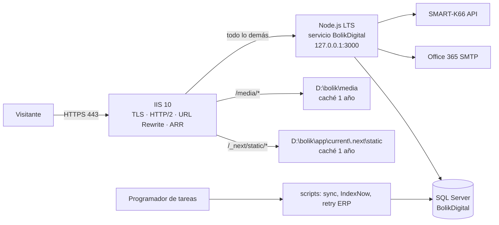
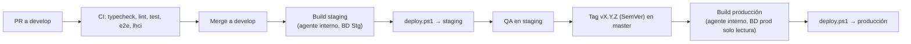

# 15 · Despliegue y operación

El sitio corre en el **IIS interno**: IIS recibe el tráfico (HTTPS, HTTP/2, redirecciones, archivos estáticos) y pasa el resto a **Node.js**, que ejecuta Next en modo `standalone` como servicio de Windows. Las tareas de servidor (Windows, IIS, DNS, certificados, SQL) se coordinan con TI; este documento dice exactamente qué se necesita.

## 1. Topología



| Entorno | URL | Servicio | Puerto | BD | Medios |
|---|---|---|---|---|---|
| Desarrollo | `http://localhost:3000` | `pnpm dev` | 3000 | Docker local | `./.media` |
| Staging | `https://staging.bolik66.com` (solo red interna o IP permitida) | `BolikDigital-Staging` | 3100 | `BolikDigital_Stg` | `D:\bolik-stg\media` |
| Producción | `https://www.bolik66.com` | `BolikDigital` | 3000 | `BolikDigital` | `D:\bolik\media` |

**Una sola instancia de Node por entorno.** La caché de Next (`'use cache'`, tags) vive en la memoria del proceso y en `.next` del release; con varias instancias habría que configurar un *cache handler* compartido (no necesario para el tráfico de Bolik).

## 2. Requisitos del servidor (pedir a TI)

- Windows Server 2019/2022, 4 vCPU, 8 GB RAM, 40 GB libres en `D:`.
- IIS 10 con: **URL Rewrite 2.1**, **Application Request Routing 3.0**, **IIS Compression** (Brotli/gzip para estáticos).
- **Node.js LTS** (≥ 20.9; usar la LTS vigente) instalado para todos los usuarios.
- **NSSM** (o PM2 con `pm2-installer`) para correr Node como servicio.
- Certificado TLS para `www.bolik66.com` y `bolik66.com` (y staging).
- Cuenta de servicio de Windows `svc-bolik` sin privilegios de administrador, con permisos de lectura en `D:\bolik\app` y escritura en `D:\bolik\media`, `D:\bolik\logs` y `D:\bolik\app\current\.next\cache`.
- Usuarios SQL: `bolik_app` (lectura/escritura de datos) y `bolik_migrator` (DDL, solo para migraciones).
- Salida HTTPS permitida hacia `smtp.office365.com:587`, `api.indexnow.org`, la API de SMART-K66 y `fonts.googleapis.com` + `fonts.gstatic.com` **solo durante el build** (next/font, ver §5).

## 3. Estructura en disco

```text
D:\bolik\
├─ app\
│  ├─ releases\
│  │  ├─ 2027-01-11_0600_a1b2c3d\   # .next/standalone + .next/static + public
│  │  └─ …                          # se conservan los 5 últimos
│  └─ current  →  releases\…        # junction (mklink /J), lo que corre el servicio
├─ config\
│  └─ production.env                # variables de entorno (solo svc-bolik y admins pueden leer)
├─ media\                           # imágenes y videos subidos (respaldado)
└─ logs\                            # logs de la app y de NSSM (rotación diaria)
```

## 4. Configurar Node e IIS (una vez por entorno)

### 4.1 Servicio de Windows con NSSM

```powershell
nssm install BolikDigital "C:\Program Files\nodejs\node.exe"
nssm set BolikDigital AppParameters "--env-file=D:\bolik\config\production.env server.js"
nssm set BolikDigital AppDirectory "D:\bolik\app\current"
nssm set BolikDigital AppEnvironmentExtra "NODE_ENV=production" "PORT=3000" "HOSTNAME=127.0.0.1"
nssm set BolikDigital ObjectName ".\svc-bolik" "<contraseña>"
nssm set BolikDigital AppStdout "D:\bolik\logs\app.log"
nssm set BolikDigital AppStderr "D:\bolik\logs\app-error.log"
nssm set BolikDigital AppRotateFiles 1
nssm set BolikDigital AppRotateBytes 10485760
nssm set BolikDigital AppExit Default Restart
nssm set BolikDigital AppRestartDelay 3000
nssm set BolikDigital Start SERVICE_AUTO_START
nssm start BolikDigital
```

`HOSTNAME=127.0.0.1` hace que Node **solo** escuche localmente: nadie puede saltarse IIS.

### 4.2 ARR (a nivel de servidor)

```powershell
Import-Module WebAdministration
$p = 'MACHINE/WEBROOT/APPHOST'
Set-WebConfigurationProperty -pspath $p -filter 'system.webServer/proxy' -name 'enabled' -value 'True'
Set-WebConfigurationProperty -pspath $p -filter 'system.webServer/proxy' -name 'preserveHostHeader' -value 'True'
Set-WebConfigurationProperty -pspath $p -filter 'system.webServer/proxy' -name 'reverseRewriteHostInResponseHeaders' -value 'False'
# 0 = sin búfer: necesario para que el streaming de React (Suspense) llegue al navegador sin esperar
Set-WebConfigurationProperty -pspath $p -filter 'system.webServer/proxy' -name 'responseBufferLimit' -value 0
# Permitir que URL Rewrite fije estas cabeceras
Add-WebConfigurationProperty -pspath $p -filter 'system.webServer/rewrite/allowedServerVariables' -name '.' -value @{name='HTTP_X_FORWARDED_PROTO'}
Add-WebConfigurationProperty -pspath $p -filter 'system.webServer/rewrite/allowedServerVariables' -name '.' -value @{name='HTTP_X_FORWARDED_HOST'}
```

### 4.3 Sitio IIS

- Sitio `bolik66` con enlaces `https://www.bolik66.com:443` y `https://bolik66.com:443` (SNI) y `http` en el 80 para redirigir.
- Ruta física: `D:\bolik\iis` (solo contiene `web.config`).
- Directorio virtual `/_next/static` → `D:\bolik\app\current\.next\static`.
- Directorio virtual `/media` → `D:\bolik\media`.
- **Compresión dinámica desactivada** en el sitio (Next ya comprime el HTML y comprimir de nuevo rompe el streaming). Compresión estática (Brotli + gzip) activada.

`D:\bolik\iis\web.config`:

```xml
<?xml version="1.0" encoding="utf-8"?>
<configuration>
  <system.webServer>
    <rewrite>
      <rules>
        <rule name="Forzar HTTPS" stopProcessing="true">
          <match url="(.*)" />
          <conditions><add input="{HTTPS}" pattern="off" /></conditions>
          <action type="Redirect" url="https://www.bolik66.com/{R:1}" redirectType="Permanent" />
        </rule>
        <rule name="Forzar www" stopProcessing="true">
          <match url="(.*)" />
          <conditions><add input="{HTTP_HOST}" pattern="^bolik66\.com$" /></conditions>
          <action type="Redirect" url="https://www.bolik66.com/{R:1}" redirectType="Permanent" />
        </rule>
        <rule name="Estaticos de Next" stopProcessing="true">
          <match url="^_next/static/" />
          <action type="None" />
        </rule>
        <rule name="Medios" stopProcessing="true">
          <match url="^media/" />
          <action type="None" />
        </rule>
        <rule name="Proxy a Node" stopProcessing="true">
          <match url="(.*)" />
          <serverVariables>
            <set name="HTTP_X_FORWARDED_PROTO" value="https" />
            <set name="HTTP_X_FORWARDED_HOST" value="{HTTP_HOST}" />
          </serverVariables>
          <action type="Rewrite" url="http://127.0.0.1:3000/{R:1}" />
        </rule>
      </rules>
    </rewrite>
    <urlCompression doStaticCompression="true" doDynamicCompression="false" />
    <httpProtocol>
      <customHeaders>
        <remove name="X-Powered-By" />
        <add name="Strict-Transport-Security" value="max-age=31536000; includeSubDomains" />
      </customHeaders>
    </httpProtocol>
    <security>
      <requestFiltering removeServerHeader="true">
        <requestLimits maxAllowedContentLength="15728640" />
      </requestFiltering>
    </security>
  </system.webServer>

  <location path="_next/static">
    <system.webServer>
      <staticContent>
        <clientCache cacheControlMode="UseMaxAge" cacheControlMaxAge="365.00:00:00" cacheControlCustom="public, immutable" />
        <remove fileExtension=".woff2" /><mimeMap fileExtension=".woff2" mimeType="font/woff2" />
      </staticContent>
    </system.webServer>
  </location>
  <location path="media">
    <system.webServer>
      <staticContent>
        <clientCache cacheControlMode="UseMaxAge" cacheControlMaxAge="365.00:00:00" cacheControlCustom="public, immutable" />
        <remove fileExtension=".webp" /><mimeMap fileExtension=".webp" mimeType="image/webp" />
        <remove fileExtension=".avif" /><mimeMap fileExtension=".avif" mimeType="image/avif" />
        <remove fileExtension=".mp4" /><mimeMap fileExtension=".mp4" mimeType="video/mp4" />
      </staticContent>
    </system.webServer>
  </location>
</configuration>
```

> Las URL viejas de Joomla (`/index.php…`) **no** se redirigen en IIS: las maneja `proxy.ts` (doc 10 §6) para que estén probadas en CI.

Staging usa el mismo `web.config` con su dominio, puerto 3100 y además `X-Robots-Tag: noindex, nofollow`.

## 5. Build y despliegue

### Dónde se construye
Con Cache Components, `next build` **prerenderiza las páginas leyendo la BD** (catálogo, tiendas, contenido). Por eso el build se ejecuta en un **agente dentro de la red interna** (runner autohospedado de GitHub Actions o agente de Azure DevOps en el servidor de staging) con acceso de **solo lectura** a la BD del entorno de destino. Además, las variables `NEXT_PUBLIC_*` quedan fijas en el build: se hace **un build por entorno** a partir del mismo commit.

> **Salida a internet del agente (confirmar con TI en BD-016).** Durante el build, `next/font/google` descarga Bricolage Grotesque, DM Sans y Baloo 2 de `fonts.googleapis.com` / `fonts.gstatic.com` (después se sirven desde el propio servidor; el navegador nunca va a Google). Si el agente interno no tiene salida HTTPS a esos dominios, el build falla: se cambia `src/app/fonts.ts` a `next/font/local` con los `.woff2` versionados en el repo. `pnpm install` también necesita el registro de npm (o un espejo interno).



### Contenido del paquete
`next build` con `output: "standalone"` genera `.next/standalone` pero **no** copia los estáticos. El pipeline arma el paquete así:

```powershell
pnpm build
Copy-Item -Recurse .next\static .next\standalone\.next\static
Copy-Item -Recurse public .next\standalone\public
Copy-Item -Recurse prisma .next\standalone\prisma   # migraciones para el deploy
Compress-Archive .next\standalone\* bolik-$env:BUILD_ID.zip
```

### `scripts/deploy.ps1` (resumen)

```powershell
param([string]$Zip, [string]$Env = "production")
$ErrorActionPreference = "Stop"
$base = if ($Env -eq "production") { "D:\bolik" } else { "D:\bolik-stg" }
$svc  = if ($Env -eq "production") { "BolikDigital" } else { "BolikDigital-Staging" }
$port = if ($Env -eq "production") { 3000 } else { 3100 }
$rel  = Join-Path "$base\app\releases" (Get-Date -Format "yyyy-MM-dd_HHmm")

Expand-Archive $Zip $rel
# 1. Migraciones (usuario bolik_migrator, variable MIGRATE_DATABASE_URL)
Push-Location $rel; npx prisma migrate deploy; Pop-Location
# 2. Cambiar 'current' y reiniciar
Stop-Service $svc
cmd /c rmdir "$base\app\current"
cmd /c mklink /J "$base\app\current" "$rel"
Start-Service $svc
# 3. Prueba de humo
Start-Sleep 5
$r = Invoke-WebRequest "http://127.0.0.1:$port/api/health" -UseBasicParsing
if ($r.StatusCode -ne 200) { throw "Health check falló: revertir con rollback.ps1" }
# 4. Limpiar: conservar 5 releases
Get-ChildItem "$base\app\releases" | Sort-Object Name -Descending | Select-Object -Skip 5 | Remove-Item -Recurse -Force
```

El reinicio corta el servicio 3–8 segundos; en producción se despliega en horario de bajo tráfico (antes de las 7:00 o después de las 20:00). IIS muestra durante ese lapso una página `502` personalizada y amable (`D:\bolik\iis\errors\502.html`).

### Migraciones seguras
- Solo cambios **compatibles hacia atrás** en un mismo despliegue (agregar columnas/tablas; para borrar o renombrar, hacerlo en dos despliegues).
- Antes de cada migración en producción: respaldo (§7).

## 6. Cabeceras de seguridad y CSP

Se definen en `next.config.ts` (`headers()`), salvo HSTS que pone IIS:

| Cabecera | Valor |
|---|---|
| `Content-Security-Policy` | ver abajo |
| `X-Content-Type-Options` | `nosniff` |
| `Referrer-Policy` | `strict-origin-when-cross-origin` |
| `Permissions-Policy` | `camera=(), microphone=(), payment=(), geolocation=(self)` |
| `X-Frame-Options` | `DENY` (además de `frame-ancestors 'none'`) |
| `Cross-Origin-Opener-Policy` | `same-origin` |

CSP:

```text
default-src 'self';
script-src 'self' 'unsafe-inline' https://www.googletagmanager.com https://www.clarity.ms https://*.clarity.ms;
style-src 'self' 'unsafe-inline';
img-src 'self' data: blob: https://*.tile.openstreetmap.org https://www.googletagmanager.com https://*.clarity.ms https://c.bing.com;
font-src 'self';
connect-src 'self' https://*.google-analytics.com https://*.analytics.google.com https://www.googletagmanager.com https://*.clarity.ms;
media-src 'self';
frame-src https://www.google.com https://www.youtube-nocookie.com;
frame-ancestors 'none';
base-uri 'self';
form-action 'self';
object-src 'none';
upgrade-insecure-requests
```

¿Por qué `'unsafe-inline'` en scripts? Las páginas públicas son **prerenderizadas**: un *nonce* obligaría a renderizarlas en cada petición (perdiendo velocidad), y Next inserta scripts en línea para hidratar. El riesgo se controla porque el sitio nunca renderiza HTML escrito por usuarios, los formularios se validan con Zod y el admin escapa todo. Se revisa al pasar a Fase 2.

Proceso: publicar primero como `Content-Security-Policy-Report-Only` en staging, revisar la consola en todas las páginas y luego activar.

## 7. Respaldos

| Qué | Cómo | Frecuencia | Retención |
|---|---|---|---|
| BD `BolikDigital` | Plan de mantenimiento del DBA (completo + log) | Completo diario 1:00; log cada hora | 30 días |
| `D:\bolik\media` | `robocopy D:\bolik\media \\respaldo\bolik\media /MIR /R:2 /W:5 /LOG+:D:\bolik\logs\robocopy.log` (tarea programada) | Diario 2:00 | Según política de TI |
| `D:\bolik\config` | Copia cifrada en el gestor de secretos de TI | En cada cambio | — |
| Releases | Los 5 últimos en disco + artefactos en CI | Cada despliegue | 90 días en CI |

**Prueba de restauración** (BD-143, luego trimestral): restaurar BD y medios en staging, arrancar la app, verificar home, una ficha con imágenes y el admin. Anotar tiempos reales.

## 8. Reversión (rollback)

Si después de un despliegue algo crítico falla (formularios, ficha, home):

```powershell
# scripts/rollback.ps1 — vuelve al release anterior en < 2 minutos
$base = "D:\bolik"; $svc = "BolikDigital"
$prev = Get-ChildItem "$base\app\releases" | Sort-Object Name -Descending | Select-Object -Skip 1 -First 1
Stop-Service $svc
cmd /c rmdir "$base\app\current"
cmd /c mklink /J "$base\app\current" $prev.FullName
Start-Service $svc
```

- Las migraciones compatibles hacia atrás (§5) permiten volver al código anterior sin tocar la BD.
- Si una migración dañó datos: restaurar el respaldo previo al despliegue (decisión del líder técnico con el DBA).
- Registrar el incidente en el ticket y crear el ticket de corrección.

## 9. Monitoreo y logs

| Qué | Herramienta | Alerta |
|---|---|---|
| Disponibilidad de `/` y `/api/health` | Monitor de TI (PRTG, Zabbix, Uptime Kuma) o servicio externo, cada 1 min | Correo/Teams tras 2 fallas seguidas |
| Errores de la app | Logs `pino` en `D:\bolik\logs\app*.log` (JSON) | Búsqueda diaria de `"level":50`; alerta si > 20/h |
| Servicio caído | NSSM reinicia solo; evento en el Visor de eventos | El monitor de disponibilidad |
| Certificado TLS | Monitor de TI | 30 días antes de vencer |
| Disco `D:` | Monitor de TI | < 15 % libre |
| Cotizaciones atascadas | Dashboard del admin (`erpStatus = error`) | Correo diario si hay > 0 con más de 24 h |
| Web Vitals reales | GA4 (`web_vital`) + Search Console | Revisión semanal |

`/api/health` responde `200 {"status":"ok","db":"ok","version":"<commit>"}` tras un `SELECT 1` con timeout de 2 s; `503` si falla la BD. Sin caché y fuera de robots.

## 10. Tareas programadas

En el Programador de tareas de Windows, como `svc-bolik`, en `D:\bolik\app\current`:

| Tarea | Comando | Cuándo |
|---|---|---|
| Enviar IndexNow | `node --env-file=D:\bolik\config\production.env scripts\flush-indexnow.mjs` | Cada 10 min |
| Reintentar envíos a SAP | `node --env-file=… scripts\retry-erp.mjs` | Cada 15 min |
| Sincronizar catálogo | `node --env-file=… scripts\sync-catalog.mjs` | Diario 5:30 |
| Limpiar logs > 30 días | PowerShell | Semanal |
| Respaldo de medios | `robocopy` (§7) | Diario 2:00 |

Los scripts de `scripts/*.ts` se compilan a `.mjs` en el build (`tsup` o `esbuild`) y se copian al paquete; así el servidor no necesita `tsx` ni `pnpm`. Cada script registra inicio, fin y resultado en el log y termina con código ≠ 0 si falla (para que la tarea quede marcada en rojo).

## 11. Variables por entorno

Ver la lista completa en doc 03 §9 y `starter/.env.example`. Diferencias:

| Variable | Staging | Producción |
|---|---|---|
| `APP_ENV` | `staging` | `production` |
| `NEXT_PUBLIC_SITE_URL` | `https://staging.bolik66.com` | `https://www.bolik66.com` |
| `NEXT_PUBLIC_GA_ID` / `CLARITY_ID` | vacío | IDs reales |
| `ERP_MODE` | `smartk66` contra SAP de pruebas (o `noop`) | `smartk66` (o `noop` hasta BD-128) |
| `MAIL_SALES_TO` | correo del equipo de desarrollo | `ventas@bolik66.com` |
| `INDEXNOW_KEY` | vacío (no se envía) | clave real |
