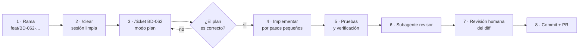

# 18 · Playbook de Claude Code

Cómo trabajar cada ticket con Claude Code para que el resultado sea consistente, rápido y revisable. Documentación oficial: <https://code.claude.com/docs>.

## 1. Preparar el repositorio (una vez, en BD-001)

| Archivo | Para qué | Origen |
|---|---|---|
| `CLAUDE.md` (raíz) | Reglas del proyecto que Claude lee en cada sesión | Este paquete |
| `docs/` | Fuente de verdad (Claude la lee cuando el ticket la cita) | Este paquete |
| `.claude/settings.json` | Permisos y *hooks* que se aplican siempre, los siga Claude o no | `starter/.claude/settings.json` |
| `.claude/skills/ticket/SKILL.md` | Comando `/ticket BD-NNN`: flujo estándar de un ticket | `starter/.claude/skills/ticket/SKILL.md` |
| `.claude/skills/perf-check/SKILL.md` | Comando `/perf-check`: build, bundle y Lighthouse | `starter/.claude/skills/perf-check/SKILL.md` |
| `.claude/agents/revisor.md` | Subagente que revisa el diff contra las reglas sin haber escrito el código | `starter/.claude/agents/revisor.md` |
| `scripts/hooks/format.mjs` | Formatea con Prettier cada archivo que Claude edita | `starter/scripts/hooks/format.mjs` |
| `.claude/settings.local.json` | Preferencias personales (no se sube a git) | Cada desarrollador |

`CLAUDE.md` es **guía**; `settings.json` es **obligatorio** (permisos y hooks se aplican siempre). Por eso lo crítico (no borrar, no tocar `.env`, formatear) está en `settings.json`.

## 2. El ciclo de un ticket



1. **Rama:** `git switch -c feat/BD-062-ficha-variantes` desde `develop`.
2. **Sesión limpia:** `/clear` entre tickets. Un contexto lleno de otro ticket produce errores. Si una sesión se alarga, `/compact` con una indicación de qué conservar.
3. **Planear primero:** activa el **modo plan** (Shift+Tab hasta ver "plan mode") y ejecuta `/ticket BD-062`. Claude lee el ticket y los docs, y propone un plan **sin editar archivos**. Revísalo: archivos a crear, componentes que reutiliza, pruebas que agregará. Corrige lo que no cuadre antes de aprobar.
4. **Implementar en pasos:** pide un paso del plan a la vez ("haz el paso 1 y para"). Revisa cada diff antes de seguir.
5. **Verificar:** Claude debe correr `pnpm typecheck`, `pnpm lint`, `pnpm test` y la E2E del ticket, y mostrar el resultado. Si el ticket toca una página pública: `/perf-check`.
6. **Revisor:** "Usa el subagente revisor sobre el diff de esta rama". Revisa sin el sesgo de quien escribió el código.
7. **Revisión humana:** lee el diff completo (`git diff develop`). Tú eres responsable del código, no Claude.
8. **Commit y PR:** `feat(ficha): selector de color y empaque [BD-062]`; la descripción del PR copia los criterios de aceptación con su estado.

## 3. Plantillas de prompts

### Arrancar un ticket (si no usas `/ticket`)
```text
Vamos a trabajar el ticket BD-062 de docs/14-plan-de-accion.md.
Lee el ticket, CLAUDE.md y los docs que cita (06 §3.4, 08, 09, 10 §4).
Revisa qué componentes ya existen en src/components antes de proponer nuevos.
Dame un plan con: archivos a crear/modificar, componentes reutilizados,
datos que necesitas de src/server/data, pruebas que vas a escribir
y cómo verificarás cada criterio de aceptación. No edites nada todavía.
```

### Implementar un paso
```text
Implementa solo el paso 2 del plan (selector de color).
Respeta: Server Component por defecto, la isla cliente lo más pequeña posible,
animación solo con transform/opacity (A-31), textos desde content/.
Al terminar, corre typecheck y las pruebas afectadas y muéstrame el resultado.
```

### Escribir pruebas primero
```text
Antes de implementar submitQuote, escribe las pruebas de integración
de docs/13 §4 para esa acción. Deben fallar. Muéstrame la salida y para.
```

### Depurar
```text
La E2E cotizacion.spec.ts falla en el proyecto "movil" con este error: <pega el error>.
Investiga la causa raíz antes de cambiar código. Explícame qué encontraste
y propón la corrección mínima. No desactives ni debilites la prueba.
```

### Rendimiento
```text
Lighthouse marca LCP de 3.1 s en /productos/boligrafos/bolik-ultra.
Corre `pnpm analyze`, identifica qué JS y qué imágenes cargan antes del LCP
y propón cambios ordenados por impacto, respetando docs/12.
```

### SEO de una página
```text
Revisa /donde-comprar/quetzaltenango contra el checklist de docs/10 y docs/11 §9:
title, description, canonical, h1 único, JSON-LD, enlaces internos, contenido en HTML sin JS.
Dame una tabla: punto · estado · corrección.
```

### Revisar antes del PR
```text
Usa el subagente revisor para revisar `git diff develop...HEAD` contra CLAUDE.md
y la definición de terminado de docs/14 §1. Lista hallazgos por gravedad.
```

## 4. Reglas de oro

1. **Un ticket, una sesión, una rama.**
2. **Plan antes de código** en todo ticket de más de 0.25 días.
3. **Nunca aceptes un cambio que no entiendes.** Pregúntale a Claude "explícame esta parte" hasta entenderla.
4. **Los docs mandan.** Si Claude propone algo distinto a la guía, pídele que justifique; si tiene razón, actualiza el doc en el mismo PR.
5. **No inventar datos de negocio.** Textos de `docs/17-copys.md`, ajustes de `SiteSetting`. Si falta algo, se marca `(validar)`.
6. **Las pruebas no se debilitan** para que pasen. Si una prueba está mal, se corrige con una explicación en el PR.
7. **Versiones actuales.** Para APIs de Next, Prisma, Tailwind o Motion, pide a Claude que verifique la documentación oficial de la versión instalada antes de usar algo que recuerde (las APIs cambian; ej.: `proxy.ts` reemplazó a `middleware.ts` en Next 16).
8. **Secretos fuera.** Claude no lee ni escribe `.env*` (bloqueado en `settings.json`); usa `.env.example`.
9. **Commits pequeños** y frecuentes: es más fácil revisar y revertir.
10. **Si Claude se atasca 2 veces** con el mismo error, para, `/clear`, y explica el problema desde cero con lo que ya sabes.

## 5. Errores comunes y cómo evitarlos

| Síntoma | Causa típica | Prevención |
|---|---|---|
| Página pública lenta o con datos en cada petición | Consulta a la BD sin `'use cache'` o `"use client"` en un componente grande | Pedir siempre "Server Component por defecto"; `/perf-check` |
| Error de build "Uncached data was accessed outside of `<Suspense>`" | Dato dinámico (cookies, headers, searchParams) sin `Suspense` ni `connection()` | doc 03 §5; pedir a Claude que ubique el límite de `Suspense` |
| Cambios del admin que no aparecen | Falta `updateTag` / tag incorrecto | Tags solo desde `lib/cache-tags.ts`; prueba de integración del admin |
| Animaciones que traban en móvil | Animar `height`, `top`, `width`, sombras | Regla de CLAUDE.md; presets del doc 09 |
| Colores nuevos "parecidos" | Claude inventa hex | Solo tokens; el subagente revisor y `scripts/check-colors.mjs` (en CI) buscan hex fuera de `tokens.css` |
| Textos inventados | Falta el copy | `docs/17-copys.md` o `(validar)` |
| Prisma falla en SQL Server | `@unique` en columna opcional, `enum`, `Json`, ciclos de cascada | doc 05 §4 |
| Código que usa APIs viejas de Next (`middleware.ts`, `revalidateTag` con un argumento, `unstable_cache`) | Conocimiento desactualizado | Regla 7 |

## 6. Uso de MCP (opcional)

- **Playwright MCP**: permite que Claude abra el sitio local, haga clic y tome capturas para verificar una UI. Se configura en `.mcp.json` (raíz). Útil en tickets de E3–E5.
- **Documentación**: si el equipo usa un servidor MCP de documentación (Next.js, Prisma), agrégalo también a `.mcp.json` para que Claude consulte la versión instalada.

No conectar Claude a la BD de producción ni a SAP.
